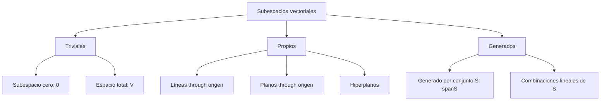
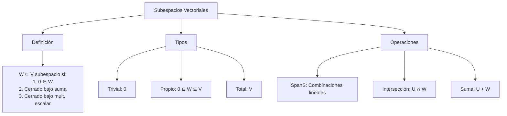
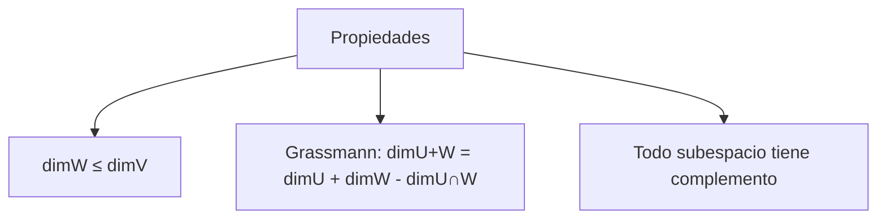

# Álgebra Lineal I - Espacios vectoriales

## 1.3 Subespacios vectoriales.

---

### 1. Conceptos Fundamentales de Subespacios Vectoriales

#### 1.1 Definición Formal

Un **subespacio vectorial** de un espacio vectorial $V$ sobre un campo $\mathbb{F}$ es un subconjunto $W \subseteq V$ que satisface:

1. **No vacío**: $W \neq \emptyset$
2. **Cerrado bajo suma**: $\forall \vec{u}, \vec{v} \in W, \vec{u} + \vec{v} \in W$
3. **Cerrado bajo multiplicación escalar**: $\forall \alpha \in \mathbb{F}, \forall \vec{v} \in W, \alpha\vec{v} \in W$

#### 1.2 Condiciones Equivalentes

Un subconjunto $W \subseteq V$ es subespacio si y solo si:

- $\vec{0} \in W$
- $\forall \alpha, \beta \in \mathbb{F}, \forall \vec{u}, \vec{v} \in W, \alpha\vec{u} + \beta\vec{v} \in W$

### 2. Tipos de Subespacios Vectoriales

#### 2.1 Subespacios Triviales

- **Subespacio cero**: $\{\vec{0}\}$
- **Subespacio total**: $V$ mismo

#### 2.2 Subespacios Propios

Subespacios diferentes de $\{\vec{0}\}$ y $V$:

- Líneas through el origen en $\mathbb{R}^2$
- Planos through el origen en $\mathbb{R}^3$
- Hiperplanos en $\mathbb{R}^n$



### 3. Subespacio Generado por un Conjunto

#### 3.1 Definición de Span

El **subespacio generado** por un conjunto $S = \{\vec{v}_1, \vec{v}_2, \ldots, \vec{v}_k\} \subseteq V$ es:

$$\operatorname{span}(S) = \{\alpha_1\vec{v}_1 + \alpha_2\vec{v}_2 + \cdots + \alpha_k\vec{v}_k \mid \alpha_i \in \mathbb{F}\}$$

#### 3.2 Propiedades del Span

- $\operatorname{span}(S)$ es el menor subespacio que contiene a $S$
- $S$ es conjunto generador de $\operatorname{span}(S)$
- Si $S \subseteq T$, entonces $\operatorname{span}(S) \subseteq \operatorname{span}(T)$

### 4. Implementación Computacional

```python
import numpy as np
import matplotlib.pyplot as plt
from mpl_toolkits.mplot3d import Axes3D
from sympy import Matrix, symbols, solve

class SubespaciosVectoriales:
    def __init__(self, dimension):
        self.dimension = dimension
        self.vector_cero = np.zeros(dimension)

    def es_subespacio(self, vectores, tol=1e-10):
        """Verifica si un conjunto de vectores forma un subespacio"""
        if len(vectores) == 0:
            return False

        # Convertir a array numpy
        vectores = [np.array(v) for v in vectores]

        # 1. Verificar que contiene el vector cero
        contiene_cero = any(np.allclose(v, self.vector_cero, atol=tol) for v in vectores)
        if not contiene_cero:
            return False

        # 2. Verificar cerradura bajo suma
        for i in range(len(vectores)):
            for j in range(len(vectores)):
                suma = vectores[i] + vectores[j]
                # Verificar si la suma está en el conjunto
                encontrado = any(np.allclose(suma, w, atol=tol) for w in vectores)
                if not encontrado:
                    return False

        # 3. Verificar cerradura bajo multiplicación escalar
        escalares = [-2, -1, 0, 1, 2]
        for alpha in escalares:
            for v in vectores:
                if np.allclose(v, self.vector_cero, atol=tol):
                    continue
                mult = alpha * v
                encontrado = any(np.allclose(mult, w, atol=tol) for w in vectores)
                if not encontrado:
                    return False

        return True

    def span(self, vectores_generadores, coeficientes_range=(-1, 0, 1)):
        """Calcula el subespacio generado por un conjunto de vectores"""
        if not vectores_generadores:
            return [self.vector_cero]

        vectores_generadores = [np.array(v) for v in vectores_generadores]
        span_set = set()

        # Generar todas las combinaciones lineales con coeficientes enteros
        n = len(vectores_generadores)
        for coef in np.ndindex(*(len(coeficientes_range) for _ in range(n))):
            coeficientes = [coeficientes_range[i] for i in coef]
            vector = sum(c * v for c, v in zip(coeficientes, vectores_generadores))
            # Redondear para evitar errores numéricos
            vector = np.round(vector, 10)
            span_set.add(tuple(vector))

        return [np.array(v) for v in span_set]

    def base_subespacio(self, vectores_generadores):
        """Encuentra una base para el subespacio generado"""
        # Construir matriz con los vectores generadores
        matriz = np.array(vectores_generadores).T
        # Encontrar rango y vectores linealmente independientes
        rango = np.linalg.matrix_rank(matriz)
        base = []

        for v in vectores_generadores:
            if len(base) < rango:
                # Verificar si el vector es linealmente independiente
                temp_base = base + [v]
                temp_matriz = np.array(temp_base).T
                if np.linalg.matrix_rank(temp_matriz) == len(temp_base):
                    base.append(v)

        return base

    def dimension_subespacio(self, vectores_generadores):
        """Calcula la dimensión del subespacio generado"""
        if not vectores_generadores:
            return 0

        matriz = np.array(vectores_generadores).T
        return np.linalg.matrix_rank(matriz)

    def interseccion_subespacios(self, generadores1, generadores2):
        """Calcula la intersección de dos subespacios"""
        # Construir sistema de ecuaciones
        todos_vectores = generadores1 + generadores2
        n = len(todos_vectores[0])

        # Encontrar vectores en la intersección
        interseccion = []
        for v in self.span(generadores1):
            if any(np.allclose(v, w) for w in self.span(generadores2)):
                interseccion.append(v)

        return interseccion

    def visualizar_subespacio_2d(self, vectores_generadores):
        """Visualización para subespacios en R2"""
        if self.dimension != 2:
            print("Solo disponible para R2")
            return

        subespacio = self.span(vectores_generadores)
        base = self.base_subespacio(vectores_generadores)

        fig, ax = plt.subplots(figsize=(10, 8))

        # Ejes
        ax.axhline(y=0, color='k', linestyle='-', alpha=0.3)
        ax.axvline(x=0, color='k', linestyle='-', alpha=0.3)
        ax.set_xlim(-3, 3)
        ax.set_ylim(-3, 3)
        ax.set_aspect('equal')

        # Vector cero
        ax.plot(0, 0, 'ko', markersize=8, label='Origen')

        # Vectores generadores
        colors = plt.cm.tab10(np.linspace(0, 1, len(vectores_generadores)))
        for i, v in enumerate(vectores_generadores):
            ax.quiver(0, 0, v[0], v[1], angles='xy', scale_units='xy', scale=1,
                     color=colors[i], width=0.02, label=f'Generador {i+1}: {v}')

        # Subespacio generado
        for v in subespacio:
            if not np.allclose(v, [0, 0]):
                ax.plot(v[0], v[1], 'o', color='red', alpha=0.6, markersize=4)

        # Base del subespacio
        for i, v in enumerate(base):
            ax.quiver(0, 0, v[0], v[1], angles='xy', scale_units='xy', scale=1,
                     color='green', width=0.015, linestyle='--', label=f'Base {i+1}: {v}')

        ax.legend()
        ax.set_title(f'Subespacio generado: dim = {len(base)}')
        ax.grid(True, alpha=0.3)
        plt.show()

    def visualizar_subespacio_3d(self, vectores_generadores):
        """Visualización para subespacios en R3"""
        if self.dimension != 3:
            print("Solo disponible para R3")
            return

        base = self.base_subespacio(vectores_generadores)
        dim = len(base)

        fig = plt.figure(figsize=(12, 10))
        ax = fig.add_subplot(111, projection='3d')

        # Ejes
        ax.plot([0, 2], [0, 0], [0, 0], 'k-', alpha=0.3)
        ax.plot([0, 0], [0, 2], [0, 0], 'k-', alpha=0.3)
        ax.plot([0, 0], [0, 0], [0, 2], 'k-', alpha=0.3)

        # Vector cero
        ax.scatter([0], [0], [0], color='black', s=100, label='Origen')

        # Vectores base
        colors = ['red', 'green', 'blue']
        for i, v in enumerate(base):
            ax.quiver(0, 0, 0, v[0], v[1], v[2],
                     color=colors[i], arrow_length_ratio=0.1, linewidth=2,
                     label=f'Base {i+1}: {v}')

        # Generar puntos del subespacio
        if dim == 1:
            # Línea
            t = np.linspace(-2, 2, 100)
            v = base[0]
            x = t * v[0]
            y = t * v[1]
            z = t * v[2]
            ax.plot(x, y, z, 'r-', alpha=0.6)

        elif dim == 2:
            # Plano
            u, v = base
            s = np.linspace(-2, 2, 20)
            t = np.linspace(-2, 2, 20)
            S, T = np.meshgrid(s, t)
            X = S * u[0] + T * v[0]
            Y = S * u[1] + T * v[1]
            Z = S * u[2] + T * v[2]
            ax.plot_surface(X, Y, Z, alpha=0.3, color='blue')

        ax.set_xlim([-2, 2])
        ax.set_ylim([-2, 2])
        ax.set_zlim([-2, 2])
        ax.set_xlabel('X')
        ax.set_ylabel('Y')
        ax.set_zlabel('Z')
        ax.set_title(f'Subespacio en R³: dim = {dim}')
        ax.legend()
        plt.show()

    def es_subconjunto(self, subespacio1, subespacio2, tol=1e-10):
        """Verifica si un subespacio está contenido en otro"""
        for v in subespacio1:
            encontrado = False
            for w in subespacio2:
                if np.allclose(v, w, atol=tol):
                    encontrado = True
                    break
            if not encontrado:
                return False
        return True

# Ejemplos de uso
print("=== SUBESPACIOS VECTORIALES ===")

# 1. Subespacios en R²
print("\n1. SUBESPACIOS EN R²")
r2 = SubespaciosVectoriales(2)

# Subespacio trivial (solo el vector cero)
subespacio_cero = [np.array([0, 0])]
print(f"¿{{0}} es subespacio? {r2.es_subespacio(subespacio_cero)}")

# Subespacio línea y = 2x
linea_y2x = [np.array([0, 0]), np.array([1, 2]), np.array([-1, -2]), np.array([2, 4])]
print(f"¿Línea y=2x es subespacio? {r2.es_subespacio(linea_y2x)}")

# Visualizar
r2.visualizar_subespacio_2d([np.array([1, 2])])

# 2. Span de conjuntos
print("\n2. SPAN DE CONJUNTOS")
vectores = [np.array([1, 0]), np.array([0, 1])]
span_completo = r2.span(vectores)
print(f"Span de {{(1,0), (0,1)}} tiene {len(span_completo)} vectores")
print(f"Dimensión: {r2.dimension_subespacio(vectores)}")

# 3. Subespacios en R³
print("\n3. SUBESPACIOS EN R³")
r3 = SubespaciosVectoriales(3)

# Plano xy
plano_xy = [
    np.array([0, 0, 0]),
    np.array([1, 0, 0]),
    np.array([0, 1, 0]),
    np.array([1, 1, 0]),
    np.array([-1, 2, 0])
]
print(f"¿Plano xy es subespacio? {r3.es_subespacio(plano_xy)}")

# Visualizar plano
r3.visualizar_subespacio_3d([np.array([1, 0, 0]), np.array([0, 1, 0])])

# 4. Intersección de subespacios
print("\n4. INTERSECCIÓN DE SUBESPACIOS")
# Plano xy y plano xz
generadores_xy = [np.array([1, 0, 0]), np.array([0, 1, 0])]
generadores_xz = [np.array([1, 0, 0]), np.array([0, 0, 1])]

interseccion = r3.interseccion_subespacios(generadores_xy, generadores_xz)
print(f"Intersección plano xy ∩ plano xz: {len(interseccion)} vectores")
for v in interseccion:
    print(f"  {v}")

# 5. Bases y dimensión
print("\n5. BASES Y DIMENSIÓN")
vectores_ld = [np.array([1, 2, 3]), np.array([2, 4, 6]), np.array([-1, -2, -3])]
base = r3.base_subespacio(vectores_ld)
dimension = r3.dimension_subespacio(vectores_ld)
print(f"Vectores: {vectores_ld}")
print(f"Base del subespacio: {base}")
print(f"Dimensión: {dimension}")

# 6. Subespacios propios
print("\n6. SUBESPACIOS PROPIOS")
# Verificar si un subconjunto es subespacio propio
def es_subespacio_propio(vectores, espacio_completo):
    if not r3.es_subespacio(vectores):
        return False

    span_sub = r3.span(vectores)
    span_completo = r3.span(espacio_completo)

    # Verificar que no es trivial ni todo el espacio
    no_trivial = len(span_sub) > 1
    no_completo = not r3.es_subconjunto(span_completo, span_sub)

    return no_trivial and no_completo

vectores_r3 = [np.array([1,0,0]), np.array([0,1,0]), np.array([0,0,1])]
print(f"¿Plano xy es subespacio propio? {es_subespacio_propio(generadores_xy, vectores_r3)}")

# 7. Subespacios de matrices
print("\n7. SUBESPACIOS DE MATRICES 2x2")
def suma_matrices(A, B):
    return A + B

def mult_escalar_matriz(alpha, A):
    return alpha * A

# Matrices simétricas
matrices_simetricas = [
    np.array([[0, 0], [0, 0]]),
    np.array([[1, 0], [0, 0]]),
    np.array([[0, 1], [1, 0]]),
    np.array([[0, 0], [0, 1]]),
    np.array([[1, 2], [2, 3]])
]

# Verificar que forman subespacio
print("¿Matrices simétricas 2x2 forman subespacio?")
print("Contiene cero:", any(np.allclose(m, np.zeros((2,2))) for m in matrices_simetricas))

# 8. Subespacios de polinomios
print("\n8. SUBESPACIOS DE POLINOMIOS")
# Polinomios de grado ≤ 1
polinomios_grado1 = [
    np.array([0, 0]),    # 0
    np.array([1, 0]),    # 1
    np.array([0, 1]),    # x
    np.array([2, 3]),    # 2 + 3x
    np.array([-1, 4])    # -1 + 4x
]

# Representar polinomios como vectores de coeficientes
def es_subespacio_polinomios(vectores_coef):
    return r2.es_subespacio(vectores_coef)

print(f"¿Polinomios grado ≤ 1 forman subespacio? {es_subespacio_polinomios(polinomios_grado1)}")
```

### 5. Ejemplos y Ejercicios

#### Ejemplo 1: Subespacio Línea en $\mathbb{R}^2$

$$W = \{(x, y) \in \mathbb{R}^2 \mid y = 2x\}$$

- **Generadores**: $\{(1, 2)\}$
- **Dimensión**: 1
- **Base**: $\{(1, 2)\}$

#### Ejemplo 2: Subespacio Plano en $\mathbb{R}^3$

$$W = \{(x, y, z) \in \mathbb{R}^3 \mid z = 0\}$$

- **Generadores**: $\{(1, 0, 0), (0, 1, 0)\}$
- **Dimensión**: 2
- **Base**: $\{(1, 0, 0), (0, 1, 0)\}$

#### Ejemplo 3: Subespacio de Matrices Simétricas

$$W = \{A \in M_{2 \times 2}(\mathbb{R}) \mid A = A^T\}$$

- **Generadores**: $ \left\lbrace \begin{bmatrix} 1&0 \\\ 0&0 \end{bmatrix}, \begin{bmatrix} 0&1 \\\ 1&0 \end{bmatrix}, \begin{bmatrix} 0&0 \\\ 0&1\end{bmatrix} \right\rbrace $
- **Dimensión**: 3

#### Ejercicio 1:

Verificar que $W = \{(x, y, z) \in \mathbb{R}^3 \mid x + y + z = 0\}$ es subespacio y encontrar una base.

### 6. Aplicaciones de los Subespacios

#### 6.1 Soluciones de Sistemas Lineales

- El conjunto solución de $A\vec{x} = \vec{0}$ es un subespacio (núcleo)
- El espacio columna de $A$ es un subespacio

#### 6.2 Geometría Computacional

- Representación de planos y líneas
- Intersecciones de subespacios
- Proyecciones ortogonales

#### 6.3 Machine Learning

- Reducción de dimensionalidad (PCA)
- Subespacios de características
- Regularización en modelos lineales

### 7. Teoremas Importantes

#### 7.1 Teorema de la Dimensión para Subespacios

Si $W$ es subespacio de $V$ de dimensión finita, entonces:

$$\dim(W) \leq \dim(V)$$

#### 7.2 Fórmula de Grassmann

Para subespacios $U$ y $W$ de $V$:

$$\dim(U + W) = \dim(U) + \dim(W) - \dim(U \cap W)$$

#### 7.3 Teorema del Complemento

Todo subespacio tiene un complemento (no único).

### 8. Visualización de Conceptos





### 9. Casos Especiales

#### 9.1 Subespacios de $\mathbb{R}^n$

- Hiperplanos: $\dim = n-1$
- Líneas: $\dim = 1$
- Puntos: $\dim = 0$ (solo el origen)

#### 9.2 Subespacios de Funciones

- Polinomios de grado ≤ n
- Funciones continuas en [a,b]
- Soluciones de EDOs lineales

#### 9.3 Subespacios Invariantes

- Bajo transformaciones lineales
- Autoespacios de operadores
- Subespacios estables

### 10. Recursos Adicionales

- "Linear Algebra Done Right" por Sheldon Axler
- "Introduction to Linear Algebra" por Gilbert Strang
- "Álgebra Lineal" por Stanley Grossman
- Software: MATLAB, NumPy, GeoGebra
- Librerías Python: NumPy, SciPy, Matplotlib
- Tutoriales online de subespacios vectoriales
- Visualizaciones interactivas de espacios vectoriales
