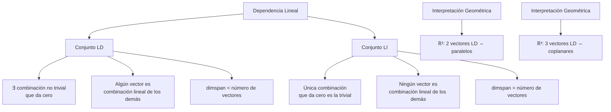
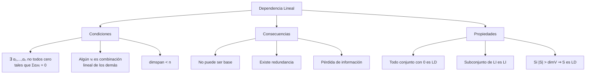
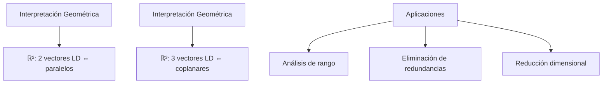

# Álgebra Lineal I - Espacios vectoriales

## 1.4 Dependencia lineal.

---

### 1. Conceptos Fundamentales de Dependencia Lineal

#### 1.1 Definición Formal

Un conjunto de vectores $\{\vec{v}_1, \vec{v}_2, \ldots, \vec{v}_k\}$ en un espacio vectorial $V$ es **linealmente dependiente** si existen escalares $\alpha_1, \alpha_2, \ldots, \alpha_k \in \mathbb{F}$, no todos cero, tales que:

$$ \alpha_1\vec{v}_1 + \alpha_2\vec{v}_2 + \cdots + \alpha_k\vec{v}_k = \vec{0} $$

#### 1.2 Independencia Lineal

Un conjunto es **linealmente independiente** si la única combinación lineal que da el vector cero es la trivial:

$$ \alpha_1\vec{v}_1 + \alpha_2\vec{v}_2 + \cdots + \alpha_k\vec{v}_k = \vec{0} \Rightarrow \alpha_1 = \alpha_2 = \cdots = \alpha_k = 0 $$

### 2. Interpretación Geométrica de la Dependencia Lineal

#### 2.1 En $\mathbb{R}^2$ y $\mathbb{R}^3$

- **2 vectores en $\mathbb{R}^2$**: LD si son paralelos
- **3 vectores en $\mathbb{R}^3$**: LD si son coplanares
- **n+1 vectores en $\mathbb{R}^n$**: Siempre son LD

#### 2.2 Relación con la Dimensión



### 3. Propiedades y Teoremas Fundamentales

#### 3.1 Propiedades Básicas

1. Todo conjunto que contiene el vector cero es LD
2. Un conjunto de un solo vector es LI si y solo si el vector no es cero
3. Si un conjunto es LD, cualquier conjunto que lo contenga también es LD
4. Si un conjunto es LI, cualquier subconjunto también es LI

#### 3.2 Teorema de la Dimensión

En un espacio vectorial de dimensión $n$:

- Cualquier conjunto con más de $n$ vectores es LD
- Cualquier conjunto LI tiene a lo más $n$ vectores
- Cualquier base tiene exactamente $n$ vectores LI

### 4. Implementación Computacional

```python
import numpy as np
import matplotlib.pyplot as plt
from mpl_toolkits.mplot3d import Axes3D
from sympy import Matrix, symbols, solve

class DependenciaLineal:
    def __init__(self, dimension):
        self.dimension = dimension

    def es_ld(self, vectores, tol=1e-10):
        """Determina si un conjunto de vectores es linealmente dependiente"""
        if not vectores:
            return False

        # Construir matriz con los vectores como columnas
        matriz = np.array(vectores).T

        # Verificar si la matriz tiene rango completo
        rango = np.linalg.matrix_rank(matriz, tol=tol)
        return rango < len(vectores)

    def coeficientes_dependencia(self, vectores, tol=1e-10):
        """Encuentra coeficientes que muestran dependencia lineal"""
        if not vectores:
            return None

        n = len(vectores)
        matriz = np.array(vectores).T

        # Resolver el sistema homogéneo A@x = 0
        try:
            # Usar SVD para encontrar solución no trivial
            U, s, Vh = np.linalg.svd(matriz)
            # La última fila de Vh corresponde al valor singular más pequeño
            coeficientes = Vh[-1, :]

            # Verificar que la combinación da aproximadamente cero
            combinacion = sum(c * v for c, v in zip(coeficientes, vectores))
            if np.linalg.norm(combinacion) < tol:
                return coeficientes
            else:
                return None
        except np.linalg.LinAlgError:
            return None

    def base_del_span(self, vectores, tol=1e-10):
        """Encuentra una base para el espacio generado por los vectores"""
        if not vectores:
            return []

        matriz = np.array(vectores).T
        # Usar descomposición QR para encontrar columnas linealmente independientes
        Q, R = np.linalg.qr(matriz)

        base = []
        indices_base = []

        for i in range(len(vectores)):
            # Verificar si la columna i es linealmente independiente
            if np.linalg.norm(R[:i+1, i]) > tol:
                base.append(vectores[i])
                indices_base.append(i)

        return base, indices_base

    def visualizar_dependencia_2d(self, vectores):
        """Visualización de dependencia lineal en R2"""
        if self.dimension != 2:
            print("Solo disponible para R2")
            return

        fig, ax = plt.subplots(figsize=(10, 8))

        # Ejes
        ax.axhline(y=0, color='k', linestyle='-', alpha=0.3)
        ax.axvline(x=0, color='k', linestyle='-', alpha=0.3)
        ax.set_xlim(-3, 3)
        ax.set_ylim(-3, 3)
        ax.set_aspect('equal')

        # Vector cero
        ax.plot(0, 0, 'ko', markersize=8, label='Origen')

        es_ld = self.es_ld(vectores)
        coeficientes = self.coeficientes_dependencia(vectores)

        # Dibujar vectores
        colors = plt.cm.tab10(np.linspace(0, 1, len(vectores)))
        for i, v in enumerate(vectores):
            ax.quiver(0, 0, v[0], v[1], angles='xy', scale_units='xy', scale=1,
                     color=colors[i], width=0.02, label=f'v{i+1} = {v}')

        # Si es LD, mostrar la combinación lineal que da cero
        if es_ld and coeficientes is not None:
            titulo = "Vectores LINEALMENTE DEPENDIENTES\n"
            titulo += f"Combinación: {coeficientes[0]:.2f}·v1"
            for i in range(1, len(coeficientes)):
                if coeficientes[i] >= 0:
                    titulo += f" + {coeficientes[i]:.2f}·v{i+1}"
                else:
                    titulo += f" - {abs(coeficientes[i]):.2f}·v{i+1}"
            titulo += " = 0"

            # Dibujar la combinación lineal
            combinacion = sum(c * v for c, v in zip(coeficientes, vectores))
            ax.plot(combinacion[0], combinacion[1], 'ro', markersize=10,
                   label='Combinación = 0')
        else:
            titulo = "Vectores LINEALMENTE INDEPENDIENTES"

        ax.legend()
        ax.set_title(titulo)
        ax.grid(True, alpha=0.3)
        plt.show()

        return es_ld, coeficientes

    def visualizar_dependencia_3d(self, vectores):
        """Visualización de dependencia lineal en R3"""
        if self.dimension != 3:
            print("Solo disponible para R3")
            return

        fig = plt.figure(figsize=(12, 10))
        ax = fig.add_subplot(111, projection='3d')

        # Ejes
        ax.plot([0, 2], [0, 0], [0, 0], 'k-', alpha=0.3)
        ax.plot([0, 0], [0, 2], [0, 0], 'k-', alpha=0.3)
        ax.plot([0, 0], [0, 0], [0, 2], 'k-', alpha=0.3)

        # Vector cero
        ax.scatter([0], [0], [0], color='black', s=100, label='Origen')

        es_ld = self.es_ld(vectores)
        coeficientes = self.coeficientes_dependencia(vectores)

        # Dibujar vectores
        colors = plt.cm.tab10(np.linspace(0, 1, len(vectores)))
        for i, v in enumerate(vectores):
            ax.quiver(0, 0, 0, v[0], v[1], v[2],
                     color=colors[i], arrow_length_ratio=0.1, linewidth=2,
                     label=f'v{i+1} = {v}')

        # Si es LD, mostrar el plano de dependencia
        if es_ld and len(vectores) == 3:
            # Encontrar el plano que contiene los vectores
            normal = np.cross(vectores[0], vectores[1])
            if np.linalg.norm(normal) > 1e-10:
                # Crear malla para el plano
                xx, yy = np.meshgrid(np.linspace(-2, 2, 10), np.linspace(-2, 2, 10))
                zz = (-normal[0] * xx - normal[1] * yy) / normal[2]
                ax.plot_surface(xx, yy, zz, alpha=0.3, color='gray')

        ax.set_xlim([-2, 2])
        ax.set_ylim([-2, 2])
        ax.set_zlim([-2, 2])
        ax.set_xlabel('X')
        ax.set_ylabel('Y')
        ax.set_zlabel('Z')

        if es_ld:
            titulo = "Vectores LINEALMENTE DEPENDIENTES (coplanares)"
        else:
            titulo = "Vectores LINEALMENTE INDEPENDIENTES"

        ax.set_title(titulo)
        ax.legend()
        plt.show()

        return es_ld, coeficientes

    def analizar_conjunto(self, vectores):
        """Análisis completo de un conjunto de vectores"""
        print("=== ANÁLISIS DE DEPENDENCIA LINEAL ===")
        print(f"Número de vectores: {len(vectores)}")
        print(f"Dimensión del espacio: {self.dimension}")

        es_ld = self.es_ld(vectores)
        print(f"¿Linealmente dependiente? {es_ld}")
        print(f"¿Linealmente independiente? {not es_ld}")

        if es_ld:
            coeficientes = self.coeficientes_dependencia(vectores)
            if coeficientes is not None:
                print("Coeficientes de dependencia:")
                for i, c in enumerate(coeficientes):
                    print(f"  α{i+1} = {c:.4f}")

        # Encontrar base del span
        base, indices = self.base_del_span(vectores)
        print(f"Dimensión del span: {len(base)}")
        print("Vectores en la base (índices):", indices)

        # Verificar si algún vector es combinación lineal de los anteriores
        for i in range(1, len(vectores)):
            subconjunto = vectores[:i]
            if self.es_ld(vectores[:i+1]):
                print(f"El vector v{i+1} es combinación lineal de v1...v{i}")

        return es_ld, base

# Ejemplos de uso
print("=== DEPENDENCIA LINEAL ===")

# 1. Vectores en R2
print("\n1. VECTORES EN R²")
r2 = DependenciaLineal(2)

# Vectores linealmente independientes
vectores_li_2d = [np.array([1, 0]), np.array([0, 1])]
print("Vectores LI:", vectores_li_2d)
ld1, _ = r2.analizar_conjunto(vectores_li_2d)
r2.visualizar_dependencia_2d(vectores_li_2d)

# Vectores linealmente dependientes
vectores_ld_2d = [np.array([1, 2]), np.array([2, 4]), np.array([3, 6])]
print("\nVectores LD:", vectores_ld_2d)
ld2, _ = r2.analizar_conjunto(vectores_ld_2d)
r2.visualizar_dependencia_2d(vectores_ld_2d)

# 2. Vectores en R3
print("\n2. VECTORES EN R³")
r3 = DependenciaLineal(3)

# Vectores LI en R3
vectores_li_3d = [np.array([1, 0, 0]), np.array([0, 1, 0]), np.array([0, 0, 1])]
print("Vectores LI:", vectores_li_3d)
ld3, _ = r3.analizar_conjunto(vectores_li_3d)
r3.visualizar_dependencia_3d(vectores_li_3d)

# Vectores LD (coplanares)
vectores_ld_3d = [np.array([1, 0, 0]), np.array([0, 1, 0]), np.array([1, 1, 0])]
print("\nVectores LD (coplanares):", vectores_ld_3d)
ld4, _ = r3.analizar_conjunto(vectores_ld_3d)
r3.visualizar_dependencia_3d(vectores_ld_3d)

# 3. Casos especiales
print("\n3. CASOS ESPECIALES")

# Conjunto vacío
print("Conjunto vacío es LI por definición")

# Conjunto con vector cero
vectores_con_cero = [np.array([0, 0]), np.array([1, 2])]
print("Con vector cero:", vectores_con_cero)
r2.analizar_conjunto(vectores_con_cero)

# Un solo vector
un_vector = [np.array([1, 1])]
print("Un vector no nulo:", un_vector)
r2.analizar_conjunto(un_vector)

# 4. Análisis de matrices
print("\n4. ANÁLISIS DE COLUMNAS DE MATRICES")

def analizar_columnas_matriz(matriz):
    """Analiza dependencia lineal de las columnas de una matriz"""
    print(f"Matriz:\n{matriz}")
    columnas = [matriz[:, i] for i in range(matriz.shape[1])]
    analizador = DependenciaLineal(matriz.shape[0])
    return analizador.analizar_conjunto(columnas)

# Matriz con columnas LI
A = np.array([[1, 2, 3],
              [0, 1, 4],
              [0, 0, 1]])
analizar_columnas_matriz(A)

# Matriz con columnas LD
B = np.array([[1, 2, 3],
              [2, 4, 6],
              [0, 1, 2]])
analizar_columnas_matriz(B)

# 5. Dimensión y máximo número de vectores LI
print("\n5. DIMENSIÓN Y MÁXIMO NÚMERO DE VECTORES LI")

def maximo_vectores_li(dimension, num_vectores):
    """Determina el máximo número de vectores LI posibles"""
    max_li = min(dimension, num_vectores)
    print(f"En R^{dimension}, con {num_vectores} vectores:")
    print(f"Máximo número de vectores LI: {max_li}")
    if num_vectores > dimension:
        print("→ El conjunto es necesariamente LD")
    return max_li

maximo_vectores_li(2, 3)
maximo_vectores_li(3, 5)
maximo_vectores_li(4, 2)

# 6. Aplicación: Eliminación de redundancias
print("\n6. ELIMINACIÓN DE REDUNDANCIAS")

def eliminar_redundancias(vectores):
    """Encuentra un subconjunto LI que genere el mismo espacio"""
    analizador = DependenciaLineal(len(vectores[0]))
    base, indices = analizador.base_del_span(vectores)
    print(f"Vectores originales: {len(vectores)}")
    print(f"Base sin redundancias: {len(base)} vectores")
    print(f"Índices en la base: {indices}")
    print(f"Vectores en la base: {base}")
    return base

vectores_redundantes = [
    np.array([1, 2]),
    np.array([2, 4]),
    np.array([3, 6]),
    np.array([0, 1]),
    np.array([1, 3])
]

base_optimizada = eliminar_redundancias(vectores_redundantes)
```

### 5. Ejemplos y Ejercicios

#### Ejemplo 1: Vectores en $\mathbb{R}^2$

- $\{(1,0), (0,1)\}$: LI (base canónica)
- $\{(1,2), (2,4)\}$: LD (el segundo es múltiplo del primero)
- $\{(1,1), (2,2), (3,3)\}$: LD (todos son paralelos)

#### Ejemplo 2: Vectores en $\mathbb{R}^3$

- $\{(1,0,0), (0,1,0), (0,0,1)\}$: LI
- $\{(1,2,3), (2,4,6), (1,1,1)\}$: LD (los dos primeros son paralelos)
- $\{(1,0,0), (0,1,0), (1,1,0)\}$: LD (coplanares con el plano xy)

#### Ejemplo 3: Detección de Dependencia

Para $\{(1,2), (3,4), (5,6)\}$ en $\mathbb{R}^2$:

- 3 vectores en $\mathbb{R}^2$ ⇒ necesariamente LD
- $(5,6) = 2*(1,2) + 1*(3,4) - (1,2)$? No exactamente
- Sistema: $\alpha(1,2) + \beta(3,4) + \gamma(5,6) = (0,0)$

#### Ejercicio 1:

Determinar si los siguientes conjuntos son LI o LD:

1. $\{(1,2,3), (4,5,6), (7,8,9)\}$ en $\mathbb{R}^3$
2. $\{(1,0,1), (0,1,1), (1,1,0)\}$ en $\mathbb{R}^3$
3. $\{(1,2), (3,4)\}$ en $\mathbb{R}^2$

### 6. Aplicaciones de la Dependencia Lineal

#### 6.1 Álgebra Lineal Numérica

- **Análisis de rango**: Determinar el rango de matrices
- **Eliminación de redundancias**: Encontrar bases minimales
- **Compresión de datos**: Reducir dimensionalidad

#### 6.2 Geometría Computacional

- **Verificar colinealidad**: 3 puntos son colineales si sus vectores son LD
- **Planaridad**: 4 puntos son coplanares si sus vectores son LD
- **Orientación**: Determinantes y productos cruz

#### 6.3 Machine Learning

- **Multicolinealidad**: En regresión, variables predictoras LD
- **Reducción de dimensionalidad**: PCA elimina dependencias lineales
- **Regularización**: Evitar sobreajuste en modelos lineales

### 7. Teoremas Importantes

#### 7.1 Teorema Fundamental de la Dependencia Lineal

En un espacio vectorial de dimensión $n$, cualquier conjunto con más de $n$ vectores es linealmente dependiente.

#### 7.2 Teorema de la Base

Todas las bases de un espacio vectorial tienen el mismo número de elementos (dimensión).

#### 7.3 Teorema de Extensión a Base

Cualquier conjunto LI puede extenderse a una base del espacio vectorial.

### 8. Visualización de Conceptos





### 9. Casos Especiales

#### 9.1 Vectores en Espacios de Dimensión Infinita

- Concepto se generaliza pero es más complejo
- Dependencia lineal aún significa combinación lineal no trivial igual a cero
- Bases pueden ser infinitas

#### 9.2 Campos Diferentes de $\mathbb{R}$

- $\mathbb{C}^n$: Similar pero con escalares complejos
- $\mathbb{F}_p^n$: Campos finitos, misma teoría pero aritmética modular
- Concepto es independiente del campo

#### 9.3 Espacios de Funciones

- Funciones pueden ser linealmente independientes
- Ejemplo: $\{1, x, x^2, \ldots, x^n\}$ son LI en $\mathcal{P}_n$
- $\{\sin x, \cos x, \sin 2x, \cos 2x\}$ son LI en espacio de funciones

### 10. Recursos Adicionales

- "Linear Algebra Done Right" por Sheldon Axler
- "Introduction to Linear Algebra" por Gilbert Strang
- "Álgebra Lineal" por Stanley Grossman
- Software: MATLAB, NumPy, Wolfram Alpha
- Librerías Python: NumPy, SciPy, SymPy
- Tutoriales online de dependencia lineal
- Visualizaciones interactivas de vectores
