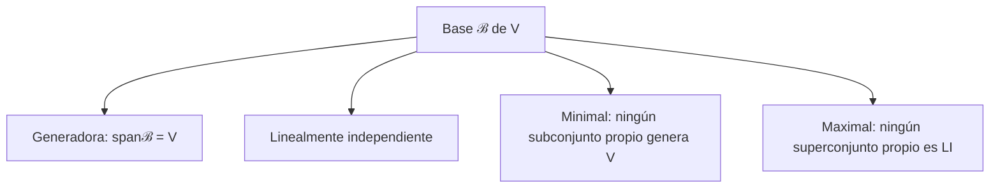
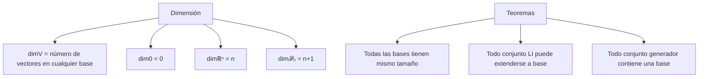
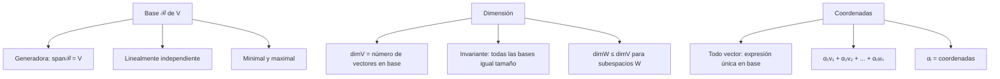
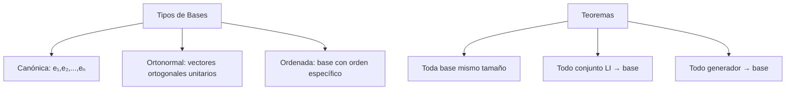

# Álgebra Lineal I - Espacios vectoriales

## 1.5 Bases y dimensión.

---

### 1. Conceptos Fundamentales de Bases y Dimensión

#### 1.1 Definición de Base

Una **base** de un espacio vectorial $V$ es un conjunto de vectores $\mathcal{B} = \{\vec{v}_1, \vec{v}_2, \ldots, \vec{v}_n\}$ que satisface:

1. **Generadores**: $\operatorname{span}(\mathcal{B}) = V$
2. **Linealmente independientes**: $\mathcal{B}$ es LI

#### 1.2 Dimensión

La **dimensión** de un espacio vectorial $V$ es el número de vectores en cualquier base de $V$:

$$\dim(V) = |\mathcal{B}| \quad \text{para cualquier base } \mathcal{B} \text{ de } V$$

### 2. Propiedades de las Bases

#### 2.1 Teorema Fundamental

Todas las bases de un espacio vectorial $V$ tienen el mismo número de elementos.

#### 2.2 Propiedades Clave





#### 2.3 Coordenadas Respecto a una Base

Si $\mathcal{B} = \{\vec{v}_1, \ldots, \vec{v}_n\}$ es base de $V$, todo vector $\vec{w} \in V$ se escribe de forma única como:

$$\vec{w} = \alpha_1\vec{v}_1 + \alpha_2\vec{v}_2 + \cdots + \alpha_n\vec{v}_n$$

Los escalares $(\alpha_1, \alpha_2, \ldots, \alpha_n)$ son las **coordenadas** de $\vec{w}$ en la base $\mathcal{B}$.

### 3. Tipos de Bases Importantes

#### 3.1 Base Canónica

- $\mathbb{R}^n$: $\{\vec{e}_1 = (1,0,\ldots,0), \vec{e}_2 = (0,1,\ldots,0), \ldots, \vec{e}_n = (0,0,\ldots,1)\}$
- $\mathcal{P}_n$: $\{1, x, x^2, \ldots, x^n\}$
- $M_{m \times n}$: Matrices elementales $E_{ij}$

#### 3.2 Base Ortonormal

Base donde todos los vectores son:

1. Ortogonales entre sí: $\vec{v}_i \cdot \vec{v}_j = 0$ para $i \neq j$
2. Norma 1: $\|\vec{v}_i\| = 1$

### 4. Implementación Computacional

```python
import numpy as np
import matplotlib.pyplot as plt
from mpl_toolkits.mplot3d import Axes3D
from sympy import Matrix, symbols, eye

class BasesDimension:
    def __init__(self, dimension):
        self.dimension = dimension

    def es_base(self, vectores, tol=1e-10):
        """Verifica si un conjunto de vectores forma una base"""
        if not vectores:
            return False

        # Verificar que genera todo el espacio
        matriz = np.array(vectores).T
        rango = np.linalg.matrix_rank(matriz, tol=tol)
        genera = (rango == self.dimension)

        # Verificar que son LI
        n_vectores = len(vectores)
        son_li = (rango == n_vectores)

        return genera and son_li and (n_vectores == self.dimension)

    def encontrar_base(self, vectores, tol=1e-10):
        """Encuentra una base a partir de un conjunto de vectores"""
        if not vectores:
            return []

        matriz = np.array(vectores).T
        # Usar descomposición QR para encontrar columnas independientes
        Q, R = np.linalg.qr(matriz)

        base = []
        indices_base = []

        for i in range(len(vectores)):
            if np.linalg.norm(R[:i+1, i]) > tol:
                base.append(vectores[i])
                indices_base.append(i)

        return base, indices_base

    def coordenadas_respecto_base(self, vector, base, tol=1e-10):
        """Encuentra las coordenadas de un vector respecto a una base"""
        matriz_base = np.array(base).T
        try:
            coordenadas = np.linalg.solve(matriz_base, vector)
            return coordenadas
        except np.linalg.LinAlgError:
            # Intentar con mínimos cuadrados si la base no es cuadrada
            coordenadas = np.linalg.lstsq(matriz_base, vector, rcond=None)[0]
            return coordenadas

    def cambio_de_base(self, vector, base_origen, base_destino):
        """Convierte coordenadas de una base a otra"""
        # Matriz de cambio de base: columns = vectores de base_origen en base_destino
        matriz_cambio = np.column_stack([
            self.coordenadas_respecto_base(v, base_destino)
            for v in base_origen
        ])

        coordenadas_origen = self.coordenadas_respecto_base(vector, base_origen)
        coordenadas_destino = matriz_cambio @ coordenadas_origen

        return coordenadas_destino

    def dimension_espacio(self, vectores_generadores, tol=1e-10):
        """Calcula la dimensión del espacio generado"""
        if not vectores_generadores:
            return 0

        matriz = np.array(vectores_generadores).T
        return np.linalg.matrix_rank(matriz, tol=tol)

    def base_canonica(self):
        """Genera la base canónica para el espacio"""
        if self.dimension == 2:
            return [np.array([1, 0]), np.array([0, 1])]
        elif self.dimension == 3:
            return [np.array([1, 0, 0]), np.array([0, 1, 0]), np.array([0, 0, 1])]
        else:
            return [np.eye(self.dimension)[i] for i in range(self.dimension)]

    def visualizar_base_2d(self, base, titulo="Base en R²"):
        """Visualización de base en R2"""
        if self.dimension != 2:
            print("Solo disponible para R2")
            return

        fig, ax = plt.subplots(figsize=(10, 8))

        # Ejes
        ax.axhline(y=0, color='k', linestyle='-', alpha=0.3)
        ax.axvline(x=0, color='k', linestyle='-', alpha=0.3)
        ax.set_xlim(-2, 2)
        ax.set_ylim(-2, 2)
        ax.set_aspect('equal')

        # Vector cero
        ax.plot(0, 0, 'ko', markersize=8, label='Origen')

        # Vectores de la base
        colors = ['red', 'blue']
        for i, v in enumerate(base):
            ax.quiver(0, 0, v[0], v[1], angles='xy', scale_units='xy', scale=1,
                     color=colors[i], width=0.02, label=f'v{i+1} = {v}')

        # Cuadrícula generada por la base
        for i in range(-2, 3):
            for j in range(-2, 3):
                punto = i * base[0] + j * base[1]
                ax.plot(punto[0], punto[1], 'o', color='green', alpha=0.3, markersize=3)

        ax.legend()
        ax.set_title(titulo)
        ax.grid(True, alpha=0.3)
        plt.show()

    def visualizar_base_3d(self, base, titulo="Base en R³"):
        """Visualización de base en R3"""
        if self.dimension != 3:
            print("Solo disponible para R3")
            return

        fig = plt.figure(figsize=(12, 10))
        ax = fig.add_subplot(111, projection='3d')

        # Ejes
        ax.plot([0, 1.5], [0, 0], [0, 0], 'k-', alpha=0.3)
        ax.plot([0, 0], [0, 1.5], [0, 0], 'k-', alpha=0.3)
        ax.plot([0, 0], [0, 0], [0, 1.5], 'k-', alpha=0.3)

        # Vectores de la base
        colors = ['red', 'green', 'blue']
        for i, v in enumerate(base):
            ax.quiver(0, 0, 0, v[0], v[1], v[2],
                     color=colors[i], arrow_length_ratio=0.1, linewidth=2,
                     label=f'v{i+1} = {v}')

        # Paralelepípedo generado
        if len(base) == 3:
            # Generar puntos del paralelepípedo
            u, v, w = base
            points = []
            for i in [0, 1]:
                for j in [0, 1]:
                    for k in [0, 1]:
                        point = i*u + j*v + k*w
                        points.append(point)

            # Dibujar aristas
            from itertools import combinations
            for p1, p2 in combinations(points, 2):
                if np.linalg.norm(p1 - p2) <= max(np.linalg.norm(u), np.linalg.norm(v), np.linalg.norm(w)) + 0.1:
                    ax.plot([p1[0], p2[0]], [p1[1], p2[1]], [p1[2], p2[2]],
                           'gray', alpha=0.2)

        ax.set_xlim([-1, 1])
        ax.set_ylim([-1, 1])
        ax.set_zlim([-1, 1])
        ax.set_xlabel('X')
        ax.set_ylabel('Y')
        ax.set_zlabel('Z')
        ax.set_title(titulo)
        ax.legend()
        plt.show()

    def analizar_espacio(self, vectores_generadores):
        """Análisis completo de un espacio vectorial"""
        print("=== ANÁLISIS DE ESPACIO VECTORIAL ===")
        print(f"Número de vectores generadores: {len(vectores_generadores)}")
        print(f"Dimensión del espacio ambiente: {self.dimension}")

        # Calcular dimensión
        dim = self.dimension_espacio(vectores_generadores)
        print(f"Dimensión del espacio generado: {dim}")

        # Encontrar base
        base, indices = self.encontrar_base(vectores_generadores)
        print(f"Base encontrada ({len(base)} vectores):")
        for i, v in enumerate(base):
            print(f"  v{indices[i]+1} = {v}")

        # Verificar si es base del espacio completo
        es_base_completa = self.es_base(base)
        print(f"¿Forma base del espacio completo? {es_base_completa}")

        return dim, base, indices

# Ejemplos de uso
print("=== BASES Y DIMENSIÓN ===")

# 1. Espacio R²
print("\n1. ESPACIO R²")
r2 = BasesDimension(2)

# Base canónica
base_canonica_r2 = r2.base_canonica()
print("Base canónica de R²:", base_canonica_r2)
print("¿Es base?", r2.es_base(base_canonica_r2))

# Otra base
base_alternativa = [np.array([1, 1]), np.array([1, -1])]
print("Base alternativa:", base_alternativa)
print("¿Es base?", r2.es_base(base_alternativa))

# Visualizar
r2.visualizar_base_2d(base_canonica_r2, "Base Canónica de R²")
r2.visualizar_base_2d(base_alternativa, "Base Alternativa de R²")

# 2. Espacio R³
print("\n2. ESPACIO R³")
r3 = BasesDimension(3)

# Base canónica
base_canonica_r3 = r3.base_canonica()
print("Base canónica de R³:", base_canonica_r3)
print("¿Es base?", r3.es_base(base_canonica_r3))

# Base alternativa
base_alternativa_r3 = [np.array([1, 0, 0]), np.array([1, 1, 0]), np.array([1, 1, 1])]
print("Base alternativa R³:", base_alternativa_r3)
print("¿Es base?", r3.es_base(base_alternativa_r3))

# Visualizar
r3.visualizar_base_3d(base_canonica_r3, "Base Canónica de R³")

# 3. Coordenadas y cambio de base
print("\n3. COORDENADAS Y CAMBIO DE BASE")
vector = np.array([3, 4])

# Coordenadas en base canónica
coordenadas_canonica = r2.coordenadas_respecto_base(vector, base_canonica_r2)
print(f"Vector {vector} en base canónica: {coordenadas_canonica}")

# Coordenadas en base alternativa
coordenadas_alternativa = r2.coordenadas_respecto_base(vector, base_alternativa)
print(f"Vector {vector} en base alternativa: {coordenadas_alternativa}")

# Verificar que son las mismas coordenadas
vector_reconstruido = sum(c * v for c, v in zip(coordenadas_alternativa, base_alternativa))
print(f"Vector reconstruido: {vector_reconstruido}")

# 4. Análisis de espacios generados
print("\n4. ANÁLISIS DE ESPACIOS GENERADOS")
vectores_generadores = [
    np.array([1, 2, 3]),
    np.array([4, 5, 6]),
    np.array([7, 8, 9]),
    np.array([2, 4, 6])
]

dimension, base, indices = r3.analizar_espacio(vectores_generadores)
print(f"Los vectores generan un espacio de dimensión {dimension}")

# 5. Dimensión de diferentes espacios
print("\n5. DIMENSIÓN DE DIFERENTES ESPACIOS")

def demostrar_dimensiones():
    """Demuestra dimensiones de espacios comunes"""
    print("dim(Rⁿ) = n")
    print("dim(𝒫ₙ) = n + 1")  # Polinomios de grado ≤ n
    print("dim(M_{m×n}) = m × n")
    print("dim({0}) = 0")
    print("dim(espacio solución Ax=0) = n - rango(A)")

demostrar_dimensiones()

# 6. Extensión a base
print("\n6. EXTENSIÓN A BASE")

def extender_a_base(vectores_li, dimension):
    """Extiende un conjunto LI a una base del espacio"""
    analizador = BasesDimension(dimension)
    base_completa = analizador.base_canonica()

    # Comenzar con los vectores LI
    base_extendida = vectores_li.copy()

    # Añadir vectores de la base canónica hasta completar
    for v in base_completa:
        if len(base_extendida) == dimension:
            break
        # Verificar si v es LI con los actuales
        temp = base_extendida + [v]
        matriz_temp = np.array(temp).T
        if np.linalg.matrix_rank(matriz_temp) == len(temp):
            base_extendida.append(v)

    return base_extendida

# Ejemplo: extender un vector en R³
vector_li = [np.array([1, 1, 1])]
base_extendida = extender_a_base(vector_li, 3)
print(f"Vector inicial: {vector_li[0]}")
print(f"Base extendida: {base_extendida}")

# 7. Subespacios y dimensión
print("\n7. SUBESPACIOS Y DIMENSIÓN")

def analizar_subespacio(generadores, espacio_completo):
    """Analiza un subespacio dentro de un espacio completo"""
    dim_completa = len(espacio_completo[0])
    analizador = BasesDimension(dim_completa)

    dim_sub = analizador.dimension_espacio(generadores)
    base_sub, _ = analizador.encontrar_base(generadores)

    print(f"Dimensión del subespacio: {dim_sub}")
    print(f"Dimensión del espacio completo: {dim_completa}")
    print(f"El subespacio es {dim_sub}-dimensional")

    if dim_sub == dim_completa:
        print("→ El subespacio es todo el espacio")
    elif dim_sub == 0:
        print("→ El subespacio es {0}")
    else:
        print("→ El subespacio es propio")

    return dim_sub, base_sub

# Ejemplo: plano en R³
generadores_plano = [np.array([1, 0, 0]), np.array([0, 1, 0])]
analizar_subespacio(generadores_plano, r3.base_canonica())

# 8. Espacios de polinomios
print("\n8. ESPACIOS DE POLINOMIOS")

# Representar polinomios a₀ + a₁x + a₂x² como vectores (a₀, a₁, a₂)
polinomios_grado2 = [
    np.array([1, 0, 0]),  # 1
    np.array([0, 1, 0]),  # x
    np.array([0, 0, 1]),  # x²
    np.array([1, 1, 1])   # 1 + x + x²
]

espacio_polinomios = BasesDimension(3)
dim_polin, base_polin, _ = espacio_polinomios.analizar_espacio(polinomios_grado2)
print(f"El espacio de polinomios de grado ≤ 2 tiene dimensión {dim_polin}")
```

### 5. Ejemplos y Ejercicios

#### Ejemplo 1: Bases en $\mathbb{R}^2$

- **Base canónica**: $\{(1,0), (0,1)\}$
- **Otra base**: $\{(1,1), (1,-1)\}$
- **No base**: $\{(1,2), (2,4)\}$ (LD)

#### Ejemplo 2: Dimensión de Espacios

- $\dim(\mathbb{R}^n) = n$
- $\dim(\mathcal{P}_n) = n + 1$
- $\dim(M_{m \times n}) = m \times n$
- $\dim(\{\vec{0}\}) = 0$

#### Ejemplo 3: Coordenadas

Vector $(3,4)$ en diferentes bases:

- Base canónica: $(3,4)$
- Base $\{(1,1), (1,-1)\}$: $(3.5, -0.5)$

#### Ejercicio 1:

Encontrar una base y la dimensión del subespacio de $\mathbb{R}^3$ dado por:

$$ W = \{(x,y,z) \in \mathbb{R}^3 \mid x + y + z = 0\} $$

### 6. Aplicaciones de Bases y Dimensión

#### 6.1 Álgebra Lineal Numérica

- **Descomposiciones matriciales**: QR, SVD, LU
- **Cálculo de rango**: Dimensión del espacio columna
- **Resolución de sistemas**: Coordenadas en diferentes bases

#### 6.2 Geometría Computacional

- **Sistemas de coordenadas**: Cambios entre sistemas de referencia
- **Transformaciones afines**: Matrices de cambio de base
- **Graficos 3D**: Bases para sistemas de coordenadas

#### 6.3 Machine Learning

- **Reducción de dimensionalidad**: PCA encuentra base óptima
- **Features engineering**: Selección de bases para representación
- **Regularización**: Control de la dimensión del espacio de parámetros

### 7. Teoremas Importantes

#### 7.1 Teorema de la Dimensión

Para cualquier espacio vectorial $V$ de dimensión finita:

$$ \dim(V) = \text{número de vectores en cualquier base} $$

#### 7.2 Teorema de la Base

Todas las bases de $V$ tienen el mismo número de elementos.

#### 7.3 Teorema de Extensión/Reducción

- Todo conjunto LI puede extenderse a una base
- Todo conjunto generador puede reducirse a una base

### 8. Visualización de Conceptos





### 9. Casos Especiales

#### 9.1 Espacios de Dimensión Cero

- $\{\vec{0}\}$ tiene dimensión 0
- La base es el conjunto vacío $\emptyset$
- Único espacio con esta propiedad

#### 9.2 Espacios de Dimensión Infinita

- $\mathcal{C}([a,b])$: funciones continuas
- $\mathcal{P}$: todos los polinomios
- Requieren bases infinitas (bases de Hamel)

#### 9.3 Espacios con Producto Interno

- Bases ortonormales: $\langle v_i, v_j \rangle = \delta_{ij}$
- Proceso de Gram-Schmidt para ortogonalizar
- Representación más eficiente de vectores

### 10. Recursos Adicionales

- "Linear Algebra Done Right" por Sheldon Axler
- "Introduction to Linear Algebra" por Gilbert Strang
- "Álgebra Lineal" por Stanley Grossman
- Software: MATLAB, NumPy, GeoGebra
- Librerías Python: NumPy, SciPy, Matplotlib
- Tutoriales online de bases y dimensión
- Visualizaciones interactivas de espacios vectoriales
