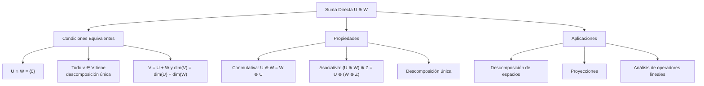
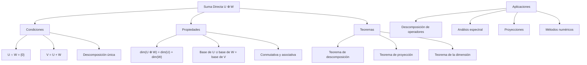

# Álgebra Lineal I - Espacios vectoriales

## 1.6 Sumas directas.

---

### 1. Conceptos Fundamentales de Sumas Directas

#### 1.1 Definición de Suma Directa

Dados dos subespacios $U$ y $W$ de un espacio vectorial $V,$ la **suma directa** $U \oplus W$ es el conjunto:

$$U \oplus W = \{\vec{u} + \vec{w} \mid \vec{u} \in U, \vec{w} \in W\}$$

con la condición adicional de que la descomposición es única:

$$ \vec{u}_1 + \vec{w}_1 = \vec{u}_2 + \vec{w}_2 \Rightarrow \vec{u}_1 = \vec{u}_2 \text{ y } \vec{w}_1 = \vec{w}_2 $$

#### 1.2 Condición Equivalente

$U \oplus W$ es suma directa si y solo si:

$$U \cap W = \{\vec{0}\}$$

### 2. Propiedades de las Sumas Directas

#### 2.1 Caracterización de Suma Directa

Las siguientes condiciones son equivalentes:

1. $V = U \oplus W$ (suma directa)
2. $V = U + W$ y $U \cap W = \{\vec{0}\}$
3. Todo vector $\vec{v} \in V$ se escribe de forma única como $\vec{v} = \vec{u} + \vec{w}$
4. $V = U + W$ y $\dim(V) = \dim(U) + \dim(W),$ si $V$ tiene dimensión finita

La condición 4 sale de la fórmula de Grassmann, $\dim(U + W) = \dim(U) + \dim(W) - \dim(U \cap W).$ Sin la hipótesis $V = U + W$ no basta comparar dimensiones: en $\mathbb{R}^2,$ el eje $x$ tomado dos veces tiene $\dim(U) + \dim(W) = 2 = \dim(\mathbb{R}^2),$ pero $U + W$ es solo el eje $x.$

#### 2.2 Propiedades Algebraicas



### 3. Suma Directa de Múltiples Subespacios

#### 3.1 Definición General

Para subespacios $W_1, W_2, \ldots, W_k$ de $V,$ la suma directa:

$$ W_1 \oplus W_2 \oplus \cdots \oplus W_k = \left\lbrace \sum_{i=1}^k \vec{w}_i \mid \vec{w}_i \in W_i \right\rbrace $$

es directa si cada vector de la suma tiene una representación única. Cuando la suma es directa se escribe con $\oplus;$ si no lo es, solo se escribe $W_1 + \cdots + W_k.$

#### 3.2 Condición para Múltiples Subespacios

La suma es directa si y solo si:

$$W_i \cap \left(\sum_{j \neq i} W_j\right) = \{\vec{0}\} \quad \text{para todo } i$$

No basta con que las intersecciones **por pares** sean triviales. Tres rectas distintas por el origen en $\mathbb{R}^2$ cumplen $W_i \cap W_j = \{\vec{0}\}$ para $i \neq j,$ pero la suma no es directa: la tercera recta está contenida en la suma de las otras dos, que es todo $\mathbb{R}^2.$ En dimensión finita, la suma es directa si y solo si

$$\dim(W_1 + \cdots + W_k) = \dim(W_1) + \cdots + \dim(W_k).$$

### 4. Implementación Computacional

```python
import numpy as np

# Cada subespacio se da por un conjunto GENERADOR (una lista de vectores).
# Un subespacio distinto de {0} es infinito; no se puede representar por la
# lista de sus elementos, así que todo se decide con rangos.

def rango(vectores):
    return np.linalg.matrix_rank(np.array(vectores).T) if vectores else 0

def es_suma_directa(*subespacios):
    """W₁ + ... + Wₖ es directa ⇔ dim(W₁ + ... + Wₖ) = dim W₁ + ... + dim Wₖ"""
    juntos = [v for W in subespacios for v in W]
    return rango(juntos) == sum(rango(W) for W in subespacios)

def descomposicion(v, U, W):
    """Escribe v = u + w con u ∈ U y w ∈ W, si U ⊕ W contiene a v"""
    if not es_suma_directa(U, W):
        raise ValueError("La suma no es directa: la descomposición no es única")
    A = np.array(U + W, dtype=float).T
    c, *_ = np.linalg.lstsq(A, v, rcond=None)
    if not np.allclose(A @ c, v):
        raise ValueError("v no está en U ⊕ W")
    u = A[:, :len(U)] @ c[:len(U)]
    return u, v - u

print("=== SUMAS DIRECTAS ===")

# 1. En ℝ²: dos rectas distintas por el origen siempre están en suma directa
eje_x = [np.array([1, 0])]
eje_y = [np.array([0, 1])]
diagonal = [np.array([1, 1])]
print("eje x ⊕ eje y:", es_suma_directa(eje_x, eje_y), " dim =", rango(eje_x + eje_y))          # True, 2
print("eje x ⊕ (y = x):", es_suma_directa(eje_x, diagonal), " dim =", rango(eje_x + diagonal))  # True, 2

# El complemento no es único: (2, 1) se descompone distinto según el complemento
v = np.array([2.0, 1.0])
print("(2,1) con eje y:", descomposicion(v, eje_x, eje_y))       # (2,0) + (0,1)
print("(2,1) con y = x:", descomposicion(v, eje_x, diagonal))    # (1,0) + (1,1)

# 2. En ℝ³: plano xy ⊕ eje z = ℝ³, pero plano xy + plano xz no es directa
xy = [np.array([1, 0, 0]), np.array([0, 1, 0])]
z = [np.array([0, 0, 1])]
xz = [np.array([1, 0, 0]), np.array([0, 0, 1])]
print("\nxy ⊕ eje z:", es_suma_directa(xy, z))                     # True
print("xy + xz directa:", es_suma_directa(xy, xz))                 # False: comparten el eje x
print("dim(xy + xz) =", rango(xy + xz), "= 2 + 2 - dim(eje x) = 3")
print("(2,3,4) =", descomposicion(np.array([2.0, 3.0, 4.0]), xy, z))

# 3. Varios subespacios: no basta que las intersecciones por pares sean {0}
r1, r2, r3 = [np.array([1, 0])], [np.array([0, 1])], [np.array([1, 1])]
print("\nTres rectas en ℝ², directa:", es_suma_directa(r1, r2, r3))  # False: dim 2 ≠ 1+1+1
print("Ejes de ℝ³, directa:", es_suma_directa([np.array([1,0,0])], [np.array([0,1,0])], z))  # True

# 4. Ejercicio: U = {x + y + z = 0}, W = {x = y = z}
U = [np.array([1, -1, 0]), np.array([0, 1, -1])]
W = [np.array([1, 1, 1])]
print("\nU ⊕ W = ℝ³:", es_suma_directa(U, W) and rango(U + W) == 3)    # True
```

### 5. Ejemplos y Ejercicios

#### Ejemplo 1: Suma Directa en $\mathbb{R}^2$

- $U = \{(x,0) \mid x \in \mathbb{R}\}$ (eje x)
- $W = \{(0,y) \mid y \in \mathbb{R}\}$ (eje y)
- $U \oplus W = \mathbb{R}^2$
- Todo vector se descompone de forma única: $(a,b) = (a,0) + (0,b)$

#### Ejemplo 2: El Complemento No Es Único
- $U = \{(x,0) \mid x \in \mathbb{R}\}$ (eje x)
- $W = \{(t,t) \mid t \in \mathbb{R}\}$ $(\text{recta } y = x)$
- $U \cap W = \{(0,0)\}$ y $\dim(U) + \dim(W) = 2,$ así que también $U \oplus W = \mathbb{R}^2.$ Cualquier recta por el origen distinta del eje $x$ es un complemento de $U$
- Ahora la descomposición es $(a,b) = (a - b, 0) + (b, b)$

#### Ejemplo 2b: Suma No Directa en $\mathbb{R}^3$
- $U$ el plano $xy$ y $W$ el plano $xz$
- $U + W = \mathbb{R}^3,$ pero $U \cap W$ es el eje $x,$ así que la suma no es directa
- La descomposición no es única: $(1,1,1) = (1,1,0) + (0,0,1) = (0,1,0) + (1,0,1)$

#### Ejemplo 3: Suma Directa en $\mathbb{R}^3$

- $U = \{(x,y,0) \mid x,y \in \mathbb{R}\}$ (plano xy)
- $W = \{(0,0,z) \mid z \in \mathbb{R}\}$ (eje z)
- $U \oplus W = \mathbb{R}^3$

#### Ejercicio 1:

Verificar si los siguientes subespacios forman suma directa en $\mathbb{R}^3:$

$$U = \{(x,y,z) \mid x + y + z = 0\}, \quad W = \{(x,y,z) \mid x = y = z\}$$

### 6. Aplicaciones de las Sumas Directas

#### 6.1 Teoría de Espacios Vectoriales

- **Descomposición de espacios**: $V = U \oplus W$
- **Bases desacopladas**: Base de $U$ unida con base de $W$ da base de $V$
- **Proyecciones**: Proyección sobre $U$ a lo largo de $W$

#### 6.2 Álgebra Lineal Numérica

- **Descomposición de matrices**: LU, QR, SVD
- **Métodos iterativos**: Descomposición de dominios
- **Procesamiento paralelo**: Dividir problemas en subproblemas independientes

#### 6.3 Física e Ingeniería

- **Mecánica**: Descomposición de fuerzas en componentes ortogonales
- **Electricidad**: Análisis de circuitos por superposición
- **Mecánica cuántica**: Espacios de Hilbert y descomposición espectral

### 7. Teoremas Importantes

#### 7.1 Teorema de la Descomposición

Si $V = U \oplus W$ y el operador lineal $T: V \rightarrow V$ deja **invariantes** a ambos subespacios, es decir, $T(U) \subseteq U$ y $T(W) \subseteq W,$ entonces $T$ se descompone como

$$T = T_U \oplus T_W,$$

donde $T_U: U \rightarrow U$ y $T_W: W \rightarrow W$ son las restricciones de $T,$ y en una base formada por una base de $U$ seguida de una de $W$ la matriz de $T$ es diagonal por bloques. Sin la invariancia no hay tal descomposición: una rotación de $90°$ en $\mathbb{R}^2$ no deja invariante ningún eje.

#### 7.2 Teorema de la Dimensión para Sumas Directas

Si $V = U \oplus W,$ entonces:

$$\dim(V) = \dim(U) + \dim(W)$$

#### 7.3 Teorema de la Proyección

Para $V = U \oplus W,$ existen proyecciones únicas $P_U$ y $P_W$ tales que:

$$P_U^2 = P_U, \quad P_W^2 = P_W, \quad P_U P_W = P_W P_U = 0, \quad P_U + P_W = I.$$

$P_U(\vec{u} + \vec{w}) = \vec{u}$ es la **proyección** sobre $U$ a lo largo de $W.$ Solo es ortogonal cuando $W = U^\perp;$ en el ejemplo 2, la proyección sobre el eje $x$ a lo largo de la recta $y = x$ manda $(a,b)$ a $(a - b, 0).$

### 8. Visualización de Conceptos



### 9. Casos Especiales

#### 9.1 Suma Directa de Múltiples Subespacios

- $V = W_1 \oplus W_2 \oplus \cdots \oplus W_k$
- Cada $W_i$ contribuye dimensiones independientes
- Bases se unen para formar base de $V$

#### 9.2 Suma Directa de Espacios Propios

- Para operadores diagonalizables
- $V = E_{\lambda_1} \oplus E_{\lambda_2} \oplus \cdots \oplus E_{\lambda_k}$
- Descomposición espectral

#### 9.3 Suma Directa Externa

- $V \oplus W = \{(v,w) \mid v \in V, w \in W\}$
- $\dim(V \oplus W) = \dim(V) + \dim(W)$
- Diferente de suma directa interna

### 10. Recursos Adicionales

- "Linear Algebra Done Right" por Sheldon Axler
- "Advanced Linear Algebra" por Steven Roman
- "Álgebra Lineal" por Stanley Grossman
- Software: MATLAB, NumPy, SageMath
- Librerías Python: NumPy, SciPy, Matplotlib
- Tutoriales online de sumas directas
- Visualizaciones interactivas de descomposiciones
