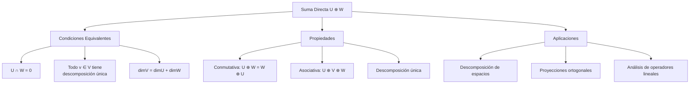
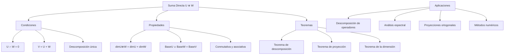

# Álgebra Lineal I - Espacios vectoriales

## 1.6 Sumas directas.

---

### 1. Conceptos Fundamentales de Sumas Directas

#### 1.1 Definición de Suma Directa

Dados dos subespacios $U$ y $W$ de un espacio vectorial $V$, la **suma directa** $U \oplus W$ es el conjunto:

$$U \oplus W = \{\vec{u} + \vec{w} \mid \vec{u} \in U, \vec{w} \in W\}$$

con la condición adicional de que la descomposición es única:

$$ \vec{u}_1 + \vec{w}_1 = \vec{u}_2 + \vec{w}_2 \Rightarrow \vec{u}_1 = \vec{u}_2 \text{ y } \vec{w}_1 = \vec{w}_2 $$

#### 1.2 Condición Equivalente

$U \oplus W$ es suma directa si y solo si:

$$U \cap W = \{\vec{0}\}$$

### 2. Propiedades de las Sumas Directas

#### 2.1 Caracterización de Suma Directa

Las siguientes condiciones son equivalentes:

1. $V = U \oplus W$ (suma directa)
2. $V = U + W$ y $U \cap W = \{\vec{0}\}$
3. Todo vector $\vec{v} \in V$ se escribe de forma única como $\vec{v} = \vec{u} + \vec{w}$
4. $\dim(V) = \dim(U) + \dim(W)$

#### 2.2 Propiedades Algebraicas



### 3. Suma Directa de Múltiples Subespacios

#### 3.1 Definición General

Para subespacios $W_1, W_2, \ldots, W_k$ de $V$, la suma directa:

$$ W_1 \oplus W_2 \oplus \cdots \oplus W_k = \left\lbrace \sum_{i=1}^k \vec{w}_i \mid \vec{w}_i \in W_i \right\rbrace $$

es directa si cada vector tiene una representación única.

#### 3.2 Condición para Múltiples Subespacios

La suma es directa si y solo si:

$$W_i \cap \left(\sum_{j \neq i} W_j\right) = \{\vec{0}\} \quad \text{para todo } i$$

### 4. Implementación Computacional

```python
import numpy as np
import matplotlib.pyplot as plt
from mpl_toolkits.mplot3d import Axes3D

class SumaDirecta:
    def __init__(self, dimension):
        self.dimension = dimension

    def es_suma_directa(self, U, W, tol=1e-10):
        """Verifica si U ⊕ W es suma directa"""
        # Verificar que U y W son subespacios
        if not self._es_subespacio(U) or not self._es_subespacio(W):
            return False

        # Verificar que la intersección es solo el vector cero
        interseccion = self._interseccion_subespacios(U, W)
        solo_cero = all(np.allclose(v, np.zeros(self.dimension), atol=tol)
                     for v in interseccion)

        # Verificar que generan todo el espacio
        genera_todo = self._generan_espacio(U + W)

        return solo_cero and genera_todo and len(interseccion) == 1

    def _es_subespacio(self, vectores, tol=1e-10):
        """Verifica si un conjunto de vectores forma un subespacio"""
        if not vectores:
            return False

        # Debe contener el vector cero
        contiene_cero = any(np.allclose(v, np.zeros(self.dimension), atol=tol)
                          for v in vectores)
        if not contiene_cero:
            return False

        # Verificar cerradura bajo suma y multiplicación escalar
        for u in vectores:
            for v in vectores:
                suma = u + v
                if not any(np.allclose(suma, w, atol=tol) for w in vectores):
                    return False

            for alpha in [-1, 0, 1, 2]:
                mult = alpha * u
                if not any(np.allclose(mult, w, atol=tol) for w in vectores):
                    return False

        return True

    def _interseccion_subespacios(self, U, W, tol=1e-10):
        """Encuentra la intersección de dos subespacios"""
        interseccion = []

        # Para cada vector en U, verificar si está en W
        for u in U:
            if any(np.allclose(u, w, atol=tol) for w in W):
                interseccion.append(u)

        # Para cada vector en W, verificar si está en U
        for w in W:
            if any(np.allclose(w, u, atol=tol) for u in U) and not any(np.allclose(w, v, atol=tol) for v in interseccion):
                interseccion.append(w)

        return interseccion

    def _generan_espacio(self, vectores, tol=1e-10):
        """Verifica si los vectores generan todo el espacio"""
        if not vectores:
            return False

        matriz = np.array(vectores).T
        return np.linalg.matrix_rank(matriz, tol=tol) == self.dimension

    def descomposicion_unica(self, vector, U, W, tol=1e-10):
        """Encuentra la descomposición única de un vector en U ⊕ W"""
        if not self.es_suma_directa(U, W, tol):
            return None, None

        # Resolver el sistema para encontrar coeficientes
        todos_vectores = U + W
        matriz = np.array(todos_vectores).T

        try:
            coeficientes = np.linalg.lstsq(matriz, vector, rcond=None)[0]

            # Separar en componentes U y W
            u_componente = sum(c * v for c, v in zip(coeficientes[:len(U)], U))
            w_componente = sum(c * v for c, v in zip(coeficientes[len(U):], W))

            return u_componente, w_componente
        except np.linalg.LinAlgError:
            return None, None

    def visualizar_suma_directa_2d(self, U, W, titulo="Suma Directa en R²"):
        """Visualización de suma directa en R2"""
        if self.dimension != 2:
            print("Solo disponible para R2")
            return

        fig, ax = plt.subplots(figsize=(10, 8))

        # Ejes
        ax.axhline(y=0, color='k', linestyle='-', alpha=0.3)
        ax.axvline(x=0, color='k', linestyle='-', alpha=0.3)
        ax.set_xlim(-3, 3)
        ax.set_ylim(-3, 3)
        ax.set_aspect('equal')

        # Vector cero
        ax.plot(0, 0, 'ko', markersize=8, label='Origen')

        # Dibujar subespacio U (línea roja)
        if U:
            u_dir = U[0] / np.linalg.norm(U[0])
            ax.quiver(0, 0, u_dir[0], u_dir[1], angles='xy', scale_units='xy', scale=1,
                     color='red', width=0.015, label=f'U: dirección {U[0]}')
            # Línea completa de U
            t = np.linspace(-3, 3, 100)
            x_u = t * u_dir[0]
            y_u = t * u_dir[1]
            ax.plot(x_u, y_u, 'r-', alpha=0.3)

        # Dibujar subespacio W (línea azul)
        if W:
            w_dir = W[0] / np.linalg.norm(W[0])
            ax.quiver(0, 0, w_dir[0], w_dir[1], angles='xy', scale_units='xy', scale=1,
                     color='blue', width=0.015, label=f'W: dirección {W[0]}')
            # Línea completa de W
            x_w = t * w_dir[0]
            y_w = t * w_dir[1]
            ax.plot(x_w, y_w, 'b-', alpha=0.3)

        # Dibujar vector ejemplo y su descomposición
        if U and W:
            vector_ejemplo = np.array([2.0, 1.5])
            u_comp, w_comp = self.descomposicion_unica(vector_ejemplo, U, W)

            if u_comp is not None and w_comp is not None:
                ax.quiver(0, 0, vector_ejemplo[0], vector_ejemplo[1], angles='xy', scale_units='xy', scale=1,
                         color='green', width=0.02, label=f'Vector: {vector_ejemplo}')
                ax.quiver(0, 0, u_comp[0], u_comp[1], angles='xy', scale_units='xy', scale=1,
                         color='red', width=0.015, linestyle='--', label=f'Componente U: {u_comp}')
                ax.quiver(u_comp[0], u_comp[1], w_comp[0], w_comp[1], angles='xy', scale_units='xy', scale=1,
                         color='blue', width=0.015, linestyle='--', label=f'Componente W: {w_comp}')

        ax.legend()
        ax.set_title(titulo)
        ax.grid(True, alpha=0.3)
        plt.show()

    def visualizar_suma_directa_3d(self, U, W, titulo="Suma Directa en R³"):
        """Visualización de suma directa en R3"""
        if self.dimension != 3:
            print("Solo disponible para R3")
            return

        fig = plt.figure(figsize=(12, 10))
        ax = fig.add_subplot(111, projection='3d')

        # Ejes
        ax.plot([0, 2], [0, 0], [0, 0], 'k-', alpha=0.3)
        ax.plot([0, 0], [0, 2], [0, 0], 'k-', alpha=0.3)
        ax.plot([0, 0], [0, 0], [0, 2], 'k-', alpha=0.3)

        # Dibujar subespacio U (plano rojo)
        if len(U) == 2:  # U es un plano
            u1, u2 = U
            # Generar malla para el plano U
            s, t = np.meshgrid(np.linspace(-1, 1, 10), np.linspace(-1, 1, 10))
            X_u = s * u1[0] + t * u2[0]
            Y_u = s * u1[1] + t * u2[1]
            Z_u = s * u1[2] + t * u2[2]
            ax.plot_surface(X_u, Y_u, Z_u, alpha=0.2, color='red')

        # Dibujar subespacio W (línea azul)
        if W and len(W) == 1:  # W es una línea
            w_dir = W[0] / np.linalg.norm(W[0])
            t = np.linspace(-2, 2, 100)
            X_w = t * w_dir[0]
            Y_w = t * w_dir[1]
            Z_w = t * w_dir[2]
            ax.plot(X_w, Y_w, Z_w, 'b-', alpha=0.7, label='Subespacio W')

        # Vector ejemplo y descomposición
        if U and W:
            vector_ejemplo = np.array([1.0, 1.0, 1.0])
            u_comp, w_comp = self.descomposicion_unica(vector_ejemplo, U, W)

            if u_comp is not None and w_comp is not None:
                # Vector completo
                ax.quiver(0, 0, 0, vector_ejemplo[0], vector_ejemplo[1], vector_ejemplo[2],
                         color='green', arrow_length_ratio=0.1, linewidth=2,
                         label=f'Vector: {vector_ejemplo}')

                # Componente U
                ax.quiver(0, 0, 0, u_comp[0], u_comp[1], u_comp[2],
                         color='red', arrow_length_ratio=0.1, linewidth=2,
                         label=f'Componente U: {u_comp}')

                # Componente W (desde el final de U)
                ax.quiver(u_comp[0], u_comp[1], u_comp[2],
                         w_comp[0], w_comp[1], w_comp[2],
                         color='blue', arrow_length_ratio=0.1, linewidth=2,
                         label=f'Componente W: {w_comp}')

        ax.set_xlim([-2, 2])
        ax.set_ylim([-2, 2])
        ax.set_zlim([-2, 2])
        ax.set_xlabel('X')
        ax.set_ylabel('Y')
        ax.set_zlabel('Z')
        ax.set_title(titulo)
        ax.legend()
        plt.show()

    def analizar_suma_directa(self, U, W):
        """Análisis completo de una suma directa"""
        print("=== ANÁLISIS DE SUMA DIRECTA ===")
        print(f"Dimensión del espacio: {self.dimension}")
        print(f"Tamaño de U: {len(U)} vectores")
        print(f"Tamaño de W: {len(W)} vectores")

        # Verificar si son suma directa
        es_directa = self.es_suma_directa(U, W)
        print(f"¿U ⊕ W es suma directa? {es_directa}")

        if es_directa:
            # Calcular dimensiones
            dim_U = np.linalg.matrix_rank(np.array(U).T)
            dim_W = np.linalg.matrix_rank(np.array(W).T)
            print(f"dim(U) = {dim_U}")
            print(f"dim(W) = {dim_W}")
            print(f"dim(U ⊕ W) = {dim_U + dim_W}")

            # Verificar descomposición única
            vector_test = np.ones(self.dimension)
            u_comp, w_comp = self.descomposicion_unica(vector_test, U, W)
            print(f"Vector test: {vector_test}")
            print(f"Componente en U: {u_comp}")
            print(f"Componente en W: {w_comp}")
            print(f"Suma componentes: {u_comp + w_comp}")

        return es_directa

# Ejemplos de uso
print("=== SUMAS DIRECTAS ===")

# 1. Suma directa en R²
print("\n1. SUMA DIRECTA EN R²")
r2 = SumaDirecta(2)

# Ejemplo de suma directa: ejes x e y
U = [np.array([1, 0])]  # Eje x
W = [np.array([0, 1])]  # Eje y

resultado1 = r2.analizar_suma_directa(U, W)
r2.visualizar_suma_directa_2d(U, W, "Suma Directa: Ejes X e Y")

# 2. Suma NO directa en R²
print("\n2. SUMA NO DIRECTA EN R²")
U2 = [np.array([1, 0])]     # Eje x
W2 = [np.array([1, 1])]     # Línea y = x (intersecta en origen pero no genera todo)

resultado2 = r2.analizar_suma_directa(U2, W2)

# 3. Suma directa en R³: plano + línea
print("\n3. SUMA DIRECTA EN R³: PLANO + LÍNEA")
r3 = SumaDirecta(3)

# Plano xy
U3 = [np.array([1, 0, 0]), np.array([0, 1, 0])]
# Línea en eje z
W3 = [np.array([0, 0, 1])]

resultado3 = r3.analizar_suma_directa(U3, W3)
r3.visualizar_suma_directa_3d(U3, W3, "Suma Directa: Plano XY + Eje Z")

# 4. Suma NO directa en R³: dos planos que se intersectan
print("\n4. SUMA NO DIRECTA EN R³: DOS PLANOS")
# Plano xy
U4 = [np.array([1, 0, 0]), np.array([0, 1, 0])]
# Plano xz
W4 = [np.array([1, 0, 0]), np.array([0, 0, 1])]

resultado4 = r3.analizar_suma_directa(U4, W4)

# 5. Descomposición única
print("\n5. DESCOMPOSICIÓN ÚNICA")
vector = np.array([2, 3, 4])
u_comp, w_comp = r3.descomposicion_unica(vector, U3, W3)

print(f"Vector: {vector}")
print(f"Componente en plano XY: {u_comp}")
print(f"Componente en eje Z: {w_comp}")
print(f"Suma: {u_comp + w_comp}")
print(f"¿Coincide? {np.allclose(vector, u_comp + w_comp)}")

# 6. Dimensión y teorema de la dimensión
print("\n6. TEOREMA DE LA DIMENSIÓN")
def demostrar_teorema_dimension(U, W, espacio):
    """Demuestra el teorema de la dimensión para suma directa"""
    analizador = SumaDirecta(len(espacio[0]))

    if analizador.es_suma_directa(U, W):
        dim_U = np.linalg.matrix_rank(np.array(U).T)
        dim_W = np.linalg.matrix_rank(np.array(W).T)
        dim_total = np.linalg.matrix_rank(np.array(U + W).T)

        print(f"dim(U) = {dim_U}")
        print(f"dim(W) = {dim_W}")
        print(f"dim(U ⊕ W) = {dim_total}")
        print(f"dim(U) + dim(W) = {dim_U + dim_W}")
        print(f"¿dim(U ⊕ W) = dim(U) + dim(W)? {dim_total == dim_U + dim_W}")

# Ejemplo con los ejes en R³
U_ejes = [np.array([1, 0, 0])]
W_ejes = [np.array([0, 1, 0]), np.array([0, 0, 1])]
demostrar_teorema_dimension(U_ejes, W_ejes, r3.base_canonica())

# 7. Aplicación: descomposición de operadores
print("\n7. APLICACIÓN: ESPACIOS PROPIOS")
# Simular espacios propios de una matriz
espacio_propio1 = [np.array([1, 0, 0])]    # λ = 2
espacio_propio2 = [np.array([0, 1, 0])]    # λ = 3
espacio_propio3 = [np.array([0, 0, 1])]    # λ = 4

# Verificar que son suma directa
print("¿Espacios propios son suma directa?")
print("E1 ⊕ E2:", r3.es_suma_directa(espacio_propio1, espacio_propio2))
print("E1 ⊕ E3:", r3.es_suma_directa(espacio_propio1, espacio_propio3))
print("E2 ⊕ E3:", r3.es_suma_directa(espacio_propio2, espacio_propio3))
print("E1 ⊕ E2 ⊕ E3:", r3.es_suma_directa(espacio_propio1 + espacio_propio2, espacio_propio3))

# 8. Suma directa de múltiples subespacios
print("\n8. SUMA DIRECTA MÚLTIPLE")
def es_suma_directa_multiple(subespacios, tol=1e-10):
    """Verifica si la suma de múltiples subespacios es directa"""
    dimension = len(subespacios[0][0])
    analizador = SumaDirecta(dimension)

    # Verificar que cada subespacio intersecta trivialmente la suma de los demás
    for i in range(len(subespacios)):
        suma_otros = []
        for j in range(len(subespacios)):
            if j != i:
                suma_otros.extend(subespacios[j])

        interseccion = analizador._interseccion_subespacios(subespacios[i], suma_otros, tol)
        solo_cero = all(np.allclose(v, np.zeros(dimension), atol=tol) for v in interseccion)

        if not solo_cero:
            return False

    return True

# Ejemplo: ejes coordenados en R³
ejes = [[np.array([1, 0, 0])], [np.array([0, 1, 0])], [np.array([0, 0, 1])]]
print("¿Ejes coordenados son suma directa?", es_suma_directa_multiple(ejes))
```

### 5. Ejemplos y Ejercicios

#### Ejemplo 1: Suma Directa en $\mathbb{R}^2$

- $U = \{(x,0) \mid x \in \mathbb{R}\}$ (eje x)
- $W = \{(0,y) \mid y \in \mathbb{R}\}$ (eje y)
- $U \oplus W = \mathbb{R}^2$
- Todo vector $(a,b) = (a,0) + (0,b)$ descomposición única

#### Ejemplo 2: Suma No Directa en $\mathbb{R}^2$

- $U = \{(x,0) \mid x \in \mathbb{R}\}$ (eje x)
- $W = \{(x,x) \mid x \in \mathbb{R}\}$ (línea y=x)
- $U \cap W = \{(0,0)\}$ pero no generan todo $\mathbb{R}^2$

#### Ejemplo 3: Suma Directa en $\mathbb{R}^3$

- $U = \{(x,y,0) \mid x,y \in \mathbb{R}\}$ (plano xy)
- $W = \{(0,0,z) \mid z \in \mathbb{R}\}$ (eje z)
- $U \oplus W = \mathbb{R}^3$

#### Ejercicio 1:

Verificar si los siguientes subespacios forman suma directa en $\mathbb{R}^3$:

$$U = \{(x,y,z) \mid x + y + z = 0\}, \quad W = \{(x,y,z) \mid x = y = z\}$$

### 6. Aplicaciones de las Sumas Directas

#### 6.1 Teoría de Espacios Vectoriales

- **Descomposición de espacios**: $V = U \oplus W$
- **Bases desacopladas**: Base de $U$ unida con base de $W$ da base de $V$
- **Proyecciones**: Proyección sobre $U$ a lo largo de $W$

#### 6.2 Álgebra Lineal Numérica

- **Descomposición de matrices**: LU, QR, SVD
- **Métodos iterativos**: Descomposición de dominios
- **Procesamiento paralelo**: Dividir problemas en subproblemas independientes

#### 6.3 Física e Ingeniería

- **Mecánica**: Descomposición de fuerzas en componentes ortogonales
- **Electricidad**: Análisis de circuitos por superposición
- **Mecánica cuántica**: Espacios de Hilbert y descomposición espectral

### 7. Teoremas Importantes

#### 7.1 Teorema de la Descomposición

Si $V = U \oplus W$, entonces todo operador lineal $T: V \rightarrow V$ puede descomponerse como:

$$T = T_U \oplus T_W$$

donde $T_U: U \rightarrow U$ y $T_W: W \rightarrow W$

#### 7.2 Teorema de la Dimensión para Sumas Directas

Si $V = U \oplus W$, entonces:

$$\dim(V) = \dim(U) + \dim(W)$$

#### 7.3 Teorema de la Proyección

Para $V = U \oplus W$, existen proyecciones únicas $P_U$ y $P_W$ tales que:

$$P_U^2 = P_U, \quad P_W^2 = P_W, \quad P_U + P_W = I$$

### 8. Visualización de Conceptos



### 9. Casos Especiales

#### 9.1 Suma Directa de Múltiples Subespacios

- $V = W_1 \oplus W_2 \oplus \cdots \oplus W_k$
- Cada $W_i$ contribuye dimensiones independientes
- Bases se unen para formar base de $V$

#### 9.2 Suma Directa de Espacios Propios

- Para operadores diagonalizables
- $V = E_{\lambda_1} \oplus E_{\lambda_2} \oplus \cdots \oplus E_{\lambda_k}$
- Descomposición espectral

#### 9.3 Suma Directa Externa

- $V \oplus W = \{(v,w) \mid v \in V, w \in W\}$
- $\dim(V \oplus W) = \dim(V) + \dim(W)$
- Diferente de suma directa interna

### 10. Recursos Adicionales

- "Linear Algebra Done Right" por Sheldon Axler
- "Advanced Linear Algebra" por Steven Roman
- "Álgebra Lineal" por Stanley Grossman
- Software: MATLAB, NumPy, SageMath
- Librerías Python: NumPy, SciPy, Matplotlib
- Tutoriales online de sumas directas
- Visualizaciones interactivas de descomposiciones
