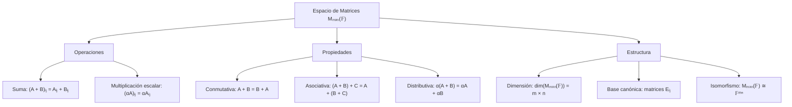
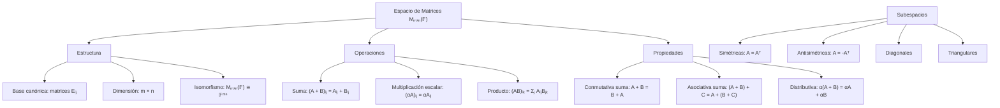

# Álgebra Lineal I - Matrices

## 2.1 El espacio de las matrices.

---

### 1. Conceptos Fundamentales del Espacio de Matrices

#### 1.1 Definición del Espacio de Matrices

El **espacio de matrices** $M_{m \times n}(\mathbb{F})$ sobre un campo $\mathbb{F}$ es el conjunto de todas las matrices de $m$ filas y $n$ columnas con entradas en $\mathbb{F}.$

$$ M_{m \times n}(\mathbb{F}) = \left\lbrace \begin{bmatrix} a_{11} & a_{12} & \cdots & a_{1n} \\ a_{21} & a_{22} & \cdots & a_{2n} \\ \vdots & \vdots & \ddots & \vdots \\ a_{m1} & a_{m2} & \cdots & a_{mn} \end{bmatrix} \mid a_{ij} \in \mathbb{F} \right\rbrace $$

#### 1.2 Estructura de Espacio Vectorial

$M_{m \times n}(\mathbb{F})$ es un espacio vectorial sobre $\mathbb{F}$ con las operaciones:

1. **Suma de matrices**: $(A + B)_{ij} = A_{ij} + B_{ij}$
2. **Multiplicación por escalar**: $(\alpha A)_{ij} = \alpha A_{ij}$

### 2. Propiedades Algebraicas del Espacio de Matrices

#### 2.1 Axiomas de Espacio Vectorial



#### 2.2 Elementos Especiales

- **Matriz cero**: $0_{m \times n}$ (matriz con todas las entradas 0)
- **Matriz identidad**: $I_n$ (diagonal principal 1, demás 0)
- **Matrices unitarias**: $E_{ij},$ con 1 en la posición $(i,j)$ y 0 en las demás. No hay que confundirlas con las **matrices elementales** de las operaciones por renglón (subtema 2.2)

### 3. Bases y Dimensión del Espacio de Matrices

#### 3.1 Base Canónica

La **base canónica** de $M_{m \times n}(\mathbb{F})$ consiste en las $mn$ matrices unitarias

$$\mathcal{B} = \{E_{11}, E_{12}, \ldots, E_{1n}, E_{21}, \ldots, E_{mn}\}$$

donde $E_{ij}$ tiene 1 en la posición $(i,j)$ y 0 en las demás. Toda matriz se escribe de forma única como

$$A = \sum_{i=1}^{m} \sum_{j=1}^{n} a_{ij} E_{ij},$$

así que las $E_{ij}$ generan y son linealmente independientes: si $\sum a_{ij} E_{ij} = 0,$ cada entrada $a_{ij}$ es 0.

#### 3.2 Dimensión

$$\dim(M_{m \times n}(\mathbb{F})) = m \times n$$

### 4. Implementación Computacional

```python
import numpy as np
import matplotlib.pyplot as plt
from sympy import Matrix, symbols, eye

class EspacioMatrices:
    def __init__(self, filas, columnas, campo='real'):
        self.m = filas
        self.n = columnas
        self.campo = campo
        self.dimension = filas * columnas

    def matriz_cero(self):
        """Retorna la matriz cero del espacio"""
        return np.zeros((self.m, self.n))

    def matriz_identidad(self):
        """Retorna la matriz identidad (solo para matrices cuadradas)"""
        if self.m != self.n:
            raise ValueError("La identidad solo existe para matrices cuadradas")
        return np.eye(self.m)

    def matriz_elemental(self, i, j):
        """Retorna la matriz elemental E_ij"""
        if i < 0 or i >= self.m or j < 0 or j >= self.n:
            raise ValueError("Índices fuera de rango")

        E = np.zeros((self.m, self.n))
        E[i, j] = 1
        return E

    def base_canonica(self):
        """Genera la base canónica del espacio de matrices"""
        base = []
        for i in range(self.m):
            for j in range(self.n):
                base.append(self.matriz_elemental(i, j))
        return base

    def es_matriz_valida(self, matriz):
        """Verifica si una matriz pertenece al espacio"""
        return matriz.shape == (self.m, self.n)

    def suma_matrices(self, A, B):
        """Suma de matrices"""
        if not (self.es_matriz_valida(A) and self.es_matriz_valida(B)):
            raise ValueError("Matrices de dimensiones incorrectas")
        return A + B

    def multiplicacion_escalar(self, alpha, A):
        """Multiplicación por escalar"""
        if not self.es_matriz_valida(A):
            raise ValueError("Matriz de dimensiones incorrectas")
        return alpha * A

    def combinacion_lineal(self, coeficientes, matrices):
        """Combination lineal de matrices"""
        if len(coeficientes) != len(matrices):
            raise ValueError("Número de coeficientes no coincide con número de matrices")

        resultado = np.zeros((self.m, self.n))
        for alpha, matriz in zip(coeficientes, matrices):
            if not self.es_matriz_valida(matriz):
                raise ValueError("Matriz de dimensiones incorrectas")
            resultado += alpha * matriz
        return resultado

    def verificar_axiomas_espacio_vectorial(self, matrices_ejemplo, escalares):
        """Verifica los axiomas de espacio vectorial"""
        resultados = {}

        # 1. Cerradura de la suma
        A, B = matrices_ejemplo[:2]
        suma = self.suma_matrices(A, B)
        resultados['cerradura_suma'] = self.es_matriz_valida(suma)

        # 2. Cerradura de la multiplicación por escalar
        alpha = escalares[0]
        mult_escalar = self.multiplicacion_escalar(alpha, A)
        resultados['cerradura_mult_escalar'] = self.es_matriz_valida(mult_escalar)

        # 3. Conmutatividad de la suma
        suma_AB = self.suma_matrices(A, B)
        suma_BA = self.suma_matrices(B, A)
        resultados['conmutatividad'] = np.array_equal(suma_AB, suma_BA)

        # 4. Asociatividad de la suma
        C = matrices_ejemplo[2]
        suma_AB_C = self.suma_matrices(suma_AB, C)
        suma_A_BC = self.suma_matrices(A, self.suma_matrices(B, C))
        resultados['asociatividad_suma'] = np.array_equal(suma_AB_C, suma_A_BC)

        # 5. Elemento neutro de la suma
        cero = self.matriz_cero()
        suma_A_cero = self.suma_matrices(A, cero)
        resultados['elemento_neutro_suma'] = np.array_equal(suma_A_cero, A)

        # 6. Inverso aditivo
        inverso_A = -1 * A
        suma_A_inverso = self.suma_matrices(A, inverso_A)
        resultados['inverso_aditivo'] = np.array_equal(suma_A_inverso, cero)

        # 7. Distributividad de la multiplicación por escalar respecto a la suma de matrices
        alpha_times_sum = self.multiplicacion_escalar(alpha, self.suma_matrices(A, B))
        sum_of_alpha_times = self.suma_matrices(self.multiplicacion_escalar(alpha, A),
                                              self.multiplicacion_escalar(alpha, B))
        resultados['distributividad_1'] = np.array_equal(alpha_times_sum, sum_of_alpha_times)

        # 8. Distributividad de la multiplicación por escalar respecto a la suma de escalares
        beta = escalares[1]
        alpha_plus_beta_times_A = self.multiplicacion_escalar(alpha + beta, A)
        alpha_times_A_plus_beta_times_A = self.suma_matrices(self.multiplicacion_escalar(alpha, A),
                                                          self.multiplicacion_escalar(beta, A))
        resultados['distributividad_2'] = np.array_equal(alpha_plus_beta_times_A, alpha_times_A_plus_beta_times_A)

        # 9. Compatibilidad de la multiplicación de escalares
        alpha_beta_times_A = self.multiplicacion_escalar(alpha * beta, A)
        alpha_times_beta_times_A = self.multiplicacion_escalar(alpha, self.multiplicacion_escalar(beta, A))
        resultados['compatibilidad'] = np.array_equal(alpha_beta_times_A, alpha_times_beta_times_A)

        # 10. Identidad multiplicativa
        one_times_A = self.multiplicacion_escalar(1, A)
        resultados['identidad_multiplicativa'] = np.array_equal(one_times_A, A)

        return resultados

    def visualizar_base_canonica(self):
        """Visualización de la base canónica para matrices pequeñas"""
        if self.m > 4 or self.n > 4:
            print("Visualización solo disponible para matrices hasta 4x4")
            return

        base = self.base_canonica()
        fig, axes = plt.subplots(self.m, self.n, figsize=(12, 10))

        if self.m == 1 or self.n == 1:
            axes = np.array(axes).reshape(self.m, self.n)

        for i in range(self.m):
            for j in range(self.n):
                ax = axes[i, j]
                matriz = base[i * self.n + j]

                # Crear heatmap de la matriz
                im = ax.imshow(matriz, cmap='Blues', vmin=0, vmax=1)

                # Añadir valores en las celdas
                for x in range(self.m):
                    for y in range(self.n):
                        ax.text(y, x, f'{matriz[x, y]:.0f}',
                               ha='center', va='center', fontweight='bold')

                ax.set_title(f'E_{{{i+1}{j+1}}}')
                ax.set_xticks([])
                ax.set_yticks([])

        plt.suptitle(f'Base Canónica de M_{{{self.m}×{self.n}}}(ℝ)')
        plt.tight_layout()
        plt.show()

    def demostrar_isomorfismo(self, matriz):
        """Demuestra el isomorfismo Mₘₓₙ𝔽 ≅ 𝔽ᵐⁿ"""
        if not self.es_matriz_valida(matriz):
            raise ValueError("Matriz de dimensiones incorrectas")

        # Aplanar la matriz a vector
        vector = matriz.flatten()
        print(f"Matriz {self.m}×{self.n}:")
        print(matriz)
        print(f"Vector en ℝ^{self.dimension}:")
        print(vector)

        # Reconstruir la matriz desde el vector
        matriz_reconstruida = vector.reshape((self.m, self.n))
        print("Matriz reconstruida:")
        print(matriz_reconstruida)
        print(f"¿Son iguales? {np.array_equal(matriz, matriz_reconstruida)}")

        return vector, matriz_reconstruida

    def subespacios_especiales(self):
        """Identifica subespacios importantes"""
        subespacios = {}

        if self.m == self.n:
            # Matrices cuadradas
            subespacios['matrices_simetricas'] = self._generar_matrices_simetricas()
            subespacios['matrices_antisimetricas'] = self._generar_matrices_antisimetricas()
            subespacios['matrices_diagonales'] = self._generar_matrices_diagonales()

        subespacios['matrices_triangulares_superiores'] = self._generar_matrices_triangulares_superiores()
        subespacios['matrices_triangulares_inferiores'] = self._generar_matrices_triangulares_inferiores()

        return subespacios

    def _generar_matrices_simetricas(self):
        """Genera matrices simétricas de ejemplo"""
        # Para 2x2
        if self.m == 2:
            return [
                np.array([[1, 2], [2, 3]]),
                np.array([[0, 1], [1, 0]]),
                np.array([[1, 0], [0, 1]])
            ]
        # Para 3x3
        elif self.m == 3:
            return [
                np.array([[1, 2, 3], [2, 4, 5], [3, 5, 6]]),
                np.eye(3)
            ]
        return []

    def _generar_matrices_antisimetricas(self):
        """Genera matrices antisimétricas de ejemplo"""
        if self.m == 2:
            return [
                np.array([[0, 1], [-1, 0]]),
                np.array([[0, 2], [-2, 0]])
            ]
        elif self.m == 3:
            return [
                np.array([[0, 1, 2], [-1, 0, 3], [-2, -3, 0]])
            ]
        return []

    def _generar_matrices_diagonales(self):
        """Genera matrices diagonales de ejemplo"""
        diagonales = []
        for i in range(self.m):
            diag = np.diag([1 if j == i else 0 for j in range(self.m)])
            diagonales.append(diag)
        return diagonales

    def _generar_matrices_triangulares_superiores(self):
        """Genera matrices triangulares superiores de ejemplo"""
        if self.m >= 2 and self.n >= 2:
            return [
                np.array([[1, 2], [0, 3]]),
                np.array([[1, 0, 1], [0, 2, 0], [0, 0, 3]]) if self.m == 3 else None
            ]
        return []

    def _generar_matrices_triangulares_inferiores(self):
        """Genera matrices triangulares inferiores de ejemplo"""
        if self.m >= 2 and self.n >= 2:
            return [
                np.array([[1, 0], [2, 3]]),
                np.array([[1, 0, 0], [2, 3, 0], [4, 5, 6]]) if self.m == 3 else None
            ]
        return []

# Ejemplos de uso
print("=== ESPACIO DE MATRICES ===")

# 1. Espacio de matrices 2x2
print("\n1. ESPACIO M₂ₓ₂(ℝ)")
m2x2 = EspacioMatrices(2, 2)

# Matrices de ejemplo
A = np.array([[1, 2], [3, 4]])
B = np.array([[5, 6], [7, 8]])
C = np.array([[0, 1], [1, 0]])

# Verificar axiomas
resultados = m2x2.verificar_axiomas_espacio_vectorial([A, B, C], [2, 3])
print("Axiomas de espacio vectorial:")
for axioma, cumple in resultados.items():
    print(f"{axioma}: {cumple}")

# 2. Base canónica
print("\n2. BASE CANÓNICA")
base = m2x2.base_canonica()
print(f"La base canónica de M₂ₓ₂(ℝ) tiene {len(base)} matrices:")
for i, matriz in enumerate(base):
    print(f"E_{i//2 + 1}{i%2 + 1} =\n{matriz}")

m2x2.visualizar_base_canonica()

# 3. Isomorfismo con R⁴
print("\n3. ISOMORFISMO M₂ₓ₂(ℝ) ≅ ℝ⁴")
matriz_ejemplo = np.array([[1, 2], [3, 4]])
vector, matriz_reconstruida = m2x2.demostrar_isomorfismo(matriz_ejemplo)

# 4. Operaciones básicas
print("\n4. OPERACIONES BÁSICAS")
print(f"A =\n{A}")
print(f"B =\n{B}")
print(f"A + B =\n{m2x2.suma_matrices(A, B)}")
print(f"2 * A =\n{m2x2.multiplicacion_escalar(2, A)}")

# 5. Combinación lineal
print("\n5. COMBINACIÓN LINEAL")
coeficientes = [1, 2, 3]
matrices = [A, B, C]
combinacion = m2x2.combinacion_lineal(coeficientes, matrices)
print(f"1*A + 2*B + 3*C =\n{combinacion}")

# 6. Espacio de matrices 3x3
print("\n6. ESPACIO M₃ₓ₃(ℝ)")
m3x3 = EspacioMatrices(3, 3)
print(f"Dimensión: {m3x3.dimension}")
print(f"Tamaño de la base canónica: {len(m3x3.base_canonica())}")

# 7. Subespacios importantes
print("\n7. SUBESPACIOS IMPORTANTES")
subespacios = m2x2.subespacios_especiales()
print("Subespacios de M₂ₓ₂(ℝ):")
for nombre, matrices in subespacios.items():
    if matrices:
        print(f"{nombre}:")
        for mat in matrices:
            if mat is not None:
                print(mat)
        print()

# 8. Matrices no cuadradas
print("\n8. MATRICES NO CUADRADAS")
m2x3 = EspacioMatrices(2, 3)
print(f"Espacio M₂ₓ₃(ℝ), dimensión: {m2x3.dimension}")

# Matriz ejemplo 2x3
D = np.array([[1, 2, 3], [4, 5, 6]])
print(f"Matriz 2x3:\n{D}")
vector_flat, _ = m2x3.demostrar_isomorfismo(D)

# 9. Diferentes campos
print("\n9. ESPACIOS SOBRE DIFERENTES CAMPOS")
# Sobre ℝ
matriz_real = np.array([[1, 2], [3, 4]])
print(f"Matriz sobre ℝ:\n{matriz_real}")

# Sobre ℂ (usando números complejos)
matriz_compleja = np.array([[1+2j, 3+4j], [5+6j, 7+8j]])
print(f"Matriz sobre ℂ:\n{matriz_compleja}")

# 10. Aplicación: transformaciones lineales
print("\n10. APLICACIÓN: TRANSFORMACIONES LINEALES")
# El espacio de matrices es isomorfo al espacio de transformaciones lineales
print("Mₘₓₙ(𝔽) ≅ Hom(𝔽ⁿ, 𝔽ᵐ)")
print("Cada matriz representa una transformación lineal")
print("La multiplicación de matrices corresponde a la composición de transformaciones")

# 11. Dimensión de subespacios
print("\n11. DIMENSIÓN DE SUBESPACIOS")
def dimension_subespacios(m, n):
    """Calcula dimensiones de subespacios importantes"""
    print(f"Para M_{m}×{n}(ℝ):")
    print(f"  • Dimensión total: {m * n}")

    if m == n:
        print(f"  • Matrices simétricas: {m*(m+1)//2}")
        print(f"  • Matrices antisimétricas: {m*(m-1)//2}")
        print(f"  • Matrices diagonales: {m}")

    print(f"  • Matrices triangulares superiores: {m*(m+1)//2 if m==n else 'Variable'}")
    print(f"  • Matrices triangulares inferiores: {m*(m+1)//2 if m==n else 'Variable'}")

dimension_subespacios(2, 2)
dimension_subespacios(3, 3)
```

### 5. Ejemplos y Ejercicios

#### Ejemplo 1: Espacio $M_{2 \times 2}(\mathbb{R})$

- **Dimensión**: 4
- **Base canónica**:

$$ E_{11} = \begin{bmatrix} 1&0 \\ 0&0\end{bmatrix}, E_{12} = \begin{bmatrix}0&1 \\ 0&0\end{bmatrix}, E_{21} = \begin{bmatrix} 0&0 \\ 1&0 \end{bmatrix}, E_{22} = \begin{bmatrix} 0&0 \\ 0&1 \end{bmatrix} $$

- **Elemento cero**: $ \begin{bmatrix} 0&0 \\ 0&0 \end{bmatrix} $

#### Ejemplo 2: Combinación Lineal en $M_{2 \times 2}(\mathbb{R})$

Para $ A = \begin{bmatrix} 1&2 \\ 3&4 \end{bmatrix}, B = \begin{bmatrix} 0&1 \\ 1&0 \end{bmatrix} :$

$$ 2A + 3B = 2\begin{bmatrix} 1&2 \\ 3&4 \end{bmatrix} + 3\begin{bmatrix} 0&1 \\ 1&0 \end{bmatrix} = \begin{bmatrix} 2&7 \\ 9&8 \end{bmatrix} $$

#### Ejemplo 3: Isomorfismo $M_{2 \times 2}(\mathbb{R}) \cong \mathbb{R}^4$

$$ \begin{bmatrix} a&b \\ c&d \end{bmatrix} \leftrightarrow (a, b, c, d) $$

#### Ejercicio 1:

Verificar que el conjunto de matrices simétricas $ 2 \times 2 $ forma un subespacio de $ M_{2 \times 2}(\mathbb{R}) $ y encontrar su dimensión.

### 6. Aplicaciones del Espacio de Matrices

#### 6.1 Álgebra Lineal

- **Representación de transformaciones lineales**
- **Sistemas de ecuaciones lineales**
- **Valores y vectores propios**

#### 6.2 Ciencias de la Computación

- **Gráficos por computadora**: Transformaciones geométricas
- **Machine Learning**: Datos en forma matricial
- **Procesamiento de imágenes**: Píxeles como matrices

#### 6.3 Física e Ingeniería

- **Mecánica cuántica**: Operadores en espacios de Hilbert
- **Ingeniería estructural**: Matrices de rigidez
- **Circuitos eléctricos**: Matrices de admitancia

### 7. Teoremas Importantes

#### 7.1 Teorema de la Dimensión

$$ \dim(M_{m \times n}(\mathbb{F})) = m \times n $$

#### 7.2 Isomorfismo con $\mathbb{F}^{mn}$

$$ M_{m \times n}(\mathbb{F}) \cong \mathbb{F}^{mn} $$

#### 7.3 Estructura de Álgebra

$M_{n \times n}(\mathbb{F})$ forma un álgebra asociativa con la multiplicación de matrices, con unidad $I_n.$ No es conmutativa si $n \geq 2:$ por ejemplo, $E_{12}E_{21} = E_{11}$ pero $E_{21}E_{12} = E_{22}.$

#### 7.4 Matrices Simétricas y Antisimétricas

La transposición $A \mapsto A^T$ es lineal: $(A + B)^T = A^T + B^T$ y $(\alpha A)^T = \alpha A^T.$ Por eso las matrices simétricas, con $A^T = A,$ y las antisimétricas, con $A^T = -A,$ forman subespacios de $M_{n \times n}(\mathbb{F}),$ de dimensiones $\frac{n(n+1)}{2}$ y $\frac{n(n-1)}{2}.$ Si $1 + 1 \neq 0$ en $\mathbb{F},$ como en $\mathbb{R}$ o $\mathbb{C},$ toda matriz se descompone de forma única como

$$A = \underbrace{\frac{A + A^T}{2}}_{\text{simétrica}} + \underbrace{\frac{A - A^T}{2}}_{\text{antisimétrica}},$$

así que $M_{n \times n}(\mathbb{F})$ es suma directa de ambos subespacios; las dimensiones suman $\frac{n(n+1)}{2} + \frac{n(n-1)}{2} = n^2.$ Por ejemplo,

$$\begin{bmatrix} 1 & 2 \\ 4 & 3 \end{bmatrix} = \begin{bmatrix} 1 & 3 \\ 3 & 3 \end{bmatrix} + \begin{bmatrix} 0 & -1 \\ 1 & 0 \end{bmatrix}.$$

#### 7.5 La Traza

La **traza** $\operatorname{tr}(A) = a_{11} + a_{22} + \cdots + a_{nn}$ es una función lineal de $M_{n \times n}(\mathbb{F})$ en $\mathbb{F}.$ Su núcleo, las matrices de traza cero, es un subespacio de dimensión $n^2 - 1.$ Además, $\operatorname{tr}(AB) = \operatorname{tr}(BA)$ aunque $AB \neq BA.$

### 8. Visualización de Conceptos



### 9. Casos Especiales

#### 9.1 Matrices Cuadradas $(m = n)$

- $M_{n \times n}(\mathbb{F})$ forma un álgebra
- Existencia de matriz identidad $I_n$
- Posibilidad de invertibilidad

#### 9.2 Matrices sobre Campos Finitos

- $M_{m \times n}(\mathbb{F}_p)$ con $p$ primo
- Aplicaciones en criptografía
- Códigos correctores de errores

#### 9.3 Matrices con Estructura Adicional

- **Matrices bandadas**: No nulas solo cerca de la diagonal
- **Matrices dispersas**: Mayoría de elementos cero
- **Matrices por bloques**: Particionadas en submatrices

### 10. Recursos Adicionales

- "Linear Algebra Done Right" por Sheldon Axler
- "Matrix Analysis" por Roger Horn y Charles Johnson
- "Álgebra Lineal" por Stanley Grossman
- Software: MATLAB, NumPy, SciPy
- Librerías Python: NumPy, SymPy, Matplotlib
- Tutoriales online de álgebra matricial
- Visualizaciones interactivas de espacios vectoriales
