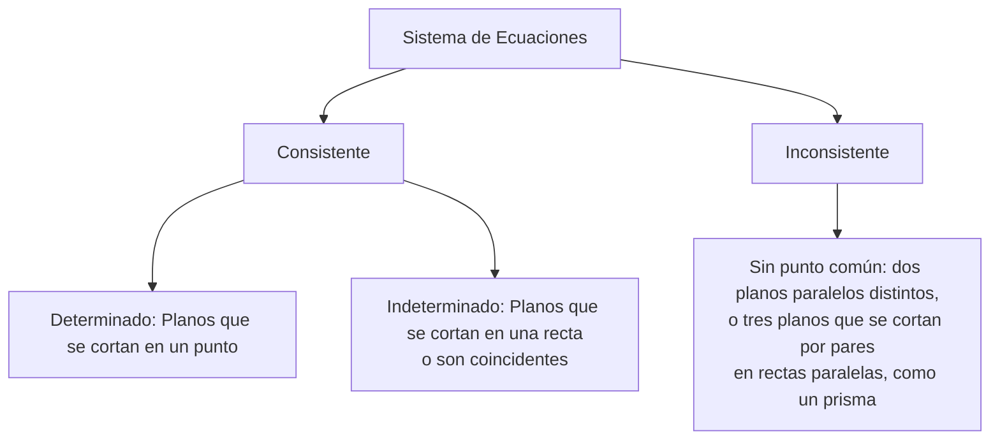
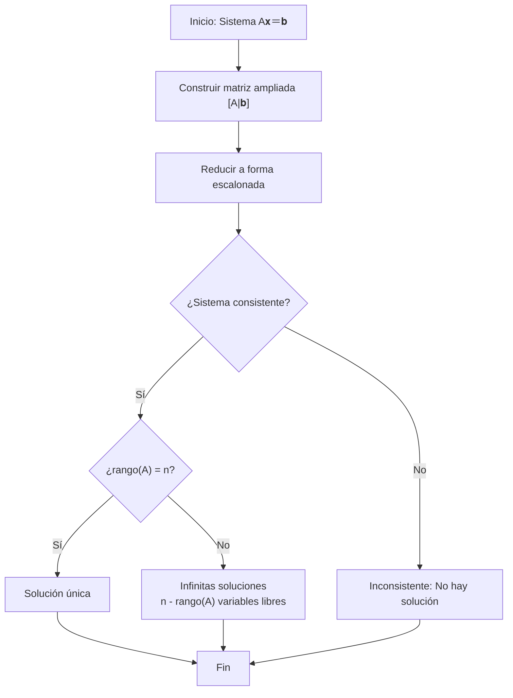

# Álgebra Lineal I - Matrices

## 2.3 Sistemas de ecuaciones lineales.

---

### 1. Definición y Representación Matricial

#### Sistema de Ecuaciones Lineales

Un sistema de $m$ ecuaciones lineales con $n$ incógnitas tiene la forma:

$$ \begin{cases} a_{11}x_1 + a_{12}x_2 + \cdots + a_{1n}x_n = b_1 \\ a_{21}x_1 + a_{22}x_2 + \cdots + a_{2n}x_n = b_2 \\ \vdots \\ a_{m1}x_1 + a_{m2}x_2 + \cdots + a_{mn}x_n = b_m \end{cases} $$

#### Representación Matricial

El sistema se puede expresar como $A\vec{x} = \vec{b},$ donde:

- $A = \begin{bmatrix} a_{11} & a_{12} & \cdots & a_{1n} \\ a_{21} & a_{22} & \cdots & a_{2n} \\ \vdots & \vdots & \ddots & \vdots \\ a_{m1} & a_{m2} & \cdots & a_{mn} \end{bmatrix}$ es la **matriz de coeficientes**
- $\vec{x} = \begin{bmatrix} x_1 \\ x_2 \\ \vdots \\ x_n \end{bmatrix}$ es el **vector de incógnitas**
- $\vec{b} = \begin{bmatrix} b_1 \\ b_2 \\ \vdots \\ b_m \end{bmatrix}$ es el **vector de términos independientes**

#### Matriz Ampliada

La matriz ampliada $[A|\vec{b}]$ contiene toda la información del sistema:

$$ [A|\vec{b}] = \left[\begin{array}{cccc|c} a_{11} & a_{12} & \cdots & a_{1n} & b_1 \\ a_{21} & a_{22} & \cdots & a_{2n} & b_2 \\ \vdots & \vdots & \ddots & \vdots & \vdots \\ a_{m1} & a_{m2} & \cdots & a_{mn} & b_m \end{array}\right] $$

### 2. Clasificación de Sistemas

#### Tipos de Soluciones

Un sistema de ecuaciones lineales puede ser:

- **Consistente:** Tiene al menos una solución
  - **Determinado:** Solución única
  - **Indeterminado:** Infinitas soluciones
- **Inconsistente:** No tiene solución

#### Interpretación Geométrica



### 3. Métodos de Resolución

#### Eliminación Gaussiana

Proceso para reducir la matriz ampliada a forma escalonada:

1. **Forma Escalonada:**
   - El primer elemento no nulo de cada fila (pivote) es 1
   - Cada pivote está a la derecha del pivote de la fila anterior
   - Las filas nulas están al final

2. **Forma Escalonada Reducida:**
   - Además de lo anterior, cada pivote es el único elemento no nulo en su columna

#### Ejemplo de Eliminación Gaussiana

Resolver el sistema:

$$ \begin{cases} 2x + y - z = 8 \\ -3x - y + 2z = -11 \\ -2x + y + 2z = -3 \end{cases} $$

**Matriz ampliada:**

$$ \left[\begin{array}{ccc|c} 2 & 1 & -1 & 8 \\ -3 & -1 & 2 & -11 \\ -2 & 1 & 2 & -3 \end{array}\right] $$

**Eliminación hacia adelante:**

1. $F_1 \leftarrow F_1/2$ da la fila $\left(1, \tfrac{1}{2}, -\tfrac{1}{2} \mid 4\right)$
2. $F_2 \leftarrow F_2 + 3F_1$ da $\left(0, \tfrac{1}{2}, \tfrac{1}{2} \mid 1\right)$
3. $F_3 \leftarrow F_3 + 2F_1$ da $(0, 2, 1 \mid 5)$
4. $F_2 \leftarrow 2F_2$ da $(0, 1, 1 \mid 2)$
5. $F_3 \leftarrow F_3 - 2F_2$ da $(0, 0, -1 \mid 1)$
6. $F_3 \leftarrow -F_3$ da $(0, 0, 1 \mid -1)$

**Forma escalonada:**

$$ \left[\begin{array}{ccc|c} 1 & \frac{1}{2} & -\frac{1}{2} & 4 \\ 0 & 1 & 1 & 2 \\ 0 & 0 & 1 & -1 \end{array}\right] $$

**Eliminación hacia atrás:**

7. $F_2 \leftarrow F_2 - F_3$ da $(0, 1, 0 \mid 3)$
8. $F_1 \leftarrow F_1 + \tfrac{1}{2}F_3 - \tfrac{1}{2}F_2$ da $(1, 0, 0 \mid 2)$

**Resultado final:**

$$ \left[\begin{array}{ccc|c} 1 & 0 & 0 & 2 \\ 0 & 1 & 0 & 3 \\ 0 & 0 & 1 & -1 \end{array}\right] $$

**Solución:** $x = 2,$ $y = 3,$ $z = -1.$ Comprobación: $2(2) + 3 - (-1) = 8,$ $-3(2) - 3 + 2(-1) = -11$ y $-2(2) + 3 + 2(-1) = -3.$

### 4. Teorema de Rouché-Frobenius

#### Rango de una Matriz

El **rango** de una matriz $A,$ denotado $\text{rango}(A),$ es el número de filas linealmente independientes, que coincide con el número de pivotes en la forma escalonada.

#### Teorema

Un sistema $A\vec{x} = \vec{b}$ es:

- **Consistente** si y solo si $rango(A) = rango([A|\vec{b}])$
- **Determinado** si es consistente y $rango(A) = n,$ el número de incógnitas
- **Indeterminado** si es consistente y $rango(A) < n;$ las soluciones dependen de $n - rango(A)$ parámetros libres

Si $rango(A) < rango([A|\vec{b}]),$ la forma escalonada tiene una fila $(0, \ldots, 0 \mid c)$ con $c \neq 0,$ que corresponde a la ecuación imposible $0 = c.$

#### Ejemplo de Aplicación

Para el sistema:

$$ \begin{cases} x + 2y = 3 \\ 2x + 4y = 6 \end{cases} $$

$A = \begin{bmatrix} 1 & 2 \\ 2 & 4 \end{bmatrix},$ $rango(A) = 1$  
$[A|\vec{b}] = \left[\begin{array}{cc|c} 1 & 2 & 3 \\ 2 & 4 & 6 \end{array}\right],$ $rango([A|\vec{b}]) = 1$

Como $rango(A) = rango([A|\vec{b}]) = 1 < 2,$ el sistema es **consistente indeterminado**: la segunda ecuación es el doble de la primera, y las soluciones son $(x, y) = (3 - 2t, t)$ con $t \in \mathbb{R}.$ Si el término independiente de la segunda ecuación fuera $7$ en lugar de $6,$ se tendría $rango([A|\vec{b}]) = 2 > 1$ y el sistema sería inconsistente: dos rectas paralelas distintas.

### 5. Sistemas Homogéneos

#### Definición

Un sistema $A\vec{x} = \vec{0}$ (donde $\vec{0}$ es el vector nulo) se llama **sistema homogéneo**.

#### Propiedades

- Siempre es **consistente** (la solución trivial $\vec{x} = \vec{0}$ siempre existe)
- Tiene solución no trivial si y solo si $rango(A) < n$
- El conjunto solución forma un **subespacio vectorial**

#### Dimensión del Espacio Solución

Si $A$ es una matriz $m \times n$ con $rango(A) = r,$ entonces la dimensión del espacio solución es $n - r.$

#### Estructura de las Soluciones de un Sistema No Homogéneo

Si $\vec{x}_p$ es una solución particular de $A\vec{x} = \vec{b},$ entonces todas las soluciones son

$$\vec{x} = \vec{x}_p + \vec{x}_h,$$

donde $\vec{x}_h$ recorre las soluciones del sistema homogéneo $A\vec{x} = \vec{0}.$ En efecto, la diferencia de dos soluciones de $A\vec{x} = \vec{b}$ cumple $A(\vec{x}_1 - \vec{x}_2) = \vec{b} - \vec{b} = \vec{0}.$ Geométricamente, el conjunto solución es el subespacio de soluciones homogéneas trasladado por $\vec{x}_p.$

### 6. Método de la Matriz Inversa

#### Condición de Aplicabilidad

Si $A$ es una matriz cuadrada $n \times n$ invertible, entonces el sistema $A\vec{x} = \vec{b}$ tiene solución única dada por:

$$\vec{x} = A^{-1}\vec{b}$$

#### Ejemplo

Resolver usando matriz inversa:

$$ \begin{cases} 2x + y = 5 \\ x - y = 1 \end{cases} $$

$A = \begin{bmatrix} 2 & 1 \\ 1 & -1 \end{bmatrix},$ $A^{-1} = \frac{1}{-3} \begin{bmatrix} -1 & -1 \\ -1 & 2 \end{bmatrix} = \begin{bmatrix} \frac{1}{3} & \frac{1}{3} \\ \frac{1}{3} & -\frac{2}{3} \end{bmatrix} $

$ \vec{x} = A^{-1}\vec{b} = \begin{bmatrix} \frac{1}{3} & \frac{1}{3} \\ \frac{1}{3} & -\frac{2}{3} \end{bmatrix} \begin{bmatrix} 5 \\ 1 \end{bmatrix} = \begin{bmatrix} 2 \\ 1 \end{bmatrix} $

**Solución:** $x = 2,$ $y = 1$

### 7. Algoritmo de Resolución General



### 8. Ejercicios Propuestos

1. Clasifique y resuelva el sistema:

   $$ \begin{cases} x + 2y - z = 1 \\ 2x + y + z = 2 \\ 3x + 3y = 3 \end{cases} $$

2. Determine para qué valores de $k$ el sistema es consistente:

   $$ \begin{cases} x + y + z = 1 \\ x + 2y + 4z = k \\ x + 4y + 10z = k^2 \end{cases} $$

3. Encuentre la solución general del sistema homogéneo:

   $$ \begin{cases} x - 2y + 3z = 0 \\ 2x - 4y + 6z = 0 \\ 3x - 6y + 9z = 0 \end{cases} $$

### 9. Soluciones de los Ejercicios

1. La tercera ecuación es la suma de las dos primeras, así que el rango es 2 con 3 incógnitas: el sistema es **consistente indeterminado**. Restando el doble de la primera ecuación a la segunda queda $-3y + 3z = 0,$ es decir, $y = z,$ y de la primera $x = 1 - 2y + z = 1 - z.$ Las soluciones son $(x, y, z) = (1 - t, t, t)$ con $t \in \mathbb{R}.$
2. Restando la primera ecuación a las otras dos y luego tres veces la nueva segunda a la nueva tercera, la forma escalonada es

   $$\left[\begin{array}{ccc|c} 1 & 1 & 1 & 1 \\ 0 & 1 & 3 & k - 1 \\ 0 & 0 & 0 & k^2 - 3k + 2 \end{array}\right].$$

   El sistema es consistente si y solo si $k^2 - 3k + 2 = (k - 1)(k - 2) = 0,$ es decir, $k = 1$ o $k = 2.$ En ambos casos tiene infinitas soluciones, porque el rango es 2.
3. Las tres ecuaciones son múltiplos de $x - 2y + 3z = 0,$ así que el rango es 1 y el espacio solución tiene dimensión $3 - 1 = 2:$ $(x, y, z) = s(2, 1, 0) + t(-3, 0, 1)$ con $s, t \in \mathbb{R}.$

```python
import sympy as sp

x, y, z, k = sp.symbols('x y z k')
print(sp.linsolve([x + 2*y - z - 1, 2*x + y + z - 2, 3*x + 3*y - 3], x, y, z))   # {(1 - z, z, z)}

M = sp.Matrix([[1, 1, 1, 1], [1, 2, 4, k], [1, 4, 10, k**2]])
print(M.echelon_form())                                     # última fila: (0, 0, 0, k² - 3k + 2)
print(sp.linsolve([x - 2*y + 3*z], x, y, z))                # {(2y - 3z, y, z)}
```
