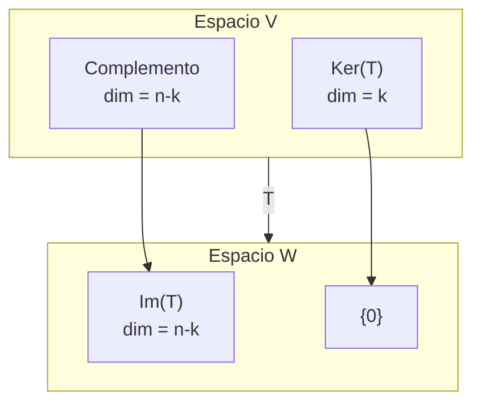
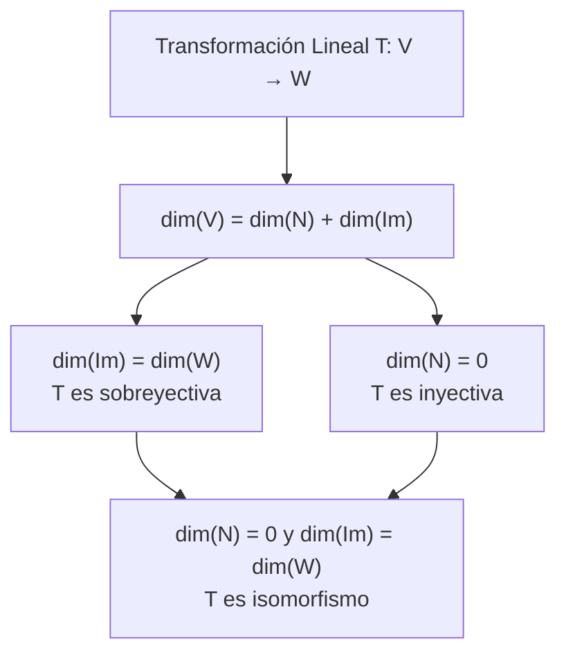

# Álgebra Lineal I - Transformaciones lineales

## 3.1 El espacio de las transformaciones lineales.

---

### 1. Definición de Transformación Lineal

#### Definición Formal

Una función $T: V \rightarrow W$ entre dos espacios vectoriales sobre un campo $\mathbb{K}$ es una **transformación lineal** si satisface:

1. **Preservación de la suma:** $T(\vec{u} + \vec{v}) = T(\vec{u}) + T(\vec{v})$ para todo $\vec{u}, \vec{v} \in V$
2. **Preservación del producto por escalar:** $T(\alpha\vec{v}) = \alpha T(\vec{v})$ para todo $\alpha \in \mathbb{K}$ y $\vec{v} \in V$

#### Propiedades Básicas

- $T(\vec{0}_V) = \vec{0}_W$ (Preserva el vector cero)
- $T(-\vec{v}) = -T(\vec{v})$ (Preserva el inverso aditivo)
- $T(\alpha_1\vec{v}_1 + \alpha_2\vec{v}_2 + \cdots + \alpha_n\vec{v}_n) = \alpha_1T(\vec{v}_1) + \alpha_2T(\vec{v}_2) + \cdots + \alpha_nT(\vec{v}_n)$

### 2. El Espacio Vectorial $\mathcal{L}(V, W)$

#### Definición

El conjunto de todas las transformaciones lineales de $V$ en $W$ se denota por $\mathcal{L}(V, W)$ y forma un **espacio vectorial** sobre el mismo campo $\mathbb{K}.$

#### Operaciones en $\mathcal{L}(V, W)$

Para $T, S \in \mathcal{L}(V, W)$ y $\alpha \in \mathbb{K}:$

1. **Suma:** $(T + S)(\vec{v}) = T(\vec{v}) + S(\vec{v})$
2. **Producto por escalar:** $(\alpha T)(\vec{v}) = \alpha T(\vec{v})$

#### Elementos del Espacio

- **Transformación nula:** $O(\vec{v}) = \vec{0}_W$ para todo $\vec{v} \in V$
- **Inverso aditivo:** $(-T)(\vec{v}) = -T(\vec{v})$

#### Teorema de Dimensión

Si $\dim(V) = n$ y $\dim(W) = m,$ entonces:

$$\dim(\mathcal{L}(V, W)) = n \times m$$

### 3. Núcleo e Imagen de una Transformación Lineal

#### Núcleo (Kernel)

El **núcleo** de $T$ es el conjunto de vectores que se mapean al vector cero:

$$\ker(T) = \{\vec{v} \in V : T(\vec{v}) = \vec{0}_W\}$$

#### Imagen (Range)

La **imagen** de $T$ es el conjunto de todos los vectores en $W$ que son imagen de algún vector en $V:$

$$\operatorname{Im}(T) = \{T(\vec{v}) \in W : \vec{v} \in V\}$$

#### Teorema de la Dimensión (Nullity-Rank Theorem)

Para $T: V \rightarrow W$ lineal, con $V$ de dimensión finita,

$$\dim(\ker(T)) + \dim(\operatorname{Im}(T)) = \dim(V)$$

#### Diagrama de una Transformación Lineal

### 4. Dimensión de $\mathcal{L}(V, W)$

#### Teorema Fundamental

Si $V$ y $W$ son espacios vectoriales de dimensión finita con $\dim(V) = n$ y $\dim(W) = m,$ entonces:

$$ \dim(\mathcal{L}(V,W)) = m \cdot n $$

#### Base para $\mathcal{L}(V, W)$

Sean $\{\vec{v}_1, \vec{v}_2, \ldots, \vec{v}_n\}$ una base de $V$ y $\{\vec{w}_1, \vec{w}_2, \ldots, \vec{w}_m\}$ una base de $W.$ Una transformación lineal queda **determinada por sus valores en una base**: para cualesquiera $\vec{u}_1, \ldots, \vec{u}_n \in W$ existe una única $T$ lineal con $T(\vec{v}_i) = \vec{u}_i,$ dada por $T\left(\sum c_i \vec{v}_i\right) = \sum c_i \vec{u}_i.$

Para cada $i = 1, \ldots, n$ y $j = 1, \ldots, m$ definimos la transformación lineal $T_{ji}$ por sus valores en la base

$$ T_{ji}(\vec{v}_k) = \begin{cases} \vec{w}_j & \text{si } k = i \\ \vec{0} & \text{si } k \neq i \end{cases} $$

El conjunto $\{T_{ji} : 1 \leq j \leq m, 1 \leq i \leq n\}$ forma una base para $\mathcal{L}(V, W),$ con $mn$ elementos. Si $T(\vec{v}_i) = \sum_j a_{ji} \vec{w}_j,$ entonces $T = \sum_{j,i} a_{ji} T_{ji};$ los coeficientes son justo las entradas de la matriz de $T.$

### 5. Representación Matricial de Transformaciones Lineales

#### Matriz Asociada a una Transformación

Sea $T: V \to W$ una transformación lineal, $\mathcal{B}_V = \{\vec{v}_1, \ldots, \vec{v}_n\}$ base de $V,$ y $\mathcal{B}_W = \{\vec{w}_1, \ldots, \vec{w}_m\}$ base de $W.$

La matriz de $T$ respecto a estas bases es la matriz $[T]_{\mathcal{B}_V}^{\mathcal{B}_W}$ de tamaño $m \times n$ cuya columna j-ésima son las coordenadas de $T(\vec{v}_j)$ en la base $\mathcal{B}_W.$

#### Isomorfismo entre $\mathcal{L}(V, W)$ y $M_{m \times n}(\mathbb{F})$

La función $\Phi: \mathcal{L}(V, W) \to M_{m \times n}(\mathbb{F})$ definida por:

$$ \Phi(T) = [T]_{\mathcal{B}_V}^{\mathcal{B}_W} $$

es un isomorfismo de espacios vectoriales.

### 6. Composición de Transformaciones Lineales

#### Definición

Si $T: U \to V$ y $S: V \to W$ son transformaciones lineales, entonces la composición $S \circ T: U \to W$ definida por:

$$ (S \circ T)(\vec{u}) = S(T(\vec{u})) $$

es también una transformación lineal.

#### Relación con la Multiplicación de Matrices

Si $[T]_{\mathcal{B}_U}^{\mathcal{B}_V}$ es la matriz de $T$ y $[S]_{\mathcal{B}_V}^{\mathcal{B}_W}$ es la matriz de $S,$ entonces

$$ [S \circ T]_{\mathcal{B}_U}^{\mathcal{B}_W} = [S]_{\mathcal{B}_V}^{\mathcal{B}_W} \cdot [T]_{\mathcal{B}_U}^{\mathcal{B}_V} $$

### 7. El Espacio Dual $V^*$

#### Definición

El espacio dual de $V$ es el espacio de todas las transformaciones lineales de $V$ al campo $\mathbb{F}:$

$$ V^* = \mathcal{L}(V, \mathbb{F}) $$

Los elementos de $V^*$ se llaman funcionales lineales o formas lineales.

#### Base Dual

Si $\mathcal{B} = \{\vec{v}_1, \ldots, \vec{v}_n\}$ es una base de $V,$ la base dual $\mathcal{B}^* = \{\varphi_1, \ldots, \varphi_n\}$ de $V^*$ se define por

$$ \varphi_i(\vec{v}_j) = \delta_{ij} = \begin{cases} 1 & \text{si } i = j \\ 0 & \text{si } i \neq j \end{cases} $$

#### Dimensión del Espacio Dual

Si $\dim(V) = n,$ entonces $\dim(V^*) = n.$

### 8. Ejemplos de Transformaciones Lineales

#### Ejemplo 1: Transformación de Proyección

$T: \mathbb{R}^3 \to \mathbb{R}^2$ definida por $T(x, y, z) = (x, y)$ es lineal.

Verificación:

$T((x_1,y_1,z_1) + (x_2,y_2,z_2)) = T(x_1+x_2, y_1+y_2, z_1+z_2) = (x_1+x_2, y_1+y_2) = T(x_1,y_1,z_1) + T(x_2,y_2,z_2)$

$T(c(x,y,z)) = T(cx, cy, cz) = (cx, cy) = c(x, y) = cT(x,y,z)$

#### Ejemplo 2: Transformación de Rotación

$R_\theta: \mathbb{R}^2 \to \mathbb{R}^2$ que rota vectores un ángulo $\theta$ es lineal.

Matriz asociada (base canónica):

$$ [R_\theta] = \begin{bmatrix} \cos\theta & -\sin\theta \\ \sin\theta & \cos\theta \end{bmatrix} $$

#### Ejemplo 3: Transformación de Derivación

$D: \mathcal{P}_n(\mathbb{R}) \to \mathcal{P}_{n-1}(\mathbb{R}),$ con $n \geq 1,$ definida por $D(p(x)) = p'(x)$ es lineal, porque $(p + q)' = p' + q'$ y $(cp)' = cp'.$ Su núcleo son los polinomios constantes y es sobreyectiva, de acuerdo con el teorema de la dimensión: $(n + 1) = 1 + n.$

#### Ejemplo 4: Una Función que No Es Lineal

$T(x, y) = (x + 1, y)$ no es lineal, porque $T(0, 0) = (1, 0) \neq (0, 0).$ Tampoco $S(x, y) = (x^2, y):$ $S(2 \cdot (1, 0)) = (4, 0)$ pero $2 \, S(1, 0) = (2, 0).$

### 9. Teoremas Importantes

#### Teorema del Núcleo y la Imagen

Para toda transformación lineal $T: V \to W$ con $V$ de dimensión finita,

$$ \dim(V) = \dim(N(T)) + \dim(\operatorname{Im}(T)) $$

donde:

- $N(T) = \{\vec{v} \in V : T(\vec{v}) = \vec{0}\}$ es el núcleo de $T$
- $\operatorname{Im}(T) = \{T(\vec{v}) \in W : \vec{v} \in V\}$ es la imagen de $T$

#### Teorema de Isomorfismo

Si $T: V \to W$ es lineal e inyectiva, entonces $V$ es isomorfo a $\operatorname{Im}(T).$

### 10. Diagrama de Clasificación de Transformaciones

### 11. Ejercicios Propuestos

1. Demuestre que el conjunto $\mathcal{L}(V, W)$ con las operaciones definidas forma un espacio vectorial.
2. Sea $T: \mathbb{R}^2 \to \mathbb{R}^2$ definida por $T(x, y) = (2x + y, x - 3y).$ Encuentre:
   a) La matriz de $T$ respecto a la base canónica
   b) El núcleo y la imagen de $T$
   c) Verifique el teorema de la dimensión
3. Demuestre que si $\dim(V) = n$ y $\dim(W) = m,$ entonces $\dim(\mathcal{L}(V, W)) = m \cdot n.$
4. Sea $V = \mathcal{P}_2(\mathbb{R})$ el espacio de polinomios de grado ≤ 2. Encuentre la base dual a la base $\{1, x, x^2\}.$
5. Demuestre que la composición de transformaciones lineales es asociativa pero no conmutativa en general.

### 12. Soluciones de Ejercicios Seleccionados

**Ejercicio 2.** La matriz es $\begin{bmatrix} 2 & 1 \\ 1 & -3 \end{bmatrix},$ con determinante $-6 - 1 = -7 \neq 0.$ Por eso $\ker(T) = \{\vec{0}\}$ e $\operatorname{Im}(T) = \mathbb{R}^2,$ y $0 + 2 = 2 = \dim(\mathbb{R}^2).$

**Ejercicio 4.** Para $p(x) = a + bx + cx^2,$ la base dual es $\varphi_1(p) = a,$ $\varphi_2(p) = b,$ $\varphi_3(p) = c.$ En términos de $p,$ $\varphi_1(p) = p(0),$ $\varphi_2(p) = p'(0)$ y $\varphi_3(p) = \frac{p''(0)}{2}.$

**Ejercicio 5.** En $\mathbb{R}^2,$ sean $T$ la rotación de $90°$ y $S$ la reflexión $S(x, y) = (x, -y).$ Entonces $(S \circ T)(1, 0) = S(0, 1) = (0, -1),$ mientras que $(T \circ S)(1, 0) = T(1, 0) = (0, 1).$
