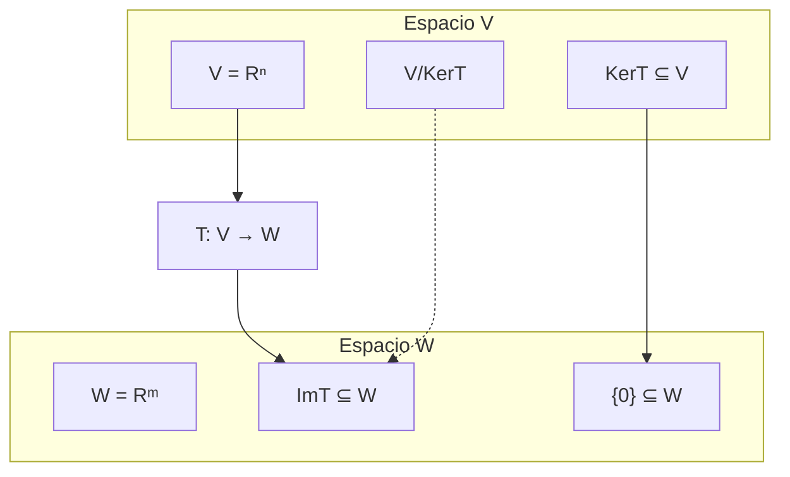

# Álgebra Lineal I - Transformaciones lineales

## 3.2 Núcleo e imagen de una transformación lineal.

---

### 1. Definiciones Fundamentales

#### 1.1. Transformación Lineal

Una función $T: V \rightarrow W$ entre espacios vectoriales es una **transformación lineal** si preserva las operaciones de espacio vectorial:

1. $T(u + v) = T(u) + T(v)$ para todo $u, v \in V$
2. $T(\alpha v) = \alpha T(v)$ para todo $\alpha \in \mathbb{R}$ y $v \in V$

#### 1.2. Núcleo (Kernel)

El **núcleo** de una transformación lineal $T: V \rightarrow W$ es el conjunto de vectores en $V$ que se mapean al vector cero en $W$:

$$ \text{Núcleo}(T) = \ker(T) = \{v \in V \mid T(v) = 0_W\} $$

#### 1.3. Imagen (Rango)

La **imagen** de una transformación lineal $T: V \rightarrow W$ es el conjunto de todos los vectores en $W$ que son imagen de algún vector en $V$:

$$ \text{Imagen}(T) = \text{Im}(T) = \{w \in W \mid \exists v \in V, T(v) = w\} $$

### 2. Teorema de la Dimensión (Teorema del Rango-Nulidad)

Para toda transformación lineal $T: V \rightarrow W$ con $V$ de dimensión finita:

$$ \dim(V) = \dim(\ker(T)) + \dim(\text{Im}(T)) $$

### 3. Implementación Computacional

```python
import numpy as np

def kernel_y_imagen(A):
    """
    Calcula el núcleo y la imagen de la transformación lineal T(x) = A*x
    donde A es una matriz que representa la transformación
    """
    # Calcular el núcleo (solución de Ax = 0)
    # Usar descomposición SVD para encontrar vectores del núcleo
    U, s, Vh = np.linalg.svd(A)
    tol = 1e-10
    rank = np.sum(s > tol)

    # Los vectores del kernel son las filas de Vh[rank:]
    kernel_basis = Vh[rank:].T if rank < Vh.shape[0] else np.array([])

    # La imagen está generada por las primeras 'rank' columnas de U
    imagen_basis = U[:, :rank] if rank > 0 else np.array([])

    return kernel_basis, imagen_basis, rank

# Ejemplo: Transformación lineal en R^3 -> R^2
A = np.array([[1, 2, 3],
              [4, 5, 6]])  # Matriz de la transformación

kernel, imagen, rango = kernel_y_imagen(A)

print("Matriz de transformación A:")
print(A)
print(f"\nDimensión del núcleo: {kernel.shape[1] if kernel.size > 0 else 0}")
print(f"Dimensión de la imagen: {rango}")
print(f"Teorema de la dimensión: {A.shape[1]} = {kernel.shape[1] if kernel.size > 0 else 0} + {rango}")

if kernel.size > 0:
    print("\nBase del núcleo:")
    print(kernel)

if imagen.size > 0:
    print("\nBase de la imagen:")
    print(imagen)
```

### 4. Visualización de Núcleo e Imagen



### 5. Propiedades del Núcleo y la Imagen

#### 5.1. Propiedades del Núcleo

1. $\ker(T)$ es un subespacio vectorial de $V$
2. $T$ es inyectiva si y solo si $\ker(T) = \{0\}$
3. $\dim(\ker(T))$ se llama **nulidad** de $T$

#### 5.2. Propiedades de la Imagen

1. $\text{Im}(T)$ es un subespacio vectorial de $W$
2. $T$ es sobreyectiva si y solo si $\text{Im}(T) = W$
3. $\dim(\text{Im}(T))$ se llama **rango** de $T$

### 6. Ejemplos de Cálculo Manual

#### 6.1. Ejemplo 1: Proyección en R³

Sea $T: \mathbb{R}^3 \rightarrow \mathbb{R}^2$ definida por $T(x, y, z) = (x, y)$

- $\ker(T) = \{(0, 0, z) \mid z \in \mathbb{R}\}$ (eje z)
- $\text{Im}(T) = \mathbb{R}^2$ (todo el plano xy)
- $\dim(\mathbb{R}^3) = 3 = 1 + 2$

#### 6.2. Ejemplo 2: Rotación en R²

Sea $T: \mathbb{R}^2 \rightarrow \mathbb{R}^2$ rotación de 90º

- $\ker(T) = \{(0, 0)\}$ (solo el vector cero)
- $\text{Im}(T) = \mathbb{R}^2$ (todo el espacio)
- $\dim(\mathbb{R}^2) = 2 = 0 + 2$

### 7. Aplicación: Verificar Inyectividad y Sobreyectividad

```python
def propiedades_transformacion(A):
    """
    Determina si una transformación lineal es inyectiva y/o sobreyectiva
    """
    m, n = A.shape
    kernel_basis, imagen_basis, rango = kernel_y_imagen(A)

    inyectiva = kernel_basis.size == 0 or kernel_basis.shape[1] == 0
    sobreyectiva = rango == m

    print(f"Transformación T: R^{n} → R^{m}")
    print(f"Inyectiva (uno a uno): {inyectiva}")
    print(f"Sobreyectiva (sobre): {sobreyectiva}")

    if inyectiva and sobreyectiva:
        print("T es un isomorfismo (biyectiva)")
    elif inyectiva:
        print("T es inyectiva pero no sobreyectiva")
    elif sobreyectiva:
        print("T es sobreyectiva pero no inyectiva")
    else:
        print("T no es inyectiva ni sobreyectiva")

    return inyectiva, sobreyectiva

# Verificar propiedades para diferentes transformaciones
A1 = np.array([[1, 0], [0, 1], [0, 0]])  # Inyectiva pero no sobreyectiva
A2 = np.array([[1, 2, 3], [4, 5, 6]])     # No inyectiva ni sobreyectiva
A3 = np.array([[1, 0], [0, 1]])           # Biyectiva

print("=== Transformación 1 ===")
propiedades_transformacion(A1)

print("\n=== Transformación 2 ===")
propiedades_transformacion(A2)

print("\n=== Transformación 3 ===")
propiedades_transformacion(A3)
```

### 8. Ejercicios de Práctica

1. Para $T: \mathbb{R}^3 \rightarrow \mathbb{R}^3$ definida por $T(x, y, z) = (x + y, y + z, z + x)$:
   a) Encuentra $\ker(T)$ y $\text{Im}(T)$
   b) Verifica el teorema de la dimensión
   c) Determina si T es inyectiva y/o sobreyectiva

2. Sea $T: P_2(\mathbb{R}) \rightarrow \mathbb{R}^2$ definida por $T(ax^2 + bx + c) = (a + b, c)$
   a) Demuestra que T es lineal
   b) Encuentra el núcleo y la imagen
   c) Calcula las dimensiones

### 9. Solución de los Ejercicios

```python
# Solución ejercicio 1
def ejercicio_1():
    # Matriz de la transformación T(x,y,z) = (x+y, y+z, z+x)
    A = np.array([[1, 1, 0],
                  [0, 1, 1],
                  [1, 0, 1]])

    kernel, imagen, rango = kernel_y_imagen(A)

    print("Solución ejercicio 1:")
    print(f"Matriz de transformación:\n{A}")
    print(f"Dimensión del núcleo: {kernel.shape[1] if kernel.size > 0 else 0}")
    print(f"Dimensión de la imagen: {rango}")
    print(f"Teorema de la dimensión: 3 = {kernel.shape[1] if kernel.size > 0 else 0} + {rango}")

    inyectiva = kernel.size == 0 or kernel.shape[1] == 0
    sobreyectiva = rango == 3
    print(f"Inyectiva: {inyectiva}")
    print(f"Sobreyectiva: {sobreyectiva}")

ejercicio_1()
```

### 10. Aplicaciones en Ciencias e Ingeniería

1. **Procesamiento de imágenes**: Transformaciones lineales para rotación, escalado
2. **Ingeniería de control**: Análisis de sistemas lineales
3. **Graphics computing**: Transformaciones 3D a 2D
4. **Machine learning**: Reducción de dimensionalidad (PCA)

### 11. Referencias

1. Axler, S. (2015). Linear Algebra Done Right.
2. Strang, G. (2016). Introduction to Linear Algebra.
3. Poole, D. (2014). Linear Algebra: A Modern Introduction.
4. Lay, D. C., Lay, S. R., & McDonald, J. J. (2016). Linear Algebra and Its Applications.
