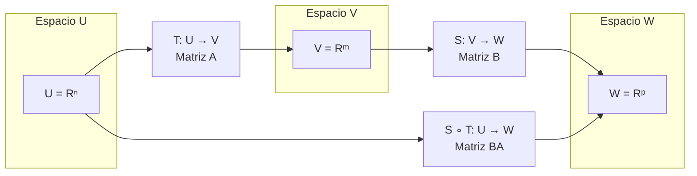

# Álgebra Lineal I - Transformaciones lineales

## 3.3 Composición de transformaciones lineales.

---

### 1. Definición de Composición

Dadas dos transformaciones lineales $T: U \rightarrow V$ y $S: V \rightarrow W$, la **composición** de $S$ y $T$ es la transformación $(S \circ T): U \rightarrow W$ definida por:

$$ (S \circ T)(u) = S(T(u)) \quad \text{para todo } u \in U $$

#### 1.1. Propiedades Fundamentales

1. **Linealidad**: Si $T$ y $S$ son lineales, entonces $S \circ T$ es lineal
2. **Asociatividad**: $(R \circ S) \circ T = R \circ (S \circ T)$
3. **Elemento identidad**: $T \circ I = I \circ T = T$ donde $I$ es la transformación identidad

### 2. Representación Matricial

Si $T: \mathbb{R}^n \rightarrow \mathbb{R}^m$ tiene matriz $A$ y $S: \mathbb{R}^m \rightarrow \mathbb{R}^p$ tiene matriz $B$, entonces la matriz de $S \circ T$ es el producto matricial $BA$:

$$ [S \circ T] = [S][T] = BA $$

### 3. Implementación Computacional

```python
import numpy as np

def composicion_transformaciones(A, B):
    """
    Calcula la matriz de la composición S ∘ T
    donde A es la matriz de T: R^n → R^m
    y B es la matriz de S: R^m → R^p
    """
    # Verificar que las dimensiones son compatibles
    if A.shape[0] != B.shape[1]:
        raise ValueError("Dimensiones incompatibles para composición")

    # La matriz de S ∘ T es el producto B × A
    matriz_composicion = np.dot(B, A)

    return matriz_composicion

def aplicar_transformacion(matriz, vector):
    """Aplica una transformación lineal representada por una matriz a un vector"""
    return np.dot(matriz, vector)

# Ejemplo: Composición de rotación y proyección
# T: Rotación 90° en R² (matriz 2x2)
theta = np.pi/2  # 90 grados en radianes
A_rotacion = np.array([[np.cos(theta), -np.sin(theta)],
                       [np.sin(theta), np.cos(theta)]])

# S: Proyección sobre el eje x en R² (matriz 2x2)
A_proyeccion = np.array([[1, 0],
                         [0, 0]])

# Matriz de la composición S ∘ T
A_composicion = composicion_transformaciones(A_rotacion, A_proyeccion)

print("Matriz de rotación T (90°):")
print(A_rotacion)
print("\nMatriz de proyección S (eje x):")
print(A_proyeccion)
print("\nMatriz de composición S ∘ T:")
print(A_composicion)

# Aplicar a un vector de prueba
v = np.array([1, 2])
print(f"\nVector original: {v}")
print(f"T(v) = {aplicar_transformacion(A_rotacion, v)}")
print(f"S(T(v)) = {aplicar_transformacion(A_composicion, v)}")
print(f"S ∘ T(v) = {aplicar_transformacion(A_composicion, v)}")
```

### 4. Visualización de la Composición



### 5. Propiedades Algebraicas

#### 5.1. Inversa de una Composición

Si $T$ y $S$ son invertibles, entonces:

$$ (S \circ T)^{-1} = T^{-1} \circ S^{-1} $$

#### 5.2. Distributividad con la Suma

$$ R \circ (S + T) = R \circ S + R \circ T $$

$$ (S + T) \circ R = S \circ R + T \circ R $$

### 6. Ejemplos de Composición

#### 6.1. Ejemplo 1: Rotación y Escalamiento

Sea $T$ rotación de 45° y $S$ escalamiento por 2:

$$ A_T = \begin{bmatrix} \cos45^\circ & -\sin45^\circ \\\ \sin45^\circ & \cos45^\circ \end{bmatrix} = \frac{\sqrt{2}}{2} \begin{bmatrix} 1 & -1 \\\ 1 & 1 \end{bmatrix} $$

$$ A_S = \begin{bmatrix} 2 & 0 \\\ 0 & 2 \end{bmatrix} $$

$$ A_{S \circ T} = A_S A_T = \sqrt{2} \begin{bmatrix} 1 & -1 \\\ 1 & 1 \end{bmatrix} $$

#### 6.2. Ejemplo 2: Proyección y Reflexión

```python
# Ejemplo computacional de composición
def ejemplo_composicion():
    # Reflexión sobre el eje y
    A_reflexion = np.array([[-1, 0],
                            [0, 1]])

    # Proyección sobre el eje x
    A_proyeccion = np.array([[1, 0],
                             [0, 0]])

    # Composición: proyección ∘ reflexión
    A_comp = composicion_transformaciones(A_reflexion, A_proyeccion)

    print("Matriz de reflexión (eje y):")
    print(A_reflexion)
    print("\nMatriz de proyección (eje x):")
    print(A_proyeccion)
    print("\nMatriz de composición (proyección ∘ reflexión):")
    print(A_comp)

    # Aplicar a un vector
    v = np.array([3, 4])
    resultado = aplicar_transformacion(A_comp, v)
    print(f"\nVector original: {v}")
    print(f"Resultado de la composición: {resultado}")

ejemplo_composicion()
```

### 7. Teorema de la Dimensión para Composición

Para $T: U \rightarrow V$ y $S: V \rightarrow W$ lineales:

$$ \dim(\ker(S \circ T)) \leq \dim(\ker(T)) + \dim(\ker(S)) $$

$$ \dim(\text{Im}(S \circ T)) \leq \min(\dim(\text{Im}(T)), \dim(\text{Im}(S))) $$

### 8. Aplicación: Transformaciones Geométricas Secuenciales

```python
def transformaciones_geometricas():
    """
    Ejemplo de composición de múltiples transformaciones geométricas
    """
    # Escalamiento por 2
    A_escala = np.array([[2, 0],
                         [0, 2]])

    # Rotación 30°
    theta = np.pi/6
    A_rota = np.array([[np.cos(theta), -np.sin(theta)],
                       [np.sin(theta), np.cos(theta)]])

    # Traslación (simulada con transformación afín)
    # Para transformaciones lineales puras, no hay traslación

    # Composición: rotación ∘ escalamiento
    A_compuesta = composicion_transformaciones(A_escala, A_rota)

    # Puntos de un cuadrado unitario
    puntos = np.array([[0, 0], [1, 0], [1, 1], [0, 1], [0, 0]]).T

    # Aplicar transformación compuesta
    puntos_transformados = np.dot(A_compuesta, puntos)

    return puntos, puntos_transformados, A_compuesta

# Visualizar resultados
puntos_orig, puntos_transf, A_comp = transformaciones_geometricas()
print("Matriz de transformación compuesta:")
print(A_comp)
print("\nPuntos originales (transpuestos):")
print(puntos_orig.T)
print("\nPuntos transformados (transpuestos):")
print(puntos_transf.T)
```

### 9. Ejercicios de Práctica

1. Sean $T: \mathbb{R}^2 \rightarrow \mathbb{R}^3$ y $S: \mathbb{R}^3 \rightarrow \mathbb{R}^2$ con:

   $$ T(x,y) = (x+y, x-y, 2x) $$

   $$ S(a,b,c) = (a+b, c) $$

   a) Encuentra las matrices de $T$ y $S$
   b) Calcula la matriz de $S \circ T$
   c) Verifica si $T \circ S$ está definida

2. Demuestra que la composición de transformaciones lineales es asociativa:

   $$ (R \circ S) \circ T = R \circ (S \circ T) $$

### 10. Solución de los Ejercicios

```python
def solucion_ejercicio_1():
    # Matriz de T: R² → R³
    A_T = np.array([[1, 1],   # x+y
                    [1, -1],  # x-y
                    [2, 0]])  # 2x

    # Matriz de S: R³ → R²
    A_S = np.array([[1, 1, 0],  # a+b
                    [0, 0, 1]]) # c

    # Matriz de S ∘ T: R² → R²
    A_S_circ_T = composicion_transformaciones(A_T, A_S)

    print("Solución ejercicio 1:")
    print("Matriz de T (3x2):")
    print(A_T)
    print("\nMatriz de S (2x3):")
    print(A_S)
    print("\nMatriz de S ∘ T (2x2):")
    print(A_S_circ_T)

    # T ∘ S no está definida porque las dimensiones no coinciden
    try:
        composicion_transformaciones(A_S, A_T)
        print("\nT ∘ S está definida")
    except ValueError:
        print("\nT ∘ S no está definida (dimensiones incompatibles)")

solucion_ejercicio_1()
```

### 11. Aplicaciones en Ciencias e Ingeniería

1. **Computer Graphics**: Composición de transformaciones 3D (rotación, escalamiento, traslación)
2. **Vision por computadora**: Transformaciones de perspectiva y corrección de imagen
3. **Robótica**: Cinemática de manipuladores seriales (transformaciones coordenadas)
4. **Procesamiento de señales**: Cascada de filtros lineales

### 12. Referencias

1. Axler, S. (2015). Linear Algebra Done Right.
2. Strang, G. (2016). Introduction to Linear Algebra.
3. Poole, D. (2014). Linear Algebra: A Modern Introduction.
4. Anton, H., & Rorres, C. (2010). Elementary Linear Algebra.
