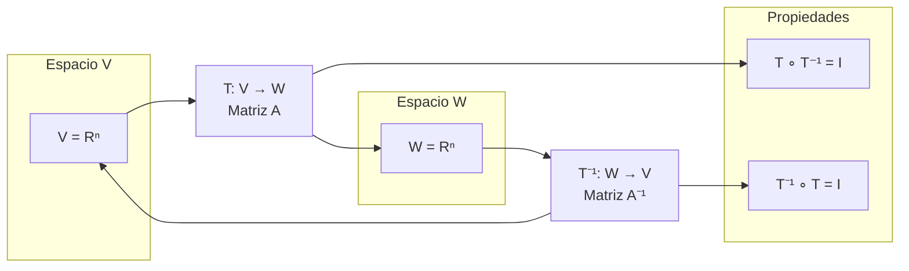

# Álgebra Lineal I - Transformaciones lineales

## 3.4 La transformación inversa.

---

### 1. Definición de Transformación Inversa

Una transformación lineal $T: V \rightarrow W$ es **invertible** si existe una transformación lineal $T^{-1}: W \rightarrow V$ tal que:

$$ T^{-1} \circ T = I_V \quad \text{y} \quad T \circ T^{-1} = I_W $$

donde $I_V$ e $I_W$ son las transformaciones identidad en $V$ y $W$ respectivamente.

#### 1.1. Condiciones para la Invertibilidad

$T$ es invertible si y solo si:

1. $T$ es inyectiva: $\ker(T) = \{0\}$
2. $T$ es sobreyectiva: $\text{Im}(T) = W$

Si $\dim(V) = \dim(W) = n$ es finita, por el teorema de la dimensión basta verificar **una** de las dos condiciones: $T$ es inyectiva si y solo si es sobreyectiva.

#### 1.2. La Inversa Es Lineal

Si $T$ es lineal y biyectiva, su inversa como función es automáticamente lineal. Sean $w_1 = T(v_1)$ y $w_2 = T(v_2);$ entonces

$$ T^{-1}(\alpha w_1 + \beta w_2) = T^{-1}(T(\alpha v_1 + \beta v_2)) = \alpha v_1 + \beta v_2 = \alpha T^{-1}(w_1) + \beta T^{-1}(w_2) $$

### 2. Relación con la Matriz Inversa

Si $T: \mathbb{R}^n \rightarrow \mathbb{R}^n$ es una transformación lineal con matriz $A,$ entonces $T$ es invertible si y solo si $A$ es invertible, y:

$$ [T^{-1}] = A^{-1} $$

**Ejemplo.** Para $T(x, y) = (2x + y, x - y),$

$$ A = \begin{bmatrix} 2 & 1 \\ 1 & -1 \end{bmatrix}, \quad \det(A) = -3, \quad A^{-1} = -\frac{1}{3}\begin{bmatrix} -1 & -1 \\ -1 & 2 \end{bmatrix} = \frac{1}{3}\begin{bmatrix} 1 & 1 \\ 1 & -2 \end{bmatrix} $$

por lo que $T^{-1}(u, v) = \left(\frac{u + v}{3}, \frac{u - 2v}{3}\right).$ Se comprueba que $T^{-1}(T(x, y)) = \left(\frac{3x}{3}, \frac{3y}{3}\right) = (x, y).$

### 3. Implementación Computacional

```python
import numpy as np

def es_transformacion_invertible(A):
    """
    Determina si una transformación lineal es invertible
    A: matriz de la transformación T: R^n → R^m
    """
    # Verificar si es cuadrada
    if A.shape[0] != A.shape[1]:
        return False, "No es cuadrada: diferentes dimensiones de dominio y codominio"

    # Verificar si el determinante es no nulo
    det = np.linalg.det(A)
    if np.isclose(det, 0):
        return False, f"Determinante cero: {det:.6f}"

    # Verificar rango completo
    rango = np.linalg.matrix_rank(A)
    if rango < A.shape[0]:
        return False, f"Rango incompleto: {rango} < {A.shape[0]}"

    return True, f"Es invertible. Determinante: {det:.6f}"

def matriz_inversa_transformacion(A):
    """
    Calcula la matriz de la transformación inversa T^{-1}
    """
    if A.shape[0] != A.shape[1]:
        raise ValueError("La matriz debe ser cuadrada para tener inversa")

    try:
        A_inv = np.linalg.inv(A)
        return A_inv
    except np.linalg.LinAlgError:
        raise ValueError("La matriz es singular y no tiene inversa")

# Ejemplo: Transformación de rotación
theta = np.pi/4  # 45 grados
A_rot = np.array([[np.cos(theta), -np.sin(theta)],
                  [np.sin(theta), np.cos(theta)]])

# Verificar invertibilidad
es_invertible, mensaje = es_transformacion_invertible(A_rot)
print("Matriz de rotación (45°):")
print(A_rot)
print(f"\n¿Es invertible? {mensaje}")

# Calcular matriz inversa
if es_invertible:
    A_inv = matriz_inversa_transformacion(A_rot)
    print("\nMatriz de la transformación inversa (rotación -45°):")
    print(A_inv)

    # Verificar que A * A^{-1} = I
    identidad = np.dot(A_rot, A_inv)
    print("\nVerificación A * A^{-1} = I:")
    print(identidad)
```

### 4. Visualización de la Transformación Inversa



### 5. Propiedades de la Transformación Inversa

#### 5.1. Unicidad

Si $T^{-1}$ existe, entonces es única: si $S_1$ y $S_2$ son inversas, $S_1 = S_1 \circ (T \circ S_2) = (S_1 \circ T) \circ S_2 = S_2.$

#### 5.2. Inversa de una Composición

Si $T$ y $S$ son invertibles, entonces:

$$ (S \circ T)^{-1} = T^{-1} \circ S^{-1} $$

El orden se invierte, como al quitarse los zapatos y luego los calcetines.

#### 5.3. Inversa de la Inversa

$$ (T^{-1})^{-1} = T $$

#### 5.4. Inversa de un Múltiplo

Si $c \neq 0,$ entonces $(cT)^{-1} = \frac{1}{c}T^{-1}.$

### 6. Ejemplos de Transformaciones Invertibles y No Invertibles

#### 6.1. Transformaciones Invertibles

1. **Rotaciones**: $T_\theta(x,y) = (x\cos\theta - y\sin\theta, x\sin\theta + y\cos\theta)$
2. **Reflexiones**: $T(x,y) = (-x,y)$ (reflexión sobre el eje y)
3. **Escalamientos no nulos**: $T(x,y) = (ax, by)$ con $a,b \neq 0$

#### 6.2. Transformaciones No Invertibles

1. **Proyecciones**: $T(x,y,z) = (x,y,0)$
2. **Transformaciones con kernel no trivial**: $T(x,y) = (x+y, x+y)$
3. **Transformaciones entre espacios de distinta dimensión**: $T: \mathbb{R}^2 \to \mathbb{R}^3$ nunca es sobreyectiva y $T: \mathbb{R}^3 \to \mathbb{R}^2$ nunca es inyectiva

### 7. Algoritmo para Calcular la Inversa

```python
def calcular_inversa_completa(A):
    """
    Calcula la inversa y proporciona información detallada
    """
    print(f"Matriz original {A.shape}:")
    print(A)

    # 1. Verificar si es cuadrada
    if A.shape[0] != A.shape[1]:
        print("No es invertible: la matriz no es cuadrada")
        return None

    # 2. Calcular determinante
    det = np.linalg.det(A)
    print(f"\nDeterminante: {det:.6f}")

    if np.isclose(det, 0):
        print("No es invertible: determinante cero")
        return None

    # 3. Calcular rango
    rango = np.linalg.matrix_rank(A)
    print(f"Rango: {rango}/{A.shape[0]}")

    # 4. Calcular matriz inversa
    A_inv = np.linalg.inv(A)
    print(f"\nMatriz inversa:")
    print(A_inv)

    # 5. Verificación
    I_calculada = np.dot(A, A_inv)
    print(f"\nVerificación A × A⁻¹ = I:")
    print(I_calculada)

    return A_inv

# Ejemplo: Transformación no invertible
A_no_inv = np.array([[1, 2],
                     [2, 4]])  # Segunda fila = 2 × primera fila

print("=== Ejemplo No Invertible ===")
calcular_inversa_completa(A_no_inv)

print("\n=== Ejemplo Invertible ===")
A_inv = np.array([[2, 1],
                  [1, 2]])
calcular_inversa_completa(A_inv)
```

### 8. Aplicación: Resolución de Sistemas de Ecuaciones

La transformación inversa permite resolver sistemas lineales $A\mathbf{x} = \mathbf{b}:$

$$ \mathbf{x} = A^{-1}\mathbf{b} $$

En la práctica numérica conviene usar `np.linalg.solve(A, b)`, que resuelve el sistema por eliminación sin formar $A^{-1};$ es más rápido y más estable. La inversa es útil cuando hay que resolver muchos sistemas con la misma $A.$

```python
def resolver_sistema_con_inversa(A, b):
    """
    Resuelve el sistema Ax = b usando la matriz inversa
    """
    if A.shape[0] != A.shape[1]:
        raise ValueError("La matriz A debe ser cuadrada")

    if not es_transformacion_invertible(A)[0]:
        raise ValueError("La matriz A no es invertible")

    A_inv = np.linalg.inv(A)
    x = np.dot(A_inv, b)

    # Equivalente y preferible numéricamente:
    assert np.allclose(x, np.linalg.solve(A, b))
    return x

# Ejemplo: Resolver sistema 2x2
A_sistema = np.array([[3, 1],
                      [1, 2]])
b_sistema = np.array([9, 8])

print("Sistema de ecuaciones:")
print("3x + y = 9")
print("x + 2y = 8")

try:
    solucion = resolver_sistema_con_inversa(A_sistema, b_sistema)
    print(f"\nSolución: x = {solucion[0]:.2f}, y = {solucion[1]:.2f}")

    # Verificación
    verificacion = np.dot(A_sistema, solucion)
    print(f"Verificación: A × x = {verificacion}")

except ValueError as e:
    print(f"Error: {e}")
```

### 9. Ejercicios de Práctica

1. Determina cuáles de estas transformaciones son invertibles y encuentra su inversa:
   a) $T(x,y) = (2x + y, x - y)$
   b) $T(x,y) = (x + y, x + y)$
   c) $T(x,y,z) = (x, y, 0)$

2. Demuestra que si $T$ es invertible, entonces $\dim(V) = \dim(W).$

3. Sea $T: \mathbb{R}^2 \rightarrow \mathbb{R}^2$ una rotación de 30°. Encuentra $T^{-1}.$

### 10. Solución de los Ejercicios

```python
def solucion_ejercicios():
    print("=== Solución Ejercicio 1 ===")

    # a) T(x,y) = (2x + y, x - y)
    A_a = np.array([[2, 1],
                    [1, -1]])
    print("\na) Matriz de T(x,y) = (2x+y, x-y):")
    print(A_a)
    invertible_a, msg_a = es_transformacion_invertible(A_a)
    print(f"¿Invertible? {msg_a}")
    if invertible_a:
        A_inv_a = matriz_inversa_transformacion(A_a)
        print("Matriz inversa:")
        print(A_inv_a)

    # b) T(x,y) = (x + y, x + y)
    A_b = np.array([[1, 1],
                    [1, 1]])
    print("\nb) Matriz de T(x,y) = (x+y, x+y):")
    print(A_b)
    invertible_b, msg_b = es_transformacion_invertible(A_b)
    print(f"¿Invertible? {msg_b}")

    # c) T(x,y,z) = (x, y, 0)
    A_c = np.array([[1, 0, 0],
                    [0, 1, 0],
                    [0, 0, 0]])
    print("\nc) Matriz de T(x,y,z) = (x, y, 0):")
    print(A_c)
    invertible_c, msg_c = es_transformacion_invertible(A_c)
    print(f"¿Invertible? {msg_c}")

solucion_ejercicios()
```

**Ejercicio 1.** a) Es invertible, con $T^{-1}(u, v) = \left(\frac{u + v}{3}, \frac{u - 2v}{3}\right).$ b) No es invertible, porque $(1, -1) \in \ker(T).$ c) No es invertible, porque $(0, 0, 1) \in \ker(T).$

**Ejercicio 2.** Si $T$ es invertible, es inyectiva y sobreyectiva, así que $\dim(\ker(T)) = 0$ e $\text{Im}(T) = W.$ Por el teorema de la dimensión, $\dim(V) = 0 + \dim(W).$

**Ejercicio 3.** La inversa de una rotación de 30° es la rotación de $-30°:$

$$ [T^{-1}] = \begin{bmatrix} \cos 30° & \sin 30° \\ -\sin 30° & \cos 30° \end{bmatrix} = \begin{bmatrix} \frac{\sqrt{3}}{2} & \frac{1}{2} \\ -\frac{1}{2} & \frac{\sqrt{3}}{2} \end{bmatrix} = [T]^T $$

### 11. Aplicaciones en Ciencias e Ingeniería

1. **Gráficos por computadora**: Transformaciones inversas para animación y manipulación 3D
2. **Procesamiento de imágenes**: Corrección de distorsiones y transformaciones geométricas
3. **Robótica**: Cinemática inversa para control de manipuladores
4. **Criptografía**: El cifrado de Hill usa una matriz invertible módulo $26;$ descifrar es aplicar la inversa

### 12. Referencias

1. Axler, S. (2015). Linear Algebra Done Right.
2. Strang, G. (2016). Introduction to Linear Algebra.
3. Poole, D. (2014). Linear Algebra: A Modern Introduction.
4. Anton, H., & Rorres, C. (2010). Elementary Linear Algebra.
