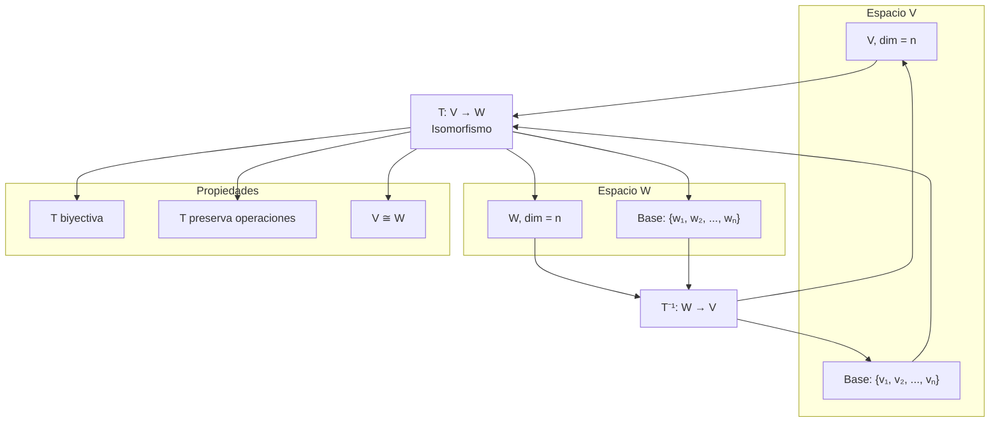

# Álgebra Lineal I - Transformaciones lineales

## 3.5 Espacios isomorfos.

---

### 1. Definición de Isomorfismo

Dos espacios vectoriales $V$ y $W$ sobre un campo $\mathbb{F}$ son **isomorfos** ( denotado $V \cong W$ ) si existe una transformación lineal biyectiva $T: V \rightarrow W$ llamada **isomorfismo**.

#### 1.1. Condiciones para Isomorfismo

Una transformación lineal $T: V \rightarrow W$ es un isomorfismo si:

1. $T$ es inyectiva: $\ker(T) = \{0\}$
2. $T$ es sobreyectiva: $\text{Im}(T) = W$

### 2. Teorema Fundamental de los Espacios Isomorfos

Dos espacios vectoriales de dimensión finita sobre el mismo campo son isomorfos si y solo si tienen la misma dimensión:

$$ V \cong W \quad \text{si y solo si} \quad \dim(V) = \dim(W) $$

### 3. Implementación Computacional para Verificar Isomorfismo

```python
import numpy as np

def son_espacios_isomorfos(dim_V, dim_W):
    """
    Determina si dos espacios vectoriales son isomorfos
    basado en sus dimensiones
    """
    return dim_V == dim_W

def construir_isomorfismo(base_V, base_W):
    """
    Construye un isomorfismo entre dos espacios de igual dimensión
    base_V: lista de vectores base para V
    base_W: lista de vectores base para W
    """
    # Verificar que tienen la misma dimensión
    if len(base_V) != len(base_W):
        raise ValueError("Los espacios no tienen la misma dimensión")

    # Construir matriz de cambio de base
    # Para un isomorfismo canónico, mapeamos cada vector de la base de V
    # al correspondiente vector de la base de W
    matriz_isomorfismo = np.column_stack(base_W)

    return matriz_isomorfismo

def aplicar_isomorfismo(matriz_T, vector, base_V):
    """
    Aplica el isomorfismo T a un vector de V
    vector: coordenadas en la base de V
    base_V: base del espacio V
    """
    # Convertir vector a coordenadas estándar si es necesario
    if len(vector) != len(base_V):
        raise ValueError("Dimensiones incompatibles")

    # Aplicar transformación
    vector_W = np.dot(matriz_T, vector)
    return vector_W

# Ejemplo: R² → P₁ (polinomios de grado ≤ 1)
base_R2 = [np.array([1, 0]), np.array([0, 1])]  # Base canónica de R²
base_P1 = [np.array([1, 0]), np.array([0, 1])]  # Base {1, x} de P₁

print("=== Verificación de Isomorfismo ===")
print(f"dim(R²) = {len(base_R2)}, dim(P₁) = {len(base_P1)}")
print(f"¿R² ≅ P₁? {son_espacios_isomorfos(len(base_R2), len(base_P1))}")

# Construir isomorfismo canónico
matriz_T = construir_isomorfismo(base_R2, base_P1)
print(f"\nMatriz del isomorfismo T: R² → P₁:")
print(matriz_T)

# Aplicar isomorfismo a un vector
vector_R2 = np.array([3, 4])  # Vector (3, 4) en R²
vector_P1 = aplicar_isomorfismo(matriz_T, vector_R2, base_R2)
print(f"\nT(3, 4) = {vector_P1} → 3*1 + 4*x")
```

### 4. Visualización de Espacios Isomorfos



### 5. Ejemplos de Espacios Isomorfos

#### 5.1. R² ≅ P₁

El espacio de polinomios de grado ≤ 1 es isomorfo a R²:

$$ T(a + bx) = (a, b) $$

#### 5.2. R³ ≅ M₂₁

El espacio de matrices 2×1 es isomorfo a R³:

$$ T\begin{pmatrix} a \\\ b \\\ c \end{pmatrix} = \begin{pmatrix} a & b \\\ c & 0 \end{pmatrix} $$

#### 5.3. R⁴ ≅ M₂₂

El espacio de matrices 2×2 es isomorfo a R⁴:

$$ T\begin{pmatrix} a \\\ b \\\ c \\\ d \end{pmatrix} = \begin{pmatrix} a & b \\\ c & d \end{pmatrix} $$

### 6. Propiedades de los Isomorfismos

#### 6.1. Preservación de Estructura

Si $T: V \rightarrow W$ es isomorfismo, entonces:

1. $T(u + v) = T(u) + T(v)$
2. $T(\alpha v) = \alpha T(v)$
3. $T(0_V) = 0_W$

#### 6.2. Relación de Equivalencia

La relación "ser isomorfo a" es:

1. **Reflexiva**: $V \cong V$
2. **Simétrica**: Si $V \cong W$ entonces $W \cong V$
3. **Transitiva**: Si $V \cong W$ y $W \cong U$ entonces $V \cong U$

### 7. Implementación de Isomorfismos entre Diferentes Espacios

```python
def isomorfismo_R2_a_P1(vector_R2):
    """
    Isomorfismo canónico: R² → P₁
    (a, b) ↦ a + bx
    """
    return np.poly1d([vector_R2[1], vector_R2[0]])  # b*x + a

def isomorfismo_P1_a_R2(polinomio):
    """
    Isomorfismo inverso: P₁ → R²
    a + bx ↦ (a, b)
    """
    coef = polinomio.coeffs
    if len(coef) == 1:
        return np.array([coef[0], 0])
    else:
        return np.array([coef[1], coef[0]])

def isomorfismo_R3_a_M21(vector_R3):
    """
    Isomorfismo: R³ → M₂₁
    (a, b, c) ↦ [[a], [b]] (c se descarta para mantener dim 2)
    """
    return np.array([[vector_R3[0]], [vector_R3[1]]])

# Ejemplos de aplicación
print("=== Ejemplos de Isomorfismos Concretos ===")

# R² → P₁
vector_ejemplo = np.array([2, 3])
polinomio_resultante = isomorfismo_R2_a_P1(vector_ejemplo)
print(f"T({vector_ejemplo}) = {polinomio_resultante}")

# P₁ → R²
polinomio_ejemplo = np.poly1d([4, 1])  # x + 4
vector_resultante = isomorfismo_P1_a_R2(polinomio_ejemplo)
print(f"T⁻¹({polinomio_ejemplo}) = {vector_resultante}")

# R³ → M₂₁
vector_R3 = np.array([1, 2, 3])
matriz_resultante = isomorfismo_R3_a_M21(vector_R3)
print(f"T({vector_R3}) = \n{matriz_resultante}")
```

### 8. Teorema de Clasificación de Espacios Vectoriales

Todo espacio vectorial de dimensión finita $n$ sobre un campo $\mathbb{F}$ es isomorfo a $\mathbb{F}^n$:

$$ V \cong \mathbb{F}^n \quad \text{para todo } V \text{ con } \dim(V) = n $$

### 9. Aplicación: Cambio de Coordenadas

```python
def cambio_coordenadas(vector, base_origen, base_destino):
    """
    Realiza cambio de coordenadas entre bases mediante isomorfismo
    """
    # Verificar que son bases del mismo espacio
    if len(base_origen) != len(base_destino):
        raise ValueError("Las bases deben tener la misma dimensión")

    # Construir matriz de cambio de base
    matriz_cambio = np.linalg.inv(np.column_stack(base_destino)).dot(np.column_stack(base_origen))

    # Aplicar cambio de coordenadas
    vector_destino = np.dot(matriz_cambio, vector)

    return vector_destino, matriz_cambio

# Ejemplo: Cambio entre bases de R²
base_canonica = [np.array([1, 0]), np.array([0, 1])]
base_alternativa = [np.array([1, 1]), np.array([1, -1])]

vector = np.array([3, 4])  # Coordenadas en base canónica

nuevas_coords, matriz_cambio = cambio_coordenadas(vector, base_canonica, base_alternativa)
print(f"\nVector en base canónica: {vector}")
print(f"Vector en base alternativa: {nuevas_coords}")
print(f"Matriz de cambio de base:
{matriz_cambio}")
```

### 10. Ejercicios de Práctica

1. Demuestra que los siguientes espacios son isomorfos:
   a) $M_{2×2}$ y $\mathbb{R}^4$
   b) $P_2$ (polinomios de grado ≤ 2) y $\mathbb{R}^3$

2. Construye explícitamente un isomorfismo entre $\mathbb{R}^3$ y el espacio de matrices simétricas 2×2.

3. ¿Son isomorfos el espacio de matrices triangulares superiores 2×2 y $\mathbb{R}^3$? Justifica.

### 11. Solución de los Ejercicios

```python
def solucion_ejercicios():
    print("=== Solución Ejercicio 1 ===")

    # a) M₂₂ ≅ R⁴
    dim_M22 = 4  # 2×2 = 4 elementos
    dim_R4 = 4
    print(f"dim(M₂₂) = {dim_M22}, dim(R⁴) = {dim_R4}")
    print(f"¿M₂₂ ≅ R⁴? {son_espacios_isomorfos(dim_M22, dim_R4)}")

    # b) P₂ ≅ R³
    dim_P2 = 3  # {1, x, x²}
    dim_R3 = 3
    print(f"\ndim(P₂) = {dim_P2}, dim(R³) = {dim_R3}")
    print(f"¿P₂ ≅ R³? {son_espacios_isomorfos(dim_P2, dim_R3)}")

    print("\n=== Solución Ejercicio 2 ===")
    # Isomorfismo: R³ → Matrices simétricas 2×2
    def isomorfismo_R3_a_simetricas(v):
        return np.array([[v[0], v[2]],
                         [v[2], v[1]]])

    v_ejemplo = np.array([1, 2, 3])
    matriz_simetrica = isomorfismo_R3_a_simetricas(v_ejemplo)
    print(f"T({v_ejemplo}) = \n{matriz_simetrica}")

    print("\n=== Solución Ejercicio 3 ===")
    # Matrices triangulares superiores 2×2: [[a, b], [0, c]]
    # Tienen 3 parámetros libres: a, b, c
    dim_triangulares = 3
    print(f"dim(matrices triangulares superiores 2×2) = {dim_triangulares}")
    print(f"¿Son isomorfos a R³? {son_espacios_isomorfos(dim_triangulares, 3)}")

solucion_ejercicios()
```

### 12. Aplicaciones en Ciencias e Ingeniería

1. **Computer Graphics**: Transformaciones entre diferentes sistemas de coordenadas
2. **Mecánica Cuántica**: Espacios de Hilbert isomorfos
3. **Procesamiento de Señales**: Transformadas entre dominio temporal y frecuencial
4. **Machine Learning**: Embeddings de datos en espacios de diferente dimensionalidad

### 13. Referencias

1. Axler, S. (2015). Linear Algebra Done Right.
2. Strang, G. (2016). Introduction to Linear Algebra.
3. Hoffman, K., & Kunze, R. (1971). Linear Algebra.
4. Roman, S. (2005). Advanced Linear Algebra.
