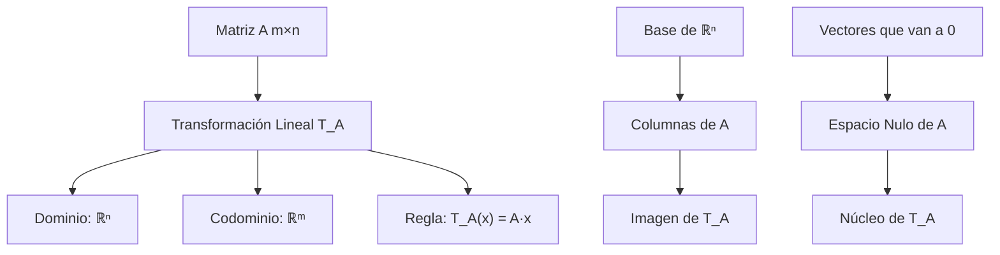

# Álgebra Lineal I - Transformaciones lineales y matrices

## 4.1 La transformación lineal asociada a una matriz.

---

### Introducción

En álgebra lineal, existe una profunda conexión entre matrices y transformaciones lineales. Cada matriz define una transformación lineal única, y toda transformación lineal entre espacios vectoriales de dimensión finita puede representarse mediante una matriz.

### Definiciones Fundamentales

#### Transformación Lineal

Una función $T: V \rightarrow W$ entre espacios vectoriales $V$ y $W$ sobre un campo $\mathbb{F}$ es una **transformación lineal** si satisface:

1. **Aditividad**: $T(\mathbf{u} + \mathbf{v}) = T(\mathbf{u}) + T(\mathbf{v})$ para todo $\mathbf{u}, \mathbf{v} \in V$
2. **Homogeneidad**: $T(c\mathbf{v}) = cT(\mathbf{v})$ para todo $c \in \mathbb{F}$ y $\mathbf{v} \in V$

#### Matriz Asociada a una Transformación Lineal

Dada una matriz $A \in M_{m \times n}(\mathbb{F}),$ la **transformación lineal asociada** $T_A: \mathbb{F}^n \rightarrow \mathbb{F}^m$ se define como:

$$T_A(\mathbf{x}) = A\mathbf{x}$$

donde $\mathbf{x} \in \mathbb{F}^n$ es un vector columna.

$T_A$ es lineal por las propiedades del producto de matrices: $A(\mathbf{u} + \mathbf{v}) = A\mathbf{u} + A\mathbf{v}$ y $A(c\mathbf{v}) = cA\mathbf{v}.$

#### Las Columnas de $A$ Son las Imágenes de la Base Canónica

Si $\mathbf{e}_j$ es el vector canónico con un $1$ en la posición $j,$ entonces $A\mathbf{e}_j$ es la columna $j$ de $A.$ Por eso

$$A\mathbf{x} = x_1 \mathbf{a}_1 + x_2 \mathbf{a}_2 + \cdots + x_n \mathbf{a}_n,$$

donde $\mathbf{a}_j$ son las columnas de $A.$ Recíprocamente, toda transformación lineal $T: \mathbb{F}^n \to \mathbb{F}^m$ es de la forma $T_A$ con $A = [\,T(\mathbf{e}_1) \mid \cdots \mid T(\mathbf{e}_n)\,],$ llamada **matriz estándar** de $T.$ Además $T_A = T_B$ implica $A = B,$ pues coinciden columna a columna.

### Construcción de la Transformación Lineal

#### Proceso General

Dada una matriz $A$ de tamaño $m \times n,$ la transformación lineal asociada $T_A$ se construye como:

$$T_A\begin{pmatrix} x_1 \\ x_2 \\ \vdots \\ x_n \end{pmatrix} = A\begin{pmatrix} x_1 \\ x_2 \\ \vdots \\ x_n \end{pmatrix} = \begin{pmatrix} a_{11}x_1 + a_{12}x_2 + \cdots + a_{1n}x_n \\ a_{21}x_1 + a_{22}x_2 + \cdots + a_{2n}x_n \\ \vdots \\ a_{m1}x_1 + a_{m2}x_2 + \cdots + a_{mn}x_n \end{pmatrix}$$

#### Ejemplo 1: Transformación de $\mathbb{R}^2$ a $\mathbb{R}^2$

Sea $A = \begin{pmatrix} 2 & -1 \\ 0 & 3 \end{pmatrix},$ entonces:

$$T_A\begin{pmatrix} x \\ y \end{pmatrix} = \begin{pmatrix} 2 & -1 \\ 0 & 3 \end{pmatrix}\begin{pmatrix} x \\ y \end{pmatrix} = \begin{pmatrix} 2x - y \\ 3y \end{pmatrix}$$

#### Ejemplo 2: Transformación de $\mathbb{R}^3$ a $\mathbb{R}^2$

Sea $B = \begin{pmatrix} 1 & 0 & 2 \\ -1 & 3 & 1 \end{pmatrix},$ entonces:

$$T_B\begin{pmatrix} x \\ y \\ z \end{pmatrix} = \begin{pmatrix} 1 & 0 & 2 \\ -1 & 3 & 1 \end{pmatrix}\begin{pmatrix} x \\ y \\ z \end{pmatrix} = \begin{pmatrix} x + 2z \\ -x + 3y + z \end{pmatrix}$$

### Propiedades Importantes

#### Composición de Transformaciones

La composición de transformaciones lineales corresponde al producto de matrices:

$$T_B \circ T_A = T_{BA}$$

#### Invertibilidad

$T_A: \mathbb{F}^n \to \mathbb{F}^n$ es invertible si y solo si $A$ es invertible, es decir $\det(A) \neq 0,$ y en ese caso $(T_A)^{-1} = T_{A^{-1}}.$ Si $m \neq n,$ $T_A$ no puede ser invertible.

#### Núcleo e Imagen

- $\text{Ker}(T_A) = \text{Nul}(A)$ (espacio nulo de A)
- $\text{Im}(T_A) = \text{Col}(A)$ (espacio columna de A)

### Diagrama de la Relación



### Implementación Computacional

#### Python con NumPy

```python
import numpy as np

def transformacion_lineal(matriz, vector):
    """
    Aplica la transformación lineal asociada a una matriz sobre un vector

    Args:
        matriz: numpy array de tamaño m×n
        vector: numpy array de tamaño n×1 o n

    Returns:
        numpy array de tamaño m×1
    """
    return np.dot(matriz, vector)

# Ejemplo 1: Transformación de R² a R²
A = np.array([[2, -1],
              [0, 3]])

vector = np.array([3, 2])
resultado = transformacion_lineal(A, vector)
print(f"T_A([3, 2]) = {resultado}")  # [4, 6]

# Ejemplo 2: Transformación de R³ a R²
B = np.array([[1, 0, 2],
              [-1, 3, 1]])

vector_3d = np.array([1, -1, 2])
resultado_3d = transformacion_lineal(B, vector_3d)
print(f"T_B([1, -1, 2]) = {resultado_3d}")  # [5, -2]
```

#### MATLAB/Octave

```matlab
function resultado = transformacion_lineal(matriz, vector)
    % Aplica la transformación lineal asociada a una matriz
    resultado = matriz * vector;
end

% Ejemplo de uso
A = [2, -1; 0, 3];
vector = [3; 2];
resultado = transformacion_lineal(A, vector);
disp(['T_A([3; 2]) = ', num2str(resultado')]);
```

### Teoremas Fundamentales

#### Teorema de la Dimensión

Para cualquier transformación lineal $T: V \rightarrow W$ con $V$ de dimensión finita,

$$\dim(V) = \dim(\text{Ker}(T)) + \dim(\text{Im}(T))$$

Para $T_A$ esto se lee $n = \dim(\text{Nul}(A)) + \operatorname{rango}(A).$

#### Teorema de Representación Matricial

Dada una transformación lineal $T: V \rightarrow W$ y bases ordenadas $B_V$ de $V$ y $B_W$ de $W,$ existe una única matriz $[T]_{B_V}^{B_W}$ tal que:

$$[T(\mathbf{v})]_{B_W} = [T]_{B_V}^{B_W}[\mathbf{v}]_{B_V}$$

### Aplicaciones Prácticas

#### Rotaciones en el Plano

La matriz de rotación por un ángulo $\theta:$

$$R_\theta = \begin{pmatrix} \cos\theta & -\sin\theta \\ \sin\theta & \cos\theta \end{pmatrix}$$

Define la transformación:

$$T\begin{pmatrix} x \\ y \end{pmatrix} = \begin{pmatrix} x\cos\theta - y\sin\theta \\ x\sin\theta + y\cos\theta \end{pmatrix}$$

#### Proyecciones

La matriz de proyección sobre el eje X:

$$P_x = \begin{pmatrix} 1 & 0 \\ 0 & 0 \end{pmatrix}$$

Define:

$$T\begin{pmatrix} x \\ y \end{pmatrix} = \begin{pmatrix} x \\ 0 \end{pmatrix}$$

#### Otras Transformaciones del Plano

| Transformación | Matriz |
| --- | --- |
| Reflexión sobre el eje $x$ | $\begin{pmatrix} 1 & 0 \\ 0 & -1 \end{pmatrix}$ |
| Reflexión sobre la recta $y = x$ | $\begin{pmatrix} 0 & 1 \\ 1 & 0 \end{pmatrix}$ |
| Escalamiento por $k$ | $\begin{pmatrix} k & 0 \\ 0 & k \end{pmatrix}$ |
| Cizalla horizontal | $\begin{pmatrix} 1 & k \\ 0 & 1 \end{pmatrix}$ |

### Ejercicios Propuestos

1. **Ejercicio 1**: Sea $A = \begin{pmatrix} 1 & 2 & 3 \\ 4 & 5 & 6 \end{pmatrix}.$ Encuentre $T_A(1, -1, 2).$

2. **Ejercicio 2**: Determine si la transformación $T(x, y) = (2x + y, x - y)$ es invertible y encuentre su inversa si existe.

3. **Ejercicio 3**: Encuentre la matriz estándar para la transformación que rota vectores en $\mathbb{R}^2$ por $45^\circ$ en sentido antihorario.

### Soluciones

1. $T_A(1, -1, 2) = (1 - 2 + 6, \; 4 - 5 + 12) = (5, 11).$
2. $\det\begin{pmatrix} 2 & 1 \\ 1 & -1 \end{pmatrix} = -3 \neq 0,$ así que es invertible y $T^{-1}(u, v) = \left(\frac{u + v}{3}, \frac{u - 2v}{3}\right).$
3. $R_{45^\circ} = \frac{\sqrt{2}}{2}\begin{pmatrix} 1 & -1 \\ 1 & 1 \end{pmatrix}.$

### Referencias y Bibliografía

#### Libros Recomendados

1. **"Linear Algebra and Its Applications"** - Gilbert Strang
2. **"Introduction to Linear Algebra"** - Serge Lang
3. **"Álgebra Lineal"** - Stanley I. Grossman, capítulo de transformaciones lineales

#### Recursos Online

1. **Khan Academy**: Linear transformations
2. **MIT OpenCourseWare**: Linear Algebra (Course 18.06)
3. **3Blue1Brown**: "Essence of Linear Algebra" series

### Conclusión

La conexión entre matrices y transformaciones lineales es fundamental en álgebra lineal. Comprender que cada matriz define una transformación lineal única y viceversa (en dimensión finita) proporciona una poderosa herramienta para analizar y visualizar operaciones lineales. Esta dualidad permite traducir problemas geométricos en problemas algebraicos y viceversa, facilitando su resolución tanto conceptual como computacionalmente.

La implementación computacional de estas transformaciones demuestra su utilidad práctica en áreas como gráficos por computadora, procesamiento de señales, machine learning y física computacional.
