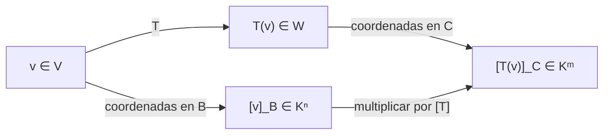

# Álgebra Lineal I - Transformaciones lineales y matrices

## 4.2 La matriz asociada a una transformación lineal.

---

### 1. Definición de Transformación Lineal

Una **transformación lineal** $T: V \to W$ entre dos espacios vectoriales $V$ y $W$ sobre el mismo cuerpo $K,$ usualmente $\mathbb{R}$ o $\mathbb{C},$ es una función que cumple con:

1. **Aditividad:**  

   $$ T(\mathbf{u} + \mathbf{v}) = T(\mathbf{u}) + T(\mathbf{v}) $$

   para todo $\mathbf{u}, \mathbf{v} \in V.$

2. **Homogeneidad:**  

   $$ T(\alpha \mathbf{v}) = \alpha T(\mathbf{v}) $$

   para todo $\mathbf{v} \in V$ y $\alpha \in K.$

### 2. Matriz Asociada a una Transformación Lineal

Cuando los espacios vectoriales $V$ y $W$ tienen bases finitas **ordenadas**, la transformación $T$ puede representarse mediante una **matriz**. El orden de los vectores de la base importa: cambiarlo permuta filas o columnas.

- Sea $\mathcal{B} = \{\mathbf{v}_1, \mathbf{v}_2, \dots, \mathbf{v}_n\}$ una base de $V.$
- Sea $\mathcal{C} = \{\mathbf{w}_1, \mathbf{w}_2, \dots, \mathbf{w}_m\}$ una base de $W.$
- Entonces, para cada $j$ con $1 \leq j \leq n,$ podemos expresar

  $$ T(\mathbf{v}_j) = a_{1j}\mathbf{w}_1 + a_{2j}\mathbf{w}_2 + \dots + a_{mj}\mathbf{w}_m $$

  Los coeficientes $a_{ij}$ forman la matriz de $T$ respecto a las bases $\mathcal{B}$ y $\mathcal{C}:$

  $$ [T]_{\mathcal{C}\leftarrow \mathcal{B}} = \begin{bmatrix} a_{11} & a_{12} & \cdots & a_{1n} \\ a_{21} & a_{22} & \cdots & a_{2n} \\ \vdots & \vdots & \ddots & \vdots \\ a_{m1} & a_{m2} & \cdots & a_{mn} \end{bmatrix} $$

  Es decir, la columna $j$ son las coordenadas de $T(\mathbf{v}_j)$ en la base $\mathcal{C},$ $[T]_{\mathcal{C}\leftarrow \mathcal{B}} = \big[\,[T(\mathbf{v}_1)]_\mathcal{C} \mid \cdots \mid [T(\mathbf{v}_n)]_\mathcal{C}\,\big].$

La propiedad fundamental es que la matriz traduce la transformación a coordenadas:

$$ [T(\mathbf{v})]_\mathcal{C} = [T]_{\mathcal{C}\leftarrow \mathcal{B}} \, [\mathbf{v}]_\mathcal{B} \quad \text{para todo } \mathbf{v} \in V $$

Se deduce de la linealidad: si $\mathbf{v} = \sum_j x_j \mathbf{v}_j,$ entonces $T(\mathbf{v}) = \sum_j x_j T(\mathbf{v}_j) = \sum_i \left(\sum_j a_{ij} x_j\right) \mathbf{w}_i.$

### 3. Ejemplo con Base Canónica

Sea $T: \mathbb{R}^2 \to \mathbb{R}^2$ definida por:

$$ T(x, y) = (2x + y, \; 3x - y) $$

1. Base canónica de $\mathbb{R}^2:$  
   $\mathcal{B} = \{ \mathbf{e}_1 = (1,0), \; \mathbf{e}_2 = (0,1) \}$

2. Evaluamos $T$ en los vectores de la base:
   - $T(\mathbf{e}_1) = T(1,0) = (2,3)$
   - $T(\mathbf{e}_2) = T(0,1) = (1,-1)$

3. Colocamos estos resultados como columnas en una matriz:

   $$ [T] = \begin{bmatrix} 2 & 1 \\ 3 & -1 \end{bmatrix} $$

### 4. Ejemplo en Python

```python
import numpy as np

# Definimos la transformación T(x,y) = (2x+y, 3x-y)
def T(v):
    x, y = v
    return np.array([2*x + y, 3*x - y])

# Vectores de la base canónica
e1 = np.array([1, 0])
e2 = np.array([0, 1])

# Aplicamos T a cada vector
col1 = T(e1)  # (2,3)
col2 = T(e2)  # (1,-1)

# Construimos la matriz
A = np.column_stack([col1, col2])
print(A)
```

### 5. Representación Diagrama



### 6. Propiedades Importantes

1. **Composición de transformaciones** corresponde a multiplicación de matrices:

   $$ [S \circ T] = [S] \cdot [T] $$

2. **Identidad:**
   La transformación identidad $I(v) = v$ tiene como matriz la identidad $I_n.$

3. **Inversas:**
   Si $T$ es invertible, la matriz asociada $[T]$ también lo es, y:

   $$ [T^{-1}] = ([T])^{-1} $$

4. **Linealidad de la representación:** $[S + T] = [S] + [T]$ y $[cT] = c[T].$ La función $T \mapsto [T]$ es un isomorfismo entre $\mathcal{L}(V, W)$ y $M_{m \times n}(K).$

En estas propiedades todas las matrices se toman respecto a las mismas bases; para la composición, la base intermedia de $S$ y $T$ debe ser la misma.

### 7. Ejemplo Geométrico: Rotación en el Plano

La transformación $R_\theta: \mathbb{R}^2 \to \mathbb{R}^2$ que rota un vector un ángulo $\theta$ tiene como matriz:

$$ [R_\theta] = \begin{bmatrix} \cos\theta & -\sin\theta \\ \sin\theta & \cos\theta \end{bmatrix} $$

Ejemplo: para $\theta = 90^\circ:$

$$ R_{90^\circ} = \begin{bmatrix} 0 & -1 \\ 1 & 0 \end{bmatrix} $$

### 8. Ejemplo con una Base No Canónica

Tomemos la misma $T(x, y) = (2x + y, 3x - y)$ y la base $\mathcal{B} = \{(1, 1), (1, -1)\}$ tanto en el dominio como en el codominio.

1. $T(1, 1) = (3, 2).$ Resolviendo $a(1, 1) + b(1, -1) = (3, 2)$ se obtiene $a = \frac{5}{2},$ $b = \frac{1}{2}.$
2. $T(1, -1) = (1, 4).$ Resolviendo $a(1, 1) + b(1, -1) = (1, 4)$ se obtiene $a = \frac{5}{2},$ $b = -\frac{3}{2}.$

$$ [T]_{\mathcal{B}\leftarrow\mathcal{B}} = \begin{bmatrix} \frac{5}{2} & \frac{5}{2} \\ \frac{1}{2} & -\frac{3}{2} \end{bmatrix} $$

La matriz es distinta de la estándar, pero representa la misma transformación. Si $P = \begin{bmatrix} 1 & 1 \\ 1 & -1 \end{bmatrix}$ tiene por columnas los vectores de $\mathcal{B},$ entonces $[T]_{\mathcal{B}\leftarrow\mathcal{B}} = P^{-1}[T]P,$ un hecho que se estudia en el tema de cambio de base.

### 9. Ejemplo en un Espacio de Polinomios

Sea $D: P_2 \to P_1,$ $D(p) = p',$ con bases $\mathcal{B} = \{1, x, x^2\}$ y $\mathcal{C} = \{1, x\}.$ Como $D(1) = 0,$ $D(x) = 1$ y $D(x^2) = 2x,$

$$ [D]_{\mathcal{C}\leftarrow\mathcal{B}} = \begin{bmatrix} 0 & 1 & 0 \\ 0 & 0 & 2 \end{bmatrix} $$

Para $p(x) = 3 + 5x - 4x^2,$ $[D]\,(3, 5, -4)^T = (5, -8)^T,$ que son las coordenadas de $p'(x) = 5 - 8x.$

```python
import numpy as np

def matriz_asociada(T, base_B, base_C):
    """Matriz de T respecto a las bases B (dominio) y C (codominio).
    La columna j son las coordenadas de T(B[j]) en la base C."""
    C = np.column_stack(base_C).astype(float)
    columnas = [np.linalg.solve(C, T(v)) for v in base_B]
    return np.column_stack(columnas)

T = lambda v: np.array([2*v[0] + v[1], 3*v[0] - v[1]])
B = [np.array([1, 1]), np.array([1, -1])]
print(matriz_asociada(T, B, B))   # [[ 2.5  2.5] [ 0.5 -1.5]]
```

### 10. Ejercicios Propuestos

1. Encuentra la matriz de $T(x, y, z) = (x - y, \; y + 2z)$ respecto a las bases canónicas.
2. Encuentra la matriz de la reflexión sobre la recta $y = x$ respecto a la base $\{(1, 1), (1, -1)\}.$ ¿Por qué es diagonal?
3. Sea $T: P_2 \to P_2,$ $T(p) = p(x + 1).$ Encuentra $[T]$ en la base $\{1, x, x^2\}.$

**Soluciones.** 1) $\begin{bmatrix} 1 & -1 & 0 \\ 0 & 1 & 2 \end{bmatrix}.$ 2) $\begin{bmatrix} 1 & 0 \\ 0 & -1 \end{bmatrix};$ es diagonal porque $(1, 1)$ queda fijo y $(1, -1)$ cambia de signo. 3) Como $T(1) = 1,$ $T(x) = 1 + x$ y $T(x^2) = 1 + 2x + x^2,$ la matriz es $\begin{bmatrix} 1 & 1 & 1 \\ 0 & 1 & 2 \\ 0 & 0 & 1 \end{bmatrix}.$

### 11. Referencias

- Lay, David C. _Álgebra Lineal y sus Aplicaciones_. Pearson.
- Strang, Gilbert. _Introduction to Linear Algebra_. MIT Press.
- Axler, Sheldon. _Linear Algebra Done Right_. Springer.
