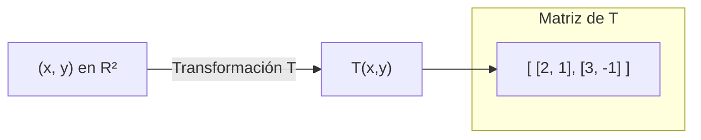

# Álgebra Lineal I - Transformaciones lineales y matrices

## 4.2 La matriz asociada a una transformación lineal.

---

### 1. Definición de Transformación Lineal

Una **transformación lineal** $T: V \to W$ entre dos espacios vectoriales $V$ y $W$ sobre el mismo cuerpo $K$ ( usualmente $\mathbb{R}$ o $\mathbb{C}$ ) es una función que cumple con:

1. **Aditividad:**  
   $$ T(\mathbf{u} + \mathbf{v}) = T(\mathbf{u}) + T(\mathbf{v}) $$
   para todo $\mathbf{u}, \mathbf{v} \in V$.

2. **Homogeneidad:**  
   $$ T(\alpha \mathbf{v}) = \alpha T(\mathbf{v}) $$
   para todo $\mathbf{v} \in V$ y $\alpha \in K$.

### 2. Matriz Asociada a una Transformación Lineal

Cuando los espacios vectoriales $V$ y $W$ tienen bases finitas, la transformación $T$ puede representarse mediante una **matriz**.

- Sea $\mathcal{B} = \{\mathbf{v}_1, \mathbf{v}_2, \dots, \mathbf{v}_n\}$ una base de $V$.
- Sea $\mathcal{C} = \{\mathbf{w}_1, \mathbf{w}_2, \dots, \mathbf{w}_m\}$ una base de $W$.
- Entonces, para cada $j$ ( con $1 \leq j \leq n$ ), podemos expresar:

  $$ T(\mathbf{v}_j) = a_{1j}\mathbf{w}_1 + a_{2j}\mathbf{w}_2 + \dots + a_{mj}\mathbf{w}_m $$

  Los coeficientes $a_{ij}$ forman la matriz de $T$ respecto a las bases $\mathcal{B}$ y $\mathcal{C}$:

  $$ [T]_{\mathcal{C}\leftarrow \mathcal{B}} = \begin{bmatrix} a_{11} & a_{12} & \cdots & a_{1n} \\\ a_{21} & a_{22} & \cdots & a_{2n} \\\ \vdots & \vdots & \ddots & \vdots \\\ a_{m1} & a_{m2} & \cdots & a_{mn} \end{bmatrix} $$

### 3. Ejemplo con Base Canónica

Sea $T: \mathbb{R}^2 \to \mathbb{R}^2$ definida por:

$$ T(x, y) = (2x + y, \; 3x - y) $$

1. Base canónica de $\mathbb{R}^2$:  
   $\mathcal{B} = \{ \mathbf{e}_1 = (1,0), \; \mathbf{e}_2 = (0,1) \}$

2. Evaluamos $T$ en los vectores de la base:
   - $T(\mathbf{e}_1) = T(1,0) = (2,3)$
   - $T(\mathbf{e}_2) = T(0,1) = (1,-1)$

3. Colocamos estos resultados como columnas en una matriz:

   $$ [T] = \begin{bmatrix} 2 & 1 \\\ 3 & -1 \end{bmatrix} $$

### 4. Ejemplo en Python

```python
import numpy as np

# Definimos la transformación T(x,y) = (2x+y, 3x-y)
def T(v):
    x, y = v
    return np.array([2*x + y, 3*x - y])

# Vectores de la base canónica
e1 = np.array([1, 0])
e2 = np.array([0, 1])

# Aplicamos T a cada vector
col1 = T(e1)  # (2,3)
col2 = T(e2)  # (1,-1)

# Construimos la matriz
A = np.column_stack([col1, col2])
print(A)
```

### 5. Representación Diagrama



### 6. Propiedades Importantes

1. **Composición de transformaciones** corresponde a multiplicación de matrices:

   $$ [S \circ T] = [S] \cdot [T] $$

2. **Identidad:**
   La transformación identidad $I(v) = v$ tiene como matriz la identidad $I\_n$.

3. **Inversas:**
   Si $T$ es invertible, la matriz asociada $[T]$ también lo es, y:

   $$ [T^{-1}] = ([T])^{-1} $$

### 7. Ejemplo Geométrico: Rotación en el Plano

La transformación $R\_\theta: \mathbb{R}^2 \to \mathbb{R}^2$ que rota un vector un ángulo $\theta$ tiene como matriz:

$$ [R_\theta] = \begin{bmatrix} \cos\theta & -\sin\theta \\\ \sin\theta & \cos\theta \end{bmatrix} $$

Ejemplo: para $\theta = 90^\circ$:

$$ R_{90^\circ} = \begin{bmatrix} 0 & -1 \\\ 1 & 0 \end{bmatrix} $$

### 8. Referencias

- Lay, David C. _Álgebra Lineal y sus Aplicaciones_. Pearson.
- Strang, Gilbert. _Introduction to Linear Algebra_. MIT Press.
- Axler, Sheldon. _Linear Algebra Done Right_. Springer.
