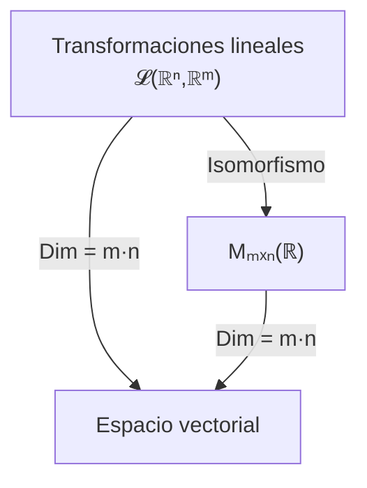

# Álgebra Lineal I - Transformaciones lineales y matrices

## 4.3 Isomorfismos entre el espacio de matrices y el de transformaciones lineales.

---

### 1. Concepto de Isomorfismo

Un **isomorfismo** entre dos espacios vectoriales $V$ y $W$ es una transformación lineal

$$ T: V \to W $$

que es **biyectiva**, es decir:

1. **Inyectiva:** $T(\mathbf{u}) = T(\mathbf{v}) \implies \mathbf{u} = \mathbf{v}$
2. **Sobreyectiva:** Para todo $\mathbf{w} \in W$ existe $\mathbf{v} \in V$ tal que $T(\mathbf{v}) = \mathbf{w}$

Si existe un isomorfismo entre $V$ y $W,$ decimos que $V$ y $W$ son **isomorfos** y escribimos

$$ V \cong W $$

### 2. Transformaciones lineales y matrices

Sea $V = \mathbb{R}^n$ y $W = \mathbb{R}^m.$  
Toda transformación lineal $T: V \to W$ está asociada a una **matriz** $A \in M_{m \times n}(\mathbb{R})$ tal que:

$$ T(\mathbf{x}) = A \mathbf{x} $$

Esto establece una correspondencia directa:

$$ \mathcal{L}(\mathbb{R}^n, \mathbb{R}^m) \cong M_{m \times n}(\mathbb{R}) $$

donde:

- $\mathcal{L}(\mathbb{R}^n, \mathbb{R}^m)$ = espacio de transformaciones lineales de $\mathbb{R}^n$ en $\mathbb{R}^m$
- $M_{m \times n}(\mathbb{R})$ = espacio vectorial de matrices $m \times n$ con entradas reales.

### 3. Dimensión de los espacios

- La dimensión de $\mathcal{L}(\mathbb{R}^n, \mathbb{R}^m)$ es:

  $$ \dim \mathcal{L}(\mathbb{R}^n, \mathbb{R}^m) = m \cdot n $$

- La dimensión de $M_{m \times n}(\mathbb{R})$ también es:

  $$ \dim M_{m \times n}(\mathbb{R}) = m \cdot n $$

Una base de $M_{m \times n}(\mathbb{R})$ son las matrices $E_{ij}$ con un $1$ en la posición $(i, j)$ y ceros en el resto; a cada una le corresponde la transformación $T_{ij}$ que manda $\mathbf{e}_j$ a $\mathbf{e}_i$ y los demás vectores canónicos a cero. Como dos espacios de dimensión finita son isomorfos si y solo si tienen la misma dimensión, esto ya prueba que ambos espacios son **isomorfos**. Lo valioso es que hay un isomorfismo concreto, el de la sección siguiente.

### 3.1 El Isomorfismo Explícito

Sea $\Phi: \mathcal{L}(\mathbb{R}^n, \mathbb{R}^m) \to M_{m \times n}(\mathbb{R})$ la función que asigna a $T$ su matriz estándar $[T] = [\,T(\mathbf{e}_1) \mid \cdots \mid T(\mathbf{e}_n)\,].$

- **Es lineal**: $(S + T)(\mathbf{e}_j) = S(\mathbf{e}_j) + T(\mathbf{e}_j)$ y $(cT)(\mathbf{e}_j) = cT(\mathbf{e}_j),$ así que $\Phi(S + T) = \Phi(S) + \Phi(T)$ y $\Phi(cT) = c\Phi(T).$
- **Es inyectiva**: si $[T] = 0,$ entonces $T(\mathbf{e}_j) = \mathbf{0}$ para todo $j,$ y por linealidad $T = 0.$
- **Es sobreyectiva**: dada $A,$ la transformación $T_A(\mathbf{x}) = A\mathbf{x}$ cumple $\Phi(T_A) = A.$

### 3.2 Espacios Generales

Para espacios abstractos $V$ y $W$ con $\dim V = n$ y $\dim W = m,$ al fijar bases ordenadas $\mathcal{B}$ de $V$ y $\mathcal{C}$ de $W$ se obtiene el isomorfismo

$$ \mathcal{L}(V, W) \to M_{m \times n}(\mathbb{R}), \quad T \mapsto [T]_{\mathcal{C}\leftarrow\mathcal{B}} $$

Este isomorfismo **depende de las bases elegidas**; con otras bases la misma $T$ tiene otra matriz. Por ejemplo, $\mathcal{L}(P_2, P_1) \cong M_{2 \times 3}(\mathbb{R}),$ y con las bases $\{1, x, x^2\}$ y $\{1, x\}$ la derivada corresponde a $\begin{bmatrix} 0 & 1 & 0 \\ 0 & 0 & 2 \end{bmatrix}.$

### 4. Ejemplo de Isomorfismo

Sea $T: \mathbb{R}^2 \to \mathbb{R}^2$ definido por:

$$ T(x, y) = (2x + y, 3x - y) $$

1. La matriz asociada es:

   $$ [T] = \begin{bmatrix} 2 & 1 \\ 3 & -1 \end{bmatrix} $$

2. Cada transformación lineal $T \in \mathcal{L}(\mathbb{R}^2, \mathbb{R}^2)$ corresponde **únicamente** a una matriz $A \in M_{2 \times 2}(\mathbb{R}).$

3. La operación de composición de transformaciones corresponde a la multiplicación de matrices.

4. Por ejemplo, si $S(x, y) = (x, -y),$ entonces $[S + T] = \begin{bmatrix} 3 & 1 \\ 3 & -2 \end{bmatrix} = [S] + [T]$ y $[S \circ T] = \begin{bmatrix} 2 & 1 \\ -3 & 1 \end{bmatrix} = [S][T].$

### 5. Diagrama explicativo



### 6. Ejemplo en Python

```python
import numpy as np

# Definimos una transformación lineal T: R2 -> R2
def T(v):
    x, y = v
    return np.array([2*x + y, 3*x - y])

# Base canónica
e1 = np.array([1,0])
e2 = np.array([0,1])

# Imagen de los vectores de la base
col1 = T(e1)
col2 = T(e2)

# Matriz asociada
A = np.column_stack([col1, col2])
print("Matriz asociada a T:\n", A)

# Verificamos que T(x) = A*x
x = np.array([4, -2])
print("T(x) =", T(x))
print("A*x =", A @ x)

# La correspondencia T -> [T] es lineal: [2S + T] = 2[S] + [T]
def S(v):
    x, y = v
    return np.array([x, -y])

def matriz(F):
    return np.column_stack([F(e1), F(e2)])

suma = lambda v: 2*S(v) + T(v)
print("[2S + T]   =\n", matriz(suma))
print("2[S] + [T] =\n", 2*matriz(S) + matriz(T))
```

Esto muestra el **isomorfismo práctico**: la transformación y la matriz actúan de forma equivalente.

### 7. Propiedades del isomorfismo

1. **Correspondencia 1 a 1**:
   Cada transformación lineal $T$ está asociada a una única matriz $A,$ y viceversa.

2. **Estructura preservada**:

   - Suma de transformaciones $\leftrightarrow$ Suma de matrices.
   - Multiplicación por escalar $\leftrightarrow$ Multiplicación por escalar en matrices.
   - Composición $\leftrightarrow$ Multiplicación de matrices.

3. **Dependencia de las bases**:
   En $\mathbb{R}^n$ con las bases canónicas la correspondencia es la estándar. En espacios abstractos no hay una base preferida, y cada elección de bases da un isomorfismo distinto.

4. **Invertibilidad**:
   Si $m = n,$ $T$ es invertible si y solo si $[T]$ es invertible, y $[T^{-1}] = [T]^{-1}.$

### 8. Ejemplo Geométrico: Rotación en el plano

La transformación de rotación $R_\theta: \mathbb{R}^2 \to \mathbb{R}^2$ tiene asociada la matriz:

$$ [R_\theta] = \begin{bmatrix} \cos\theta & -\sin\theta \\ \sin\theta & \cos\theta \end{bmatrix} $$

Ejemplo: para $\theta = 90^\circ:$

$$ R_{90^\circ} = \begin{bmatrix} 0 & -1 \\ 1 & 0 \end{bmatrix} $$

### 9. Ejercicios Propuestos

1. ¿Cuál es la dimensión de $\mathcal{L}(\mathbb{R}^3, \mathbb{R}^2)?$ Escribe la transformación que corresponde a $E_{12}.$
2. Demuestra que $\Phi(S \circ T) = \Phi(S)\Phi(T)$ evaluando en $\mathbf{e}_j.$
3. ¿A qué espacio de matrices es isomorfo $\mathcal{L}(P_3, \mathbb{R})?$

**Soluciones.** 1) Dimensión $6;$ $E_{12}$ corresponde a $T(x, y, z) = (y, 0).$ 2) La columna $j$ de $\Phi(S \circ T)$ es $S(T(\mathbf{e}_j)) = [S]\,T(\mathbf{e}_j) = [S]\,([T]\mathbf{e}_j),$ que es la columna $j$ de $[S][T].$ 3) A $M_{1 \times 4}(\mathbb{R}),$ las matrices fila de $4$ entradas.

### 10. Conclusión

- El espacio de transformaciones lineales $\mathcal{L}(\mathbb{R}^n, \mathbb{R}^m)$ y el espacio de matrices $M_{m \times n}(\mathbb{R})$ son **isomorfos**.
- Esta relación facilita los cálculos: podemos trabajar con matrices en lugar de funciones abstractas.
- El isomorfismo respeta todas las operaciones lineales, garantizando una equivalencia completa entre ambos espacios.

### 11. Referencias

- Lay, David C. _Álgebra Lineal y sus Aplicaciones_. Pearson.
- Strang, Gilbert. _Introduction to Linear Algebra_. MIT Press.
- Axler, Sheldon. _Linear Algebra Done Right_. Springer.
- Hoffman, Kunze. _Álgebra Lineal_. Prentice Hall.
