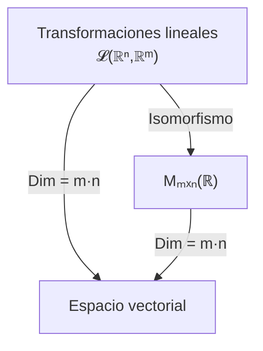

# Álgebra Lineal I - Transformaciones lineales y matrices

## 4.3 Isomorfismos entre el espacio de matrices y el de transformaciones lineales.

---

### 1. Concepto de Isomorfismo

Un **isomorfismo** entre dos espacios vectoriales $V$ y $W$ es una transformación lineal

$$ T: V \to W $$

que es **biyectiva**, es decir:

1. **Inyectiva:** $T(\mathbf{u}) = T(\mathbf{v}) \implies \mathbf{u} = \mathbf{v}$
2. **Sobreyectiva:** Para todo $\mathbf{w} \in W$ existe $\mathbf{v} \in V$ tal que $T(\mathbf{v}) = \mathbf{w}$

Si existe un isomorfismo entre $V$ y $W$, decimos que **$V$ y $W$ son isomorfos** y escribimos:

$$ V \cong W $$

### 2. Transformaciones lineales y matrices

Sea $V = \mathbb{R}^n$ y $W = \mathbb{R}^m$.  
Toda transformación lineal $T: V \to W$ está asociada a una **matriz** $A \in M_{m \times n}(\mathbb{R})$ tal que:

$$ T(\mathbf{x}) = A \mathbf{x} $$

Esto establece una correspondencia directa:

$$ \mathcal{L}(\mathbb{R}^n, \mathbb{R}^m) \cong M_{m \times n}(\mathbb{R}) $$

donde:

- $\mathcal{L}(\mathbb{R}^n, \mathbb{R}^m)$ = espacio de transformaciones lineales de $\mathbb{R}^n$ en $\mathbb{R}^m$
- $M_{m \times n}(\mathbb{R})$ = espacio vectorial de matrices $m \times n$ con entradas reales.

### 3. Dimensión de los espacios

- La dimensión de $\mathcal{L}(\mathbb{R}^n, \mathbb{R}^m)$ es:

  $$ \dim \mathcal{L}(\mathbb{R}^n, \mathbb{R}^m) = m \cdot n $$

- La dimensión de $M_{m \times n}(\mathbb{R})$ también es:

  $$ \dim M_{m \times n}(\mathbb{R}) = m \cdot n $$

Esto refuerza la idea de que ambos espacios son **isomorfos**.

### 4. Ejemplo de Isomorfismo

Sea $T: \mathbb{R}^2 \to \mathbb{R}^2$ definido por:

$$ T(x, y) = (2x + y, 3x - y) $$

1. La matriz asociada es:

   $$ [T] = \begin{bmatrix} 2 & 1 \\\ 3 & -1 \end{bmatrix} $$

2. Cada transformación lineal $T \in \mathcal{L}(\mathbb{R}^2, \mathbb{R}^2)$ corresponde **únicamente** a una matriz $A \in M_{2 \times 2}(\mathbb{R})$.

3. La operación de composición de transformaciones corresponde a la multiplicación de matrices.

### 5. Diagrama explicativo



### 6. Ejemplo en Python

```python
import numpy as np

# Definimos una transformación lineal T: R2 -> R2
def T(v):
    x, y = v
    return np.array([2*x + y, 3*x - y])

# Base canónica
e1 = np.array([1,0])
e2 = np.array([0,1])

# Imagen de los vectores de la base
col1 = T(e1)
col2 = T(e2)

# Matriz asociada
A = np.column_stack([col1, col2])
print("Matriz asociada a T:\n", A)

# Verificamos que T(x) = A*x
x = np.array([4, -2])
print("T(x) =", T(x))
print("A*x =", A @ x)
```

Esto muestra el **isomorfismo práctico**: la transformación y la matriz actúan de forma equivalente.

### 7. Propiedades del isomorfismo

1. **Correspondencia 1 a 1**:
   Cada transformación lineal $T$ está asociada a una única matriz $A$, y viceversa.

2. **Estructura preservada**:

   - Suma de transformaciones $\leftrightarrow$ Suma de matrices.
   - Multiplicación por escalar $\leftrightarrow$ Multiplicación por escalar en matrices.
   - Composición $\leftrightarrow$ Multiplicación de matrices.

3. **Isomorfismo natural**:
   Esta correspondencia no depende de elecciones adicionales si se usa la base canónica.

### 8. Ejemplo Geométrico: Rotación en el plano

La transformación de rotación $R\_\theta: \mathbb{R}^2 \to \mathbb{R}^2$ tiene asociada la matriz:

$$ [R_\theta] = \begin{bmatrix} \cos\theta & -\sin\theta \\\ \sin\theta & \cos\theta \end{bmatrix} $$

Ejemplo: para $\theta = 90^\circ$:

$$ R_{90^\circ} = \begin{bmatrix} 0 & -1 \\\ 1 & 0 \end{bmatrix} $$

### 9. Conclusión

- El espacio de transformaciones lineales $\mathcal{L}(\mathbb{R}^n, \mathbb{R}^m)$ y el espacio de matrices $M\_{m \times n}(\mathbb{R})$ son **isomorfos**.
- Esta relación facilita los cálculos: podemos trabajar con matrices en lugar de funciones abstractas.
- El isomorfismo respeta todas las operaciones lineales, garantizando una equivalencia completa entre ambos espacios.

### 10. Referencias

- Lay, David C. _Álgebra Lineal y sus Aplicaciones_. Pearson.
- Strang, Gilbert. _Introduction to Linear Algebra_. MIT Press.
- Axler, Sheldon. _Linear Algebra Done Right_. Springer.
- Hoffman, Kunze. _Álgebra Lineal_. Prentice Hall.
