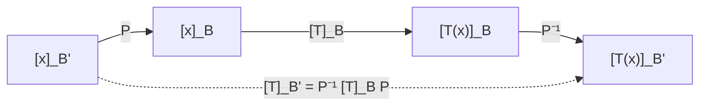

# Álgebra Lineal I - Transformaciones lineales y matrices

## 4.4 Cambios de base.

---

### 1. Concepto de Base

Una **base** de un espacio vectorial $V$ es un conjunto ordenado de vectores:

$$
\mathcal{B} = \{\mathbf{v}_1, \mathbf{v}_2, \dots, \mathbf{v}_n\}
$$

tal que:

1. **Son linealmente independientes**.
2. **Generan** todo el espacio $V.$

Con respecto a una base $\mathcal{B},$ todo vector $\mathbf{x} \in V$ puede escribirse de manera única como:

$$
\mathbf{x} = c_1 \mathbf{v}_1 + c_2 \mathbf{v}_2 + \dots + c_n \mathbf{v}_n
$$

El vector columna de coeficientes

$$ [\mathbf{x}]_{\mathcal{B}} = \begin{bmatrix} c_1 \\ c_2 \\ \vdots \\ c_n \end{bmatrix} $$

se llama vector de **coordenadas** de $\mathbf{x}$ en la base $\mathcal{B}.$

### 2. Cambio de base

Supongamos que $\mathcal{B}$ y $\mathcal{B}'$ son dos bases de $V.$

Sea $\mathcal{B}' = \{\mathbf{w}_1, \ldots, \mathbf{w}_n\}.$ La **matriz de cambio de base** de $\mathcal{B}'$ a $\mathcal{B}$ es la matriz $P = P_{\mathcal{B}\leftarrow\mathcal{B}'}$ cuya columna $j$ son las coordenadas de $\mathbf{w}_j$ en la base $\mathcal{B}:$

$$ P = \big[\,[\mathbf{w}_1]_\mathcal{B} \mid [\mathbf{w}_2]_\mathcal{B} \mid \cdots \mid [\mathbf{w}_n]_\mathcal{B}\,\big] $$

Esta matriz convierte coordenadas en la base nueva a coordenadas en la base original:

$$ [\mathbf{x}]_{\mathcal{B}} = P \, [\mathbf{x}]_{\mathcal{B}'} $$

- $P$ siempre es invertible, porque sus columnas son coordenadas de vectores linealmente independientes.
- El cambio en sentido contrario usa la inversa:

  $$ [\mathbf{x}]_{\mathcal{B}'} = P^{-1} \, [\mathbf{x}]_{\mathcal{B}} $$

- Cuando $\mathcal{B}$ es la base canónica de $\mathbb{R}^n,$ las columnas de $P$ son simplemente los vectores de $\mathcal{B}'.$

Hay que cuidar la notación, porque algunos libros llaman matriz de cambio de $\mathcal{B}$ a $\mathcal{B}'$ a la inversa $P^{-1}.$ Lo importante es saber qué coordenadas entran y cuáles salen.

**Ejemplo.** Con $\mathcal{B}$ canónica y $\mathcal{B}' = \{(1, 1), (1, -1)\},$ el vector $\mathbf{x} = (3, 1)$ cumple $(3, 1) = 2(1, 1) + 1(1, -1),$ así que $[\mathbf{x}]_{\mathcal{B}'} = (2, 1)^T.$ Se comprueba que $P(2, 1)^T = (3, 1)^T.$

### 3. Cambio de base en Transformaciones Lineales

Si $T: V \to V$ es una transformación lineal, su matriz depende de la base elegida.

- Respecto a la base $\mathcal{B},$ la matriz es $[T]_{\mathcal{B}}.$
- Respecto a la base $\mathcal{B}',$ la matriz es $[T]_{\mathcal{B}'}.$

La relación entre ambas es:

$$ [T]_{\mathcal{B}'} = P^{-1} [T]_{\mathcal{B}} P $$

donde $P = P_{\mathcal{B}\leftarrow\mathcal{B}'}$ es la matriz de cambio de base de la sección anterior.

**Por qué.** Para leer $[T]_{\mathcal{B}'}$ se parte de coordenadas en $\mathcal{B}',$ se pasan a $\mathcal{B}$ con $P,$ se aplica $[T]_\mathcal{B}$ y se regresa a $\mathcal{B}'$ con $P^{-1}.$ Las matrices se leen de derecha a izquierda.

Esto significa que **matrices distintas pueden representar la misma transformación lineal**, dependiendo de la base.

### 4. Ejemplo práctico

Sea $T: \mathbb{R}^2 \to \mathbb{R}^2$ definido por:

$$
T(x, y) = (2x + y, \; x + 3y)
$$

1. **Base canónica** $\mathcal{B} = \{(1,0), (0,1)\}$

   - $T(1,0) = (2,1)$
   - $T(0,1) = (1,3)$
   - Entonces:

   $$ [T]_{\mathcal{B}} = \begin{bmatrix} 2 & 1 \\ 1 & 3 \end{bmatrix} $$

2. **Nueva base** $\mathcal{B}' = \{(1,1), (1,-1)\}$

   - La matriz de cambio de base $P$ tiene como columnas los vectores de $\mathcal{B}'$ en la base canónica:

   $$ P = \begin{bmatrix} 1 & 1 \\ 1 & -1 \end{bmatrix} $$

   - Calculamos la matriz de $T$ en la nueva base:

   $$ [T]_{\mathcal{B}'} = P^{-1} [T]_{\mathcal{B}} P = \frac{1}{2}\begin{bmatrix} 1 & 1 \\ 1 & -1 \end{bmatrix} \begin{bmatrix} 2 & 1 \\ 1 & 3 \end{bmatrix} \begin{bmatrix} 1 & 1 \\ 1 & -1 \end{bmatrix} = \begin{bmatrix} \frac{7}{2} & -\frac{1}{2} \\ -\frac{1}{2} & \frac{3}{2} \end{bmatrix} $$

   - Comprobación directa: $T(1, 1) = (3, 4) = \frac{7}{2}(1, 1) - \frac{1}{2}(1, -1)$ y $T(1, -1) = (1, -2) = -\frac{1}{2}(1, 1) + \frac{3}{2}(1, -1).$ Las columnas coinciden.
   - La traza $(5)$ y el determinante $(5)$ son iguales en ambas matrices, como debe ocurrir con matrices semejantes.

### 5. Ejemplo en Python

```python
import numpy as np

# Matriz de T en base canónica
A = np.array([[2, 1],
              [1, 3]])

# Base nueva B' = {(1,1), (1,-1)}
P = np.array([[1, 1],
              [1, -1]])

# Matriz de T en la nueva base
P_inv = np.linalg.inv(P)
A_new = P_inv @ A @ P

print("Matriz en base canónica:\n", A)
print("\nMatriz de cambio de base P:\n", P)
print("\nMatriz en la nueva base:\n", A_new)
```

**Salida esperada:**

```
Matriz en base canónica:
 [[2 1]
 [1 3]]

Matriz de cambio de base P:
 [[ 1  1]
 [ 1 -1]]

Matriz en la nueva base:
 [[ 3.5 -0.5]
 [-0.5  1.5]]
```

### 6. Diagrama explicativo



### 7. Propiedades del cambio de base

1. La matriz de cambio de base $P$ siempre es **invertible**.
2. El cambio de base **no altera la transformación lineal**, solo su representación matricial.
3. Dos matrices $A$ y $B$ son **semejantes** si existe $P$ invertible tal que:

   $$ B = P^{-1} A P $$

   Esto significa que representan la misma transformación en bases distintas.
4. Las matrices semejantes comparten determinante, traza, rango, polinomio característico y valores propios, porque esas cantidades dependen solo de la transformación.

### 8. Conexión con diagonalización

- Un caso especial importante del cambio de base es la **diagonalización**.
- Si existe una base de vectores propios de $T,$ la matriz de $T$ en esa base es **diagonal**.
- Es decir:

  $$ A = P D P^{-1} $$

  donde $D$ es una matriz diagonal con los valores propios y las columnas de $P$ son los vectores propios.

**Ejemplo.** $A = \begin{bmatrix} 2 & 1 \\ 1 & 2 \end{bmatrix}$ tiene vectores propios $(1, 1)$ con valor propio $3$ y $(1, -1)$ con valor propio $1.$ En la base $\mathcal{B}' = \{(1, 1), (1, -1)\}$ la matriz es $\begin{bmatrix} 3 & 0 \\ 0 & 1 \end{bmatrix}:$ la transformación estira por $3$ en la dirección de $(1, 1)$ y deja fija la dirección de $(1, -1).$

### 9. Ejercicios Propuestos

1. Encuentra las coordenadas de $(5, -1)$ en la base $\{(1, 2), (3, 1)\}.$
2. Sea $T(x, y) = (y, x)$ la reflexión sobre $y = x.$ Calcula $[T]$ en la base $\{(1, 1), (1, -1)\}$ usando $P^{-1}[T]P.$
3. Demuestra que si $B = P^{-1}AP,$ entonces $\det(B) = \det(A).$

**Soluciones.** 1) $a(1, 2) + b(3, 1) = (5, -1)$ da $a = -\frac{8}{5}$ y $b = \frac{11}{5}.$ 2) $\begin{bmatrix} 1 & 0 \\ 0 & -1 \end{bmatrix}.$ 3) $\det(P^{-1}AP) = \det(P)^{-1}\det(A)\det(P) = \det(A).$

### 10. Conclusión

- El **cambio de base** es una herramienta para expresar vectores y transformaciones en diferentes sistemas de referencia.
- Permite **simplificar cálculos**, especialmente al diagonalizar matrices o buscar representaciones más convenientes.
- Cambiar de base **no cambia el objeto matemático**, solo su descripción.

### 11. Referencias

- Lay, David C. _Álgebra Lineal y sus Aplicaciones_. Pearson.
- Strang, Gilbert. _Introduction to Linear Algebra_. MIT Press.
- Axler, Sheldon. _Linear Algebra Done Right_. Springer.
- Hoffman, Kunze. _Álgebra Lineal_. Prentice Hall.
