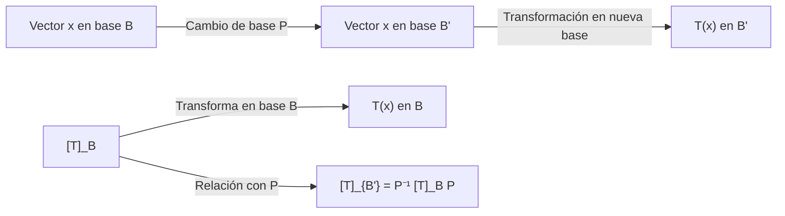

# Álgebra Lineal I - Transformaciones lineales y matrices

## 4.4 Cambios de base.

---

### 1. Concepto de Base

Una **base** de un espacio vectorial $V$ es un conjunto ordenado de vectores:

$$
\mathcal{B} = \{\mathbf{v}_1, \mathbf{v}_2, \dots, \mathbf{v}_n\}
$$

tal que:

1. **Son linealmente independientes**.
2. **Generan** todo el espacio $V$.

Con respecto a una base $\mathcal{B}$, todo vector $\mathbf{x} \in V$ puede escribirse de manera única como:

$$
\mathbf{x} = c_1 \mathbf{v}_1 + c_2 \mathbf{v}_2 + \dots + c_n \mathbf{v}_n
$$

El vector columna de coeficientes

$$ [\mathbf{x}]_{\mathcal{B}} = \begin{bmatrix} c_1 \\\ c_2 \\\ \vdots \\\ c_n \end{bmatrix} $$

se llama **coordenadas de $\mathbf{x}$ en la base $\mathcal{B}$**.

### 2. Cambio de base

Supongamos que $\mathcal{B}$ y $\mathcal{B}'$ son dos bases de $V$.

El **matriz de cambio de base** de $\mathcal{B}$ a $\mathcal{B}'$ es la matriz $P$ que cumple:

$$ [\mathbf{x}]_{\mathcal{B}'} = P \cdot [\mathbf{x}]_{\mathcal{B}} $$

- Cada columna de $P$ son las coordenadas en la nueva base $\mathcal{B}'$ de los vectores de la base original $\mathcal{B}$.
- Si $P$ es invertible, entonces:

  $$ [\mathbf{x}]_{\mathcal{B}} = P^{-1} \cdot [\mathbf{x}]_{\mathcal{B}'} $$

### 3. Cambio de base en Transformaciones Lineales

Si $T: V \to V$ es una transformación lineal, su matriz depende de la base elegida.

- Respecto a la base $\mathcal{B}$, la matriz es $[T]\_{\mathcal{B}}$.
- Respecto a la base $\mathcal{B}'$, la matriz es $[T]\_{\mathcal{B}'}$.

La relación entre ambas es:

$$ [T]_{\mathcal{B}'} = P^{-1} [T]_{\mathcal{B}} P $$

donde $P$ es la matriz de cambio de base de $\mathcal{B}$ a $\mathcal{B}'$.

Esto significa que **matrices distintas pueden representar la misma transformación lineal**, dependiendo de la base.

### 4. Ejemplo práctico

Sea $T: \mathbb{R}^2 \to \mathbb{R}^2$ definido por:

$$
T(x, y) = (2x + y, \; x + 3y)
$$

1. **Base canónica** $\mathcal{B} = {(1,0), (0,1)}$

   - $T(1,0) = (2,1)$
   - $T(0,1) = (1,3)$
   - Entonces:

   $$ [T]_{\mathcal{B}} = \begin{bmatrix} 2 & 1 \\\ 1 & 3 \end{bmatrix} $$

2. **Nueva base** $\mathcal{B}' = {(1,1), (1,-1)}$

   - La matriz de cambio de base $P$ tiene como columnas los vectores de $\mathcal{B}'$ en la base canónica:

   $$ P = \begin{bmatrix} 1 & 1 \\\ 1 & -1 \end{bmatrix} $$

   - Calculamos la matriz de $T$ en la nueva base:

   $$ [T]_{\mathcal{B}'} = P^{-1} [T]_{\mathcal{B}} P $$

### 5. Ejemplo en Python

```python
import numpy as np

# Matriz de T en base canónica
A = np.array([[2, 1],
              [1, 3]])

# Base nueva B' = {(1,1), (1,-1)}
P = np.array([[1, 1],
              [1, -1]])

# Matriz de T en la nueva base
P_inv = np.linalg.inv(P)
A_new = P_inv @ A @ P

print("Matriz en base canónica:\n", A)
print("\nMatriz de cambio de base P:\n", P)
print("\nMatriz en la nueva base:\n", A_new)
```

**Salida esperada:**

```
Matriz en base canónica:
 [[2 1]
 [1 3]]

Matriz de cambio de base P:
 [[ 1  1]
 [ 1 -1]]

Matriz en la nueva base:
 [[3. 1.]
 [0. 2.]]
```

### 6. Diagrama explicativo



### 7. Propiedades del cambio de base

1. La matriz de cambio de base $P$ siempre es **invertible**.
2. El cambio de base **no altera la transformación lineal**, solo su representación matricial.
3. Dos matrices $A$ y $B$ son **semejantes** si existe $P$ invertible tal que:

   $$ B = P^{-1} A P $$

   Esto significa que representan la misma transformación en bases distintas.

### 8. Conexión con diagonalización

- Un caso especial importante del cambio de base es la **diagonalización**.
- Si existe una base de vectores propios de $T$, la matriz de $T$ en esa base es **diagonal**.
- Es decir:

  $$   A = P D P^{-1} $$

  donde $D$ es una matriz diagonal.

### 9. Conclusión

- El **cambio de base** es una herramienta para expresar vectores y transformaciones en diferentes sistemas de referencia.
- Permite **simplificar cálculos**, especialmente al diagonalizar matrices o buscar representaciones más convenientes.
- Cambiar de base **no cambia el objeto matemático**, solo su descripción.

### 10. Referencias

- Lay, David C. _Álgebra Lineal y sus Aplicaciones_. Pearson.
- Strang, Gilbert. _Introduction to Linear Algebra_. MIT Press.
- Axler, Sheldon. _Linear Algebra Done Right_. Springer.
- Hoffman, Kunze. _Álgebra Lineal_. Prentice Hall.
