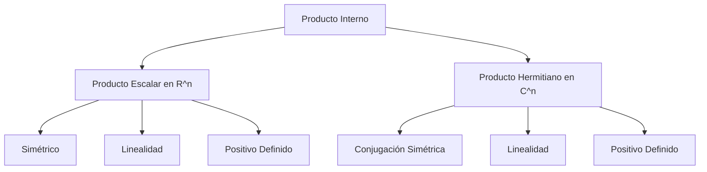

# Álgebra Lineal I - Producto escalar

## 5.1 Productos escalares y hermitianos.

---

### Tema: Producto escalar

#### Subtema: Productos escalares y hermitianos

### 1. Introducción

En Álgebra Lineal, el **producto escalar** (o **producto interno**) es una generalización del producto punto en $\mathbb{R}^n$.
Este concepto es fundamental porque permite definir nociones de longitud, ángulo y ortogonalidad en espacios vectoriales, no solo reales, sino también complejos.

Cuando extendemos la idea al caso de espacios complejos, necesitamos un **producto hermitiano**, que asegura propiedades similares a las del producto escalar en los reales, pero adaptadas a la presencia de números complejos.

### 2. Definiciones Fundamentales

#### 2.1 Producto escalar en $\mathbb{R}^n$

Un **producto escalar** en $\mathbb{R}^n$ es una función:

$$ \langle \cdot, \cdot \rangle : \mathbb{R}^n \times \mathbb{R}^n \to \mathbb{R} $$

que satisface las propiedades:

1. **Linealidad en la primera variable**
   $\langle au + bv, w \rangle = a \langle u, w \rangle + b \langle v, w \rangle$

2. **Simetría**
   $\langle u, v \rangle = \langle v, u \rangle$

3. **Positividad definida**
   $\langle v, v \rangle \geq 0$, y $\langle v, v \rangle = 0 \iff v = 0$

Ejemplo clásico en $\mathbb{R}^n$:

$$ \langle u, v \rangle = \sum_{i=1}^n u_i v_i $$

#### 2.2 Producto hermitiano en $\mathbb{C}^n$

Un **producto hermitiano** es una función:

$$ \langle \cdot, \cdot \rangle : \mathbb{C}^n \times \mathbb{C}^n \to \mathbb{C} $$

con propiedades:

1. **Linealidad en la primera variable**
   $\langle au + bv, w \rangle = a \langle u, w \rangle + b \langle v, w \rangle$

2. **Conjugación simétrica**
   $\langle u, v \rangle = \overline{\langle v, u \rangle}$

3. **Positividad definida**
   $\langle v, v \rangle \geq 0$, y $\langle v, v \rangle = 0 \iff v = 0$

Ejemplo clásico en $\mathbb{C}^n$:

$$ \langle u, v \rangle = \sum_{i=1}^n u_i \overline{v_i} $$

### 3. Interpretaciones geométricas

- En $\mathbb{R}^n$, el producto escalar define ángulos:

  $$
  \cos(\theta) = \frac{\langle u, v \rangle}{\|u\|\|v\|}
  $$

- En $\mathbb{C}^n$, el producto hermitiano también permite medir ángulos y longitudes, pero tomando en cuenta el conjugado complejo.

### 4. Ejemplos

#### Ejemplo 1: Producto escalar en $\mathbb{R}^3$

Sea $u = (1, 2, 3)$ y $v = (4, -1, 2)$:

$$ \langle u, v \rangle = 1\cdot 4 + 2 \cdot (-1) + 3 \cdot 2 = 4 - 2 + 6 = 8 $$

#### Ejemplo 2: Producto hermitiano en $\mathbb{C}^2$

Sea $u = (1+i, 2)$ y $v = (3, -i)$:

$$ \langle u, v \rangle = (1+i)\overline{3} + (2)\overline{-i} = (1+i)(3) + 2(i) = 3 + 3i + 2i = 3 + 5i $$

### 5. Implementación en código

#### Python (NumPy)

```python
import numpy as np

# Producto escalar en R^n
u = np.array([1, 2, 3])
v = np.array([4, -1, 2])
producto_escalar = np.dot(u, v)
print("Producto escalar:", producto_escalar)

# Producto hermitiano en C^n
u = np.array([1+1j, 2])
v = np.array([3, -1j])
producto_hermitiano = np.vdot(v, u)  # vdot aplica el conjugado al primero
print("Producto hermitiano:", producto_hermitiano)
```

### 6. Propiedades importantes

1. **Ortogonalidad**:

   $$ u \perp v \iff \langle u, v \rangle = 0 $$

2. **Norma inducida**:

   $$ \| v \| = \sqrt{\langle v, v \rangle} $$

3. **Desigualdad de Cauchy-Schwarz**:

   $$ |\langle u, v \rangle| \leq \|u\| \cdot \|v\| $$

4. **Desigualdad triangular**:

   $$ \|u + v\| \leq \|u\| + \|v\| $$

### 7. Diagrama conceptual (Mermaid)



### 8. Referencias

- Lay, D. C. (2016). **Álgebra Lineal y sus aplicaciones**. Pearson.
- Axler, S. (2015). **Linear Algebra Done Right**. Springer.
- Strang, G. (2016). **Introduction to Linear Algebra**. Wellesley-Cambridge Press.
- Documentación de NumPy: [https://numpy.org/doc/](https://numpy.org/doc/)
