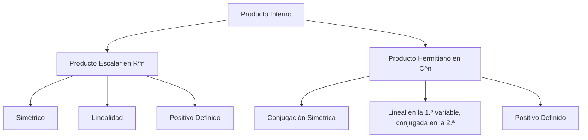

# Álgebra Lineal I - Producto escalar

## 5.1 Productos escalares y hermitianos.

---

### 1. Introducción

En Álgebra Lineal, el **producto escalar** (o **producto interno**) es una generalización del producto punto en $\mathbb{R}^n.$
Este concepto es fundamental porque permite definir nociones de longitud, ángulo y ortogonalidad en espacios vectoriales, no solo reales, sino también complejos.

Cuando extendemos la idea al caso de espacios complejos, necesitamos un **producto hermitiano**, que asegura propiedades similares a las del producto escalar en los reales, pero adaptadas a la presencia de números complejos.

### 2. Definiciones Fundamentales

#### 2.1 Producto escalar en $\mathbb{R}^n$

Un **producto escalar** en $\mathbb{R}^n$ es una función:

$$ \langle \cdot, \cdot \rangle : \mathbb{R}^n \times \mathbb{R}^n \to \mathbb{R} $$

que satisface las propiedades:

1. **Linealidad en la primera variable**
   $\langle au + bv, w \rangle = a \langle u, w \rangle + b \langle v, w \rangle$

2. **Simetría**
   $\langle u, v \rangle = \langle v, u \rangle$

3. **Positividad definida**
   $\langle v, v \rangle \geq 0,$ y $\langle v, v \rangle = 0 \iff v = 0$

Por la simetría, también es lineal en la segunda variable; se dice que es una forma **bilineal simétrica definida positiva**. La misma definición sirve en cualquier espacio vectorial real $V;$ un espacio con producto escalar se llama **espacio euclidiano** si es de dimensión finita.

Ejemplo clásico en $\mathbb{R}^n:$

$$ \langle u, v \rangle = \sum_{i=1}^n u_i v_i $$

#### 2.1.1 Otros productos escalares

El producto punto no es el único. Estos también cumplen los tres axiomas:

- **Producto ponderado** en $\mathbb{R}^n:$ $\langle u, v \rangle = \sum_{i=1}^n w_i u_i v_i$ con pesos $w_i > 0.$
- **Producto definido por una matriz**: $\langle u, v \rangle = u^T A v,$ donde $A$ es simétrica y definida positiva. Por ejemplo, con $A = \begin{bmatrix} 2 & 1 \\ 1 & 2 \end{bmatrix}$ se obtiene $\langle u, v \rangle = 2u_1v_1 + u_1v_2 + u_2v_1 + 2u_2v_2.$ El caso ponderado es el de $A$ diagonal.
- **Producto integral** en el espacio $C[a, b]$ de funciones continuas: $\langle f, g \rangle = \int_a^b f(x)g(x)\,dx.$
- **Producto de Frobenius** en $M_{m \times n}(\mathbb{R}):$ $\langle A, B \rangle = \operatorname{tr}(A^T B) = \sum_{i,j} a_{ij} b_{ij}.$

En cambio, $\langle u, v \rangle = u_1 v_1 - u_2 v_2$ **no** es un producto escalar en $\mathbb{R}^2:$ $\langle (0, 1), (0, 1) \rangle = -1 < 0.$

#### 2.2 Producto hermitiano en $\mathbb{C}^n$

Un **producto hermitiano** es una función:

$$ \langle \cdot, \cdot \rangle : \mathbb{C}^n \times \mathbb{C}^n \to \mathbb{C} $$

con propiedades:

1. **Linealidad en la primera variable**
   $\langle au + bv, w \rangle = a \langle u, w \rangle + b \langle v, w \rangle$

2. **Conjugación simétrica**
   $\langle u, v \rangle = \overline{\langle v, u \rangle}$

3. **Positividad definida**
   $\langle v, v \rangle \geq 0,$ y $\langle v, v \rangle = 0 \iff v = 0$

Consecuencias:

- $\langle v, v \rangle$ siempre es **real**, porque es igual a su conjugado.
- En la segunda variable el producto es **lineal conjugado**: $\langle u, av + bw \rangle = \overline{a}\langle u, v \rangle + \overline{b}\langle u, w \rangle.$ Por eso se dice que es **sesquilineal**.
- Algunos textos, sobre todo de física, piden linealidad en la segunda variable y conjugan la primera. Ambas convenciones son equivalentes; solo hay que ser consistente.

**¿Por qué conjugar?** Sin conjugado, en $\mathbb{C}^1$ se tendría $\langle i, i \rangle = i^2 = -1,$ y la longitud de $i$ sería imaginaria. Con conjugado, $\langle i, i \rangle = i\,\overline{i} = 1.$

Ejemplo clásico en $\mathbb{C}^n:$

$$ \langle u, v \rangle = \sum_{i=1}^n u_i \overline{v_i} $$

### 3. Interpretaciones geométricas

- En $\mathbb{R}^n,$ el producto escalar define ángulos:

  $$
  \cos(\theta) = \frac{\langle u, v \rangle}{\|u\|\|v\|}
  $$

- En $\mathbb{C}^n,$ el producto hermitiano también permite medir longitudes, $\|v\| = \sqrt{\langle v, v \rangle} = \sqrt{\sum |v_i|^2},$ y ortogonalidad. Como $\langle u, v \rangle$ es complejo, el ángulo se define usualmente con $\frac{|\langle u, v \rangle|}{\|u\|\|v\|}$ o con la parte real $\frac{\operatorname{Re}\langle u, v \rangle}{\|u\|\|v\|}.$

### 4. Ejemplos

#### Ejemplo 1: Producto escalar en $\mathbb{R}^3$

Sea $u = (1, 2, 3)$ y $v = (4, -1, 2):$

$$ \langle u, v \rangle = 1\cdot 4 + 2 \cdot (-1) + 3 \cdot 2 = 4 - 2 + 6 = 8 $$

#### Ejemplo 2: Producto hermitiano en $\mathbb{C}^2$

Sea $u = (1+i, 2)$ y $v = (3, -i):$

$$ \langle u, v \rangle = (1+i)\overline{3} + (2)\overline{-i} = (1+i)(3) + 2(i) = 3 + 3i + 2i = 3 + 5i $$

### 5. Implementación en código

#### Python (NumPy)

```python
import numpy as np

# Producto escalar en R^n
u = np.array([1, 2, 3])
v = np.array([4, -1, 2])
producto_escalar = np.dot(u, v)
print("Producto escalar:", producto_escalar)

# Producto hermitiano en C^n
u = np.array([1+1j, 2])
v = np.array([3, -1j])
producto_hermitiano = np.vdot(v, u)  # vdot conjuga su primer argumento: sum(conj(v) * u)
print("Producto hermitiano:", producto_hermitiano)  # (3+5j)

# Producto definido por una matriz simétrica definida positiva
A = np.array([[2, 1],
              [1, 2]])
x = np.array([1, -1])
y = np.array([3, 0])
print("<x, y>_A =", x @ A @ y)                       # 3
print("¿A definida positiva?", np.all(np.linalg.eigvalsh(A) > 0))

# Producto integral en C[0, 1]: <x, x^2> = 1/4
t = np.linspace(0, 1, 10001)
print("<x, x^2> ≈", np.trapezoid(t * t**2, t))
```

### 6. Propiedades importantes

1. **Ortogonalidad**:

   $$ u \perp v \iff \langle u, v \rangle = 0 $$

2. **Norma inducida**:

   $$ \| v \| = \sqrt{\langle v, v \rangle} $$

3. **Desigualdad de Cauchy-Schwarz**:

   $$ |\langle u, v \rangle| \leq \|u\| \cdot \|v\| $$

4. **Desigualdad triangular**:

   $$ \|u + v\| \leq \|u\| + \|v\| $$

**Demostración de Cauchy-Schwarz (caso real).** Si $v = 0$ es inmediata. Si no, para todo $t \in \mathbb{R}$

$$ 0 \leq \langle u - tv, u - tv \rangle = \|u\|^2 - 2t\langle u, v \rangle + t^2\|v\|^2 $$

Un polinomio cuadrático en $t$ que nunca es negativo tiene discriminante no positivo: $4\langle u, v \rangle^2 - 4\|u\|^2\|v\|^2 \leq 0.$ La igualdad ocurre si y solo si $u$ y $v$ son linealmente dependientes.

### 7. Ejercicios Propuestos

1. Calcula $\langle u, v \rangle$ para $u = (2, 0, -1)$ y $v = (1, 5, 3)$ con el producto punto y con los pesos $w = (1, 2, 3).$
2. En $\mathbb{C}^2,$ calcula $\langle u, v \rangle$ y $\langle v, u \rangle$ para $u = (i, 1)$ y $v = (1, 1 + i),$ y verifica que son conjugados.
3. Calcula $\langle 1, x \rangle$ y $\|x\|$ con el producto integral en $C[0, 1].$
4. ¿Es $\langle u, v \rangle = u_1v_1 + 3u_2v_2$ un producto escalar en $\mathbb{R}^2?$

**Soluciones.** 1) $2 - 3 = -1$ y $2 - 9 = -7.$ 2) $\langle u, v \rangle = i \cdot 1 + 1 \cdot (1 - i) = 1,$ y $\langle v, u \rangle = 1 \cdot (-i) + (1 + i) \cdot 1 = 1.$ Ambos valen $1,$ que es real e igual a su conjugado. 3) $\langle 1, x \rangle = \frac{1}{2}$ y $\|x\| = \sqrt{\int_0^1 x^2\,dx} = \frac{1}{\sqrt{3}}.$ 4) Sí: es el producto ponderado con pesos $1$ y $3.$

### 8. Diagrama conceptual (Mermaid)



### 9. Referencias

- Lay, D. C. (2016). **Álgebra Lineal y sus aplicaciones**. Pearson.
- Axler, S. (2015). **Linear Algebra Done Right**. Springer.
- Strang, G. (2016). **Introduction to Linear Algebra**. Wellesley-Cambridge Press.
- Documentación de NumPy: [https://numpy.org/doc/](https://numpy.org/doc/)
