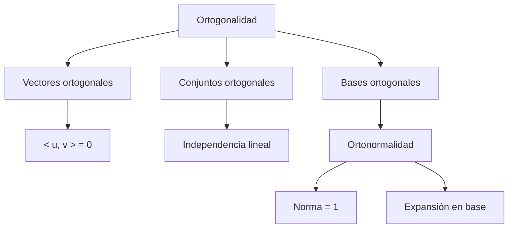

# Álgebra Lineal I - Producto escalar

## 5.2 Ortogonalidad.

---

### 1. Introducción

La **ortogonalidad** es un concepto central en Álgebra Lineal que generaliza la idea de “perpendicularidad” de la geometría euclidiana.
Gracias al **producto escalar** podemos definir cuándo dos vectores forman un ángulo recto (90°), así como construir **bases ortogonales** y **ortonormales** que simplifican muchos cálculos.

### 2. Definiciones Fundamentales

#### 2.1 Ortogonalidad de vectores

Dos vectores $u, v \in \mathbb{R}^n$ o $\mathbb{C}^n$ son **ortogonales** si:

$$ \langle u, v \rangle = 0 $$

En el caso real, esto significa que forman un ángulo de $90^\circ:$

$$ \cos(\theta) = \frac{\langle u, v \rangle}{\|u\|\|v\|}, \quad \text{si } \theta = 90^\circ \implies \cos(\theta) = 0 $$

#### 2.2 Conjuntos ortogonales

Un conjunto de vectores $\{v_1, v_2, \dots, v_k\}$ es **ortogonal** si:

$$ \langle v_i, v_j \rangle = 0, \quad \forall i \neq j $$

Si además cada vector tiene norma unitaria:

$$ \|v_i\| = 1, \quad \forall i $$

entonces el conjunto es **ortonormal**.

#### 2.3 Bases ortogonales

Una **base ortogonal** es una base de un espacio vectorial en la que todos los vectores son ortogonales entre sí.
Si además es ortonormal, los cálculos de coordenadas y proyecciones se simplifican notablemente.

### 3. Propiedades Importantes

1. **Teorema de Pitágoras.** Si $u \perp v,$ entonces $\|u + v\|^2 = \|u\|^2 + \|v\|^2,$ porque $\|u + v\|^2 = \|u\|^2 + 2\operatorname{Re}\langle u, v \rangle + \|v\|^2.$
2. **Independencia.** Un conjunto ortogonal de vectores no nulos es linealmente independiente. Si $\sum_i c_i v_i = 0,$ al hacer el producto con $v_j$ todos los términos se anulan salvo uno: $c_j\|v_j\|^2 = 0,$ y como $v_j \neq 0,$ $c_j = 0.$
3. **Coordenadas en una base ortogonal.** Si $\{v_1, \dots, v_n\}$ es una base ortogonal, las coordenadas se obtienen sin resolver sistemas:

   $$ v = \sum_{i=1}^n \frac{\langle v, v_i \rangle}{\langle v_i, v_i \rangle} v_i $$

4. **Expansión en base ortonormal.** Si $\{u_1, \dots, u_n\}$ es ortonormal, los denominadores valen $1:$

   $$ v = \sum_{i=1}^n \langle v, u_i \rangle u_i, \qquad \|v\|^2 = \sum_{i=1}^n |\langle v, u_i \rangle|^2 $$

   La segunda fórmula es la **identidad de Parseval**.

5. **Matrices ortogonales.** Si las columnas de $Q \in \mathbb{R}^{n \times n}$ son ortonormales, entonces $Q^T Q = I,$ es decir $Q^{-1} = Q^T,$ y $\|Qx\| = \|x\|$ para todo $x.$ En el caso complejo se pide $Q^* Q = I$ y $Q$ se llama **unitaria**.

### 4. Ejemplos

#### Ejemplo 1: Vectores ortogonales en $\mathbb{R}^2$

Sean $u = (1, 2)$ y $v = (2, -1):$

$$ \langle u, v \rangle = 1\cdot 2 + 2\cdot (-1) = 2 - 2 = 0 $$

Entonces $u \perp v.$

#### Ejemplo 2: Coordenadas en una base ortogonal

$\{(1, 2), (2, -1)\}$ es una base ortogonal de $\mathbb{R}^2.$ Para $v = (4, 3),$

$$ v = \frac{\langle v, (1, 2) \rangle}{5}(1, 2) + \frac{\langle v, (2, -1) \rangle}{5}(2, -1) = \frac{10}{5}(1, 2) + \frac{5}{5}(2, -1) = 2(1, 2) + 1(2, -1) $$

#### Ejemplo 3: Vectores en $\mathbb{C}^2$

Sea $u = (1, i)$ y $v = (i, 1):$

$$ \langle u, v \rangle = 1 \cdot \overline{i} + i \cdot \overline{1} = 1(-i) + i(1) = -i + i = 0 $$

Entonces $u \perp v.$ Sin el conjugado se habría obtenido $1 \cdot i + i \cdot 1 = 2i \neq 0;$ el producto punto ordinario no sirve en $\mathbb{C}^n.$

### 5. Implementación en Código

#### Python (NumPy)

```python
import numpy as np

def son_ortogonales(u, v):
    producto = np.vdot(u, v)  # incluye conjugado complejo
    return np.isclose(producto, 0)

# Ejemplo en R^2
u = np.array([1, 2])
v = np.array([2, -1])
print("Ortogonalidad R^2:", son_ortogonales(u, v))

# Ejemplo en C^2
u = np.array([1, 1j])
v = np.array([1j, 1])
print("Ortogonalidad C^2:", son_ortogonales(u, v))

# Coordenadas en una base ortogonal sin resolver sistemas
base = [np.array([1, 2]), np.array([2, -1])]
w = np.array([4, 3])
coef = [float(np.dot(w, b) / np.dot(b, b)) for b in base]
print("Coordenadas:", coef)                                  # [2.0, 1.0]
print("Reconstrucción:", sum(c * b for c, b in zip(coef, base)))  # [4. 3.]

# Matriz ortogonal: columnas ortonormales
Q = np.column_stack([b / np.linalg.norm(b) for b in base])
print("Q^T Q = I:", np.allclose(Q.T @ Q, np.eye(2)))
```

### 6. Ejercicios Propuestos

1. Verifica si los vectores $u = (1, 0, -1)$ y $v = (2, 1, 2)$ son ortogonales en $\mathbb{R}^3.$
2. Determina si $\{(1, 0, 0), (0, 1, 0), (0, 0, 1)\}$ es una base ortogonal y si además es ortonormal.
3. Calcula la proyección de $v = (2, 3)$ sobre $u = (1, 1).$

   $$ \text{proj}_u(v) = \frac{\langle v, u \rangle}{\langle u, u \rangle} u $$

4. En $\mathbb{C}^2,$ verifica si los vectores $u = (1, i)$ y $v = (1, -i)$ son ortogonales.
5. Construye una base ortonormal en $\mathbb{R}^2$ a partir de los vectores $(1, 2)$ y $(2, 1)$ aplicando el **procedimiento de Gram-Schmidt**.

**Soluciones.**

1. $\langle u, v \rangle = 2 + 0 - 2 = 0,$ así que son ortogonales.
2. Es ortogonal y además ortonormal, porque cada vector tiene norma $1.$
3. $\text{proj}_u(v) = \frac{5}{2}(1, 1) = \left(\frac{5}{2}, \frac{5}{2}\right).$
4. $\langle u, v \rangle = 1 \cdot \overline{1} + i \cdot \overline{-i} = 1 + i \cdot i = 0,$ así que son ortogonales.
5. $u_1 = \frac{1}{\sqrt{5}}(1, 2).$ Luego $w_2 = (2, 1) - \frac{4}{5}(1, 2) = \left(\frac{6}{5}, -\frac{3}{5}\right),$ y al normalizar $u_2 = \frac{1}{\sqrt{5}}(2, -1).$

### 7. Diagrama Conceptual (Mermaid)



### 8. Referencias

- Lay, D. C. (2016). **Álgebra Lineal y sus aplicaciones**. Pearson.
- Strang, G. (2016). **Introduction to Linear Algebra**. Wellesley-Cambridge Press.
- Axler, S. (2015). **Linear Algebra Done Right**. Springer.
- Documentación de NumPy: [https://numpy.org/doc/](https://numpy.org/doc/)
