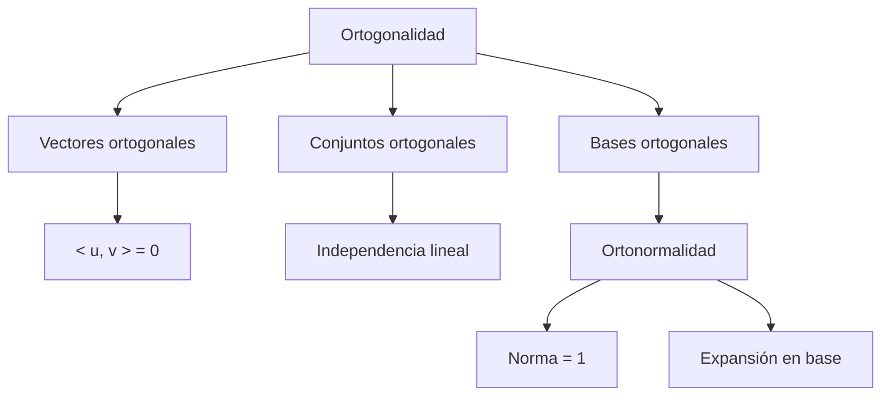

# Álgebra Lineal I - Producto escalar

## 5.2 Ortogonalidad.

---

### 1. Introducción

La **ortogonalidad** es un concepto central en Álgebra Lineal que generaliza la idea de “perpendicularidad” de la geometría euclidiana.
Gracias al **producto escalar** podemos definir cuándo dos vectores forman un ángulo recto (90°), así como construir **bases ortogonales** y **ortonormales** que simplifican muchos cálculos.

### 2. Definiciones Fundamentales

#### 2.1 Ortogonalidad de vectores

Dos vectores $u, v \in \mathbb{R}^n$ o $\mathbb{C}^n$ son **ortogonales** si:

$$ \langle u, v \rangle = 0 $$

En el caso real, esto significa que forman un ángulo de $90^\circ$:

$$ \cos(\theta) = \frac{\langle u, v \rangle}{\|u\|\|v\|}, \quad \text{si } \theta = 90^\circ \implies \cos(\theta) = 0 $$

#### 2.2 Conjuntos ortogonales

Un conjunto de vectores ${v\_1, v\_2, \dots, v\_k}$ es **ortogonal** si:

$$ \langle v_i, v_j \rangle = 0, \quad \forall i \neq j $$

Si además cada vector tiene norma unitaria:

$$ \|v_i\| = 1, \quad \forall i $$

entonces el conjunto es **ortonormal**.

#### 2.3 Bases ortogonales

Una **base ortogonal** es una base de un espacio vectorial en la que todos los vectores son ortogonales entre sí.
Si además es ortonormal, los cálculos de coordenadas y proyecciones se simplifican notablemente.

### 3. Propiedades Importantes

1. Si $u \perp v$, entonces $\langle u, v \rangle = 0$.
2. Un conjunto ortogonal de vectores no nulos es linealmente independiente.
3. Si ${u\_1, \dots, u\_n}$ es una base ortonormal, entonces cualquier vector $v$ se puede expresar como:

   $$ v = \sum_{i=1}^n \langle v, u_i \rangle u_i $$

   (Expansión en base ortonormal).

### 4. Ejemplos

#### Ejemplo 1: Vectores ortogonales en $\mathbb{R}^2$

Sean $u = (1, 2)$ y $v = (2, -1)$:

$$ \langle u, v \rangle = 1\cdot 2 + 2\cdot (-1) = 2 - 2 = 0 $$

Entonces $u \perp v$.

#### Ejemplo 2: Vectores en $\mathbb{C}^2$

Sea $u = (1, i)$ y $v = (i, 1)$:

$$ \langle u, v \rangle = 1 \cdot \overline{i} + i \cdot \overline{1} = 1(-i) + i(1) = -i + i = 0 $$

Entonces $u \perp v$.

### 5. Implementación en Código

#### Python (NumPy)

```python
import numpy as np

def son_ortogonales(u, v):
    producto = np.vdot(u, v)  # incluye conjugado complejo
    return np.isclose(producto, 0)

# Ejemplo en R^2
u = np.array([1, 2])
v = np.array([2, -1])
print("Ortogonalidad R^2:", son_ortogonales(u, v))

# Ejemplo en C^2
u = np.array([1, 1j])
v = np.array([1j, 1])
print("Ortogonalidad C^2:", son_ortogonales(u, v))
```

### 6. Ejercicios Propuestos

1. Verifica si los vectores $u = (1, 0, -1)$ y $v = (2, 1, 2)$ son ortogonales en $\mathbb{R}^3$.
2. Determina si ${(1, 0, 0), (0, 1, 0), (0, 0, 1)}$ es una base ortogonal y si además es ortonormal.
3. Calcula la proyección de $v = (2, 3)$ sobre $u = (1, 1)$.

   $$ \text{proj}_u(v) = \frac{\langle v, u \rangle}{\langle u, u \rangle} u $$

4. En $\mathbb{C}^2$, verifica si los vectores $u = (1, i)$ y $v = (1, -i)$ son ortogonales.
5. Construye una base ortonormal en $\mathbb{R}^2$ a partir de los vectores $(1, 2)$ y $(2, 1)$ aplicando el **procedimiento de Gram-Schmidt**.

### 7. Diagrama Conceptual (Mermaid)



### 8. Referencias

- Lay, D. C. (2016). **Álgebra Lineal y sus aplicaciones**. Pearson.
- Strang, G. (2016). **Introduction to Linear Algebra**. Wellesley-Cambridge Press.
- Axler, S. (2015). **Linear Algebra Done Right**. Springer.
- Documentación de NumPy: [https://numpy.org/doc/](https://numpy.org/doc/)
