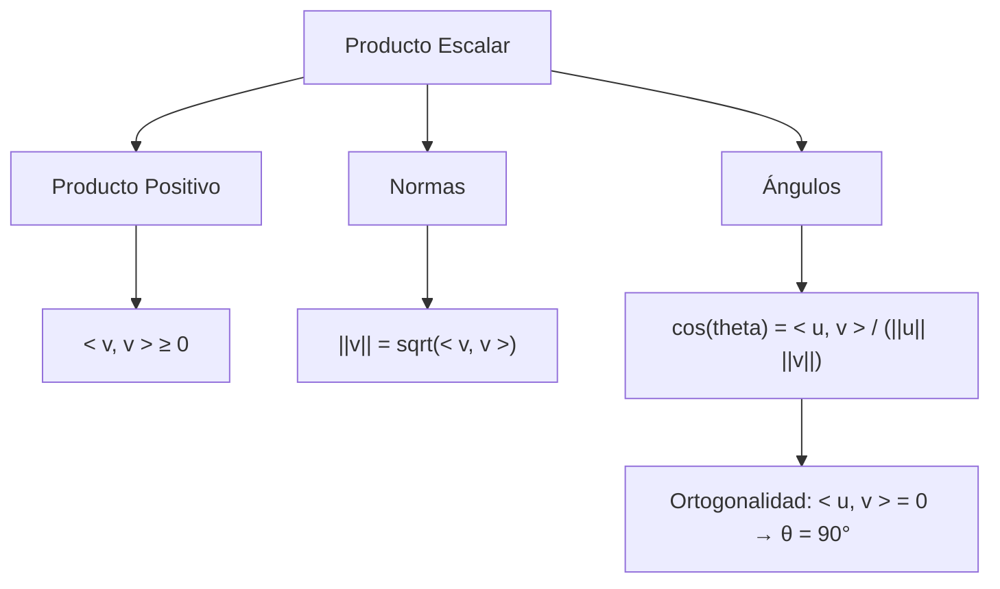

# Álgebra Lineal I - Producto escalar

## 5.3 Productos positivos, normas y ángulos.

---

### 1. Introducción

El **producto escalar** no solo permite multiplicar vectores, sino que también nos proporciona herramientas fundamentales para:

- Definir **longitudes** de vectores (normas).
- Calcular **ángulos** entre vectores.
- Establecer propiedades de **positividad** que permiten interpretar a los vectores como "direcciones" en el espacio.

Estos conceptos son la base de nociones como **distancia**, **ortogonalidad** y **proyecciones** en Álgebra Lineal.

### 2. Definiciones Fundamentales

#### 2.1 Producto positivo

Un producto escalar $\langle u, v \rangle$ se dice **positivo definido** si:

$$ \langle v, v \rangle \geq 0 \quad \forall v \in V $$

y además:

$$ \langle v, v \rangle = 0 \iff v = 0 $$

Esto asegura que la longitud de un vector nunca sea negativa.

#### 2.2 Norma de un vector

La **norma** (o longitud) de un vector $v$ en un espacio con producto escalar se define como:

$$ \|v\| = \sqrt{\langle v, v \rangle} $$

Propiedades:

1. $|v| \geq 0$
2. $|v| = 0 \iff v = 0$
3. $|\alpha v| = |\alpha| \cdot |v|$
4. **Desigualdad triangular**:

   $$ \|u + v\| \leq \|u\| + \|v\| $$

#### 2.3 Ángulo entre vectores

Dado $u, v \in \mathbb{R}^n$, el ángulo $\theta$ entre ellos se define como:

$$ \cos(\theta) = \frac{\langle u, v \rangle}{\|u\|\|v\|} $$

- Si $\theta = 0^\circ \implies u, v$ apuntan en la misma dirección.
- Si $\theta = 90^\circ \implies u \perp v$ (ortogonales).
- Si $\theta = 180^\circ \implies u, v$ son opuestos.

### 3. Propiedades Relevantes

1. **Desigualdad de Cauchy-Schwarz**:

$$ |\langle u, v \rangle| \leq \|u\| \cdot \|v\| $$

2. **Norma inducida**:
   La norma está inducida por el producto escalar.

3. **Relación entre ángulo y ortogonalidad**:

   $$ u \perp v \iff \langle u, v \rangle = 0 \iff \theta = 90^\circ $$

### 4. Ejemplos

#### Ejemplo 1: Producto positivo en $\mathbb{R}^3$

Sea $v = (1, 2, -2)$:

$$ \langle v, v \rangle = 1^2 + 2^2 + (-2)^2 = 1 + 4 + 4 = 9 $$

Por lo tanto:

$$ \|v\| = \sqrt{9} = 3 $$

#### Ejemplo 2: Ángulo entre vectores

Sean $u = (1, 0)$ y $v = (1, 1)$ en $\mathbb{R}^2$:

$$ \langle u, v \rangle = 1\cdot 1 + 0 \cdot 1 = 1 $$

$$ \|u\| = \sqrt{1^2 + 0^2} = 1, \quad \|v\| = \sqrt{1^2 + 1^2} = \sqrt{2} $$

$$ \cos(\theta) = \frac{1}{1 \cdot \sqrt{2}} = \frac{1}{\sqrt{2}} $$

Entonces:

$$ \theta = 45^\circ $$

#### Ejemplo 3: Ángulo en $\mathbb{C}^2$

Sean $u = (1+i, 1)$ y $v = (1, -i)$:

$$ \langle u, v \rangle = (1+i)\overline{1} + (1)\overline{-i} = (1+i)(1) + (1)(i) = 1 + i + i = 1 + 2i $$

La norma de cada vector:

$$ \|u\| = \sqrt{|1+i|^2 + |1|^2} = \sqrt{(1^2+1^2) + 1} = \sqrt{3} $$

$$ \|v\| = \sqrt{|1|^2 + |-i|^2} = \sqrt{1 + 1} = \sqrt{2} $$

Entonces:

$$ \cos(\theta) = \frac{|\langle u, v \rangle|}{\|u\|\|v\|} = \frac{|1+2i|}{\sqrt{3}\sqrt{2}} = \frac{\sqrt{1^2+2^2}}{\sqrt{6}} = \frac{\sqrt{5}}{\sqrt{6}} $$

### 5. Implementación en Código

#### Python (NumPy)

```python
import numpy as np

def norma(v):
    return np.sqrt(np.vdot(v, v))  # vdot incluye conjugado complejo

def angulo(u, v):
    cos_theta = np.vdot(u, v) / (norma(u) * norma(v))
    return np.arccos(np.real(cos_theta))  # ángulo en radianes

# Ejemplo en R^3
v = np.array([1, 2, -2])
print("Norma de v:", norma(v))

# Ángulo entre u y v en R^2
u = np.array([1, 0])
v = np.array([1, 1])
print("Ángulo u-v en grados:", np.degrees(angulo(u, v)))
```

### 6. Ejercicios Propuestos

1. Calcula la norma de los siguientes vectores:
   a) $v = (3, -4)$
   b) $v = (1, -2, 2)$

2. Verifica la desigualdad de Cauchy-Schwarz para $u = (1, 2, 3)$ y $v = (4, -1, 2)$.

3. Calcula el ángulo entre $u = (1, 2)$ y $v = (-2, 1)$ en $\mathbb{R}^2$.

4. En $\mathbb{C}^2$, determina la norma de $v = (1+i, 2-i)$.

5. Encuentra la proyección de $v = (3, 4)$ sobre $u = (1, 0)$.

   $$ \text{proj}_u(v) = \frac{\langle v, u \rangle}{\langle u, u \rangle} u $$

### 7. Diagrama Conceptual (Mermaid)



### 8. Referencias

- Lay, D. C. (2016). **Álgebra Lineal y sus aplicaciones**. Pearson.
- Strang, G. (2016). **Introduction to Linear Algebra**. Wellesley-Cambridge Press.
- Axler, S. (2015). **Linear Algebra Done Right**. Springer.
- Documentación de NumPy: [https://numpy.org/doc/](https://numpy.org/doc/)
