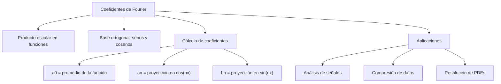

# Álgebra Lineal I - Producto escalar

## 5.4 Coeficientes de Fourier.

---

### 1. Introducción

Los **coeficientes de Fourier** surgen al expresar una función como combinación lineal (o infinita) de funciones ortogonales, típicamente senos y cosenos.

El **producto escalar** permite calcular esos coeficientes, de manera análoga a cómo se calculan coordenadas de un vector respecto a una base ortogonal.

En otras palabras:

- En **espacios vectoriales**: los coeficientes se obtienen proyectando un vector sobre una base ortogonal.
- En **espacios de funciones**: los coeficientes de Fourier se obtienen proyectando la función sobre la base de senos y cosenos.

### 2. Definiciones Fundamentales

#### 2.1 Producto escalar en espacios de funciones

Para funciones $f,g : [-\pi,\pi] \to \mathbb{R}$, el producto escalar se define como:

$$
\langle f, g \rangle = \int_{-\pi}^{\pi} f(x) g(x) \, dx
$$

Esto convierte al conjunto de funciones cuadrado-integrables en un **espacio con producto interno**.

#### 2.2 Sistema ortogonal de funciones

Un conjunto de funciones ${\phi\_n(x)}$ es ortogonal si:

$$
\langle \phi_m, \phi_n \rangle = 0, \quad m \neq n
$$

Ejemplo clásico:

- ${1, \cos(nx), \sin(nx)}\_{n=1}^\infty$ en $[-\pi,\pi]$

#### 2.3 Coeficientes de Fourier

Dada una función $f(x)$ periódica de periodo $2\pi$, su **serie de Fourier** es:

$$
f(x) \sim \frac{a_0}{2} + \sum_{n=1}^\infty \left[ a_n \cos(nx) + b_n \sin(nx) \right]
$$

donde los coeficientes se calculan mediante:

- **Coeficiente constante**:

  $$
  a_0 = \frac{1}{\pi} \int_{-\pi}^{\pi} f(x) \, dx
  $$

- **Coeficientes de coseno**:

  $$
  a_n = \frac{1}{\pi} \int_{-\pi}^{\pi} f(x) \cos(nx) \, dx
  $$

- **Coeficientes de seno**:

  $$
  b_n = \frac{1}{\pi} \int_{-\pi}^{\pi} f(x) \sin(nx) \, dx
  $$

Estos coeficientes representan las **proyecciones de $f(x)$** sobre las funciones base $\cos(nx)$ y $\sin(nx)$.

### 3. Propiedades Importantes

1. **Ortogonalidad de senos y cosenos**:

$$ \langle \cos(mx), \cos(nx) \rangle = \begin{cases} 0 & m \neq n \\\ \pi & m = n \neq 0 \end{cases} $$

$$ \langle \sin(mx), \sin(nx) \rangle = \begin{cases} 0 & m \neq n \\\ \pi & m = n \end{cases} $$

$$
\langle \cos(mx), \sin(nx) \rangle = 0
$$

2. **Parseval** (relación energía):

$$
\frac{1}{\pi}\int_{-\pi}^\pi |f(x)|^2 dx = \frac{a_0^2}{2} + \sum_{n=1}^\infty (a_n^2 + b_n^2)
$$

### 4. Ejemplos

#### Ejemplo 1: Serie de Fourier de $f(x) = x$ en $[-\pi, \pi]$

- Como $f(x)$ es **impar**, $a\_0 = a\_n = 0$.
- Solo aparecen coeficientes de seno:

$$
b_n = \frac{1}{\pi} \int_{-\pi}^{\pi} x \sin(nx) \, dx
$$

Por simetría:

$$
b_n = \frac{2}{\pi} \int_{0}^{\pi} x \sin(nx) \, dx
$$

Integración por partes:

$$
b_n = \frac{2}{\pi} \left( \frac{-x\cos(nx)}{n} \Big|_0^\pi + \frac{1}{n} \int_0^\pi \cos(nx) dx \right)
$$

$$
b_n = \frac{2}{\pi} \left( \frac{-\pi \cos(n\pi)}{n} + \frac{1}{n^2} \sin(n\pi) \right)
$$

$$
b_n = \frac{2}{n} (-1)^{n+1}
$$

Serie resultante:

$$
x \sim \sum_{n=1}^\infty \frac{2}{n} (-1)^{n+1} \sin(nx)
$$

#### Ejemplo 2: Función $f(x)=1$

- $a\_0 = \frac{1}{\pi} \int\_{-\pi}^{\pi} 1 dx = 2$
- $a\_n = 0$, $b\_n = 0$
- Serie de Fourier:

$$
f(x) = 1 \sim 1
$$

### 5. Implementación en Código

#### Python (NumPy + Sympy)

```python
import sympy as sp

x, n = sp.symbols('x n', real=True)
f = x   # función a expandir

# Coeficientes de Fourier
a0 = (1/sp.pi) * sp.integrate(f, (x, -sp.pi, sp.pi))
an = (1/sp.pi) * sp.integrate(f*sp.cos(n*x), (x, -sp.pi, sp.pi))
bn = (1/sp.pi) * sp.integrate(f*sp.sin(n*x), (x, -sp.pi, sp.pi))

print("a0 =", sp.simplify(a0))
print("an =", sp.simplify(an))
print("bn =", sp.simplify(bn))
```

### 6. Ejercicios Propuestos

1. Calcula los coeficientes de Fourier de $f(x) = |x|$ en $[-\pi, \pi]$.
2. Determina los coeficientes de Fourier de $f(x) = \cos(x)$ y verifica que solo aparece un término.
3. Expande $f(x) = x^2$ en serie de Fourier en $[-\pi, \pi]$.
4. Verifica la identidad de Parseval para $f(x) = x$ en $[-\pi, \pi]$ usando sus coeficientes de Fourier.
5. Implementa en Python un programa que grafique las aproximaciones parciales de la serie de Fourier de $f(x)=x$.

### 7. Diagrama Conceptual (Mermaid)



### 8. Referencias

- Kreyszig, E. (2011). **Advanced Engineering Mathematics**. Wiley.
- Strang, G. (2016). **Introduction to Linear Algebra**. Wellesley-Cambridge Press.
- Lay, D. C. (2016). **Álgebra Lineal y sus aplicaciones**. Pearson.
- Stein, E. & Shakarchi, R. (2003). **Fourier Analysis**. Princeton University Press.
- Documentación SymPy: [https://docs.sympy.org](https://docs.sympy.org)
