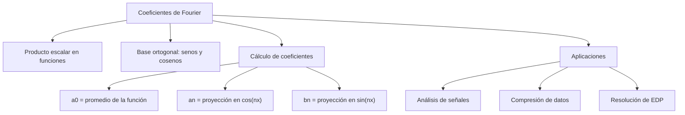

# Álgebra Lineal I - Producto escalar

## 5.4 Coeficientes de Fourier.

---

### 1. Introducción

Los **coeficientes de Fourier** surgen al expresar una función como combinación lineal (o infinita) de funciones ortogonales, típicamente senos y cosenos.

El **producto escalar** permite calcular esos coeficientes, de manera análoga a cómo se calculan coordenadas de un vector respecto a una base ortogonal.

En otras palabras:

- En **espacios vectoriales**: los coeficientes se obtienen proyectando un vector sobre una base ortogonal.
- En **espacios de funciones**: los coeficientes de Fourier se obtienen proyectando la función sobre la base de senos y cosenos.

### 2. Definiciones Fundamentales

#### 2.0 Coeficientes de Fourier en un espacio con producto escalar

Sea $V$ un espacio con producto escalar y $\{e_1, e_2, \ldots\}$ un conjunto **ortonormal**. Los **coeficientes de Fourier** de $v \in V$ respecto a ese conjunto son

$$
c_k = \langle v, e_k \rangle
$$

Si el conjunto es solo ortogonal, $c_k = \frac{\langle v, e_k \rangle}{\langle e_k, e_k \rangle}.$ Tres hechos explican por qué son importantes:

1. **Coordenadas.** Si $\{e_1, \ldots, e_n\}$ es base ortonormal, $v = \sum_{k=1}^n c_k e_k.$
2. **Mejor aproximación.** Si $W = \text{span}\{e_1, \ldots, e_n\},$ el vector de $W$ más cercano a $v$ es la proyección $\sum_{k=1}^n c_k e_k,$ y el error $v - \sum c_k e_k$ es ortogonal a $W.$ Ninguna otra elección de coeficientes da un error menor.
3. **Desigualdad de Bessel.** $\sum_{k=1}^n |c_k|^2 \leq \|v\|^2.$ Hay igualdad (Parseval) exactamente cuando $v \in W.$

**Ejemplo en** $\mathbb{R}^3.$ Con $e_1 = \frac{1}{\sqrt{2}}(1, 1, 0)$ y $e_2 = (0, 0, 1)$ y $v = (3, 1, 2):$ $c_1 = \frac{4}{\sqrt{2}} = 2\sqrt{2}$ y $c_2 = 2.$ La mejor aproximación de $v$ en el plano generado es $c_1 e_1 + c_2 e_2 = (2, 2, 2),$ el error es $(1, -1, 0),$ ortogonal a $e_1$ y $e_2,$ y Bessel da $8 + 4 = 12 \leq 14 = \|v\|^2.$

Las series de Fourier clásicas son este mismo cálculo en un espacio de funciones.

#### 2.1 Producto escalar en espacios de funciones

Para funciones $f,g : [-\pi,\pi] \to \mathbb{R},$ el producto escalar se define como:

$$
\langle f, g \rangle = \int_{-\pi}^{\pi} f(x) g(x) \, dx
$$

Esto convierte al espacio de funciones continuas en $[-\pi, \pi]$ en un **espacio con producto interno**. Con más rigor, se usa el espacio $L^2$ de funciones de cuadrado integrable, identificando funciones que difieren en un conjunto de medida cero.

#### 2.2 Sistema ortogonal de funciones

Un conjunto de funciones $\{\phi_n(x)\}$ es ortogonal si:

$$
\langle \phi_m, \phi_n \rangle = 0, \quad m \neq n
$$

Ejemplo clásico:

- $\{1, \cos(nx), \sin(nx)\}_{n=1}^\infty$ en $[-\pi,\pi]$

No es ortonormal: $\|1\|^2 = 2\pi$ y $\|\cos(nx)\|^2 = \|\sin(nx)\|^2 = \pi.$ Al dividir entre esas normas se obtiene el sistema ortonormal $\left\{\frac{1}{\sqrt{2\pi}}, \frac{\cos(nx)}{\sqrt{\pi}}, \frac{\sin(nx)}{\sqrt{\pi}}\right\}.$

#### 2.3 Coeficientes de Fourier

Dada una función $f(x)$ periódica de periodo $2\pi,$ su **serie de Fourier** es:

$$
f(x) \sim \frac{a_0}{2} + \sum_{n=1}^\infty \left[ a_n \cos(nx) + b_n \sin(nx) \right]
$$

donde los coeficientes se calculan mediante:

- **Coeficiente constante**:

  $$
  a_0 = \frac{1}{\pi} \int_{-\pi}^{\pi} f(x) \, dx
  $$

- **Coeficientes de coseno**:

  $$
  a_n = \frac{1}{\pi} \int_{-\pi}^{\pi} f(x) \cos(nx) \, dx
  $$

- **Coeficientes de seno**:

  $$
  b_n = \frac{1}{\pi} \int_{-\pi}^{\pi} f(x) \sin(nx) \, dx
  $$

Estos coeficientes son exactamente los cocientes $\frac{\langle f, \phi \rangle}{\langle \phi, \phi \rangle}$ de la sección 2.0. Por ejemplo, $a_n = \frac{\langle f, \cos(nx) \rangle}{\pi}$ y el término constante $\frac{a_0}{2} = \frac{\langle f, 1 \rangle}{2\pi}$ es el promedio de $f.$ El factor $\frac{1}{2}$ en $\frac{a_0}{2}$ aparece porque $\|1\|^2 = 2\pi$ y no $\pi.$

La suma parcial $S_N(x) = \frac{a_0}{2} + \sum_{n=1}^N \left[a_n\cos(nx) + b_n\sin(nx)\right]$ es la **mejor aproximación** de $f$ por polinomios trigonométricos de grado $N,$ en el sentido de la norma del producto escalar.

### 3. Propiedades Importantes

1. **Ortogonalidad de senos y cosenos**:

$$ \langle \cos(mx), \cos(nx) \rangle = \begin{cases} 0 & m \neq n \\ \pi & m = n \neq 0 \end{cases} $$

$$ \langle \sin(mx), \sin(nx) \rangle = \begin{cases} 0 & m \neq n \\ \pi & m = n \end{cases} $$

$$
\langle \cos(mx), \sin(nx) \rangle = 0
$$

2. **Parseval** (relación energía):

$$
\frac{1}{\pi}\int_{-\pi}^\pi |f(x)|^2 dx = \frac{a_0^2}{2} + \sum_{n=1}^\infty (a_n^2 + b_n^2)
$$

Vale para toda $f$ de cuadrado integrable. Es la versión infinita del teorema de Pitágoras.

### 4. Ejemplos

#### Ejemplo 1: Serie de Fourier de $f(x) = x$ en $[-\pi, \pi]$

- Como $f(x)$ es **impar**, $a_0 = a_n = 0.$
- Solo aparecen coeficientes de seno:

$$
b_n = \frac{1}{\pi} \int_{-\pi}^{\pi} x \sin(nx) \, dx
$$

Por simetría:

$$
b_n = \frac{2}{\pi} \int_{0}^{\pi} x \sin(nx) \, dx
$$

Integración por partes:

$$
b_n = \frac{2}{\pi} \left( \frac{-x\cos(nx)}{n} \Big|_0^\pi + \frac{1}{n} \int_0^\pi \cos(nx) dx \right)
$$

$$
b_n = \frac{2}{\pi} \left( \frac{-\pi \cos(n\pi)}{n} + \frac{1}{n^2} \sin(n\pi) \right)
$$

$$
b_n = \frac{2}{n} (-1)^{n+1}
$$

Serie resultante:

$$
x \sim \sum_{n=1}^\infty \frac{2}{n} (-1)^{n+1} \sin(nx) = 2\left(\sin x - \frac{\sin 2x}{2} + \frac{\sin 3x}{3} - \cdots\right)
$$

La serie converge a $x$ en $(-\pi, \pi);$ en $x = \pm\pi$ converge a $0,$ el promedio de los saltos de la extensión periódica.

#### Ejemplo 2: Función $f(x)=1$

- $a_0 = \frac{1}{\pi} \int_{-\pi}^{\pi} 1 \, dx = 2$
- $a_n = 0,$ $b_n = 0$
- Serie de Fourier:

$$
f(x) = 1 \sim 1
$$

### 5. Implementación en Código

#### Python (NumPy + Sympy)

```python
import sympy as sp

x = sp.symbols('x', real=True)
n = sp.symbols('n', integer=True, positive=True)  # entero: así sympy simplifica sin(nπ) = 0
f = x   # función a expandir

# Coeficientes de Fourier
a0 = (1/sp.pi) * sp.integrate(f, (x, -sp.pi, sp.pi))
an = (1/sp.pi) * sp.integrate(f*sp.cos(n*x), (x, -sp.pi, sp.pi))
bn = (1/sp.pi) * sp.integrate(f*sp.sin(n*x), (x, -sp.pi, sp.pi))

print("a0 =", sp.simplify(a0))
print("an =", sp.simplify(an))
print("bn =", sp.simplify(bn))   # -2*(-1)**n/n, es decir 2(-1)^(n+1)/n

# Error cuadrático de la suma parcial S_N. Por ortogonalidad (Pitágoras):
# ||f - S_N||^2 = ||f||^2 - pi * sum(b_k^2), que disminuye al crecer N
norma_f2 = sp.integrate(f**2, (x, -sp.pi, sp.pi))   # 2*pi^3/3
for N in (1, 5, 20, 100):
    error = norma_f2 - sp.pi * sum(sp.simplify(bn).subs(n, k)**2 for k in range(1, N + 1))
    print(f"N = {N:3d}: ||f - S_N||^2 = {float(error):.4f}")
```

### 6. Ejercicios Propuestos

1. Calcula los coeficientes de Fourier de $f(x) = |x|$ en $[-\pi, \pi].$
2. Determina los coeficientes de Fourier de $f(x) = \cos(x)$ y verifica que solo aparece un término.
3. Expande $f(x) = x^2$ en serie de Fourier en $[-\pi, \pi].$
4. Verifica la identidad de Parseval para $f(x) = x$ en $[-\pi, \pi]$ usando sus coeficientes de Fourier.
5. Implementa en Python un programa que grafique las aproximaciones parciales de la serie de Fourier de $f(x)=x.$

**Soluciones.**

1. $|x|$ es par, así que $b_n = 0.$ $a_0 = \pi$ y $a_n = \frac{2((-1)^n - 1)}{\pi n^2},$ que vale $-\frac{4}{\pi n^2}$ si $n$ es impar y $0$ si es par.
2. $a_1 = 1$ y los demás coeficientes son cero, porque $\cos x$ ya es una función de la base.
3. $a_0 = \frac{2\pi^2}{3},$ $a_n = \frac{4(-1)^n}{n^2},$ $b_n = 0.$ Así $x^2 \sim \frac{\pi^2}{3} + \sum_{n=1}^\infty \frac{4(-1)^n}{n^2}\cos(nx).$
4. $\frac{1}{\pi}\int_{-\pi}^{\pi} x^2\,dx = \frac{2\pi^2}{3}$ y $\sum b_n^2 = \sum \frac{4}{n^2}.$ Igualando se obtiene $\sum_{n=1}^\infty \frac{1}{n^2} = \frac{\pi^2}{6}.$

### 7. Diagrama Conceptual (Mermaid)



### 8. Referencias

- Kreyszig, E. (2011). **Advanced Engineering Mathematics**. Wiley.
- Strang, G. (2016). **Introduction to Linear Algebra**. Wellesley-Cambridge Press.
- Lay, D. C. (2016). **Álgebra Lineal y sus aplicaciones**. Pearson.
- Stein, E. & Shakarchi, R. (2003). **Fourier Analysis**. Princeton University Press.
- Documentación SymPy: [https://docs.sympy.org](https://docs.sympy.org)
