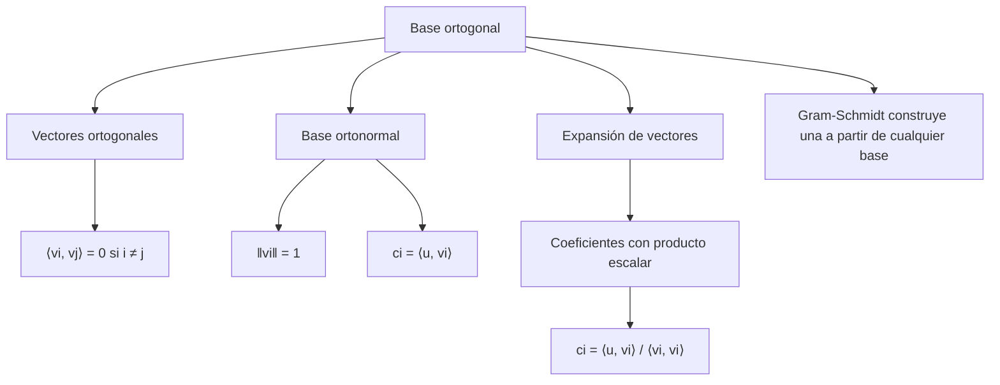

# Álgebra Lineal I - Producto escalar

## 5.5 Bases ortogonales (caso positivo).

---

### 1. Introducción

Una **base ortogonal** es una colección de vectores que son mutuamente ortogonales entre sí.
En el **caso positivo**, es decir en espacios con producto escalar definido positivo como $\mathbb{R}^n$ o $\mathbb{C}^n$ con el producto usual, estas bases son fundamentales porque:

- Simplifican los cálculos de coordenadas.
- Facilitan la descomposición de vectores.
- Son la base de algoritmos como Gram-Schmidt.
- Permiten el uso de proyecciones y la construcción de bases **ortonormales**.

### 2. Definiciones Fundamentales

#### 2.1 Base ortogonal

Un conjunto $\{v_1, v_2, \dots, v_n\}$ en un espacio vectorial $V$ con producto escalar $\langle \cdot, \cdot \rangle$ es una **base ortogonal** si:

$$
\langle v_i, v_j \rangle = 0 \quad \text{para todo } i \neq j
$$

y además genera $V.$ Basta pedir que los vectores sean **no nulos**: un conjunto ortogonal de vectores no nulos es automáticamente linealmente independiente, así que $n$ vectores ortogonales no nulos en un espacio de dimensión $n$ ya forman una base.

En el **caso positivo** el vector cero es el único con $\langle v, v \rangle = 0.$ Si el producto no fuera definido positivo podría haber vectores no nulos ortogonales a sí mismos, como $(1, 1)$ con $\langle u, v \rangle = u_1v_1 - u_2v_2,$ y fallarían varios de los resultados de este tema.

#### 2.2 Base ortonormal

Si además cada vector tiene norma unitaria:

$$
\|v_i\| = 1 \quad \forall i
$$

entonces la base es **ortonormal**.

#### 2.3 Expansión en bases ortogonales

Si $\{v_1, \dots, v_n\}$ es una base ortogonal de $V$ y $u \in V,$ entonces:

$$
u = \sum_{i=1}^n c_i v_i
$$

donde los coeficientes se obtienen como:

$$
c_i = \frac{\langle u, v_i \rangle}{\langle v_i, v_i \rangle}
$$

En el caso ortonormal, se simplifica a:

$$
c_i = \langle u, v_i \rangle
$$

### 3. Propiedades Importantes

1. En una base ortogonal, los coeficientes se calculan fácilmente mediante el producto escalar.
2. En una base ortonormal, las coordenadas son simplemente proyecciones directas.
3. Todo conjunto ortogonal de vectores no nulos es linealmente independiente.
4. Con el proceso de **Gram-Schmidt** se puede convertir cualquier base en una ortogonal. En consecuencia, **todo espacio de dimensión finita con producto escalar definido positivo tiene una base ortonormal**.

#### 3.1 Proceso de Gram-Schmidt

Dada una base $\{x_1, \ldots, x_n\},$ se define

$$
v_1 = x_1, \qquad v_k = x_k - \sum_{j=1}^{k-1} \frac{\langle x_k, v_j \rangle}{\langle v_j, v_j \rangle} v_j \quad (k = 2, \ldots, n)
$$

Cada $v_k$ es $x_k$ menos su proyección sobre el espacio generado por los anteriores, así que es ortogonal a todos ellos. Además $\text{span}\{v_1, \ldots, v_k\} = \text{span}\{x_1, \ldots, x_k\}$ para cada $k.$ Para una base ortonormal se divide al final cada $v_k$ entre su norma.

### 4. Ejemplos

#### Ejemplo 1: Base ortogonal en $\mathbb{R}^2$

Los vectores $v_1 = (1,1)$ y $v_2 = (1,-1)$ forman una base ortogonal porque:

$$
\langle v_1, v_2 \rangle = 1\cdot 1 + 1\cdot (-1) = 1 - 1 = 0
$$

Normas:

$$
\|v_1\| = \sqrt{1^2 + 1^2} = \sqrt{2}, \quad \|v_2\| = \sqrt{1^2 + (-1)^2} = \sqrt{2}
$$

Si normalizamos:

$$
u_1 = \frac{1}{\sqrt{2}}(1,1), \quad u_2 = \frac{1}{\sqrt{2}}(1,-1)
$$

se obtiene una base **ortonormal**.

#### Ejemplo 2: Expansión en base ortogonal

Sea $u = (2,1)$ y la base ortogonal $\{v_1=(1,1), v_2=(1,-1)\}.$

Coeficientes:

$$
c_1 = \frac{\langle u, v_1 \rangle}{\langle v_1, v_1 \rangle} = \frac{2\cdot 1 + 1\cdot 1}{2} = \frac{3}{2}
$$

$$
c_2 = \frac{\langle u, v_2 \rangle}{\langle v_2, v_2 \rangle} = \frac{2\cdot 1 + 1\cdot (-1)}{2} = \frac{1}{2}
$$

Por lo tanto:

$$
u = \frac{3}{2}(1,1) + \frac{1}{2}(1,-1)
$$

#### Ejemplo 3: Gram-Schmidt en $\mathbb{R}^3$

Partimos de $x_1 = (1, 1, 0),$ $x_2 = (1, 0, 1),$ $x_3 = (0, 1, 1).$

1. $v_1 = (1, 1, 0).$
2. $\langle x_2, v_1 \rangle = 1$ y $\langle v_1, v_1 \rangle = 2,$ así que $v_2 = (1, 0, 1) - \frac{1}{2}(1, 1, 0) = \left(\frac{1}{2}, -\frac{1}{2}, 1\right).$
3. $\langle x_3, v_1 \rangle = 1,$ $\langle x_3, v_2 \rangle = \frac{1}{2}$ y $\langle v_2, v_2 \rangle = \frac{3}{2},$ así que

$$
v_3 = (0, 1, 1) - \frac{1}{2}(1, 1, 0) - \frac{1}{3}\left(\frac{1}{2}, -\frac{1}{2}, 1\right) = \left(-\frac{2}{3}, \frac{2}{3}, \frac{2}{3}\right)
$$

Se comprueba que $\langle v_1, v_3 \rangle = \langle v_2, v_3 \rangle = 0.$ Al normalizar se obtiene la base ortonormal $\frac{1}{\sqrt{2}}(1, 1, 0),$ $\frac{1}{\sqrt{6}}(1, -1, 2),$ $\frac{1}{\sqrt{3}}(-1, 1, 1).$

### 5. Implementación en Código (Python + NumPy)

```python
import numpy as np

def es_ortogonal(v1, v2):
    return np.isclose(np.dot(v1, v2), 0)

def expansion(u, base):
    coefs = []
    for v in base:
        c = float(np.dot(u, v) / np.dot(v, v))
        coefs.append(c)
    return coefs

# Base ortogonal en R^2
v1 = np.array([1, 1])
v2 = np.array([1, -1])
u = np.array([2, 1])

print("¿v1 y v2 son ortogonales?", es_ortogonal(v1, v2))
print("Coeficientes de u en la base ortogonal:", expansion(u, [v1, v2]))  # [1.5, 0.5]

def gram_schmidt(vectores, normalizar=True, tol=1e-12):
    """Ortogonaliza una lista de vectores. Descarta los que dependen de los anteriores."""
    base = []
    for x in vectores:
        v = np.array(x, dtype=float)
        for b in base:
            v = v - np.dot(v, b) / np.dot(b, b) * b   # resta la proyección sobre b
        if np.linalg.norm(v) > tol:
            base.append(v)
    if normalizar:
        base = [b / np.linalg.norm(b) for b in base]
    return base

def tipo_de_base(vectores, tol=1e-10):
    """'ortonormal', 'ortogonal' o 'no ortogonal' (vectores reales no nulos)."""
    G = np.array([[np.dot(a, b) for b in vectores] for a in vectores])  # matriz de Gram
    if not np.allclose(G - np.diag(np.diag(G)), 0, atol=tol):
        return "no ortogonal"
    return "ortonormal" if np.allclose(np.diag(G), 1, atol=tol) else "ortogonal"

B = gram_schmidt([[1, 1, 0], [1, 0, 1], [0, 1, 1]], normalizar=False)
print("Gram-Schmidt:", [np.round(b, 4).tolist() for b in B])
print(tipo_de_base(B), "|", tipo_de_base(gram_schmidt([[1, 1, 0], [1, 0, 1], [0, 1, 1]])))
```

La función `tipo_de_base` usa la **matriz de Gram** $G_{ij} = \langle v_i, v_j \rangle:$ el conjunto es ortogonal cuando $G$ es diagonal y ortonormal cuando $G = I.$

### 6. Ejercicios Propuestos

1. Determina si los vectores $v_1=(1,0,1),$ $v_2=(0,1,1)$ en $\mathbb{R}^3$ son ortogonales.
2. Aplica Gram-Schmidt a los vectores anteriores y obtén una base ortonormal del plano que generan.
3. Expresa el vector $u=(2,2,2)$ en la base ortogonal $\{(1,1,0),(1,-1,0),(0,0,1)\}.$
4. Aplica el proceso de **Gram-Schmidt** a la base $\{(1,2,2),(1,0,1),(0,0,1)\}$ para obtener una base ortogonal.
5. Implementa en Python una función que verifique si un conjunto de vectores forma una base ortogonal u ortonormal.

**Soluciones.**

1. No lo son: $\langle v_1, v_2 \rangle = 0 + 0 + 1 = 1 \neq 0.$
2. $u_1 = \frac{1}{\sqrt{2}}(1, 0, 1);$ $v_2 - \frac{1}{2}v_1 = \left(-\frac{1}{2}, 1, \frac{1}{2}\right),$ y al normalizar $u_2 = \frac{1}{\sqrt{6}}(-1, 2, 1).$
3. $c_1 = \frac{4}{2} = 2,$ $c_2 = \frac{0}{2} = 0,$ $c_3 = \frac{2}{1} = 2.$ Así $u = 2(1,1,0) + 0(1,-1,0) + 2(0,0,1).$
4. $v_1 = (1, 2, 2),$ $v_2 = (1, 0, 1) - \frac{3}{9}(1, 2, 2) = \left(\frac{2}{3}, -\frac{2}{3}, \frac{1}{3}\right),$ y $v_3 = (0, 0, 1) - \frac{2}{9}(1, 2, 2) - \frac{1}{3}\left(\frac{2}{3}, -\frac{2}{3}, \frac{1}{3}\right) = \left(-\frac{4}{9}, -\frac{2}{9}, \frac{4}{9}\right).$
5. Ver la función `tipo_de_base` de la sección 5.

### 7. Diagrama Conceptual (Mermaid)



### 8. Referencias

- Lay, D. C. (2016). **Álgebra Lineal y sus aplicaciones**. Pearson.
- Strang, G. (2016). **Introduction to Linear Algebra**. Wellesley-Cambridge Press.
- Axler, S. (2015). **Linear Algebra Done Right**. Springer.
- Kreyszig, E. (2011). **Advanced Engineering Mathematics**. Wiley.
- Documentación NumPy: [https://numpy.org/doc/](https://numpy.org/doc/)
