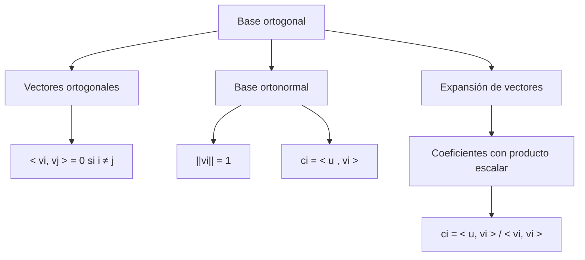

# Álgebra Lineal I - Producto escalar

## 5.5 Bases ortogonales (caso positivo).

---

### 1. Introducción

Una **base ortogonal** es una colección de vectores que son mutuamente ortogonales entre sí.
En el **caso positivo** ( espacios con producto escalar positivo definido, como $\mathbb{R}^n$ o $\mathbb{C}^n$ ), estas bases son fundamentales porque:

- Simplifican los cálculos de coordenadas.
- Facilitan la descomposición de vectores.
- Son la base de algoritmos como Gram-Schmidt.
- Permiten el uso de proyecciones y la construcción de bases **ortonormales**.

### 2. Definiciones Fundamentales

#### 2.1 Base ortogonal

Un conjunto ${v\_1, v\_2, \dots, v\_n}$ en un espacio vectorial $V$ con producto escalar $\langle \cdot, \cdot \rangle$ es una **base ortogonal** si:

$$
\langle v_i, v_j \rangle = 0 \quad \text{para todo } i \neq j
$$

y los vectores son linealmente independientes.

#### 2.2 Base ortonormal

Si además cada vector tiene norma unitaria:

$$
\|v_i\| = 1 \quad \forall i
$$

entonces la base es **ortonormal**.

#### 2.3 Expansión en bases ortogonales

Si ${v\_1, \dots, v\_n}$ es una base ortogonal de $V$ y $u \in V$, entonces:

$$
u = \sum_{i=1}^n c_i v_i
$$

donde los coeficientes se obtienen como:

$$
c_i = \frac{\langle u, v_i \rangle}{\langle v_i, v_i \rangle}
$$

En el caso ortonormal, se simplifica a:

$$
c_i = \langle u, v_i \rangle
$$

### 3. Propiedades Importantes

1. En una base ortogonal, los coeficientes se calculan fácilmente mediante el producto escalar.
2. En una base ortonormal, las coordenadas son simplemente proyecciones directas.
3. Todo conjunto ortogonal de vectores no nulos es linealmente independiente.
4. Con el proceso de **Gram-Schmidt** se puede convertir cualquier base en una ortogonal.

### 4. Ejemplos

#### Ejemplo 1: Base ortogonal en $\mathbb{R}^2$

Los vectores $v\_1 = (1,1)$ y $v\_2 = (1,-1)$ forman una base ortogonal porque:

$$
\langle v_1, v_2 \rangle = 1\cdot 1 + 1\cdot (-1) = 1 - 1 = 0
$$

Normas:

$$
\|v_1\| = \sqrt{1^2 + 1^2} = \sqrt{2}, \quad \|v_2\| = \sqrt{1^2 + (-1)^2} = \sqrt{2}
$$

Si normalizamos:

$$
u_1 = \frac{1}{\sqrt{2}}(1,1), \quad u_2 = \frac{1}{\sqrt{2}}(1,-1)
$$

se obtiene una base **ortonormal**.

#### Ejemplo 2: Expansión en base ortogonal

Sea $u = (2,1)$ y la base ortogonal ${v\_1=(1,1), v\_2=(1,-1)}$.

Coeficientes:

$$
c_1 = \frac{\langle u, v_1 \rangle}{\langle v_1, v_1 \rangle} = \frac{2\cdot 1 + 1\cdot 1}{2} = \frac{3}{2}
$$

$$
c_2 = \frac{\langle u, v_2 \rangle}{\langle v_2, v_2 \rangle} = \frac{2\cdot 1 + 1\cdot (-1)}{2} = \frac{1}{2}
$$

Por lo tanto:

$$
u = \frac{3}{2}(1,1) + \frac{1}{2}(1,-1)
$$

### 5. Implementación en Código (Python + NumPy)

```python
import numpy as np

def es_ortogonal(v1, v2):
    return np.isclose(np.dot(v1, v2), 0)

def expansion(u, base):
    coefs = []
    for v in base:
        c = np.dot(u, v) / np.dot(v, v)
        coefs.append(c)
    return coefs

# Base ortogonal en R^2
v1 = np.array([1, 1])
v2 = np.array([1, -1])
u = np.array([2, 1])

print("¿v1 y v2 son ortogonales?", es_ortogonal(v1, v2))
print("Coeficientes de u en la base ortogonal:", expansion(u, [v1, v2]))
```

### 6. Ejercicios Propuestos

1. Verifica que los vectores $v\_1=(1,0,1)$, $v\_2=(0,1,1)$ en $\mathbb{R}^3$ son ortogonales.
2. Normaliza los vectores anteriores y construye una base ortonormal.
3. Expresa el vector $u=(2,2,2)$ en la base ortogonal ${(1,1,0),(1,-1,0),(0,0,1)}$.
4. Aplica el proceso de **Gram-Schmidt** a la base canónica ${(1,1,0),(1,0,1),(0,1,1)}$ para obtener una base ortogonal.
5. Implementa en Python una función que verifique si un conjunto de vectores forma una base ortogonal u ortonormal.

### 7. Diagrama Conceptual (Mermaid)



### 8. Referencias

- Lay, D. C. (2016). **Álgebra Lineal y sus aplicaciones**. Pearson.
- Strang, G. (2016). **Introduction to Linear Algebra**. Wellesley-Cambridge Press.
- Axler, S. (2015). **Linear Algebra Done Right**. Springer.
- Kreyszig, E. (2011). **Advanced Engineering Mathematics**. Wiley.
- Documentación NumPy: [https://numpy.org/doc/](https://numpy.org/doc/)
