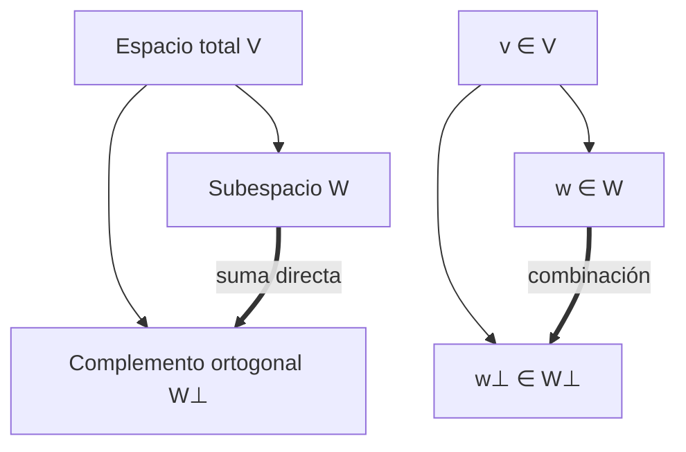

# Álgebra Lineal I - Producto escalar

## 5.6 Complemento ortogonal de un subespacio. Aplicación a los sistemas de ecuaciones.

---

### 1. Definiciones Fundamentales

#### Producto escalar

En un espacio vectorial $V$ sobre $\mathbb{R}$, un **producto escalar** es una función:

$$
\langle \cdot, \cdot \rangle : V \times V \to \mathbb{R}
$$

que satisface:

1. **Bilinealidad**: $\langle u+v, w \rangle = \langle u, w \rangle + \langle v, w \rangle$
2. **Simetría**: $\langle u, v \rangle = \langle v, u \rangle$
3. **Positividad**: $\langle v, v \rangle \geq 0$, con igualdad si y sólo si $v = 0$.

#### Subespacio vectorial

Un **subespacio** $W \subseteq V$ es un subconjunto cerrado bajo suma y multiplicación escalar.

#### Complemento ortogonal

Dado un subespacio $W \subseteq V$, se define su **complemento ortogonal** como:

$$
W^\perp = \{ v \in V \mid \langle v, w \rangle = 0 \ \forall w \in W \}
$$

#### Propiedades importantes

1. $W \cap W^\perp = {0}$
2. $(W^\perp)^\perp = W$ (en espacios de dimensión finita).
3. $\dim(W) + \dim(W^\perp) = \dim(V)$.
4. Todo vector $v \in V$ puede descomponerse como:

$$
v = w + w^\perp, \quad w \in W, \, w^\perp \in W^\perp
$$

### 2. Aplicación a Sistemas de Ecuaciones

Un sistema lineal homogéneo $A\mathbf{x} = 0$ tiene como **espacio solución** el **núcleo** de $A$:

$$
\ker(A) = \{ \mathbf{x} \in \mathbb{R}^n \mid A\mathbf{x}=0 \}
$$

Mientras que el **espacio generado por las filas de $A$** es el **espacio fila**:

$$
\text{Row}(A) = \langle \text{filas de } A \rangle
$$

Entonces:

$$
\ker(A) = (\text{Row}(A))^\perp
$$

#### Interpretación geométrica

- El **espacio fila** contiene las restricciones lineales.
- El **núcleo** contiene las soluciones.
- Ambos son complementos ortogonales.

### 3. Ejemplo Teórico

Sea $A = \begin{bmatrix} 1 & 2 & 3 \\\ 0 & 1 & 4 \end{bmatrix}$

1. **Espacio fila:**
   $\text{Row}(A) = \text{span}{(1,2,3), (0,1,4)}$

2. **Núcleo:** Resolver $A\mathbf{x} = 0$

$$ \begin{cases} x_1 + 2x_2 + 3x_3 = 0 \\\ x_2 + 4x_3 = 0 \end{cases} $$

De la segunda ecuación: $x\_2 = -4x\_3$
Sustituyendo en la primera: $x\_1 - 5x\_3 = 0 \implies x\_1 = 5x\_3$

Entonces:

$$ \ker(A) = \text{span}\{(5, -4, 1)\} $$

3. Verificación:

   $$ \langle (5, -4, 1), (1,2,3) \rangle = 5 - 8 + 3 = 0 $$

   $$ \langle (5, -4, 1), (0,1,4) \rangle = 0 - 4 + 4 = 0 $$

Por lo tanto:

$$ \ker(A) = (\text{Row}(A))^\perp $$

### 4. Código de Ejemplo (Python con NumPy)

```python
import numpy as np

# Matriz del sistema
A = np.array([[1, 2, 3],
              [0, 1, 4]])

# Espacio fila (vectores base)
rowspace = A

# Cálculo del núcleo con SVD
U, S, Vt = np.linalg.svd(A)
rank = np.sum(S > 1e-10)
null_space = Vt[rank:].T

print("Base del espacio fila:")
print(rowspace)

print("\nBase del núcleo (complemento ortogonal):")
print(null_space)
```

### 5. Diagramas



### 6. Ejercicios Propuestos

1. Sea $W = \text{span}{(1,0,1), (0,1,1)} \subseteq \mathbb{R}^3$.

   - Encuentra $W^\perp$.
   - Verifica que $\dim(W) + \dim(W^\perp) = 3$.

2. Dada la matriz $A = \begin{bmatrix} 1 & -1 & 0 \\\ 2 & 1 & -1 \end{bmatrix}$:

   - Encuentra el espacio fila.
   - Calcula el núcleo de $A$.
   - Verifica que $\ker(A) = (\text{Row}(A))^\perp$.

3. Demuestra que para cualquier matriz $A \in \mathbb{R}^{m \times n}$, se cumple: $ \dim(\ker(A)) + \dim(\text{Row}(A)) = n $

4. Considera el sistema $x+y+z=0$, $x-z=0$.

   - Escribe la matriz asociada.
   - Calcula el espacio fila.
   - Encuentra su complemento ortogonal.

### 7. Referencias

- Anton, H., & Rorres, C. (2010). **Álgebra Lineal con Aplicaciones**. Wiley.
- Strang, G. (2016). **Introduction to Linear Algebra**. MIT Press.
- Lay, D. C. (2015). **Álgebra lineal y sus aplicaciones**. Pearson.
- Gilbert Strang (MIT OpenCourseWare). [Linear Algebra - Lectures](https://ocw.mit.edu/courses/18-06-linear-algebra-spring-2010/)
