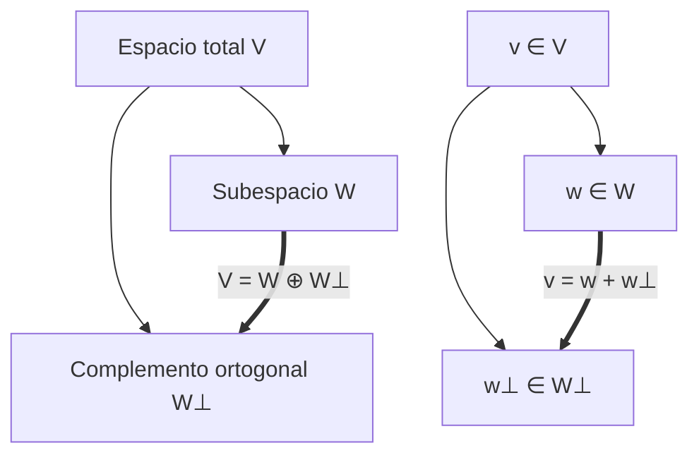

# Álgebra Lineal I - Producto escalar

## 5.6 Complemento ortogonal de un subespacio. Aplicación a los sistemas de ecuaciones.

---

### 1. Definiciones Fundamentales

#### Producto escalar

En un espacio vectorial $V$ sobre $\mathbb{R},$ un **producto escalar** es una función:

$$
\langle \cdot, \cdot \rangle : V \times V \to \mathbb{R}
$$

que satisface:

1. **Bilinealidad**: $\langle u+v, w \rangle = \langle u, w \rangle + \langle v, w \rangle$ y $\langle cu, w \rangle = c\langle u, w \rangle$ (y lo mismo en la segunda entrada, por simetría)
2. **Simetría**: $\langle u, v \rangle = \langle v, u \rangle$
3. **Positividad**: $\langle v, v \rangle \geq 0,$ con igualdad si y sólo si $v = 0.$

#### Subespacio vectorial

Un **subespacio** $W \subseteq V$ es un subconjunto no vacío cerrado bajo suma y multiplicación escalar. $W^\perp$ siempre es un subespacio, aunque $W$ sea solo un subconjunto.

#### Complemento ortogonal

Dado un subespacio $W \subseteq V,$ se define su **complemento ortogonal** como:

$$
W^\perp = \{ v \in V \mid \langle v, w \rangle = 0 \ \forall w \in W \}
$$

#### Propiedades importantes

1. $W \cap W^\perp = \{0\}$
2. $(W^\perp)^\perp = W$ (en espacios de dimensión finita).
3. $\dim(W) + \dim(W^\perp) = \dim(V)$ (en dimensión finita).
4. Todo vector $v \in V$ puede descomponerse de manera **única** como

$$
v = w + w^\perp, \quad w \in W, \, w^\perp \in W^\perp
$$

### 2. Aplicación a Sistemas de Ecuaciones

Un sistema lineal homogéneo $A\mathbf{x} = 0$ tiene como **espacio solución** el **núcleo** de $A:$

$$
\ker(A) = \{ \mathbf{x} \in \mathbb{R}^n \mid A\mathbf{x}=0 \}
$$

Mientras que el espacio generado por las filas de $A$ es el **espacio fila**:

$$
\text{Row}(A) = \langle \text{filas de } A \rangle
$$

Entonces:

$$
\ker(A) = (\text{Row}(A))^\perp
$$

#### Interpretación geométrica

- El **espacio fila** contiene las restricciones lineales.
- El **núcleo** contiene las soluciones.
- Ambos son complementos ortogonales.

### 3. Ejemplo Teórico

Sea $A = \begin{bmatrix} 1 & 2 & 3 \\ 0 & 1 & 4 \end{bmatrix}.$

1. **Espacio fila:**
   $\text{Row}(A) = \text{span}\{(1,2,3), (0,1,4)\}$

2. **Núcleo:** Resolver $A\mathbf{x} = 0$

$$ \begin{cases} x_1 + 2x_2 + 3x_3 = 0 \\ x_2 + 4x_3 = 0 \end{cases} $$

De la segunda ecuación: $x_2 = -4x_3$
Sustituyendo en la primera: $x_1 - 5x_3 = 0 \implies x_1 = 5x_3$

Entonces:

$$ \ker(A) = \text{span}\{(5, -4, 1)\} $$

3. Verificación:

   $$ \langle (5, -4, 1), (1,2,3) \rangle = 5 - 8 + 3 = 0 $$

   $$ \langle (5, -4, 1), (0,1,4) \rangle = 0 - 4 + 4 = 0 $$

Por lo tanto:

$$ \ker(A) = (\text{Row}(A))^\perp $$

### 4. Código de Ejemplo (Python con NumPy)

```python
import numpy as np
from sympy import Matrix

# Matriz del sistema
A = Matrix([[1, 2, 3],
            [0, 1, 4]])

# Base del espacio fila: filas no nulas de la forma escalonada reducida
R, pivotes = A.rref()
fila = [R.row(i) for i in range(len(pivotes))]
nucleo = A.nullspace()

print("Base del espacio fila:", [list(f) for f in fila])
print("Base del núcleo:", [list(v) for v in nucleo])

# Cada vector del núcleo es ortogonal a cada fila de A
for v in nucleo:
    print("A·v =", list(A * v))   # [0, 0]

# Versión numérica con SVD: las filas de Vt después del rango generan el núcleo
U, S, Vt = np.linalg.svd(np.array(A, dtype=float))
rango = np.sum(S > 1e-10)
print("Núcleo (SVD, normalizado):", Vt[rango:])
```

**Salida:**

```
Base del espacio fila: [[1, 0, -5], [0, 1, 4]]
Base del núcleo: [[5, -4, 1]]
A·v = [0, 0]
Núcleo (SVD, normalizado): [[-0.77151675  0.6172134  -0.15430335]]
```

El vector que da la SVD es $(5, -4, 1)/\sqrt{42},$ el mismo que obtuvimos a mano pero normalizado (el signo puede variar).

### 5. Diagramas



### 6. Proyección Ortogonal y Mínimos Cuadrados

La descomposición $v = w + w^\perp$ da la **proyección ortogonal** $w = \operatorname{proy}_W(v),$ el vector de $W$ más cercano a $v.$ Si las columnas de $A$ son linealmente independientes y $W = \operatorname{Col}(A),$ entonces

$$
\operatorname{proy}_W(b) = A(A^T A)^{-1} A^T b.
$$

Esto resuelve los sistemas **incompatibles** $A\mathbf{x} = b$ en el sentido de mínimos cuadrados: el error $b - A\hat{\mathbf{x}}$ debe estar en $\operatorname{Col}(A)^\perp = \ker(A^T),$ de donde salen las **ecuaciones normales**

$$
A^T A \hat{\mathbf{x}} = A^T b.
$$

Las otras dos relaciones fundamentales son $\operatorname{Col}(A)^\perp = \ker(A^T)$ y, por ello, $A\mathbf{x} = b$ tiene solución si y sólo si $b$ es ortogonal a toda solución de $A^T \mathbf{y} = 0$ (alternativa de Fredholm).

**Ejemplo.** Para ajustar la recta $y = c_0 + c_1 t$ a los puntos $(0, 1),$ $(1, 2),$ $(2, 2),$ tomamos

$$
A = \begin{bmatrix} 1 & 0 \\ 1 & 1 \\ 1 & 2 \end{bmatrix}, \quad b = \begin{bmatrix} 1 \\ 2 \\ 2 \end{bmatrix}, \quad A^T A = \begin{bmatrix} 3 & 3 \\ 3 & 5 \end{bmatrix}, \quad A^T b = \begin{bmatrix} 5 \\ 6 \end{bmatrix}.
$$

Resolviendo, $c_1 = \frac{1}{2}$ y $c_0 = \frac{7}{6},$ es decir $y = \frac{7}{6} + \frac{1}{2} t.$

### 7. Ejercicios Propuestos

1. Sea $W = \text{span}\{(1,0,1), (0,1,1)\} \subseteq \mathbb{R}^3.$

   - Encuentra $W^\perp.$
   - Verifica que $\dim(W) + \dim(W^\perp) = 3.$

2. Dada la matriz $A = \begin{bmatrix} 1 & -1 & 0 \\ 2 & 1 & -1 \end{bmatrix},$

   - Encuentra el espacio fila.
   - Calcula el núcleo de $A.$
   - Verifica que $\ker(A) = (\text{Row}(A))^\perp.$

3. Demuestra que para cualquier matriz $A \in \mathbb{R}^{m \times n},$ se cumple $\dim(\ker(A)) + \dim(\text{Row}(A)) = n.$

4. Considera el sistema $x+y+z=0,$ $x-z=0.$

   - Escribe la matriz asociada.
   - Calcula el espacio fila.
   - Encuentra su complemento ortogonal.

### 8. Referencias

- Anton, H., & Rorres, C. (2010). **Álgebra Lineal con Aplicaciones**. Wiley.
- Strang, G. (2016). **Introduction to Linear Algebra**. MIT Press.
- Lay, D. C. (2015). **Álgebra lineal y sus aplicaciones**. Pearson.
- Gilbert Strang (MIT OpenCourseWare). [Linear Algebra - Lectures](https://ocw.mit.edu/courses/18-06-linear-algebra-spring-2010/)
