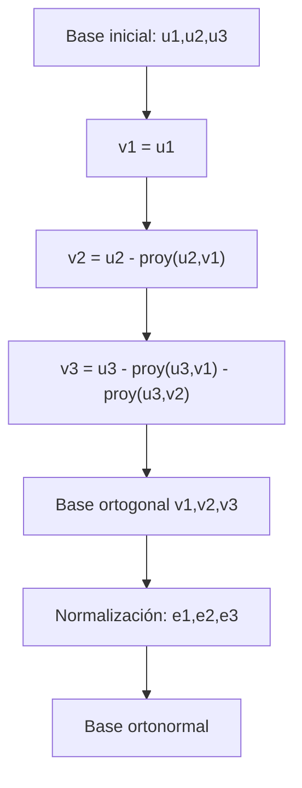

# Álgebra Lineal I - Producto escalar

## 5.7 Bases ortogonales (caso general).

---

### 1. Definiciones Fundamentales

#### Base

Una **base** de un espacio vectorial $V$ de dimensión $n$ es un conjunto de $n$ vectores linealmente independientes que generan todo el espacio.

$$ \mathcal{B} = \{v_1, v_2, \dots, v_n\}, \quad V = \text{span}(\mathcal{B}) $$

#### Ortogonalidad

Dos vectores $u,v \in V$ son **ortogonales** si:

$$ \langle u, v \rangle = 0 $$

donde $\langle \cdot , \cdot \rangle$ es el producto escalar.

#### Base ortogonal

Una base $\{v_1, v_2, \dots, v_n\}$ se llama **ortogonal** si:

$$ \langle v_i, v_j \rangle = 0 \quad \text{para todo } i \neq j $$

Si además $\|v_i\| = 1$ para todo $i,$ se llama **base ortonormal**.

#### Importancia

Las bases ortogonales simplifican muchos cálculos:

- La representación de vectores en coordenadas.
- El cálculo de proyecciones.
- La resolución de sistemas lineales.
- La descomposición de espacios.

#### Del caso positivo al caso general

En el tema anterior el producto escalar era **definido positivo**. En el **caso general** se trabaja con una **forma bilineal simétrica** cualquiera $b: V \times V \to \mathbb{R};$ por ejemplo $b(u, v) = u^T A v$ con $A$ simétrica pero no necesariamente definida positiva. La ortogonalidad se define igual, $b(u, v) = 0,$ y su **forma cuadrática** asociada es $q(v) = b(v, v).$

La diferencia esencial es que puede haber **vectores isótropos**: vectores $v \neq 0$ con $q(v) = 0,$ es decir, ortogonales a sí mismos. En ese caso:

- Un conjunto ortogonal de vectores no nulos puede ser linealmente **dependiente**.
- No se puede normalizar un vector con $q(v) \leq 0;$ lo más que se logra es $q(v_i) \in \{1, -1, 0\}.$
- Gram-Schmidt puede fallar, porque divide entre $b(v_j, v_j).$

Las secciones 2 y 3 repasan Gram-Schmidt en el caso positivo; la sección 4 trata el caso general.

### 2. Construcción de una Base Ortonormal: Proceso de Gram-Schmidt

Dada una base $\{u_1, u_2, \dots, u_n\}$ de $V,$ no necesariamente ortogonal, y un producto escalar definido positivo, podemos construir una base ortogonal mediante **Gram-Schmidt**:

1. Tomamos $v_1 = u_1.$
2. Definimos:

   $$ v_k = u_k - \sum_{j=1}^{k-1} \frac{\langle u_k, v_j \rangle}{\langle v_j, v_j \rangle} v_j, \quad k=2,\dots,n $$

3. Si normalizamos:

   $$ e_k = \frac{v_k}{\|v_k\|} $$

   obtenemos una **base ortonormal** $\{e_1, \dots, e_n\}.$

### 3. Ejemplo Paso a Paso

Sea $V = \mathbb{R}^3$ con el producto punto y la base

$$ u_1 = (1,1,0), \quad u_2 = (1,0,1), \quad u_3 = (0,1,1) $$

**Aplicamos Gram-Schmidt:**

1.

$$ v_1 = u_1 = (1,1,0) $$

2.

$$ v_2 = u_2 - \frac{\langle u_2,v_1 \rangle}{\langle v_1,v_1 \rangle}v_1 $$

$$ \langle u_2, v_1 \rangle = (1,0,1)\cdot(1,1,0)=1 $$

$$ \langle v_1,v_1 \rangle = (1,1,0)\cdot(1,1,0)=2 $$

$$ v_2 = (1,0,1) - \tfrac{1}{2}(1,1,0) = \left(\tfrac{1}{2}, -\tfrac{1}{2}, 1\right) $$

3.

$$ v_3 = u_3 - \frac{\langle u_3,v_1 \rangle}{\langle v_1,v_1 \rangle}v_1 - \frac{\langle u_3,v_2 \rangle}{\langle v_2,v_2 \rangle}v_2 $$

Calculando:

$\langle u_3,v_1\rangle = (0,1,1)\cdot(1,1,0)=1$ y $\langle v_1,v_1\rangle=2$

$\langle u_3,v_2\rangle = (0,1,1)\cdot(\tfrac{1}{2}, -\tfrac{1}{2}, 1) = -\tfrac{1}{2}+1=\tfrac{1}{2}$

$\langle v_2,v_2\rangle = (\tfrac{1}{2})^2+(-\tfrac{1}{2})^2+1^2 = \tfrac{3}{2}$

Entonces:

$$ v_3 = (0,1,1) - \tfrac{1}{2}(1,1,0) - \tfrac{\tfrac{1}{2}}{\tfrac{3}{2}}(\tfrac{1}{2}, -\tfrac{1}{2}, 1) $$

$$ v_3 = (0,1,1) - \tfrac{1}{2}(1,1,0) - \tfrac{1}{3}(\tfrac{1}{2}, -\tfrac{1}{2}, 1) $$

$$ v_3 = \left(-\tfrac{2}{3}, \tfrac{2}{3}, \tfrac{2}{3}\right) $$

Así, obtenemos una **base ortogonal**:

$$ \{(1,1,0), (\tfrac{1}{2},- \tfrac{1}{2},1), (-\tfrac{2}{3}, \tfrac{2}{3}, \tfrac{2}{3})\} $$

Si normalizamos, obtenemos una **base ortonormal**.

### 4. Bases Ortogonales para una Forma Bilineal Simétrica

**Teorema.** Sea $b$ una forma bilineal simétrica sobre un espacio $V$ de dimensión finita, con escalares reales o complejos. Entonces $V$ tiene una base $\{v_1, \ldots, v_n\}$ con $b(v_i, v_j) = 0$ para $i \neq j.$ En esa base la matriz de $b$ es **diagonal**.

**Idea de la demostración.** Si $b$ es idénticamente cero, cualquier base sirve. Si no, existe $v_1$ con $q(v_1) \neq 0;$ esto se debe a la **identidad de polarización** $b(u, w) = \frac{1}{2}\left(q(u + w) - q(u) - q(w)\right):$ si $q$ fuera cero en todo vector, $b$ también lo sería. Entonces $V = \text{span}\{v_1\} \oplus v_1^\perp,$ porque todo $w$ se escribe como $\frac{b(w, v_1)}{q(v_1)} v_1 + \left(w - \frac{b(w, v_1)}{q(v_1)} v_1\right).$ Se repite el argumento en $v_1^\perp,$ que tiene dimensión $n - 1.$

La diferencia con Gram-Schmidt es que, si el vector que sigue es isótropo, hay que **escoger otro**, por ejemplo una suma de vectores, en lugar de dividir entre cero.

#### Ejemplo 1: Forma indefinida

Sea $b(u, v) = u^T A v$ con $A = \begin{bmatrix} 1 & 2 \\ 2 & 1 \end{bmatrix},$ cuya forma cuadrática es $q(x, y) = x^2 + 4xy + y^2.$

1. $v_1 = (1, 0)$ cumple $q(v_1) = 1 \neq 0.$
2. $v_2 = (0, 1) - \frac{b((0,1), v_1)}{q(v_1)} v_1 = (0, 1) - 2(1, 0) = (-2, 1).$

Se comprueba que $A v_2 = (0, -3),$ así que $b(v_1, v_2) = 0$ y $q(v_2) = -3.$ En la base $\{v_1, v_2\}$ la matriz de $b$ es $\begin{bmatrix} 1 & 0 \\ 0 & -3 \end{bmatrix}.$ Esto equivale a completar el cuadrado: $q(x, y) = (x + 2y)^2 - 3y^2.$

#### Ejemplo 2: Vectores isótropos

Sea $b(u, v) = u_1 v_2 + u_2 v_1$ en $\mathbb{R}^2.$ Los dos vectores canónicos son isótropos: $q(e_1) = q(e_2) = 0,$ así que Gram-Schmidt no puede empezar con ellos. Sin embargo, $v_1 = (1, 1)$ y $v_2 = (1, -1)$ cumplen $b(v_1, v_2) = -1 + 1 = 0,$ con $q(v_1) = 2$ y $q(v_2) = -2.$ En esa base la matriz es $\begin{bmatrix} 2 & 0 \\ 0 & -2 \end{bmatrix}.$

#### Ley de inercia de Sylvester

En el caso real, al dividir cada $v_i$ con $q(v_i) \neq 0$ entre $\sqrt{|q(v_i)|},$ la matriz diagonal queda con entradas $1,$ $-1$ y $0.$ La ley de inercia de Sylvester afirma que el número $p$ de unos, el número $m$ de menos unos y el número de ceros **no dependen de la base ortogonal elegida**. El par $(p, m)$ se llama **signatura** de la forma. Así:

- $b$ es un producto escalar definido positivo si y solo si $p = n.$
- Los ejemplos 1 y 2 tienen signatura $(1, 1).$
- El espacio de Minkowski de la relatividad especial usa $q(t, x, y, z) = -t^2 + x^2 + y^2 + z^2,$ de signatura $(3, 1).$

Para formas $u^T A v,$ la signatura coincide con el número de valores propios positivos y negativos de $A.$ En el ejemplo 1 los valores propios son $3$ y $-1.$

### 5. Representación en Diagramas



### 6. Código en Python

```python
import numpy as np

def gram_schmidt(vectors):
    orthogonal = []
    for v in vectors:
        for u in orthogonal:
            v = v - np.dot(v, u)/np.dot(u,u) * u
        orthogonal.append(v)
    return orthogonal

def normalize(vectors):
    return [v/np.linalg.norm(v) for v in vectors]

# Ejemplo
U = [np.array([1,1,0]), np.array([1,0,1]), np.array([0,1,1])]
V = gram_schmidt(U)
E = normalize(V)

print("Base ortogonal:")
for v in V: print(v)

print("\nBase ortonormal:")
for e in E: print(e)
```

El siguiente código construye una base ortogonal para cualquier forma $b(u, v) = u^T A v$ con $A$ simétrica, siguiendo la demostración del teorema de la sección 4. Usa aritmética exacta.

```python
from sympy import Matrix, Rational, eye

def base_ortogonal(A):
    """Base ortogonal de R^n respecto a b(u, v) = u^T A v, con A simétrica."""
    b = lambda u, w: (u.T * A * w)[0]
    n = A.shape[0]
    resto = [eye(n).col(i) for i in range(n)]   # base del subespacio que falta
    base = []
    while resto:
        # buscar un vector no isótropo: primero los de 'resto', luego sumas de pares
        candidatos = resto + [u + w for i, u in enumerate(resto) for w in resto[i + 1:]]
        v = next((c for c in candidatos if b(c, c) != 0), None)
        if v is None:                 # b es cero en este subespacio: cualquier base sirve
            base += resto
            break
        base.append(v)
        # proyectar sobre el complemento ortogonal de v y quedarse con una base
        proyectados = [w - b(w, v) / b(v, v) * v for w in resto]
        resto = Matrix.hstack(*proyectados).columnspace()
    return base

for A in (Matrix([[1, 2], [2, 1]]), Matrix([[0, 1], [1, 0]])):
    B = base_ortogonal(A)
    P = Matrix.hstack(*B)
    print("Base:", [list(v) for v in B], " matriz P^T A P =", (P.T * A * P).tolist())
```

**Salida:**

```
Base: [[1, 0], [-2, 1]]  matriz P^T A P = [[1, 0], [0, -3]]
Base: [[1, 1], [1/2, -1/2]]  matriz P^T A P = [[2, 0], [0, -1/2]]
```

Si $P$ tiene por columnas la base ortogonal, la matriz de $b$ en esa base es $P^T A P,$ que resulta diagonal. Este cambio $A \mapsto P^T A P$ se llama **congruencia**; no debe confundirse con la semejanza $P^{-1}AP.$

### 7. Ejercicios Propuestos

1. Aplica Gram-Schmidt a la base $\{(1,0,0), (1,1,0), (1,1,1)\}$ en $\mathbb{R}^3.$
2. Normaliza la base $\{(2,0,0), (0,3,0), (0,0,4)\}$ y verifica que obtienes una base ortonormal.
3. Demuestra que, para un producto escalar definido positivo, todo conjunto ortogonal de vectores no nulos es linealmente independiente. Da un contraejemplo para la forma $b(u, v) = u_1v_1 - u_2v_2.$
4. En $\mathbb{R}^4,$ considera $\{(1,1,1,1), (1,-1,1,-1), (1,1,-1,-1), (1,-1,-1,1)\}.$ Aplica Gram-Schmidt y construye una base ortonormal.
5. Explica por qué en un espacio de dimensión $n$ con producto escalar definido positivo siempre existe una base ortonormal.
6. Encuentra una base ortogonal y la signatura de $q(x, y) = 2xy + y^2.$

**Soluciones.**

1. $v_1 = (1, 0, 0),$ $v_2 = (0, 1, 0),$ $v_3 = (0, 0, 1):$ se recupera la base canónica.
2. $\left\{(1, 0, 0), (0, 1, 0), (0, 0, 1)\right\}.$
3. Si $\sum c_i v_i = 0,$ el producto con $v_j$ da $c_j\langle v_j, v_j \rangle = 0$ y $\langle v_j, v_j \rangle > 0.$ Con $b(u, v) = u_1v_1 - u_2v_2,$ el vector $w = (1, 1)$ cumple $b(w, w) = 0,$ así que $\{w, 2w\}$ es ortogonal y dependiente.
4. Los vectores ya son ortogonales: Gram-Schmidt no los cambia. Cada uno tiene norma $2,$ así que la base ortonormal se obtiene dividiéndolos entre $2.$
5. Se aplica Gram-Schmidt a cualquier base. Ningún $v_k$ es cero, porque $u_k$ no está en el espacio generado por los anteriores, y en el caso positivo $\langle v_k, v_k \rangle > 0$ permite normalizar.
6. Completando el cuadrado, $q = (x + y)^2 - x^2.$ Con $v_1 = (0, 1),$ $q(v_1) = 1,$ y $v_2 = (1, 0) - 1 \cdot (0, 1) = (1, -1),$ $q(v_2) = -1.$ La signatura es $(1, 1).$

### 8. Referencias

- Anton, H., & Rorres, C. (2010). **Álgebra Lineal con Aplicaciones**. Wiley.
- Lay, D. C. (2015). **Álgebra lineal y sus aplicaciones**. Pearson.
- Strang, G. (2016). **Introduction to Linear Algebra**. MIT Press.
- MIT OpenCourseWare – [Linear Algebra Lectures](https://ocw.mit.edu/courses/18-06-linear-algebra-spring-2010/)
