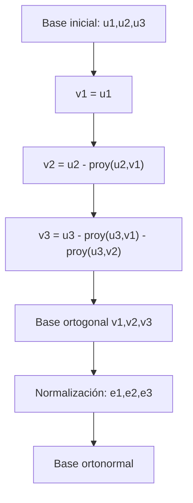

# Álgebra Lineal I - Producto escalar

## 5.7 Bases ortogonales (caso general).

---

### 1. Definiciones Fundamentales

#### Base

Una **base** de un espacio vectorial $V$ de dimensión $n$ es un conjunto de $n$ vectores linealmente independientes que generan todo el espacio.

$$ \mathcal{B} = \{v_1, v_2, \dots, v_n\}, \quad V = \text{span}(\mathcal{B}) $$

#### Ortogonalidad

Dos vectores $u,v \in V$ son **ortogonales** si:

$$ \langle u, v \rangle = 0 $$

donde $\langle \cdot , \cdot \rangle$ es el producto escalar.

#### Base ortogonal

Una base ${v_1, v_2, \dots, v_n}$ se llama **ortogonal** si:

$$ \langle v_i, v_j \rangle = 0 \quad \text{para todo } i \neq j $$

Si además $|v_i| = 1$ para todo $i$, se llama **base ortonormal**.

#### Importancia

Las bases ortogonales simplifican muchos cálculos:

- La representación de vectores en coordenadas.
- El cálculo de proyecciones.
- La resolución de sistemas lineales.
- La descomposición de espacios.

### 2. Construcción de una Base Ortonormal: Proceso de Gram-Schmidt

Dada una base $ {u_1, u_2, \dots, u_n} $ de $V$ (no necesariamente ortogonal), podemos construir una base ortogonal mediante **Gram-Schmidt**:

1. Tomamos $ v_1 = u_1 $.
2. Definimos:

   $$    v_k = u_k - \sum_{j=1}^{k-1} \frac{\langle u_k, v_j \rangle}{\langle v_j, v_j \rangle} v_j, \quad k=2,\dots,n $$

3. Si normalizamos:

   $$    e_k = \frac{v_k}{\|v_k\|}    $$

   obtenemos una **base ortonormal** ${e_1, \dots, e_n}$.

### 3. Ejemplo Paso a Paso

Sea $ V = \mathbb{R}^3 $, con la base estándar:

$$ u_1 = (1,1,0), \quad u_2 = (1,0,1), \quad u_3 = (0,1,1) $$

**Aplicamos Gram-Schmidt:**

1.

$$ v_1 = u_1 = (1,1,0) $$

2.

$$ v_2 = u_2 - \frac{\langle u_2,v_1 \rangle}{\langle v_1,v_1 \rangle}v_1 $$

$$ \langle u_2, v_1 \rangle = (1,0,1)\cdot(1,1,0)=1 $$

$$ \langle v_1,v_1 \rangle = (1,1,0)\cdot(1,1,0)=2 $$

$$ v_2 = (1,0,1) - \tfrac{1}{2}(1,1,0) = \left(\tfrac{1}{2}, -\tfrac{1}{2}, 1\right) $$

3.

$$ v_3 = u_3 - \frac{\langle u_3,v_1 \rangle}{\langle v_1,v_1 \rangle}v_1 - \frac{\langle u_3,v_2 \rangle}{\langle v_2,v_2 \rangle}v_2 $$

Calculando:

$\langle u_3,v_1\rangle = (0,1,1)\cdot(1,1,0)=1$ $\langle v_1,v_1\rangle=2$

$\langle u_3,v_2\rangle = (0,1,1)\cdot(\tfrac{1}{2}, -\tfrac{1}{2}, 1) = -\tfrac{1}{2}+1=\tfrac{1}{2}$

$\langle v_2,v_2\rangle = (\tfrac{1}{2})^2+(-\tfrac{1}{2})^2+1^2 = \tfrac{3}{2}$

Entonces:

$$ v_3 = (0,1,1) - \tfrac{1}{2}(1,1,0) - \tfrac{\tfrac{1}{2}}{\tfrac{3}{2}}(\tfrac{1}{2}, -\tfrac{1}{2}, 1) $$

$$ v_3 = (0,1,1) - \tfrac{1}{2}(1,1,0) - \tfrac{1}{3}(\tfrac{1}{2}, -\tfrac{1}{2}, 1) $$

$$ v_3 = \left(-\tfrac{2}{3}, \tfrac{2}{3}, \tfrac{2}{3}\right) $$

Así, obtenemos una **base ortogonal**:

$$ \{(1,1,0), (\tfrac{1}{2},- \tfrac{1}{2},1), (-\tfrac{2}{3}, \tfrac{2}{3}, \tfrac{2}{3})\} $$

Si normalizamos, obtenemos una **base ortonormal**.

### 4. Representación en Diagramas



### 5. Código en Python (Gram-Schmidt)

```python
import numpy as np

def gram_schmidt(vectors):
    orthogonal = []
    for v in vectors:
        for u in orthogonal:
            v = v - np.dot(v, u)/np.dot(u,u) * u
        orthogonal.append(v)
    return orthogonal

def normalize(vectors):
    return [v/np.linalg.norm(v) for v in vectors]

# Ejemplo
U = [np.array([1,1,0]), np.array([1,0,1]), np.array([0,1,1])]
V = gram_schmidt(U)
E = normalize(V)

print("Base ortogonal:")
for v in V: print(v)

print("\nBase ortonormal:")
for e in E: print(e)
```

### 6. Ejercicios Propuestos

1. Aplica Gram-Schmidt a la base ${(1,0,0), (1,1,0), (1,1,1)}$ en $\mathbb{R}^3$.
2. Normaliza la base ${(2,0,0), (0,3,0), (0,0,4)}$ y verifica que obtienes una base ortonormal.
3. Demuestra que en un espacio con producto escalar, **toda base ortogonal es linealmente independiente**.
4. En $\mathbb{R}^4$, considera ${(1,1,1,1), (1,-1,1,-1), (1,1,-1,-1), (1,-1,-1,1)}$. Aplica Gram-Schmidt y construye una base ortonormal.
5. Explica por qué en un espacio de dimensión $n$, siempre existe una base ortonormal.

### 7. Referencias

- Anton, H., & Rorres, C. (2010). **Álgebra Lineal con Aplicaciones**. Wiley.
- Lay, D. C. (2015). **Álgebra lineal y sus aplicaciones**. Pearson.
- Strang, G. (2016). **Introduction to Linear Algebra**. MIT Press.
- MIT OpenCourseWare – [Linear Algebra Lectures](https://ocw.mit.edu/courses/18-06-linear-algebra-spring-2010/)
