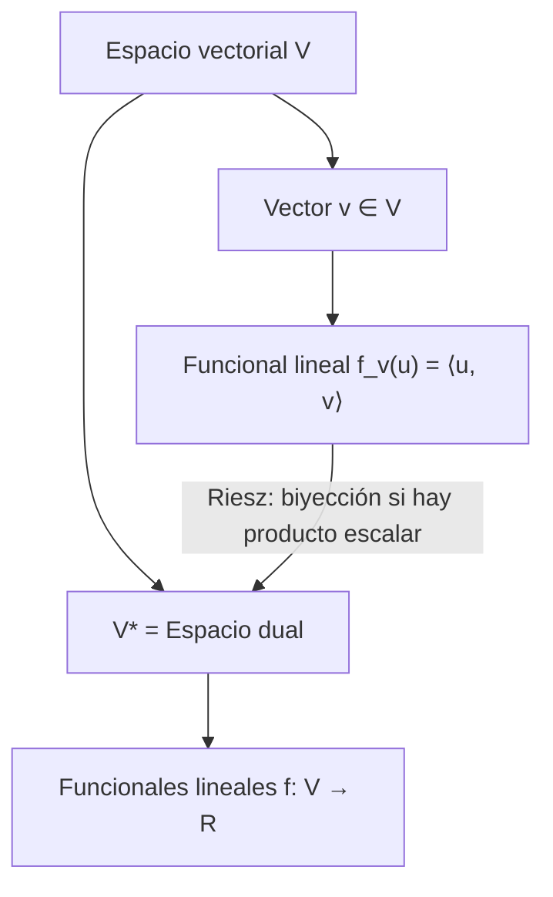

# Álgebra Lineal I - Producto escalar

## 5.8 Espacio dual.

---

### 1. Definiciones Fundamentales

#### Funcional lineal

Sea $V$ un espacio vectorial sobre $\mathbb{R}.$ Todo lo que sigue vale igual sobre $\mathbb{C}$ cambiando $\mathbb{R}$ por $\mathbb{C}.$ Una **forma lineal** o **funcional lineal** es una aplicación

$$ f: V \to \mathbb{R} \quad \text{tal que} \quad f(\alpha u + \beta v) = \alpha f(u) + \beta f(v), \ \forall u,v \in V, \ \alpha,\beta \in \mathbb{R} $$

#### Espacio dual

El **espacio dual** de $V,$ denotado $V^*,$ es el conjunto de **todos los funcionales lineales** sobre $V:$

$$ V^* = \{ f: V \to \mathbb{R} \mid f \text{ es lineal} \} $$

Propiedades importantes:

1. $V^*$ es un espacio vectorial con la suma $(f + g)(v) = f(v) + g(v)$ y el producto $(cf)(v) = cf(v).$ Es el espacio $\mathcal{L}(V, \mathbb{R}).$
2. Si $\dim(V)=n,$ y $\{e_1, \dots, e_n\}$ es una base de $V,$ existe una base dual $\{e^1, \dots, e^n\}$ de $V^*$ tal que

$$ e^i(e_j) = \delta^i_j = \begin{cases} 1 & i=j \\ 0 & i\neq j \end{cases} $$

Cada $e^i$ existe y es única porque una transformación lineal queda determinada por sus valores en una base. En consecuencia $\dim(V^*) = \dim(V)$ **en dimensión finita**; en dimensión infinita $V^*$ es estrictamente más grande.

3. El funcional $e^i$ extrae la coordenada número $i:$ si $v = \sum_j x_j e_j,$ entonces $e^i(v) = x_i.$ Además todo $f \in V^*$ se escribe como

$$ f = \sum_{i=1}^n f(e_i)\, e^i $$

4. **Cálculo práctico** en $\mathbb{R}^n.$ Si $B$ es la matriz cuyas columnas son los vectores de la base, los funcionales de la base dual son las filas de $B^{-1},$ porque $B^{-1}B = I$ dice exactamente que la fila $i$ aplicada a la columna $j$ da $\delta^i_j.$

#### Relación con producto escalar

Si $V$ tiene un producto escalar $\langle \cdot , \cdot \rangle,$ cada vector $v \in V$ define un funcional lineal $f_v \in V^*$ mediante:

$$ f_v(u) = \langle u, v \rangle, \quad \forall u \in V $$

**Teorema de representación de Riesz (dimensión finita).** Si $V$ tiene dimensión finita y un producto escalar definido positivo, la función $v \mapsto f_v$ es una biyección entre $V$ y $V^*:$ todo funcional lineal es de la forma $f(u) = \langle u, v \rangle$ para un único $v.$

- Es inyectiva: si $f_v = 0,$ entonces $\langle v, v \rangle = f_v(v) = 0$ y $v = 0.$ Como $\dim V = \dim V^*,$ también es sobreyectiva.
- Si $\{e_1, \ldots, e_n\}$ es ortonormal, el vector que representa a $f$ es $v = \sum_i f(e_i)\, e_i$ (con $\overline{f(e_i)}$ en el caso complejo).
- En el caso real la función $v \mapsto f_v$ es lineal, así que es un isomorfismo $V \cong V^*.$ En el caso complejo es **lineal conjugada**: $f_{cv} = \overline{c} f_v.$

Sin producto escalar también se tiene $V \cong V^*$ en dimensión finita, pero el isomorfismo depende de la base elegida.

### 2. Ejemplo Conceptual

Sea $V = \mathbb{R}^3$ con la base estándar $\{e_1, e_2, e_3\}.$

- La base dual $\{e^1, e^2, e^3\}$ se define por:

$$ e^i(e_j) = \delta^i_j $$

- Por ejemplo:

$$ e^1(2,3,5) = 2, \quad e^2(2,3,5) = 3, \quad e^3(2,3,5) = 5 $$

- Si tomamos $v = (1,1,0),$ el funcional lineal asociado mediante producto escalar es:

$$ f_v(u) = \langle u, v \rangle = u_1 + u_2 $$

#### Base dual de una base no canónica

Sea $\mathcal{B} = \{(1, 1), (1, -1)\}$ en $\mathbb{R}^2.$ Con $B = \begin{bmatrix} 1 & 1 \\ 1 & -1 \end{bmatrix},$ se tiene $B^{-1} = \frac{1}{2}\begin{bmatrix} 1 & 1 \\ 1 & -1 \end{bmatrix},$ así que

$$ e^1(x, y) = \frac{x + y}{2}, \qquad e^2(x, y) = \frac{x - y}{2} $$

Se comprueba que $e^1(1, 1) = 1,$ $e^1(1, -1) = 0,$ $e^2(1, 1) = 0$ y $e^2(1, -1) = 1.$ Por ejemplo, $(5, 1) = 3(1, 1) + 2(1, -1),$ y en efecto $e^1(5, 1) = 3$ y $e^2(5, 1) = 2.$

#### Un funcional en un espacio de funciones

En $P_2,$ la evaluación $f(p) = p(2)$ y la integral $g(p) = \int_0^1 p(x)\,dx$ son funcionales lineales. En la base $\{1, x, x^2\}$ se escriben $f = e^1 + 2e^2 + 4e^3$ y $g = e^1 + \frac{1}{2}e^2 + \frac{1}{3}e^3.$

#### Transpuesta de una transformación

Toda $T: V \to W$ lineal induce $T^*: W^* \to V^*,$ $T^*(g) = g \circ T.$ En bases duales, la matriz de $T^*$ es la **transpuesta** de la matriz de $T.$

### 3. Código en Python

```python
import numpy as np

# Definimos un vector v en R^3
v = np.array([1, 1, 0])

# Función que representa el funcional lineal f_v(u) = <u,v>
def f(u):
    return np.dot(u, v)

# Ejemplo de evaluación del funcional
u = np.array([2, 3, 5])
print("f_v(u) =", f(u))  # Salida: 5

# Base dual: las filas de B^{-1}, donde las columnas de B son la base
B = np.array([[1, 1],
              [1, -1]])
dual = np.linalg.inv(B)
print("e^1 =", dual[0], " e^2 =", dual[1])   # [0.5 0.5]  [ 0.5 -0.5]
print("e^i(b_j):\n", dual @ B)                # identidad
print("Coordenadas de (5, 1):", dual @ np.array([5, 1]))   # [3. 2.]
```

### 4. Diagramas



### 5. Ejercicios Propuestos

1. Sea $V = \mathbb{R}^2$ con base $\{(1,0),(0,1)\}.$ Encuentra la base dual $\{e^1, e^2\}$ y verifica $e^i(e_j) = \delta^i_j.$

2. En $V = \mathbb{R}^3$ con producto escalar usual, define el funcional lineal asociado al vector $v = (2,-1,3)$ y evalúalo en $u=(1,0,1).$

3. Demuestra que la dimensión del espacio dual es igual a la dimensión del espacio original.

4. Sea $V = \mathbb{R}^3$ y $\{v_1, v_2, v_3\}$ una base. Define el funcional lineal $f$ tal que $f(v_1)=1, f(v_2)=0, f(v_3)=2.$ Encuentra $f$ aplicado a $v = 3v_1+v_2-2v_3.$

5. Explica cómo identificar $V$ con $V^*$ mediante un producto escalar.

**Soluciones.**

1. $e^1(x, y) = x$ y $e^2(x, y) = y.$
2. $f_v(u) = 2u_1 - u_2 + 3u_3,$ y $f_v(1, 0, 1) = 5.$
3. Dada una base $\{e_1, \ldots, e_n\}$ de $V,$ los $n$ funcionales $e^i$ son linealmente independientes, porque si $\sum c_i e^i = 0,$ al evaluar en $e_j$ queda $c_j = 0.$ Generan $V^*,$ porque $f = \sum f(e_i) e^i.$
4. $f(v) = 3 \cdot 1 + 1 \cdot 0 - 2 \cdot 2 = -1.$
5. Ver el teorema de representación de Riesz de la sección 1.

### 6. Referencias

- Anton, H., & Rorres, C. (2010). **Álgebra Lineal con Aplicaciones**. Wiley.
- Strang, G. (2016). **Introduction to Linear Algebra**. MIT Press.
- Lay, D. C. (2015). **Álgebra lineal y sus aplicaciones**. Pearson.
- MIT OpenCourseWare – [Linear Algebra Lectures](https://ocw.mit.edu/courses/18-06-linear-algebra-spring-2010/)
