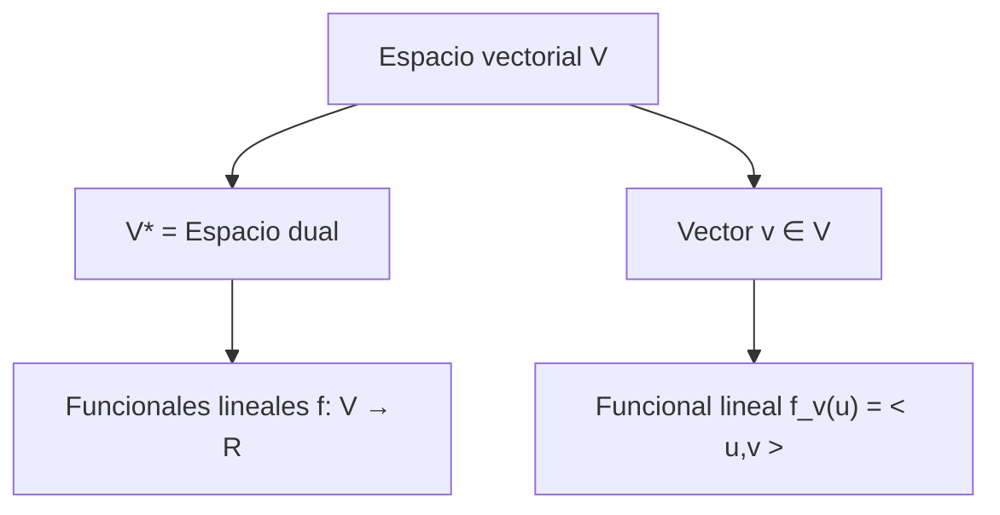

# Álgebra Lineal I - Producto escalar

## 5.8 Espacio dual.

---

### 1. Definiciones Fundamentales

#### Funcional lineal

Sea $V$ un espacio vectorial sobre $\mathbb{R}$ ( o $\mathbb{C}$ ). Una **función lineal** o **funcional lineal** es una aplicación:

$$ f: V \to \mathbb{R} \quad \text{tal que} \quad f(\alpha u + \beta v) = \alpha f(u) + \beta f(v), \ \forall u,v \in V, \ \alpha,\beta \in \mathbb{R} $$

#### Espacio dual

El **espacio dual** de $V$, denotado $V^*$, es el conjunto de **todos los funcionales lineales** sobre $V$:

$$ V^* = \{ f: V \to \mathbb{R} \mid f \text{ es lineal} \} $$

Propiedades importantes:

1. $V^*$ es un espacio vectorial de la misma dimensión que $V$.
2. Si $\dim(V)=n$, y ${e\_1, \dots, e\_n}$ es una base de $V$, existe una base dual ${e^1, \dots, e^n}$ de $V^*$ tal que:

$$ e^i(e_j) = \delta^i_j = \begin{cases} 1 & i=j \\\ 0 & i\neq j \end{cases} $$

#### Relación con producto escalar

Si $V$ tiene un producto escalar $\langle \cdot , \cdot \rangle$, cada vector $v \in V$ define un funcional lineal $f\_v \in V^*$ mediante:

$$ f_v(u) = \langle u, v \rangle, \quad \forall u \in V $$

Esta construcción permite identificar $V$ con $V^*$ cuando el espacio es **finito-dimensional y tiene producto escalar**.

### 2. Ejemplo Conceptual

Sea $V = \mathbb{R}^3$ con la base estándar ${e\_1, e\_2, e\_3}$.

- La base dual ${e^1, e^2, e^3}$ se define por:

$$ e^i(e_j) = \delta^i_j $$

- Por ejemplo:

$$ e^1(2,3,5) = 2, \quad e^2(2,3,5) = 3, \quad e^3(2,3,5) = 5 $$

- Si tomamos $v = (1,1,0)$, el funcional lineal asociado mediante producto escalar es:

$$ f_v(u) = \langle u, v \rangle = u_1 + u_2 $$

### 3. Código en Python

```python
import numpy as np

# Definimos un vector v en R^3
v = np.array([1, 1, 0])

# Función que representa el funcional lineal f_v(u) = <u,v>
def f(u):
    return np.dot(u, v)

# Ejemplo de evaluación del funcional
u = np.array([2, 3, 5])
print("f_v(u) =", f(u))  # Salida: 5
```

### 4. Diagramas



### 5. Ejercicios Propuestos

1. Sea $V = \mathbb{R}^2$ con base ${(1,0),(0,1)}$. Encuentra la base dual ${e^1, e^2}$ y verifica $e^i(e\_j) = \delta^i\_j$.

2. En $V = \mathbb{R}^3$ con producto escalar usual, define el funcional lineal asociado al vector $v = (2,-1,3)$ y evalúalo en $u=(1,0,1)$.

3. Demuestra que la dimensión del espacio dual es igual a la dimensión del espacio original.

4. Sea $V = \mathbb{R}^3$ y ${v\_1, v\_2, v\_3}$ una base. Define el funcional lineal $f$ tal que $f(v\_1)=1, f(v\_2)=0, f(v\_3)=2$. Encuentra $f$ aplicado a $v = 3v\_1+v\_2-2v\_3$.

5. Explica cómo identificar $V$ con $V^*$ mediante un producto escalar.

### 6. Referencias

- Anton, H., & Rorres, C. (2010). **Álgebra Lineal con Aplicaciones**. Wiley.
- Strang, G. (2016). **Introduction to Linear Algebra**. MIT Press.
- Lay, D. C. (2015). **Álgebra lineal y sus aplicaciones**. Pearson.
- MIT OpenCourseWare – [Linear Algebra Lectures](https://ocw.mit.edu/courses/18-06-linear-algebra-spring-2010/)
