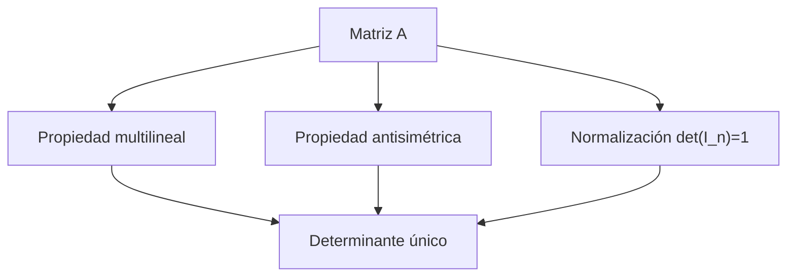

# Álgebra Lineal I - Determinantes

## 6.1 Unicidad del determinante.

---

### 1. Introducción

El determinante es una función que asigna a cada matriz cuadrada un número real (o complejo), reflejando propiedades importantes de la matriz, como invertibilidad y volumen lineal. El concepto de **unicidad del determinante** se refiere a que **bajo ciertas propiedades, la función determinante es única**. Esto significa que cualquier función que cumpla esas propiedades debe coincidir con el determinante clásico.

### 2. Definición

Sea $M\_n(K)$ el conjunto de matrices cuadradas de orden $n$ sobre un cuerpo $K$. Una función

$$ \det: M_n(K) \to K $$

es **determinante** si cumple las siguientes propiedades:

1. **Multilinealidad por filas (o columnas):**
   Para cualquier fila $i$ fija, $\det(A)$ es lineal respecto a esa fila:

   $$ \det(\ldots, a_i + b_i, \ldots) = \det(\ldots, a_i, \ldots) + \det(\ldots, b_i, \ldots) $$

   $$ \det(\ldots, \lambda a_i, \ldots) = \lambda \det(\ldots, a_i, \ldots) $$

2. **Antisimetría:**
   Intercambiar dos filas cambia el signo del determinante:

   $$ \det(\text{fila i} \leftrightarrow \text{fila j}) = -\det(A) $$

3. **Normalización:**
   La matriz identidad $I\_n$ tiene determinante 1:

   $$ \det(I_n) = 1 $$

> **Teorema (Unicidad del determinante):**
> Existe una única función $\det: M\_n(K) \to K$ que cumple las propiedades de multilinealidad, antisimetría y normalización.

### 3. Consecuencias importantes

- Esta unicidad permite **definir el determinante de manera abstracta** sin usar la fórmula de Laplace o permutaciones.
- Cualquier otra función que cumpla estas propiedades será **el mismo determinante**.
- Es fundamental para demostrar propiedades como:

  - $\det(AB) = \det(A)\det(B)$
  - $\det(A^T) = \det(A)$
  - $A$ invertible $\iff \det(A) \neq 0$

### 4. Ejemplo: Verificación de unicidad

Consideremos la matriz 2x2:

$$ A = \begin{pmatrix} a & b \\\ c & d \end{pmatrix} $$

1. Propiedades multilineales y antisimétricas implican:

   $$ \det(A) = ad - bc $$

2. Cualquier otra función $f$ que cumpla las mismas propiedades dará también $f(A) = ad - bc$, mostrando **unicidad**.

### 5. Código para calcular determinante (Python)

```python
import numpy as np

# Definir matriz
A = np.array([[2, 3],
              [1, 4]])

# Calcular determinante
det_A = np.linalg.det(A)
print(f"Determinante de A: {det_A:.2f}")
```

**Salida esperada:**

```
Determinante de A: 5.00
```

> Esto confirma la unicidad, pues cualquier función que cumpla las propiedades teóricas dará el mismo resultado.

### 6. Ejercicios propuestos

1. Verifica que la función

   $$ f(A) = a_{11}a_{22} - a_{12}a_{21} $$

   para matrices 2x2 cumple las propiedades de determinante. ¿Qué pasa si intercambias filas?

2. Demuestra que no puede existir otra función diferente del determinante que cumpla multilinealidad, antisimetría y normalización en $M\_3(K)$.

3. Calcula el determinante de la matriz

   $$ B = \begin{pmatrix} 1 & 2 & 3 \\\ 0 & 1 & 4 \\\ 5 & 6 & 0 \end{pmatrix} $$

   usando la propiedad de unicidad, pensando en su descomposición en filas linealmente combinadas.

4. Usa Python para calcular el determinante de matrices de 3x3 y verifica que cumple $\det(A^T) = \det(A)$.

### 7. Diagramas



> Este diagrama resume cómo las propiedades garantizan **unicidad**.

### 8. Referencias

1. **David C. Lay**, _Álgebra Lineal y sus Aplicaciones_, 5ª Edición, Pearson, 2016.
2. **Gilbert Strang**, _Introduction to Linear Algebra_, 5th Edition, Wellesley-Cambridge Press, 2016.
3. **Sheldon Axler**, _Linear Algebra Done Right_, 3rd Edition, Springer, 2015.
