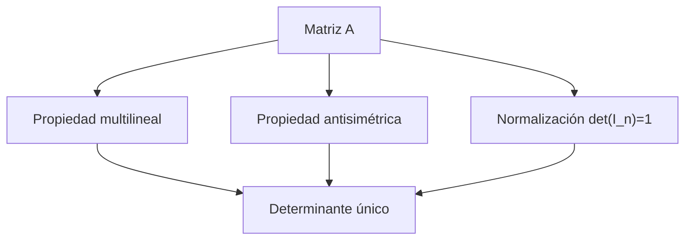

# Álgebra Lineal I - Determinantes

## 6.1 Unicidad del determinante.

---

### 1. Introducción

El determinante es una función que asigna a cada matriz cuadrada un número real (o complejo), reflejando propiedades importantes de la matriz, como la invertibilidad y el factor por el que la transformación multiplica los volúmenes. El concepto de **unicidad del determinante** se refiere a que **bajo ciertas propiedades, la función determinante es única**. Esto significa que cualquier función que cumpla esas propiedades debe coincidir con el determinante clásico.

### 2. Definición

Sea $M_n(K)$ el conjunto de matrices cuadradas de orden $n$ sobre un cuerpo $K.$ Una función

$$ \det: M_n(K) \to K $$

es **determinante** si cumple las siguientes propiedades:

1. **Multilinealidad por filas (o columnas):**
   Para cualquier fila $i$ fija, $\det(A)$ es lineal respecto a esa fila:

   $$ \det(\ldots, a_i + b_i, \ldots) = \det(\ldots, a_i, \ldots) + \det(\ldots, b_i, \ldots) $$

   $$ \det(\ldots, \lambda a_i, \ldots) = \lambda \det(\ldots, a_i, \ldots) $$

2. **Antisimetría:**
   Intercambiar dos filas cambia el signo del determinante:

   $$ \det(\ldots, a_j, \ldots, a_i, \ldots) = -\det(\ldots, a_i, \ldots, a_j, \ldots) $$

   Equivalentemente, si dos filas son iguales el determinante es $0.$ Esta segunda forma, llamada **alternancia**, es la que se usa como axioma cuando el cuerpo tiene característica $2,$ donde $-1 = 1.$

3. **Normalización:**
   La matriz identidad $I_n$ tiene determinante 1:

   $$ \det(I_n) = 1 $$

> **Teorema (Unicidad del determinante):**
> Existe una única función $\det: M_n(K) \to K$ que cumple las propiedades de multilinealidad, antisimetría y normalización.

### 3. Consecuencias importantes

- Esta unicidad permite **definir el determinante de manera abstracta** sin usar la fórmula de Laplace o permutaciones.
- Cualquier otra función que cumpla estas propiedades será **el mismo determinante**.
- Es fundamental para demostrar propiedades como:

  - $\det(AB) = \det(A)\det(B)$
  - $\det(A^T) = \det(A)$
  - $A$ invertible $\iff \det(A) \neq 0$

### 4. Ejemplo: Verificación de unicidad

Consideremos la matriz $2 \times 2$

$$ A = \begin{pmatrix} a & b \\ c & d \end{pmatrix} $$

y una función $f$ cualquiera que cumpla las tres propiedades. Escribimos las filas en términos de la base canónica: $r_1 = a e_1 + b e_2$ y $r_2 = c e_1 + d e_2.$ Por multilinealidad en cada fila,

$$ f(r_1, r_2) = ac\, f(e_1, e_1) + ad\, f(e_1, e_2) + bc\, f(e_2, e_1) + bd\, f(e_2, e_2) $$

Las filas repetidas dan cero, $f(e_2, e_1) = -f(e_1, e_2)$ por antisimetría, y $f(e_1, e_2) = f(I_2) = 1.$ Por lo tanto

$$ f(A) = ad - bc $$

El resultado no depende de $f:$ **cualquier** función con las tres propiedades vale $ad - bc.$ Eso es la unicidad.

#### El caso general

El mismo argumento funciona para $n \times n.$ Al desarrollar cada fila $r_i = \sum_j a_{ij} e_j$ por multilinealidad se obtienen $n^n$ términos $a_{1j_1}\cdots a_{nj_n} f(e_{j_1}, \ldots, e_{j_n}).$ Los términos con índices repetidos se anulan, y los que quedan corresponden a permutaciones $\sigma.$ Cada $f(e_{\sigma(1)}, \ldots, e_{\sigma(n)})$ se lleva a $f(I_n) = 1$ con intercambios, y vale $\operatorname{sgn}(\sigma).$ Así cualquier $f$ con las tres propiedades es igual a

$$ \det(A) = \sum_{\sigma \in S_n} \operatorname{sgn}(\sigma)\, a_{1\sigma(1)} a_{2\sigma(2)} \cdots a_{n\sigma(n)} $$

que es la **fórmula de Leibniz**. Esto prueba la unicidad. La existencia se prueba verificando que esta fórmula sí cumple las tres propiedades.

#### Efecto de las operaciones elementales

Las propiedades determinan cómo cambia el determinante con cada operación elemental de filas, y con ello dan el método práctico de cálculo:

| Operación | Efecto en el determinante |
| --- | --- |
| Intercambiar dos filas | Cambia de signo |
| Multiplicar una fila por $\lambda$ | Se multiplica por $\lambda$ |
| Sumar a una fila un múltiplo de otra | No cambia |

Escalonando la matriz hasta una triangular, el determinante es el producto de la diagonal, corregido por los intercambios y escalamientos realizados.

### 5. Código para calcular determinante (Python)

```python
import numpy as np

# Definir matriz
A = np.array([[2, 3],
              [1, 4]])

# Calcular determinante
det_A = np.linalg.det(A)
print(f"Determinante de A: {det_A:.2f}")
```

**Salida esperada:**

```
Determinante de A: 5.00
```

> NumPy no usa la fórmula de Leibniz, sino una factorización LU, es decir, eliminación de Gauss. Que el resultado coincida con $ad - bc = 8 - 3 = 5$ ilustra la unicidad: cualquier método correcto de cálculo produce la misma función.

### 6. Ejercicios propuestos

1. Verifica que la función

   $$ f(A) = a_{11}a_{22} - a_{12}a_{21} $$

   para matrices 2x2 cumple las propiedades de determinante. ¿Qué pasa si intercambias filas?

2. Demuestra que no puede existir otra función diferente del determinante que cumpla multilinealidad, antisimetría y normalización en $M_3(K).$

3. Calcula el determinante de la matriz

   $$ B = \begin{pmatrix} 1 & 2 & 3 \\ 0 & 1 & 4 \\ 5 & 6 & 0 \end{pmatrix} $$

   usando operaciones elementales de filas.

4. Usa Python para calcular el determinante de matrices de 3x3 y verifica que cumple $\det(A^T) = \det(A).$

**Soluciones.**

1. Es lineal en cada fila porque cada término tiene exactamente un factor de cada fila; al intercambiar filas queda $a_{21}a_{12} - a_{22}a_{11} = -f(A);$ y $f(I) = 1.$
2. Es el argumento del caso general de la sección 4 con $n = 3:$ cualquier función con las tres propiedades coincide con la fórmula de Leibniz.
3. $F_3 \to F_3 - 5F_1$ da la fila $(0, -4, -15);$ luego $F_3 \to F_3 + 4F_2$ da $(0, 0, 1).$ La matriz queda triangular con diagonal $1, 1, 1,$ así que $\det(B) = 1.$

### 7. Diagramas



> Este diagrama resume cómo las propiedades garantizan **unicidad**.

### 8. Referencias

1. **David C. Lay**, _Álgebra Lineal y sus Aplicaciones_, 5ª Edición, Pearson, 2016.
2. **Gilbert Strang**, _Introduction to Linear Algebra_, 5th Edition, Wellesley-Cambridge Press, 2016.
3. **Sheldon Axler**, _Linear Algebra Done Right_, 3rd Edition, Springer, 2015.
