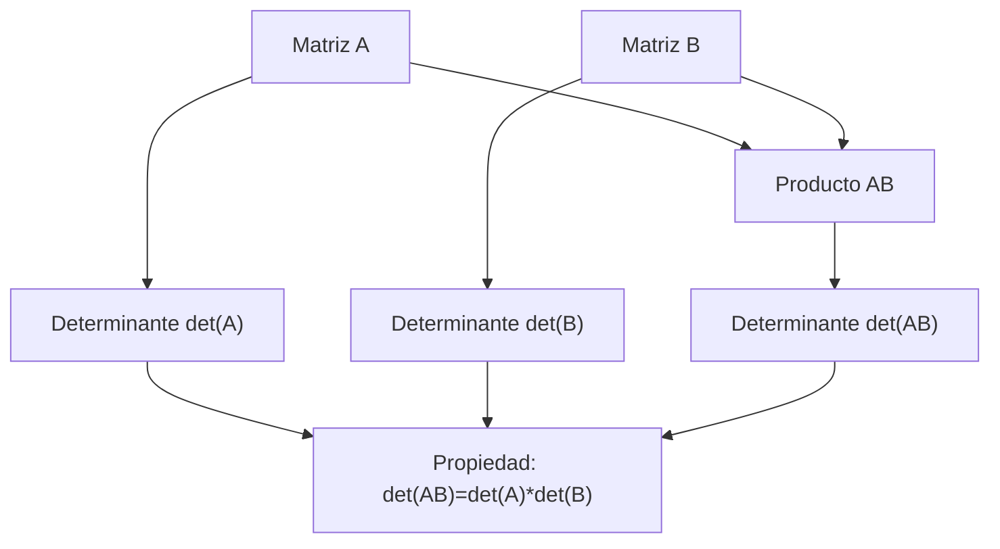

# Álgebra Lineal I - Determinantes

## 6.2 Determinante de un producto.

---

### 1. Introducción

Una de las propiedades más importantes del determinante es su comportamiento respecto al **producto de matrices**. Esta propiedad es clave para muchos resultados en Álgebra Lineal, como el cálculo de inversas, la diagonalización y el estudio de transformaciones lineales.

### 2. Definición y propiedad

Sea $A, B \in M\_n(K)$ matrices cuadradas de orden $n$. La propiedad del determinante de un producto establece que:

$$ \det(AB) = \det(A)\cdot \det(B) $$

**Consecuencias inmediatas:**

- Si $A$ es invertible, entonces $\det(A^{-1}) = \frac{1}{\det(A)}$.
- $\det(A^k) = (\det(A))^k$ para cualquier entero $k \ge 1$.
- La propiedad también se mantiene para transpuestas: $\det(A^T B^T) = \det(A^T)\det(B^T)$.

> Esta propiedad puede derivarse de la **unicidad del determinante**, ya que cualquier función que cumpla multilinealidad, antisimetría y normalización debe respetar $\det(AB) = \det(A)\det(B)$.

### 3. Ejemplo teórico

Sean las matrices:

$$ A = \begin{pmatrix} 1 & 2 \\ 0 & 3 \end{pmatrix}, \quad B = \begin{pmatrix} 4 & 0 \\ 1 & 2 \end{pmatrix} $$

1. Calculamos los determinantes individuales:

$$ \det(A) = 1\cdot3 - 2\cdot0 = 3 $$

$$ \det(B) = 4\cdot2 - 0\cdot1 = 8 $$

2. Calculamos el producto:

$$ AB = \begin{pmatrix} 1 & 2 \\ 0 & 3 \end{pmatrix} \begin{pmatrix} 4 & 0 \\ 1 & 2 \end{pmatrix} = \begin{pmatrix} 6 & 4 \\ 3 & 6 \end{pmatrix} $$

3. Determinante del producto:

$$ \det(AB) = 6\cdot6 - 4\cdot3 = 36 - 12 = 24 $$

4. Verificamos la propiedad:

$$ \det(A)\det(B) = 3 \cdot 8 = 24 = \det(AB) $$

La propiedad se cumple.

### 4. Código en Python para cálculo

```python
import numpy as np

# Definir matrices
A = np.array([[1, 2],
              [0, 3]])
B = np.array([[4, 0],
              [1, 2]])

# Determinantes individuales
det_A = np.linalg.det(A)
det_B = np.linalg.det(B)

# Determinante del producto
det_AB = np.linalg.det(A @ B)

print(f"det(A) = {det_A:.2f}")
print(f"det(B) = {det_B:.2f}")
print(f"det(A*B) = {det_AB:.2f}")
print(f"det(A)*det(B) = {det_A*det_B:.2f}")
```

**Salida esperada:**

```
det(A) = 3.00
det(B) = 8.00
det(A*B) = 24.00
det(A)*det(B) = 24.00
```

> Esto confirma la propiedad del determinante de un producto.

### 5. Ejercicios propuestos

1. Demuestra que si $A$ y $B$ son invertibles, entonces $AB$ también es invertible usando la propiedad del determinante.

2. Sea $A = \begin{pmatrix} 2 & 1 \ 3 & 4 \end{pmatrix}$ y $B = \begin{pmatrix} 0 & 1 \ 2 & 3 \end{pmatrix}$. Calcula $\det(A)$, $\det(B)$ y $\det(AB)$, y verifica que $\det(AB) = \det(A)\det(B)$.

3. Prueba que $\det(A^k) = (\det(A))^k$ para $k = 3$ y $A = \begin{pmatrix} 1 & 2 \ 3 & 4 \end{pmatrix}$.

4. Si $\det(A) = 0$ y $\det(B) \neq 0$, ¿qué se puede decir de $\det(AB)$? Explica.

### 6. Diagramas (Mermaid)



> Este diagrama resume cómo los determinantes individuales y el producto se relacionan mediante la propiedad.

### 7. Referencias

1. **David C. Lay**, _Álgebra Lineal y sus Aplicaciones_, 5ª Edición, Pearson, 2016.
2. **Gilbert Strang**, _Introduction to Linear Algebra_, 5th Edition, Wellesley-Cambridge Press, 2016.
3. **Sheldon Axler**, _Linear Algebra Done Right_, 3rd Edition, Springer, 2015.
