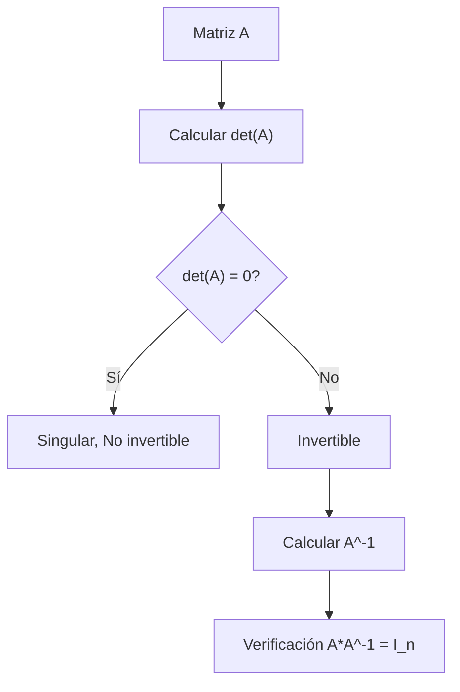

# Álgebra Lineal I - Determinantes

## 6.3 Invertibilidad de matrices y determinantes.

---

### 1. Introducción

El determinante de una matriz cuadrada no solo mide propiedades geométricas como el volumen, sino que también permite **determinar si una matriz es invertible**. La relación entre determinante e invertibilidad es fundamental en Álgebra Lineal y se utiliza constantemente para resolver sistemas de ecuaciones, calcular inversas y estudiar transformaciones lineales.

### 2. Definición

Sea $A \in M_n(K)$ una matriz cuadrada de orden $n.$

- $A$ es **invertible** si existe $A^{-1}$ tal que:

$$ A A^{-1} = A^{-1} A = I_n $$

- Una propiedad clave es:

$$ A \text{ invertible } \iff \det(A) \neq 0 $$

**Por qué.** Si $A$ es invertible, $1 = \det(I) = \det(A)\det(A^{-1}),$ así que $\det(A) \neq 0.$ Si $A$ no es invertible, al escalonarla aparece una fila de ceros; las operaciones elementales solo multiplican el determinante por números distintos de cero, y una matriz con una fila nula tiene determinante $0.$

Para $A \in M_n(K)$ las siguientes afirmaciones son equivalentes:

- $A$ es invertible.
- $\det(A) \neq 0.$
- $\operatorname{rango}(A) = n.$
- Las columnas (o las filas) de $A$ son linealmente independientes.
- $A\mathbf{x} = \mathbf{0}$ solo tiene la solución trivial.
- $A\mathbf{x} = \mathbf{b}$ tiene solución única para todo $\mathbf{b}.$

- Consecuencias:

1. Si $\det(A) = 0,$ la matriz es **singular**, no tiene inversa.
2. Si $\det(A) \neq 0,$ la matriz es **regular**, y su inversa existe y cumple:

$$ \det(A^{-1}) = \frac{1}{\det(A)} $$

### 3. Ejemplo teórico

Consideremos las matrices:

1. Matriz invertible:

$$ A = \begin{pmatrix} 2 & 1 \\ 3 & 4 \end{pmatrix} $$

Determinante:

$$ \det(A) = 2\cdot4 - 1\cdot3 = 8 - 3 = 5 \neq 0 $$

Por lo tanto, $A$ es invertible.

2. Matriz singular:

$$ B = \begin{pmatrix} 1 & 2 \\ 2 & 4 \end{pmatrix} $$

Determinante:

$$ \det(B) = 1\cdot4 - 2\cdot2 = 4 - 4 = 0 $$

$B$ no es invertible: su segunda fila es el doble de la primera.

### 3.1 Fórmula de la inversa con la adjunta

Si $\det(A) \neq 0,$

$$ A^{-1} = \frac{1}{\det(A)} \operatorname{adj}(A) $$

donde $\operatorname{adj}(A)$ es la transpuesta de la matriz de cofactores $C_{ij} = (-1)^{i+j} M_{ij}.$ En el caso $2 \times 2,$

$$ \begin{pmatrix} a & b \\ c & d \end{pmatrix}^{-1} = \frac{1}{ad - bc}\begin{pmatrix} d & -b \\ -c & a \end{pmatrix} $$

Para la matriz $A$ del ejemplo, $A^{-1} = \frac{1}{5}\begin{pmatrix} 4 & -1 \\ -3 & 2 \end{pmatrix}.$ La fórmula muestra de dónde sale la condición $\det(A) \neq 0:$ es el único denominador. Para matrices grandes conviene más el método de Gauss-Jordan.

### 3.2 Regla de Cramer

Si $\det(A) \neq 0,$ la solución de $A\mathbf{x} = \mathbf{b}$ es $x_i = \frac{\det(A_i)}{\det(A)},$ donde $A_i$ es $A$ con la columna $i$ sustituida por $\mathbf{b}.$ Por ejemplo, para $2x + y = 3$ y $3x + 4y = 7,$ se obtiene $x = \frac{12 - 7}{5} = 1$ y $y = \frac{14 - 9}{5} = 1.$

### 4. Propiedades útiles

1. **Multiplicación de matrices:**

$$ \det(AB) = \det(A)\cdot\det(B) $$

2. **Transposición:**

$$ \det(A^T) = \det(A) $$

3. **Inversa:**

Si $A$ es invertible:

$$ \det(A^{-1}) = \frac{1}{\det(A)} $$

4. **Fila multiplicada:**
   Multiplicar una fila por $\lambda \neq 0$ multiplica el determinante por $\lambda.$ Por eso las operaciones elementales no cambian si el determinante es cero o no.

### 5. Código en Python para verificación

```python
import numpy as np

# Matriz invertible
A = np.array([[2, 1],
              [3, 4]])

# Matriz singular
B = np.array([[1, 2],
              [2, 4]])

# Determinantes
det_A = np.linalg.det(A)
det_B = np.linalg.det(B)

# Con números de punto flotante no se compara con 0 exactamente: se usa una tolerancia
es_singular = lambda d: np.isclose(d, 0)
print(f"det(A) = {det_A:.2f} -> {'Singular' if es_singular(det_A) else 'Invertible'}")
print(f"det(B) = {det_B:.2f} -> {'Singular' if es_singular(det_B) else 'Invertible'}")

# Verificando inversa
if not es_singular(det_A):
    A_inv = np.linalg.inv(A)
    print("Inversa de A:\n", A_inv)
    print("Verificación A*A_inv:\n", A @ A_inv)
```

**Salida esperada:**

```
det(A) = 5.00 -> Invertible
det(B) = 0.00 -> Singular
Inversa de A:
 [[ 0.8 -0.2]
 [-0.6  0.4]]
Verificación A*A_inv:
 [[1. 0.]
 [0. 1.]]
```

### 6. Ejercicios propuestos

1. Determina si las siguientes matrices son invertibles usando su determinante:

$$ C = \begin{pmatrix} 1 & 2 & 3 \\ 0 & 1 & 4 \\ 5 & 6 & 0 \end{pmatrix}, \quad D = \begin{pmatrix} 2 & 4 & 1 \\ 1 & 2 & 0 \\ 3 & 6 & 1 \end{pmatrix} $$

2. Demuestra que si $A$ y $B$ son invertibles, entonces $AB$ también lo es.

3. Si $A$ es singular, demuestra que $A^2$ también es singular.

4. Usa Python para calcular la inversa de una matriz 3x3 invertible y verifica que $A A^{-1} = I_3.$

**Soluciones.**

1. $\det(C) = 1(0 - 24) - 2(0 - 20) + 3(0 - 5) = 1,$ así que $C$ es invertible. En $D$ la segunda columna es el doble de la primera, así que $\det(D) = 0$ y $D$ no es invertible.
2. $\det(AB) = \det(A)\det(B) \neq 0.$
3. $\det(A^2) = \det(A)^2 = 0.$

### 7. Diagramas



> Este diagrama resume el proceso de determinar la invertibilidad usando el determinante.

### 8. Referencias

1. **David C. Lay**, _Álgebra Lineal y sus Aplicaciones_, 5ª Edición, Pearson, 2016.
2. **Gilbert Strang**, _Introduction to Linear Algebra_, 5th Edition, Wellesley-Cambridge Press, 2016.
3. **Sheldon Axler**, _Linear Algebra Done Right_, 3rd Edition, Springer, 2015.
