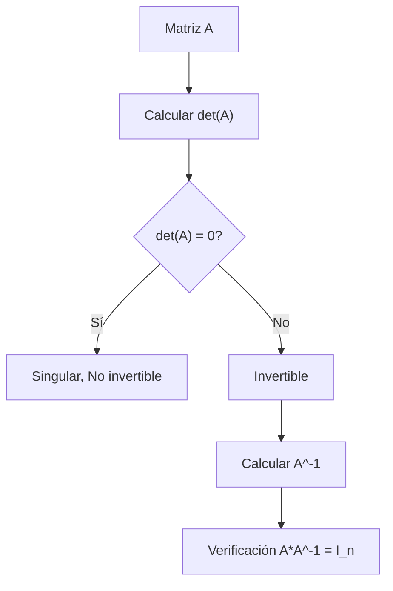

# Álgebra Lineal I - Determinantes

## 6.3 Invertibilidad de matrices y determinantes.

---

### 1. Introducción

El determinante de una matriz cuadrada no solo mide propiedades geométricas como el volumen, sino que también permite **determinar si una matriz es invertible**. La relación entre determinante e invertibilidad es fundamental en Álgebra Lineal y se utiliza constantemente para resolver sistemas de ecuaciones, calcular inversas y estudiar transformaciones lineales.

### 2. Definición

Sea $A \in M\_n(K)$ una matriz cuadrada de orden $n$.

- $A$ es **invertible** si existe $A^{-1}$ tal que:

$$ A A^{-1} = A^{-1} A = I_n $$

- Una propiedad clave es:

$$ A \text{ invertible } \iff \det(A) \neq 0 $$

- Consecuencias:

1. Si $\det(A) = 0$, la matriz es **singular**, no tiene inversa.
2. Si $\det(A) \neq 0$, la matriz es **regular**, y su inversa existe y cumple:

$$ \det(A^{-1}) = \frac{1}{\det(A)} $$

### 3. Ejemplo teórico

Consideremos las matrices:

1. Matriz invertible:

$$ A = \begin{pmatrix} 2 & 1 \\\ 3 & 4 \end{pmatrix} $$

Determinante:

$$ \det(A) = 2\cdot4 - 1\cdot3 = 8 - 3 = 5 \neq 0 $$

Por lo tanto, $A$ es invertible.

2. Matriz singular:

$$ B = \begin{pmatrix} 1 & 2 \\\ 2 & 4 \end{pmatrix} $$

Determinante:

$$ \det(B) = 1\cdot4 - 2\cdot2 = 4 - 4 = 0 $$

$B$ no es invertible.

### 4. Propiedades útiles

1. **Multiplicación de matrices:**

$$ \det(AB) = \det(A)\cdot\det(B) $$

2. **Transposición:**

$$ \det(A^T) = \det(A) $$

3. **Inversa:**

Si $A$ es invertible:

$$ \det(A^{-1}) = \frac{1}{\det(A)} $$

4. **Fila múltiplicada:**
   Multiplicar una fila por $ \lambda \neq 0 $ multiplica el determinante por $ \lambda $.

### 5. Código en Python para verificación

```python
import numpy as np

# Matriz invertible
A = np.array([[2, 1],
              [3, 4]])

# Matriz singular
B = np.array([[1, 2],
              [2, 4]])

# Determinantes
det_A = np.linalg.det(A)
det_B = np.linalg.det(B)

print(f"det(A) = {det_A:.2f} -> {'Invertible' if det_A != 0 else 'Singular'}")
print(f"det(B) = {det_B:.2f} -> {'Invertible' if det_B != 0 else 'Singular'}")

# Verificando inversa
if det_A != 0:
    A_inv = np.linalg.inv(A)
    print("Inversa de A:\n", A_inv)
    print("Verificación A*A_inv:\n", A @ A_inv)
```

**Salida esperada:**

```
det(A) = 5.00 -> Invertible
det(B) = 0.00 -> Singular
Inversa de A:
 [[ 0.8 -0.2]
  [-0.6  0.4]]
Verificación A*A_inv:
 [[1. 0.]
  [0. 1.]]
```

### 6. Ejercicios propuestos

1. Determina si las siguientes matrices son invertibles usando su determinante:

$$ C = \begin{pmatrix} 1 & 2 & 3 \\\ 0 & 1 & 4 \\\ 5 & 6 & 0 \end{pmatrix}, \quad D = \begin{pmatrix} 2 & 4 & 1 \\\ 1 & 2 & 0 \\\ 3 & 6 & 1 \end{pmatrix} $$

2. Demuestra que si $A$ y $B$ son invertibles, entonces $AB$ también lo es.

3. Si $A$ es singular, demuestra que $A^2$ también es singular.

4. Usa Python para calcular la inversa de una matriz 3x3 invertible y verifica que $A A^{-1} = I\_3$.

### 7. Diagramas



> Este diagrama resume el proceso de determinar la invertibilidad usando el determinante.

### 8. Referencias

1. **David C. Lay**, _Álgebra Lineal y sus Aplicaciones_, 5ª Edición, Pearson, 2016.
2. **Gilbert Strang**, _Introduction to Linear Algebra_, 5th Edition, Wellesley-Cambridge Press, 2016.
3. **Sheldon Axler**, _Linear Algebra Done Right_, 3rd Edition, Springer, 2015.
