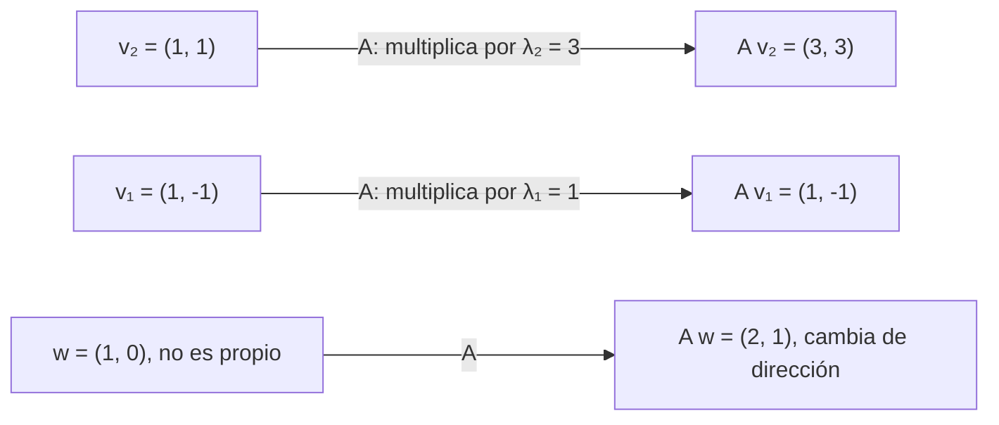

# Álgebra Lineal I - Transformaciones simétricas

## 7.1 Definición y propiedades elementales de valores y vectores propios.

---

### 1. Introducción

En Álgebra Lineal, los **valores propios (autovalores)** y **vectores propios (autovectores)** son conceptos centrales para comprender cómo una **transformación lineal** actúa sobre el espacio vectorial.

En particular, en el caso de las **transformaciones simétricas**, es decir, las representadas en una base ortonormal por matrices simétricas $A = A^T,$ los vectores y valores propios poseen propiedades muy útiles, como la posibilidad de **diagonalizar la matriz** mediante una base ortonormal.

### 2. Definiciones Fundamentales

#### Definición de valor y vector propio

Sea $T: V \to V$ una transformación lineal sobre un espacio vectorial $V.$
Un escalar $\lambda,$ real o complejo según el espacio, es un **valor propio** de $T$ si existe un vector **no nulo** $\mathbf{v} \in V$ tal que

$$ T(\mathbf{v}) = \lambda \mathbf{v} $$

En términos matriciales, si $T$ está representada por una matriz $A,$

$$ A \mathbf{v} = \lambda \mathbf{v} $$

Aquí, $\mathbf{v}$ es el **vector propio** correspondiente al valor propio $\lambda.$ Se exige $\mathbf{v} \neq \mathbf{0}$ porque $A\mathbf{0} = \lambda\mathbf{0}$ para cualquier $\lambda.$ Los múltiplos no nulos de un vector propio también son vectores propios del mismo valor.

El conjunto $E_\lambda = \ker(A - \lambda I)$ se llama **subespacio propio** de $\lambda;$ está formado por los vectores propios de $\lambda$ y el vector cero.

#### Ecuación característica

Para encontrar los valores propios se resuelve la **ecuación característica**:

$$ \det(A - \lambda I) = 0 $$

- Las soluciones $\lambda$ son los **valores propios**.
- Para cada $\lambda,$ los vectores propios se obtienen resolviendo:

$$ (A - \lambda I)\mathbf{v} = \mathbf{0} $$

El sistema tiene soluciones no nulas exactamente cuando $A - \lambda I$ no es invertible, es decir, cuando $\det(A - \lambda I) = 0.$

### 3. Propiedades elementales

#### 3.1 Para cualquier matriz cuadrada

1. $\lambda = 0$ es valor propio de $A$ si y solo si $A$ es singular.
2. Vectores propios de valores propios distintos son **linealmente independientes**. En consecuencia, una matriz $n \times n$ tiene a lo más $n$ valores propios distintos.
3. Si $A\mathbf{v} = \lambda\mathbf{v},$ entonces $A^k\mathbf{v} = \lambda^k\mathbf{v},$ $(A + cI)\mathbf{v} = (\lambda + c)\mathbf{v}$ y, si $A$ es invertible, $A^{-1}\mathbf{v} = \lambda^{-1}\mathbf{v}.$
4. Los valores propios de una matriz triangular son las entradas de su diagonal.
5. La suma de los valores propios, contados con multiplicidad, es $\operatorname{tr}(A)$ y su producto es $\det(A).$
6. $A$ y $A^T$ tienen los mismos valores propios, aunque en general distintos vectores propios.

#### 3.2 Para matrices simétricas reales

En el caso de **matrices simétricas reales** $A = A^T:$

1. **Valores propios reales:**
   Todos los valores propios de $A$ son reales. Si $A\mathbf{v} = \lambda\mathbf{v}$ con $\mathbf{v} \in \mathbb{C}^n$ no nulo, entonces $\overline{\mathbf{v}}^T A \mathbf{v} = \lambda \|\mathbf{v}\|^2.$ El lado izquierdo es real, porque es igual a su conjugado cuando $A$ es real y simétrica; por tanto $\lambda$ es real.

2. **Ortogonalidad de vectores propios:**
   Vectores propios correspondientes a valores propios distintos son ortogonales. Si $A\mathbf{u} = \lambda\mathbf{u}$ y $A\mathbf{v} = \mu\mathbf{v},$ entonces $\lambda\langle \mathbf{u}, \mathbf{v} \rangle = \langle A\mathbf{u}, \mathbf{v} \rangle = \langle \mathbf{u}, A\mathbf{v} \rangle = \mu\langle \mathbf{u}, \mathbf{v} \rangle,$ y como $\lambda \neq \mu,$ $\langle \mathbf{u}, \mathbf{v} \rangle = 0.$

3. **Diagonalización ortogonal:**
   Una matriz simétrica puede diagonalizarse mediante una matriz ortogonal:

   $$ A = Q \Lambda Q^T $$

   donde $Q$ es ortogonal (sus columnas son vectores propios ortonormales) y $\Lambda$ es diagonal con los valores propios.

4. **Multiplicidad:**

   - **Algebraica:** veces que un valor propio aparece como raíz del polinomio característico.
   - **Geométrica:** dimensión del subespacio propio asociado.
     Siempre $1 \leq$ geométrica $\leq$ algebraica. Para matrices simétricas siempre son iguales. En cambio, $\begin{bmatrix} 1 & 1 \\ 0 & 1 \end{bmatrix}$ tiene $\lambda = 1$ con multiplicidad algebraica $2$ y geométrica $1,$ y no es diagonalizable.

### 4. Ejemplos ilustrativos

#### Ejemplo 1: Matriz simétrica 2×2

Sea

$$ A = \begin{bmatrix} 2 & 1 \\ 1 & 2 \end{bmatrix} $$

**Paso 1. Ecuación característica:**

$$ \det(A - \lambda I) = \begin{vmatrix} 2-\lambda & 1 \\ 1 & 2-\lambda \end{vmatrix} = (2-\lambda)^2 - 1 $$

$$ = \lambda^2 - 4\lambda + 3 = 0 $$

$$ \lambda_1 = 1, \quad \lambda_2 = 3 $$

**Paso 2. Vectores propios:**

- Para $\lambda_1 = 1:$

$$ (A - I)\mathbf{v} = \begin{bmatrix} 1 & 1 \\ 1 & 1 \end{bmatrix} \begin{bmatrix} x \\ y \end{bmatrix} = 0 $$

$\implies x = -y .$
Un vector propio: $\mathbf{v}_1 = \begin{bmatrix} 1 \\ -1 \end{bmatrix}.$

- Para $\lambda_2 = 3:$

$$ (A - 3I)\mathbf{v} = \begin{bmatrix} -1 & 1 \\ 1 & -1 \end{bmatrix} \begin{bmatrix} x \\ y \end{bmatrix} = 0 $$

$\implies x = y .$
Un vector propio: $\mathbf{v}_2 = \begin{bmatrix} 1 \\ 1 \end{bmatrix}.$

**Conclusión:** Los vectores propios son ortogonales, $(1, -1) \cdot (1, 1) = 0,$ y corresponden a las direcciones principales de la transformación. Comprobaciones: $1 + 3 = 4 = \operatorname{tr}(A)$ y $1 \cdot 3 = 3 = \det(A).$ Al normalizar, $Q = \frac{1}{\sqrt{2}}\begin{bmatrix} 1 & 1 \\ -1 & 1 \end{bmatrix}$ y $A = Q\begin{bmatrix} 1 & 0 \\ 0 & 3 \end{bmatrix}Q^T.$

#### Ejemplo 2: Matriz no simétrica

$B = \begin{bmatrix} 1 & 2 \\ 0 & 3 \end{bmatrix}$ es triangular, así que sus valores propios son $1$ y $3.$ Sus vectores propios son $(1, 0)$ y $(1, 1),$ que **no** son ortogonales: la ortogonalidad es propia del caso simétrico.

### 5. Representación geométrica

- Un valor propio indica cuánto se **estira o comprime** un vector en una dirección particular.
- Un vector propio indica la **dirección invariante** bajo la transformación.

En el ejemplo 1, $A$ deja fija la recta $y = -x,$ con factor $1,$ y estira por $3$ la recta $y = x.$ Un círculo unitario se transforma en una elipse con semiejes de longitud $3$ y $1$ en esas dos direcciones.



### 6. Código en Python (NumPy)

```python
import numpy as np

# Definir matriz simétrica
A = np.array([[2, 1],
              [1, 2]])

# Calcular valores y vectores propios
# Para matrices simétricas se usa np.linalg.eigh: devuelve valores reales
# ordenados de menor a mayor y vectores ortonormales.
# np.linalg.eig sirve para cualquier matriz, pero puede devolver números complejos.
valores, vectores = np.linalg.eigh(A)

print("Valores propios:")
print(valores)
print("\nVectores propios:")
print(vectores)

# Comprobación A v = λ v para cada columna
for lam, v in zip(valores, vectores.T):
    print(lam, np.allclose(A @ v, lam * v))
```

Salida esperada:

```
Valores propios:
[1. 3.]

Vectores propios:
[[-0.70710678  0.70710678]
 [ 0.70710678  0.70710678]]
1.0 True
3.0 True
```

Cada **columna** es un vector propio normalizado: $\frac{1}{\sqrt{2}}(-1, 1)$ para $1$ y $\frac{1}{\sqrt{2}}(1, 1)$ para $3.$ El signo de cada vector es arbitrario.

### 7. Ejercicios propuestos

1. Encuentra los valores y vectores propios de la matriz:

   $$ A = \begin{bmatrix} 4 & 2 \\ 2 & 3 \end{bmatrix} $$

2. Verifica la ortogonalidad de los vectores propios en el ejercicio anterior.

3. Demuestra que una matriz simétrica siempre es diagonalizable.

4. Escribe un programa en Python que reciba una matriz $n \times n$ simétrica y devuelva su descomposición ortogonal $A = Q \Lambda Q^T.$

5. Interpreta geométricamente los valores propios de la matriz de rotación:

   $$ R = \begin{bmatrix} \cos \theta & -\sin \theta \\ \sin \theta & \cos \theta \end{bmatrix} $$

**Soluciones.**

1. $\lambda^2 - 7\lambda + 8 = 0,$ así que $\lambda = \frac{7 \pm \sqrt{17}}{2}.$ Para cada $\lambda,$ un vector propio es $(2, \lambda - 4).$
2. $(2, \lambda_1 - 4) \cdot (2, \lambda_2 - 4) = 4 + \lambda_1\lambda_2 - 4(\lambda_1 + \lambda_2) + 16 = 4 + 8 - 28 + 16 = 0.$
3. Es el teorema espectral; una prueba usa inducción: se toma un vector propio unitario $q_1$ y se observa que $q_1^\perp$ es invariante bajo $A.$
5. $\det(R - \lambda I) = \lambda^2 - 2\cos\theta\,\lambda + 1,$ con raíces $e^{\pm i\theta}.$ Solo son reales si $\theta$ es múltiplo de $\pi:$ una rotación genuina no deja ninguna dirección fija.

### 8. Referencias recomendadas

- Lay, David C. _Álgebra Lineal y sus aplicaciones_. Pearson.
- Strang, Gilbert. _Introduction to Linear Algebra_. MIT Press.
- Axler, Sheldon. _Linear Algebra Done Right_. Springer.
- Zill, Dennis & Cullen, Michael. _Álgebra Lineal con aplicaciones_. McGraw Hill.
- [Documentación de NumPy - Linear Algebra](https://numpy.org/doc/stable/reference/routines.linalg.html)
