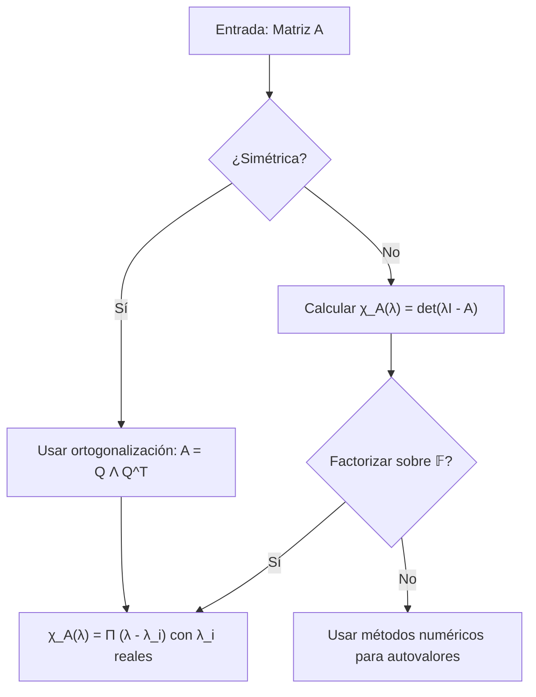
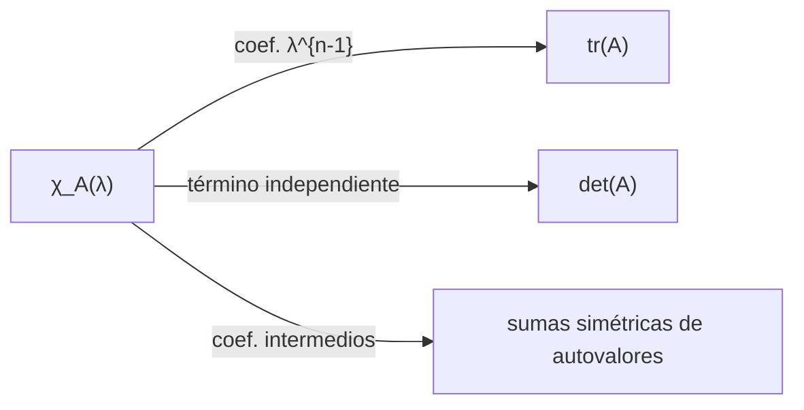
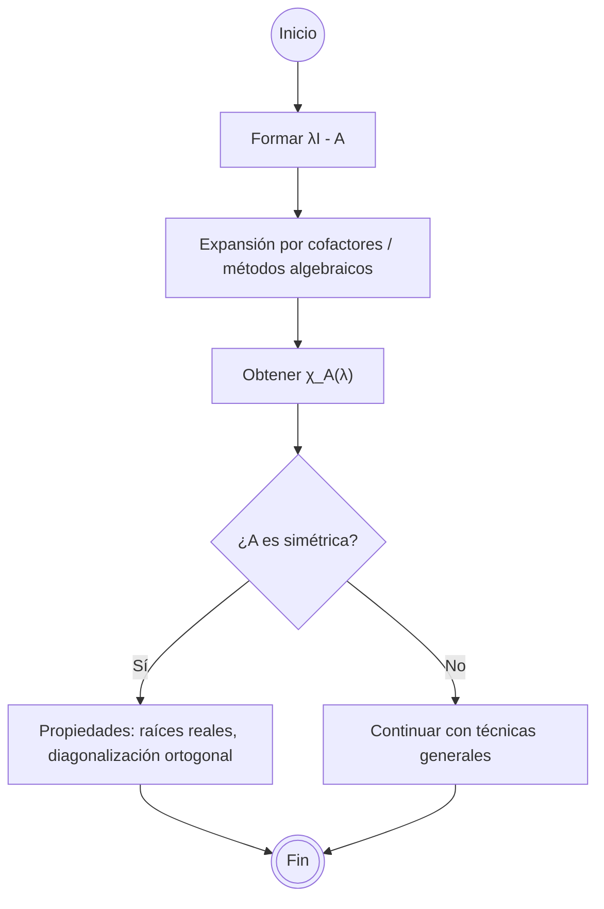

# Álgebra Lineal I - Transformaciones simétricas

## 7.2 Polinomio característico.

---

### 1 Objetivos de aprendizaje

Al finalizar esta guía podrás:

- Definir el **polinomio característico** de una transformación/matriz.
- Relacionarlo con **valores propios** y **vectores propios**.
- Usar sus **coeficientes** (traza, determinante, sumas de menores principales) y el **teorema de Cayley–Hamilton**.
- Calcularlo a mano en matrices 2×2 y 3×3, y con software (Python/SymPy).
- Aplicar propiedades especiales para **matrices simétricas reales**.

### 2 Contexto y definiciones

**Transformación lineal y matriz asociada.** Sea $T: \mathbb{R}^n \to \mathbb{R}^n$ lineal y sea $A$ su matriz en una base ortonormal. Decimos que $T,$ o $A,$ es **simétrica** si $A = A^T.$

**Valores y vectores propios.** $\lambda\in\mathbb{C}$ es un **valor propio** de $A$ si existe $\mathbf{v} \ne \mathbf{0}$ tal que $A\mathbf{v} = \lambda\mathbf{v}.$ Un $\mathbf{v}$ así es un **vector propio**.

**Polinomio característico.** El **polinomio característico** de $A\in\mathbb{F}^{n\times n},$ con $\mathbb{F}=\mathbb{R}$ o $\mathbb{C},$ se define como

$$ \chi_A(\lambda) \;=\; \det(\lambda I - A) $$

Es un polinomio **mónico** de grado $n.$ Algunos libros usan $\det(A-\lambda I) = (-1)^n\chi_A(\lambda),$ que tiene las mismas raíces.

Sus raíces, contadas con multiplicidad, son precisamente los **valores propios** de $A,$ porque $\lambda$ es valor propio si y solo si $\lambda I - A$ no es invertible. Sobre $\mathbb{C}$ siempre hay exactamente $n$ raíces contando multiplicidades; sobre $\mathbb{R}$ puede no haber ninguna.

**Polinomio característico de una transformación.** Si $T: V \to V$ y $A = [T]_\mathcal{B},$ se define $\chi_T = \chi_A.$ No depende de la base, por la propiedad 1 de la sección siguiente.

### 3 Propiedades clave (generales)

1. **Invarianza por similitud.** Si $B = P^{-1}AP$ con $P$ invertible, entonces $\chi_B = \chi_A,$ porque $\det(\lambda I - P^{-1}AP) = \det(P^{-1}(\lambda I - A)P) = \det(\lambda I - A).$ El recíproco es falso: $I_2$ y $\begin{bmatrix} 1 & 1 \\ 0 & 1 \end{bmatrix}$ tienen el mismo polinomio $(\lambda - 1)^2$ y no son semejantes.
2. **Coeficientes en términos de invariantes.** Si $\chi_A(\lambda) = \lambda^n - s_1\lambda^{n-1} + s_2\lambda^{n-2} - \cdots + (-1)^n s_n,$ entonces:

   - $s_1 = \operatorname{tr}(A)$ (suma de diagonales).
   - $s_n = \det(A).$
   - En general, $s_k$ es la **suma de los menores principales** de orden $k,$ y también la función simétrica elemental de grado $k$ de los valores propios. Por ejemplo, $s_2 = \sum_{i<j} \lambda_i\lambda_j.$

3. **Cayley–Hamilton.** $A$ satisface su propio polinomio característico: $\chi_A(A) = 0,$ donde el término constante $c$ se sustituye por $cI.$ Por ejemplo, para $2 \times 2,$ $A^2 - \operatorname{tr}(A)A + \det(A)I = 0.$
4. **Multiplicidades.** La multiplicidad algebraica de un valor propio es su multiplicidad como raíz de $\chi_A;$ la geométrica es $\dim\ker(A - \lambda I),$ el número de vectores propios independientes. Siempre geométrica $\leq$ algebraica, y $A$ es diagonalizable si y solo si son iguales para todos los valores propios. En las simétricas reales siempre lo son.
5. **Descomposición espectral (visión).** Si $A$ es diagonalizable: $A = PDP^{-1},$ con $D=\operatorname{diag}(\lambda_1,\dots,\lambda_n).$ Entonces $\chi_A(\lambda)=\prod_{i=1}^n(\lambda-\lambda_i).$

### 4 En el caso **simétrico real** (Transformaciones simétricas)

Para $A=A^T\in\mathbb{R}^{n\times n}:$

- **Espectro real:** todas las raíces de $\chi_A$ son reales.
- **Diagonalización ortogonal:** existe $Q$ ortogonal con $A = Q\,\Lambda\,Q^T$ y $\Lambda=\operatorname{diag}(\lambda_1,\dots,\lambda_n).$ Luego $\chi_A(\lambda)=\prod_i(\lambda-\lambda_i)$ con $\lambda_i\in\mathbb{R}.$
- **Estabilidad numérica:** para simétricas, el cálculo de autovalores es mejor condicionado; librerías usan métodos específicos (Jacobi, QR simétrico, tridiagonalización, etc.).

### 5 Cálculo explícito (2×2 y 3×3)

**Caso 2×2.** Sea $A=\begin{bmatrix}a & b\\ c & d\end{bmatrix}.$ Entonces

$$ \chi_A(\lambda)=\det\begin{bmatrix}\lambda-a & -b\\ -c & \lambda-d\end{bmatrix}=\lambda^2-(a+d)\lambda+(ad-bc). $$

- $\operatorname{tr}(A)=a+d,$ $\det(A)=ad-bc.$

**Simétrica 2×2 (b=c).** $A=\begin{bmatrix}a & b\\ b & d\end{bmatrix}$ tiene

$$ \lambda_{\pm}=\frac{(a+d)\pm\sqrt{(a-d)^2+4b^2}}{2}\in\mathbb{R}. $$

El discriminante $(a+d)^2 - 4(ad - b^2) = (a-d)^2 + 4b^2$ nunca es negativo, lo que comprueba directamente que los valores propios son reales.

**Caso 3×3.** Para $A=[a_{ij}],$

$$ \chi_A(\lambda) = \lambda^3 - \underbrace{\operatorname{tr}(A)}_{s_1} \lambda^2 + \underbrace{\sum_{i<j} \det A_{\{i,j\} \times \{i,j\}}}_{s_2} \lambda - \underbrace{\det(A)}_{s_3} $$

siendo $A_{\{i,j\}\times\{i,j\}}$ los menores principales 2×2.

### 6 Diagramas







### 7 Ejemplos resueltos

**Ejemplo 1 (simétrica 2×2).** $A=\begin{bmatrix} 2 & 1 \\ 1 & 2 \end{bmatrix}.$

1. $\chi_A(\lambda)=\det\begin{bmatrix} \lambda-2 & -1 \\ -1 & \lambda-2 \end{bmatrix}=(\lambda-2)^2-1=\lambda^2-4\lambda+3.$
2. Raíces: $\lambda_1=1,$ $\lambda_2=3$ (reales).
3. Comprobación: $\operatorname{tr}(A)=4$ da el coeficiente $-4,$ y $\det(A)=3$ es el término independiente.

**Ejemplo 2 (simétrica 3×3).** $A=\begin{bmatrix} 4 & 2 & 0 \\ 2 & 3 & 0 \\ 0 & 0 & 1 \end{bmatrix}.$

- La matriz es diagonal por bloques: un bloque $1 \times 1$ con valor propio $1$ y el bloque $2 \times 2$ $\begin{bmatrix} 4 & 2 \\ 2 & 3 \end{bmatrix}.$
- Para el bloque 2×2: $\lambda^2-7\lambda+(12-4)=\lambda^2-7\lambda+8.$ Raíces $\lambda=\frac{7\pm\sqrt{17}}{2},$ es decir $\lambda \approx 1.438$ y $\lambda \approx 5.562.$
- Espectro total: $\left\{1, \frac{7-\sqrt{17}}{2}, \frac{7+\sqrt{17}}{2}\right\},$ tres valores reales distintos.
- Polinomio característico total: $\chi_A(\lambda)=(\lambda-1)(\lambda^2-7\lambda+8)=\lambda^3-8\lambda^2+15\lambda-8.$
- Verifica: $\operatorname{tr}(A)=4+3+1=8,$ $\det(A)=1\cdot(12-4)=8,$ y la suma de menores principales $2 \times 2$ es $(12-4)+(4-0)+(3-0)=15.$

**Ejemplo 3 (no simétrica, contraste).** $A=\begin{bmatrix} 0 & -1 \\ 1 & 0 \end{bmatrix}$ (rotación 90°).

- $\chi_A(\lambda)=\lambda^2+1.$ Raíces complejas $\pm i.$ Como $A$ no es simétrica, sus valores propios no tienen por qué ser reales.

### 8 Código (Python)

#### 8.1 Cálculo con SymPy (polinomio y autovalores)

```python
import sympy as sp

# Matriz simétrica de ejemplo
A = sp.Matrix([[4, 2, 0],
               [2, 3, 0],
               [0, 0, 1]])

λ = sp.symbols('λ')
chi = A.charpoly(λ)  # polinomio característico
print('χ_A(λ) =', chi.as_expr())

# Autovalores (con multiplicidades)
print('Eigenvals:', A.eigenvals())  # dict {valor: multiplicidad}

# Verificar Cayley–Hamilton: evaluar el polinomio en la matriz.
# Cuidado: no basta con subs(λ, A), porque el término constante debe multiplicar a I.
coef = chi.all_coeffs()                      # [1, -8, 15, -8]
chi_de_A = sp.zeros(3)
for c in coef:                               # esquema de Horner con matrices
    chi_de_A = chi_de_A * A + c * sp.eye(3)
print('χ_A(A) =', chi_de_A)                  # matriz cero
```

#### 8.2 Cálculo numérico con NumPy (autovalores y vectores)

```python
import numpy as np

A = np.array([[4., 2., 0.],
              [2., 3., 0.],
              [0., 0., 1.]])

w, V = np.linalg.eigh(A)  # eigh para matrices simétricas
print('Autovalores:', w)
print('Vectores propios (columnas):\n', V)
```

#### 8.3 Función genérica para el polinomio característico

```python
import sympy as sp

def char_poly_symbolic(M):
    λ = sp.symbols('λ')
    return (sp.Matrix(M).charpoly(λ)).as_expr()

print(char_poly_symbolic([[2,1],[1,2]]))
```

### 9 Estrategias de cálculo y atajos

- **Triangular / bloque diagonal:** $\chi_A$ es el producto de los polinomios característicos de los bloques (e.g., diagonal $\Rightarrow$ raíces = entradas diagonales).
- **Rangos y ceros:** Si $A$ es singular, $\det A = 0$ y $0$ es raíz. Más aún, si $\operatorname{rango}(A) = r,$ el valor $0$ tiene multiplicidad geométrica $n - r.$
- **Trazas y determinantes como chequeo:** tras expandir $\chi_A,$ verifica coeficientes con $\operatorname{tr}(A)$ y $\det(A).$
- **Simétrica real:** usa `numpy.linalg.eigh` (mejor estabilidad y vectores ortogonales).

### 10 Ejercicios propuestos

1. (Simétrica 2×2) Para $A=\begin{bmatrix} 3 & -2 \\ -2 & 5 \end{bmatrix}:$

   a) Calcula $\chi_A(\lambda).$ b) Halla los autovalores. c) Verifica $\operatorname{tr}(A)$ y $\det(A)$ con los coeficientes.

2. (Simétrica 3×3) $A=\begin{bmatrix} 2 & 0 & 1 \\ 0 & 3 & 0 \\ 1 & 0 & 2 \end{bmatrix}.$

   a) Calcula $\chi_A(\lambda).$ b) Factoriza y encuentra el espectro. c) Comprueba ortogonalidad de vectores propios asociados a autovalores distintos.

3. (Bloques) Sea $A=\operatorname{diag}(B,C)$ con $B=\begin{bmatrix} 4 & 1 \\ 1 & 4 \end{bmatrix},$ $C=\begin{bmatrix}1\end{bmatrix}.$

   a) Determina $\chi_A.$ b) Lista los autovalores con multiplicidades.

4. (Cayley–Hamilton) Para $A=\begin{bmatrix} 0 & 2 \\ 2 & 0 \end{bmatrix}:$

   a) Halla $\chi_A.$ b) Verifica $\chi_A(A)=0.$ c) Usa Cayley–Hamilton para expresar $A^5$ como combinación lineal de $I$ y $A.$

5. (Contraste no simétrico) $A=\begin{bmatrix} 0 & -2 \\ 1 & 0 \end{bmatrix}:$

   a) Calcula $\chi_A.$ b) Determina el espectro. c) Explica por qué no contradice el caso simétrico.

> **Sugerencia:** Resuelve (2) usando SymPy y comprueba con `numpy.linalg.eigh`.

**Soluciones.**

1. $\chi_A(\lambda) = \lambda^2 - 8\lambda + 11,$ con raíces $4 \pm \sqrt{5}.$ Se comprueba $\operatorname{tr}(A) = 8$ y $\det(A) = 15 - 4 = 11.$
2. $\chi_A(\lambda) = (\lambda - 3)\left[(\lambda - 2)^2 - 1\right] = (\lambda - 1)(\lambda - 3)^2.$ Espectro $\{1, 3, 3\}.$ Para $1,$ el vector $(1, 0, -1);$ para $3,$ los vectores $(1, 0, 1)$ y $(0, 1, 0).$ El de $1$ es ortogonal a ambos.
3. $\chi_A(\lambda) = (\lambda^2 - 8\lambda + 15)(\lambda - 1) = (\lambda - 1)(\lambda - 3)(\lambda - 5).$ Valores propios $1,$ $3,$ $5,$ cada uno con multiplicidad $1.$
4. $\chi_A(\lambda) = \lambda^2 - 4;$ en efecto $A^2 = 4I.$ Entonces $A^4 = 16I$ y $A^5 = 16A.$
5. $\chi_A(\lambda) = \lambda^2 + 2,$ con raíces $\pm i\sqrt{2}.$ No hay contradicción porque $A$ no es simétrica.

### 11 Errores comunes

- Confundir $\det(\lambda I - A)$ con $\det(A - \lambda I):$ difieren por un factor $(-1)^n,$ pero **tienen las mismas raíces**.
- Olvidar que la **traza** aparece con signo: el coeficiente de $\lambda^{n-1}$ en $\det(\lambda I - A)$ es $-\operatorname{tr}(A).$
- Evaluar $\chi_A(A)$ sustituyendo $\lambda$ por $A$ sin cambiar el término constante $c$ por $cI.$
- En simétricas, asumir que todos los autovectores son automáticamente **ortonormales**: los de valores propios distintos son ortogonales, pero dentro de un mismo subespacio propio hay que ortogonalizarlos con Gram-Schmidt y normalizarlos.

### 12 Referencias recomendadas

- S. Axler, _Linear Algebra Done Right_, Springer.
- G. Strang, _Introduction to Linear Algebra_, Wellesley–Cambridge Press.
- D. C. Lay, S. R. Lay & J. J. McDonald, _Linear Algebra and Its Applications_, Pearson.
- H. Anton & C. Rorres, _Elementary Linear Algebra_, Wiley.
- Documentación de SymPy: `Matrix.charpoly`, `eigenvals`, `eigenvects`.

### 13 Checklist de autoevaluación

- Puedo definir $\chi_A(\lambda)$ y explicar su relación con el espectro.
- Puedo calcular $\chi_A$ en 2×2 y 3×3 y verificar con traza/determinante.
- Sé enunciar y usar Cayley–Hamilton.
- Reconozco por qué, en simétricas reales, los autovalores son reales y la diagonalización es ortogonal.
- Sé usar SymPy/NumPy para confirmar resultados.
