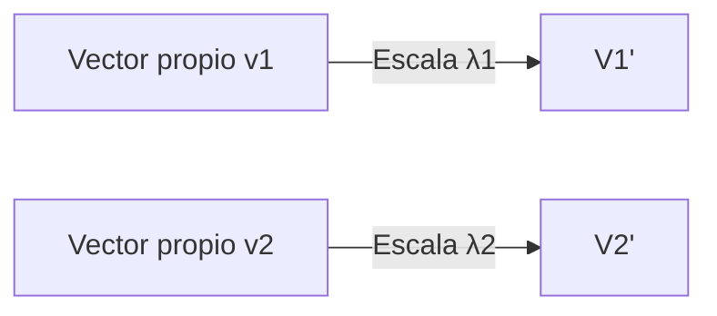
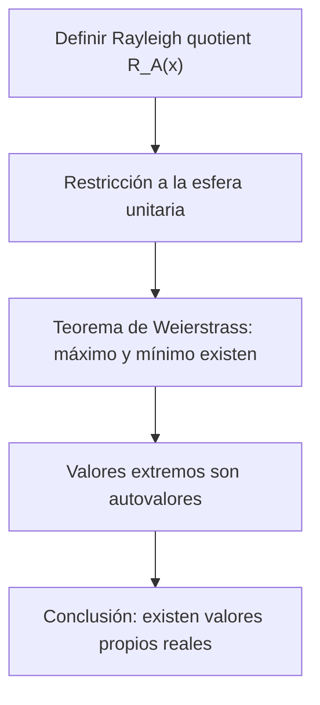

# Álgebra Lineal I - Transformaciones simétricas

## 7.3 Existencia de valores propios reales de transformaciones simétricas.

---

### 1 Objetivos de aprendizaje

Al finalizar esta guía podrás:

- Comprender el **teorema espectral** para matrices simétricas reales.
- Demostrar y entender por qué toda matriz simétrica real tiene al menos un valor propio real.
- Relacionar las propiedades geométricas y algebraicas que garantizan la existencia de valores propios.
- Aplicar métodos algebraicos y numéricos para calcular valores propios reales.
- Usar representaciones gráficas y código para reforzar la intuición.

### 2 Contexto y definiciones

**Matriz simétrica.** Una matriz $A \in \mathbb{R}^{n \times n}$ es **simétrica** si cumple:

$$ A = A^T. $$

**Transformación simétrica.** Una transformación lineal $T: \mathbb{R}^n \to \mathbb{R}^n$ es simétrica si su matriz respecto a una base ortonormal es simétrica.

**Valor y vector propio.** Recordemos que un número $\lambda$ y un vector no nulo $v$ satisfacen:

$$ Av = \lambda v. $$

**Problema:** ¿Por qué $A$ simétrica **siempre tiene valores propios reales**?

### 3 Teorema espectral (versión simplificada)

**Enunciado.** Sea $A$ una matriz real y simétrica de tamaño $n \times n$. Entonces:

1. Todos los valores propios de $A$ son reales.
2. Existen $n$ vectores propios ortogonales que forman una base de $\mathbb{R}^n$.
3. Existe una matriz ortogonal $Q$ tal que

   $$ A = Q \Lambda Q^T, \quad \Lambda = \operatorname{diag}(\lambda_1, \dots, \lambda_n). $$

### 4 Esquema de demostración de la existencia de valores propios reales

**Idea:** Para matrices simétricas $A$, el polinomio característico $\chi_A(\lambda)$ tiene raíces reales.

**Justificación (intuitiva):**

- Considera la función de Rayleigh:

  $$ R_A(x) = \frac{x^T A x}{x^T x}, \quad x \neq 0. $$

- Esta función toma valores reales ( porque $A=A^T$ ).
- El valor máximo y el mínimo de $R_A(x)$ en la esfera unitaria son alcanzados (teorema de Weierstrass).
- Dichos extremos son valores propios de $A$.

**Conclusión:** Siempre existen valores propios reales.

### 5 Representación geométrica

- Los valores propios reales de $A$ describen **direcciones invariantes** en $\mathbb{R}^n$ donde la transformación actúa como un simple escalado.
- En el caso de simétricas, estas direcciones siempre existen y son ortogonales.

**Ejemplo en 2D:**



### 6 Ejemplos resueltos

**Ejemplo 1 (2×2).**

$$ A = \begin{bmatrix} 2 & 1 \\\ 1 & 3 \end{bmatrix} $$

Polinomio característico:

$$ \chi_A(\lambda) = \det(\lambda I - A) = (\lambda-2)(\lambda-3)-1 = \lambda^2 - 5\lambda + 5. $$

Raíces:

$$ \lambda = \frac{5 \pm \sqrt{25-20}}{2} = \frac{5 \pm \sqrt{5}}{2} \in \mathbb{R}. $$

Ambos autovalores son reales.

**Ejemplo 2 (3×3).**

$$ A = \begin{bmatrix} 4 & 2 & 0 \\\ 2 & 3 & 0 \\\ 0 & 0 & 1 \end{bmatrix} $$

- El bloque 2×2 tiene autovalores reales $1,6$.
- El bloque 1×1 da autovalor real $1$.
- Total: valores propios $\{1,1,6\}$, todos reales.

**Ejemplo 3 (contraste no simétrico).**

$$ A = \begin{bmatrix} 0 & -1 \\\ 1 & 0 \end{bmatrix} \quad (\text{rotación 90°}) $$

$\chi_A(\lambda) = \lambda^2+1$. Raíces complejas $\pm i$. No es simétrica.

**Flujo de la demostración (existencia de eigenvalores reales):**



**Relación entre simetría y espectro real:**


### 8 Código en Python

```python
import numpy as np

# Matriz simétrica
A = np.array([[2, 1],
              [1, 3]])

# Cálculo de autovalores y autovectores
vals, vecs = np.linalg.eigh(A)  # eigh: especializado en simétricas
print("Valores propios:", vals)
print("Vectores propios (columnas):\n", vecs)
```

```python
import sympy as sp

A = sp.Matrix([[2,1],[1,3]])
λ = sp.symbols('λ')
chi = A.charpoly(λ)
print("Polinomio característico:", chi.as_expr())
print("Autovalores:", A.eigenvals())
```

### 9 Estrategias de aprendizaje

- **Usa la función de Rayleigh** para interpretar geométricamente el problema.
- **Recuerda:** en matrices simétricas, los extremos de $R_A(x)$ en la esfera corresponden a valores propios.
- **Verifica siempre:** los autovalores son reales y los vectores propios asociados a distintos autovalores son ortogonales.
- **Apóyate en software** para confirmar resultados.

### 10 Ejercicios propuestos

1. Para $A = \begin{bmatrix} 1 & 2 \\\ 2 & 4 \end{bmatrix}$:
   a) Calcula $\chi_A(\lambda)$. b) Halla sus autovalores y verifica que son reales.

2. Demuestra que el cociente de Rayleigh $R_A(x)$ siempre toma valores entre el mínimo y máximo autovalor de una matriz simétrica.

3. Sea $A = \begin{bmatrix} 2 & 0 & 0 \\\ 0 & 3 & 1 \\\ 0 & 1 & 3 \end{bmatrix}$. Calcula sus autovalores y confirma que son reales.

4. Explica por qué la existencia de valores propios reales no se cumple para matrices no simétricas (ejemplo: rotaciones).

5. Implementa una función en Python que, dada una matriz simétrica, calcule el valor propio más grande y el más pequeño usando `numpy.linalg.eigh`.

### 11 Referencias recomendadas

- S. Axler, _Linear Algebra Done Right_, Springer.
- G. Strang, _Introduction to Linear Algebra_, MIT Press.
- D. C. Lay, _Álgebra Lineal y sus aplicaciones_, Pearson.
- H. Anton & C. Rorres, _Álgebra Lineal con aplicaciones_, Wiley.
- Documentación NumPy: [`numpy.linalg.eigh`](https://numpy.org/doc/stable/reference/generated/numpy.linalg.eigh.html).
- SymPy docs: `Matrix.charpoly`, `eigenvals`, `eigenvects`.

### 12 Checklist de autoevaluación

- Puedo enunciar el teorema espectral.
- Sé demostrar que existen autovalores reales usando el cociente de Rayleigh.
- Sé calcular ejemplos sencillos de matrices simétricas y obtener autovalores reales.
- Entiendo el contraste con matrices no simétricas (autovalores complejos).
- Sé usar Python (NumPy/SymPy) para verificar resultados.
