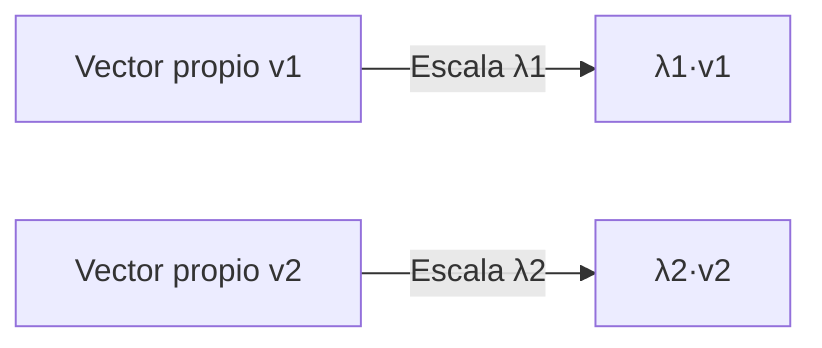
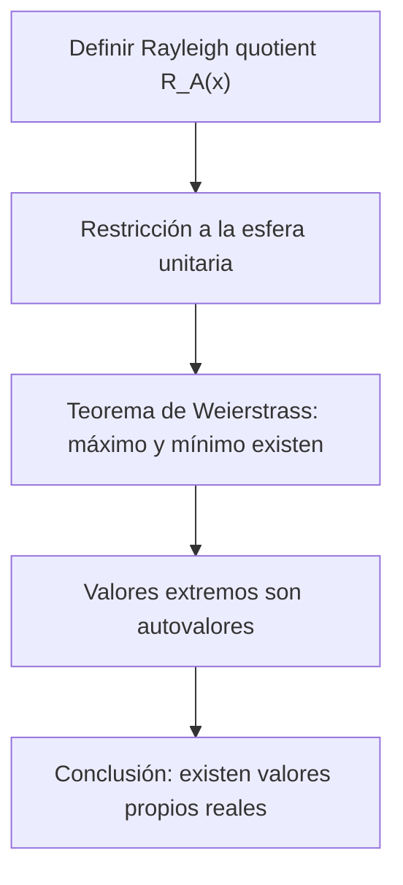

# Álgebra Lineal I - Transformaciones simétricas

## 7.3 Existencia de valores propios reales de transformaciones simétricas.

---

### 1 Objetivos de aprendizaje

Al finalizar esta guía podrás:

- Comprender el **teorema espectral** para matrices simétricas reales.
- Demostrar y entender por qué toda matriz simétrica real tiene al menos un valor propio real.
- Relacionar las propiedades geométricas y algebraicas que garantizan la existencia de valores propios.
- Aplicar métodos algebraicos y numéricos para calcular valores propios reales.
- Usar representaciones gráficas y código para reforzar la intuición.

### 2 Contexto y definiciones

**Matriz simétrica.** Una matriz $A \in \mathbb{R}^{n \times n}$ es **simétrica** si cumple:

$$ A = A^T. $$

**Transformación simétrica.** Una transformación lineal $T: \mathbb{R}^n \to \mathbb{R}^n$ es simétrica si su matriz respecto a una base ortonormal es simétrica.

**Valor y vector propio.** Recordemos que un número $\lambda$ y un vector no nulo $v$ satisfacen:

$$ Av = \lambda v. $$

**Problema:** ¿Por qué $A$ simétrica **siempre tiene valores propios reales**?

### 3 Teorema espectral (versión simplificada)

**Enunciado.** Sea $A$ una matriz real y simétrica de tamaño $n \times n.$ Entonces:

1. Todos los valores propios de $A$ son reales.
2. Existen $n$ vectores propios ortogonales que forman una base de $\mathbb{R}^n.$
3. Existe una matriz ortogonal $Q$ tal que

   $$ A = Q \Lambda Q^T, \quad \Lambda = \operatorname{diag}(\lambda_1, \dots, \lambda_n). $$

### 4 Esquema de demostración de la existencia de valores propios reales

**Idea:** Para matrices simétricas $A,$ el polinomio característico $\chi_A(\lambda)$ tiene raíces reales.

Hay dos demostraciones clásicas.

#### 4.1 Demostración algebraica (con números complejos)

Sobre $\mathbb{C}$ el polinomio característico tiene al menos una raíz $\lambda,$ con un vector propio $v \in \mathbb{C}^n$ no nulo. Sea $v^* = \overline{v}^T.$ Entonces

$$ v^* A v = v^*(\lambda v) = \lambda \|v\|^2 $$

Por otro lado, como $A$ es real y simétrica, $\overline{v^* A v} = v^T A \overline{v} = (v^T A \overline{v})^T = v^* A^T v = v^* A v.$ Así que $v^* A v$ es real, y como $\|v\|^2 > 0,$ también $\lambda$ es real. Además, $A - \lambda I$ es una matriz real singular, así que también hay un vector propio **real**.

#### 4.2 Demostración variacional (cociente de Rayleigh)

- Considera el **cociente de Rayleigh**:

  $$ R_A(x) = \frac{x^T A x}{x^T x}, \quad x \neq 0. $$

- $R_A(cx) = R_A(x)$ para $c \neq 0,$ así que basta estudiarlo en la esfera unitaria $\|x\| = 1,$ donde vale $x^T A x.$
- La esfera es cerrada y acotada, y $x^T A x$ es continua, así que alcanza un máximo en algún $x_0$ (teorema de Weierstrass).
- En el máximo, por multiplicadores de Lagrange, $\nabla(x^T A x) = \mu \nabla(x^T x),$ es decir $(A + A^T)x_0 = 2\mu x_0.$ **Aquí se usa la simetría**: $A + A^T = 2A,$ y se obtiene $Ax_0 = \mu x_0$ con $\mu$ real.
- Además $\mu = x_0^T A x_0 = \max R_A:$ el máximo del cociente es el mayor valor propio $\lambda_{\max}.$ Del mismo modo, el mínimo es $\lambda_{\min}.$

**Conclusión:** Siempre existen valores propios reales, y el mayor y el menor tienen la caracterización

$$ \lambda_{\min} = \min_{x \neq 0} R_A(x), \qquad \lambda_{\max} = \max_{x \neq 0} R_A(x) $$

Para una matriz no simétrica el cociente de Rayleigh también tiene máximo, pero ese máximo no es un valor propio: solo depende de la parte simétrica $\frac{A + A^T}{2}.$

### 5 Representación geométrica

- Los valores propios reales de $A$ describen **direcciones invariantes** en $\mathbb{R}^n$ donde la transformación actúa como un simple escalado.
- En el caso de simétricas, estas direcciones siempre existen y son ortogonales.

**Ejemplo en 2D:**



### 6 Ejemplos resueltos

**Ejemplo 1 (2×2).**

$$ A = \begin{bmatrix} 2 & 1 \\ 1 & 3 \end{bmatrix} $$

Polinomio característico:

$$ \chi_A(\lambda) = \det(\lambda I - A) = (\lambda-2)(\lambda-3)-1 = \lambda^2 - 5\lambda + 5. $$

Raíces:

$$ \lambda = \frac{5 \pm \sqrt{25-20}}{2} = \frac{5 \pm \sqrt{5}}{2} \in \mathbb{R}. $$

Ambos autovalores son reales.

**Ejemplo 2 (3×3).**

$$ A = \begin{bmatrix} 4 & 2 & 0 \\ 2 & 3 & 0 \\ 0 & 0 & 1 \end{bmatrix} $$

- El bloque 2×2 $\begin{bmatrix} 4 & 2 \\ 2 & 3 \end{bmatrix}$ tiene polinomio $\lambda^2 - 7\lambda + 8,$ con autovalores reales $\frac{7 \pm \sqrt{17}}{2}.$ El discriminante es $49 - 32 = 17 > 0.$
- El bloque 1×1 da autovalor real $1.$
- Total: valores propios $\left\{1, \frac{7-\sqrt{17}}{2}, \frac{7+\sqrt{17}}{2}\right\},$ todos reales.

**Ejemplo 3 (contraste no simétrico).**

$$ A = \begin{bmatrix} 0 & -1 \\ 1 & 0 \end{bmatrix} \quad (\text{rotación 90°}) $$

$\chi_A(\lambda) = \lambda^2+1.$ Raíces complejas $\pm i.$ No es simétrica.

**Flujo de la demostración (existencia de eigenvalores reales):**



**Relación entre simetría y espectro real:**


### 7 Código en Python

```python
import numpy as np

# Matriz simétrica
A = np.array([[2, 1],
              [1, 3]])

# Cálculo de autovalores y autovectores
vals, vecs = np.linalg.eigh(A)  # eigh: especializado en simétricas
print("Valores propios:", vals)
print("Vectores propios (columnas):\n", vecs)

# El cociente de Rayleigh en puntos aleatorios queda entre el menor y el mayor valor propio
rng = np.random.default_rng(0)
X = rng.normal(size=(10000, 2))
R = np.einsum('ij,jk,ik->i', X, A, X) / np.einsum('ij,ij->i', X, X)
print("min R ≈", R.min(), " max R ≈", R.max())   # cercanos a 1.382 y 3.618
```

```python
import sympy as sp

A = sp.Matrix([[2,1],[1,3]])
λ = sp.symbols('λ')
chi = A.charpoly(λ)
print("Polinomio característico:", chi.as_expr())
print("Autovalores:", A.eigenvals())
```

### 8 Estrategias de aprendizaje

- **Usa la función de Rayleigh** para interpretar geométricamente el problema.
- **Recuerda:** en matrices simétricas, los extremos de $R_A(x)$ en la esfera corresponden a valores propios.
- **Verifica siempre:** los autovalores son reales y los vectores propios asociados a distintos autovalores son ortogonales.
- **Apóyate en software** para confirmar resultados.

### 9 Ejercicios propuestos

1. Para $A = \begin{bmatrix} 1 & 2 \\ 2 & 4 \end{bmatrix}:$
   a) Calcula $\chi_A(\lambda).$ b) Halla sus autovalores y verifica que son reales.

2. Demuestra que el cociente de Rayleigh $R_A(x)$ siempre toma valores entre el mínimo y máximo autovalor de una matriz simétrica.

3. Sea $A = \begin{bmatrix} 2 & 0 & 0 \\ 0 & 3 & 1 \\ 0 & 1 & 3 \end{bmatrix}.$ Calcula sus autovalores y confirma que son reales.

4. Explica por qué la existencia de valores propios reales no se cumple para matrices no simétricas (ejemplo: rotaciones).

5. Implementa una función en Python que, dada una matriz simétrica, calcule el valor propio más grande y el más pequeño usando `numpy.linalg.eigh`.

**Soluciones.**

1. $\chi_A(\lambda) = \lambda^2 - 5\lambda,$ con autovalores $0$ y $5.$ El $0$ aparece porque $A$ es singular: la segunda fila es el doble de la primera.
2. Por el teorema espectral, $x = Qy$ con $Q$ ortogonal da $R_A(x) = \frac{\sum \lambda_i y_i^2}{\sum y_i^2},$ un promedio ponderado de los $\lambda_i$ con pesos $y_i^2 \geq 0.$ Un promedio ponderado está entre el menor y el mayor valor.
3. El bloque $\begin{bmatrix} 3 & 1 \\ 1 & 3 \end{bmatrix}$ tiene autovalores $2$ y $4;$ con el bloque $1 \times 1$ el espectro es $\{2, 2, 4\}.$
4. Una rotación de ángulo $\theta$ que no es múltiplo de $\pi$ no deja fija ninguna dirección, así que no tiene vectores propios reales: sus autovalores son $e^{\pm i\theta}.$
5. `vals = np.linalg.eigh(A)[0]; return vals[0], vals[-1]`, porque `eigh` los devuelve en orden creciente.

### 10 Referencias recomendadas

- S. Axler, _Linear Algebra Done Right_, Springer.
- G. Strang, _Introduction to Linear Algebra_, MIT Press.
- D. C. Lay, _Álgebra Lineal y sus aplicaciones_, Pearson.
- H. Anton & C. Rorres, _Álgebra Lineal con aplicaciones_, Wiley.
- Documentación NumPy: [`numpy.linalg.eigh`](https://numpy.org/doc/stable/reference/generated/numpy.linalg.eigh.html).
- SymPy docs: `Matrix.charpoly`, `eigenvals`, `eigenvects`.

### 11 Checklist de autoevaluación

- Puedo enunciar el teorema espectral.
- Sé demostrar que existen autovalores reales usando el cociente de Rayleigh.
- Sé calcular ejemplos sencillos de matrices simétricas y obtener autovalores reales.
- Entiendo el contraste con matrices no simétricas (autovalores complejos).
- Sé usar Python (NumPy/SymPy) para verificar resultados.
