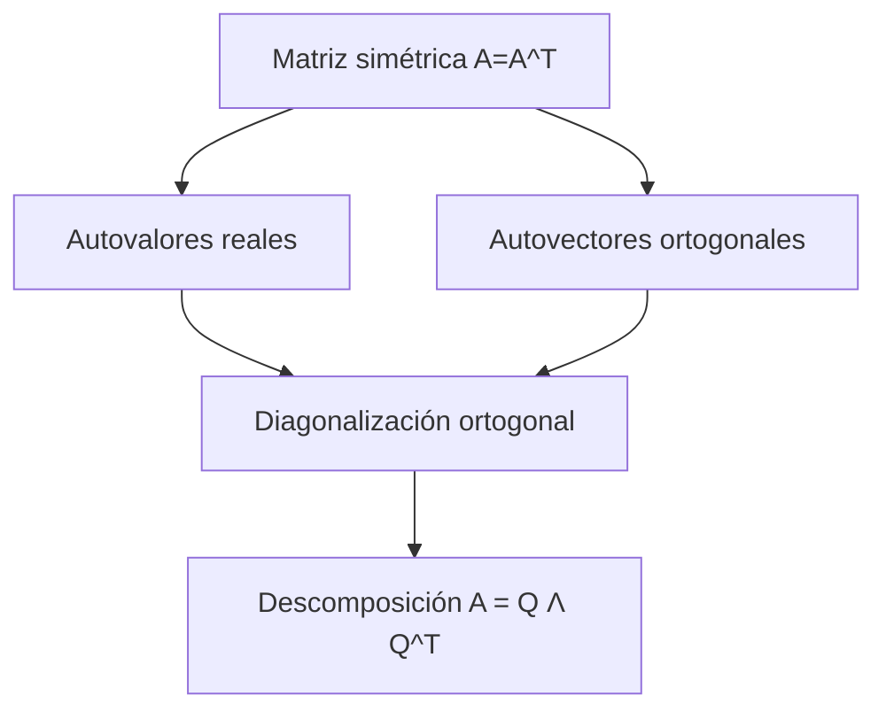
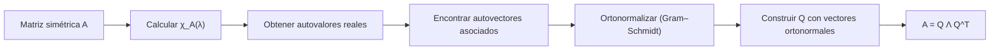

# Álgebra Lineal I - Transformaciones simétricas

## 7.4 Teorema espectral para transformaciones simétricas.

---

### 1 Objetivos de aprendizaje

Al finalizar esta guía podrás:

- Enunciar y comprender el **teorema espectral** para matrices simétricas reales.
- Explicar por qué garantiza la **diagonalización ortogonal**.
- Relacionar los autovalores y autovectores de matrices simétricas con el análisis geométrico.
- Aplicar el teorema espectral a ejemplos concretos.
- Utilizar software (NumPy/SymPy) para verificar resultados.

### 2 Recordatorio de definiciones

**Matriz simétrica:**

$$ A \in \mathbb{R}^{n \times n} \quad \text{es simétrica si } A = A^T. $$

**Autovalor y autovector:** $\lambda$ es un autovalor de $A$ si existe $v \neq 0$ tal que

$$ Av = \lambda v. $$

**Diagonalización:** Una matriz es diagonalizable si existe $P$ invertible tal que

$$ A = P D P^{-1}, \quad D \text{ diagonal}. $$

**Matriz ortogonal:** $Q \in \mathbb{R}^{n \times n}$ es ortogonal si

$$ Q^T Q = I. $$

### 3 Teorema espectral (enunciado)

**Teorema.** Si $A \in \mathbb{R}^{n \times n}$ es simétrica, entonces:

1. Todos sus autovalores son reales.
2. Autovectores asociados a autovalores distintos son ortogonales.
3. Existe una matriz ortogonal $Q$ y una diagonal $\Lambda$ tal que:

   $$ A = Q \Lambda Q^T, \quad \Lambda = \operatorname{diag}(\lambda_1,\dots,\lambda_n). $$

Esto se conoce como **descomposición espectral**. Si $q_1, \ldots, q_n$ son las columnas de $Q,$ se puede escribir como suma de proyecciones:

$$ A = \lambda_1 q_1 q_1^T + \lambda_2 q_2 q_2^T + \cdots + \lambda_n q_n q_n^T $$

donde cada $q_i q_i^T$ es la proyección ortogonal sobre la recta generada por $q_i.$

**El recíproco también es cierto:** si $A = Q\Lambda Q^T$ con $Q$ ortogonal y $\Lambda$ diagonal real, entonces $A^T = Q\Lambda^T Q^T = A.$ Así, una matriz real es **ortogonalmente diagonalizable si y solo si es simétrica**.

**Versión compleja.** Para matrices hermitianas, $A = A^*,$ vale lo mismo con $Q$ unitaria: $A = U\Lambda U^*$ con $\Lambda$ real.

### 4 Demostración (ideas clave)

- **Realidad de autovalores:** usando el cociente de Rayleigh $R_A(x)=\frac{x^T A x}{x^T x},$ los extremos alcanzados son autovalores reales, como se vio en el tema anterior.
- **Ortogonalidad de autovectores:** si $Av=\lambda v,$ $Aw=\mu w,$ con $\lambda\neq \mu,$ entonces

  $$ \lambda (v^T w) = (\lambda v)^T w = (A v)^T w = v^T A^T w = v^T (Aw) = \mu (v^T w) $$

  La simetría se usa en $A^T = A.$ Así $(\lambda - \mu)(v^T w) = 0,$ y como $\lambda \neq \mu,$ $v^T w=0.$

- **Diagonalización ortogonal**, por inducción sobre $n:$
  1. Se toma un autovalor real $\lambda_1$ y un autovector unitario $q_1.$
  2. El complemento $W = q_1^\perp$ es **invariante** bajo $A:$ si $x \perp q_1,$ entonces $q_1^T(Ax) = (Aq_1)^T x = \lambda_1 q_1^T x = 0.$
  3. Restringida a $W,$ que tiene dimensión $n - 1,$ $A$ sigue siendo simétrica respecto al producto punto. Por hipótesis de inducción, $W$ tiene una base ortonormal de autovectores $q_2, \ldots, q_n.$
  4. Entonces $\{q_1, \ldots, q_n\}$ es una base ortonormal de autovectores de $\mathbb{R}^n.$

  En la práctica, dentro de cada subespacio propio de dimensión mayor que $1$ se aplica Gram–Schmidt; los de autovalores distintos ya son ortogonales.

### 5 Consecuencias

- **Facilita el cálculo de potencias de matrices:** $A^k = Q \Lambda^k Q^T.$
- **Cálculo eficiente de funciones de matrices:** $f(A) = Q f(\Lambda) Q^T,$ donde $f(\Lambda)$ aplica $f$ a cada entrada de la diagonal. Por ejemplo, si todos los $\lambda_i \geq 0,$ la raíz cuadrada $\sqrt{A} = Q\sqrt{\Lambda}Q^T$ cumple $(\sqrt{A})^2 = A.$
- **Definición positiva:** $A$ es definida positiva si y solo si todos sus autovalores son positivos, porque $x^T A x = \sum \lambda_i y_i^2$ con $y = Q^T x.$
- **Interpretación geométrica:** las transformaciones simétricas estiran o contraen en direcciones ortogonales.

### 6 Diagramas

**Relación general del teorema espectral:**



**Proceso de diagonalización:**



### 7 Ejemplos resueltos

**Ejemplo 1 (2×2):**

$$ A = \begin{bmatrix}2 & 1 \\ 1 & 2\end{bmatrix} $$

1. $\chi_A(\lambda) = (\lambda-1)(\lambda-3).$
2. Autovalores: $1,3.$
3. Autovectores: $v_1 = (1,-1), v_2 = (1,1).$
4. Normalizando y formando $Q = \frac{1}{\sqrt{2}} \begin{bmatrix}1 & 1 \\ -1 & 1\end{bmatrix}.$
5. Entonces:

$$ A = Q \begin{bmatrix}1 & 0 \\ 0 & 3\end{bmatrix} Q^T. $$

6. En forma de proyecciones:

$$ A = 1 \cdot \frac{1}{2}\begin{bmatrix} 1 & -1 \\ -1 & 1 \end{bmatrix} + 3 \cdot \frac{1}{2}\begin{bmatrix} 1 & 1 \\ 1 & 1 \end{bmatrix} = \begin{bmatrix} 2 & 1 \\ 1 & 2 \end{bmatrix} $$

7. Potencias: $A^k = Q\begin{bmatrix} 1 & 0 \\ 0 & 3^k \end{bmatrix}Q^T = \frac{1}{2}\begin{bmatrix} 3^k + 1 & 3^k - 1 \\ 3^k - 1 & 3^k + 1 \end{bmatrix}.$

**Ejemplo 2 (3×3):**

$$ A = \begin{bmatrix} 4 & 2 & 0 \\ 2 & 3 & 0 \\ 0 & 0 & 1 \end{bmatrix} $$

- Autovalores: $1$ y $\frac{7 \pm \sqrt{17}}{2},$ las raíces de $(\lambda - 1)(\lambda^2 - 7\lambda + 8).$
- Autovectores: $(0, 0, 1)$ para $1,$ y $(2, \lambda - 4, 0)$ para cada $\lambda = \frac{7 \pm \sqrt{17}}{2}.$ Son tres autovalores distintos, así que los autovectores son ortogonales sin necesidad de Gram–Schmidt.
- Al normalizarlos se obtiene $Q$ y se cumple $A = Q \Lambda Q^T.$

**Ejemplo 3 (autovalor repetido):**

$$ A = \begin{bmatrix} 2 & 1 & 1 \\ 1 & 2 & 1 \\ 1 & 1 & 2 \end{bmatrix} $$

- $\chi_A(\lambda) = (\lambda - 1)^2(\lambda - 4).$
- Para $4:$ $(1, 1, 1).$ Para $1:$ el plano $x + y + z = 0,$ con base $(1, -1, 0)$ y $(1, 0, -1).$
- Esos dos vectores no son ortogonales entre sí. Gram–Schmidt da $(1, -1, 0)$ y $(1, 0, -1) - \frac{1}{2}(1, -1, 0) = \left(\frac{1}{2}, \frac{1}{2}, -1\right).$
- Normalizando: $q_1 = \frac{1}{\sqrt{2}}(1, -1, 0),$ $q_2 = \frac{1}{\sqrt{6}}(1, 1, -2),$ $q_3 = \frac{1}{\sqrt{3}}(1, 1, 1),$ y $A = Q\operatorname{diag}(1, 1, 4)Q^T.$

### 8 Código en Python

**Usando NumPy (autovalores y autovectores):**

```python
import numpy as np

A = np.array([[2,1],[1,2]])

# eigh: especializado para simétricas
vals, vecs = np.linalg.eigh(A)

print("Autovalores:", vals)
print("Autovectores (columnas de Q):\n", vecs)

# Verificaciones: Q ortogonal y A = Q Λ Q^T
Q, L = vecs, np.diag(vals)
print("Q^T Q = I:", np.allclose(Q.T @ Q, np.eye(2)))
print("A = Q Λ Q^T:", np.allclose(Q @ L @ Q.T, A))

# Autovalor repetido: eigh devuelve una base ortonormal también dentro del subespacio propio
B = np.array([[2, 1, 1], [1, 2, 1], [1, 1, 2]])
vb, Qb = np.linalg.eigh(B)
print("Autovalores de B:", np.round(vb, 10))
print("Q_B ortogonal:", np.allclose(Qb.T @ Qb, np.eye(3)))
```

**Usando SymPy (cálculo simbólico):**

```python
import sympy as sp

A = sp.Matrix([[2,1],[1,2]])
λ = sp.symbols('λ')
chi = A.charpoly(λ)
print("χ_A(λ) =", chi.as_expr())
print("Autovalores:", A.eigenvals())
print("Autovectores:", A.eigenvects())
```

### 9 Estrategias de comprensión

- Piensa en el teorema espectral como una **generalización geométrica**: las simétricas siempre tienen un sistema de coordenadas ortogonal donde son simples de describir.
- Usa ejemplos en 2D/3D para visualizar: las direcciones de estiramiento son ortogonales.
- Recuerda que $Q$ ortogonal significa que **preserva longitudes y ángulos**.

### 10 Ejercicios propuestos

1. Para $A = \begin{bmatrix} 3 & 0 & 1 \\ 0 & 2 & 0 \\ 1 & 0 & 3 \end{bmatrix}:$
   a) Calcula sus autovalores y autovectores.
   b) Construye $Q$ ortogonal y verifica $A = Q \Lambda Q^T.$

2. Demuestra que si $A$ es simétrica, entonces $R_A(x) = \frac{x^T A x}{x^T x}$ alcanza su máximo y mínimo en autovectores.

3. Usa NumPy para encontrar la descomposición espectral de

   $$ A = \begin{bmatrix} 1 & 2 \\ 2 & 4 \end{bmatrix} $$

4. Verifica ortogonalidad de autovectores para la matriz del Ejemplo 1.

5. Explica geométricamente el significado de la diagonalización ortogonal en términos de ejes principales.

**Soluciones.**

1. $\chi_A(\lambda) = (\lambda - 2)\left[(\lambda - 3)^2 - 1\right] = (\lambda - 2)^2(\lambda - 4).$ Para $2:$ $(0, 1, 0)$ y $(1, 0, -1);$ para $4:$ $(1, 0, 1).$ Normalizando, las columnas de $Q$ son $(0, 1, 0),$ $\frac{1}{\sqrt{2}}(1, 0, -1)$ y $\frac{1}{\sqrt{2}}(1, 0, 1),$ con $\Lambda = \operatorname{diag}(2, 2, 4).$
2. Con $x = Qy,$ $R_A(x) = \frac{\sum \lambda_i y_i^2}{\sum y_i^2};$ el valor máximo $\lambda_{\max}$ se alcanza cuando $y$ solo tiene componentes en los autovalores máximos, es decir, cuando $x$ es autovector de $\lambda_{\max}.$ Igual para el mínimo.
3. Autovalores $0$ y $5,$ con $q_1 = \frac{1}{\sqrt{5}}(2, -1)$ y $q_2 = \frac{1}{\sqrt{5}}(1, 2).$ Así $A = 5\,q_2 q_2^T:$ es $5$ veces la proyección sobre la recta generada por $(1, 2).$
4. $(1, -1) \cdot (1, 1) = 0.$
5. En las coordenadas $y = Q^T x$ de los ejes principales, $A$ actúa multiplicando cada coordenada por su autovalor. La forma cuadrática $x^T A x$ se vuelve $\sum \lambda_i y_i^2,$ sin términos cruzados.

### 11 Referencias recomendadas

- S. Axler, _Linear Algebra Done Right_, Springer.
- G. Strang, _Introduction to Linear Algebra_, MIT Press.
- D. C. Lay, _Álgebra Lineal y sus aplicaciones_, Pearson.
- H. Anton & C. Rorres, _Álgebra Lineal con aplicaciones_, Wiley.
- Documentación NumPy: [`numpy.linalg.eigh`](https://numpy.org/doc/stable/reference/generated/numpy.linalg.eigh.html).
- SymPy docs: `Matrix.eigenvals`, `Matrix.eigenvects`.

### 12 Checklist de autoevaluación

- Sé enunciar el teorema espectral.
- Comprendo que autovalores de matrices simétricas son reales.
- Sé demostrar ortogonalidad de autovectores con autovalores distintos.
- Puedo diagonalizar ortogonalmente una matriz simétrica.
- Sé usar Python (NumPy/SymPy) para comprobar la descomposición espectral.
