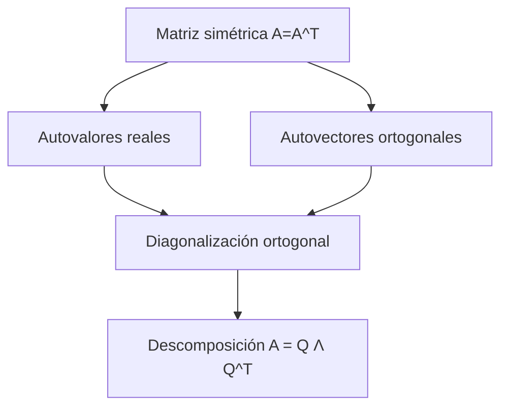
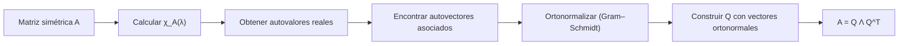

# Álgebra Lineal I - Transformaciones simétricas

## 7.4 Teorema espectral para transformaciones simétricas.

---

### 1 Objetivos de aprendizaje

Al finalizar esta guía podrás:

- Enunciar y comprender el **teorema espectral** para matrices simétricas reales.
- Explicar por qué garantiza la **diagonalización ortogonal**.
- Relacionar los autovalores y autovectores de matrices simétricas con el análisis geométrico.
- Aplicar el teorema espectral a ejemplos concretos.
- Utilizar software (NumPy/SymPy) para verificar resultados.

### 2 Recordatorio de definiciones

**Matriz simétrica:**

$$ A \in \mathbb{R}^{n \times n} \quad \text{es simétrica si } A = A^T. $$

**Autovalor y autovector:** $\lambda\in \mathbb{R}$ es un autovalor de $A$ si existe $v \neq 0$ tal que

$$ Av = \lambda v. $$

**Diagonalización:** Una matriz es diagonalizable si existe $P$ invertible tal que

$$ A = P D P^{-1}, \quad D \text{ diagonal}. $$

**Matriz ortogonal:** $Q \in \mathbb{R}^{n \times n}$ es ortogonal si

$$ Q^T Q = I. $$

### 3 Teorema espectral (enunciado)

**Teorema.** Si $A \in \mathbb{R}^{n \times n}$ es simétrica, entonces:

1. Todos sus autovalores son reales.
2. Autovectores asociados a autovalores distintos son ortogonales.
3. Existe una matriz ortogonal $Q$ y una diagonal $\Lambda$ tal que:

   $$ A = Q \Lambda Q^T, \quad \Lambda = \operatorname{diag}(\lambda_1,\dots,\lambda_n). $$

Esto se conoce como **descomposición espectral**.

### 4 Demostración (ideas clave)

- **Realidad de autovalores:** usando el cociente de Rayleigh $R_A(x)=\frac{x^T A x}{x^T x}$, los extremos alcanzados son autovalores reales.
- **Ortogonalidad de autovectores:** si $Av=\lambda v$, $Aw=\mu w$, con $\lambda\neq \mu$, entonces

  $$ \lambda (v^T w) = v^T (Aw) = (A v)^T w = (\lambda v)^T w = \lambda (v^T w), $$

  lo que implica $v^T w=0$.

- **Diagonalización ortogonal:** se construye una base ortonormal de vectores propios usando Gram–Schmidt.

### 5 Consecuencias

- **Facilita el cálculo de potencias de matrices:** $A^k = Q \Lambda^k Q^T.$
- **Cálculo eficiente de funciones de matrices:** $f(A) = Q f(\Lambda) Q^T.$
- **Interpretación geométrica:** las transformaciones simétricas estiran o contraen en direcciones ortogonales.

### 6 Diagramas

**Relación general del teorema espectral:**



**Proceso de diagonalización:**



### 7 Ejemplos resueltos

**Ejemplo 1 (2×2):**

$$ A = \begin{bmatrix}2 & 1 \\\ 1 & 2\end{bmatrix} $$

1. $\chi_A(\lambda) = (\lambda-1)(\lambda-3)$.
2. Autovalores: $1,3$.
3. Autovectores: $v_1 = (1,-1), v_2 = (1,1)$.
4. Normalizando y formando $Q = \frac{1}{\sqrt{2}} \begin{bmatrix}1 & 1 \\\ -1 & 1\end{bmatrix}$.
5. Entonces:

$$ A = Q \begin{bmatrix}1 & 0 \\\ 0 & 3\end{bmatrix} Q^T. $$

**Ejemplo 2 (3×3):**

$$ A = \begin{bmatrix} 4 & 2 & 0 \\\ 2 & 3 & 0 \\\ 0 & 0 & 1 \end{bmatrix} $$

- Autovalores: $1,1,6$.
- Autovectores correspondientes forman base ortogonal.
- Se cumple $A = Q \Lambda Q^T$.

### 8 Código en Python

**Usando NumPy (autovalores y autovectores):**

```python
import numpy as np

A = np.array([[2,1],[1,2]])

# eigh: especializado para simétricas
vals, vecs = np.linalg.eigh(A)

print("Autovalores:", vals)
print("Autovectores (columnas de Q):\n", vecs)
```

**Usando SymPy (cálculo simbólico):**

```python
import sympy as sp

A = sp.Matrix([[2,1],[1,2]])
λ = sp.symbols('λ')
chi = A.charpoly(λ)
print("χ_A(λ) =", chi.as_expr())
print("Autovalores:", A.eigenvals())
print("Autovectores:", A.eigenvects())
```

### 9 Estrategias de comprensión

- Piensa en el teorema espectral como una **generalización geométrica**: las simétricas siempre tienen un sistema de coordenadas ortogonal donde son simples de describir.
- Usa ejemplos en 2D/3D para visualizar: las direcciones de estiramiento son ortogonales.
- Recuerda que $Q$ ortogonal significa que **preserva longitudes y ángulos**.

### 10 Ejercicios propuestos

1. Para $A = \begin{bmatrix} 3 & 0 & 1 \\\ 0 & 2 & 0 \\\ 1 & 0 & 3 \end{bmatrix}$:
   a) Calcula sus autovalores y autovectores.
   b) Construye $Q$ ortogonal y verifica $A = Q \Lambda Q^T$.

2. Demuestra que si $A$ es simétrica, entonces $R_A(x) = \frac{x^T A x}{x^T x}$ alcanza su máximo y mínimo en autovectores.

3. Usa NumPy para encontrar la descomposición espectral de

   $$ A = \begin{bmatrix} 1 & 2 \\\ 2 & 4 \end{bmatrix} $$

4. Verifica ortogonalidad de autovectores para la matriz del Ejemplo 1.

5. Explica geométricamente el significado de la diagonalización ortogonal en términos de ejes principales.

### 11 Referencias recomendadas

- S. Axler, _Linear Algebra Done Right_, Springer.
- G. Strang, _Introduction to Linear Algebra_, MIT Press.
- D. C. Lay, _Álgebra Lineal y sus aplicaciones_, Pearson.
- H. Anton & C. Rorres, _Álgebra Lineal con aplicaciones_, Wiley.
- Documentación NumPy: [`numpy.linalg.eigh`](https://numpy.org/doc/stable/reference/generated/numpy.linalg.eigh.html).
- SymPy docs: `Matrix.eigenvals`, `Matrix.eigenvects`.

### 12 Checklist de autoevaluación

- Sé enunciar el teorema espectral.
- Comprendo que autovalores de matrices simétricas son reales.
- Sé demostrar ortogonalidad de autovectores con autovalores distintos.
- Puedo diagonalizar ortogonalmente una matriz simétrica.
- Sé usar Python (NumPy/SymPy) para comprobar la descomposición espectral.
