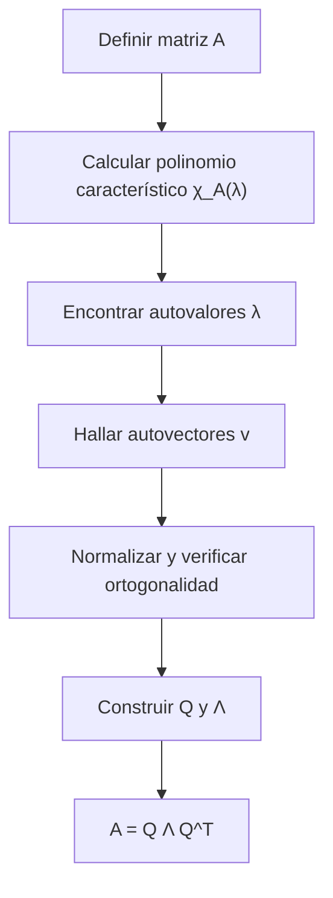

# Álgebra Lineal I - Transformaciones simétricas

## 7.5 Ejemplos.

---

### 1 Objetivos de aprendizaje

Al finalizar esta guía podrás:

- Resolver ejemplos de transformaciones simétricas.
- Calcular polinomios característicos, valores y vectores propios.
- Verificar la ortogonalidad de los autovectores.
- Aplicar el teorema espectral en ejemplos concretos.
- Usar Python para comprobar cálculos manuales.

### 2 Ejemplo 1: Matriz simétrica 2×2

$$ A = \begin{bmatrix} 2 & 1 \\ 1 & 2 \end{bmatrix} $$

**Paso 1. Polinomio característico:**

$$ \chi_A(\lambda) = (2-\lambda)^2 - 1 = \lambda^2 - 4\lambda + 3. $$

**Paso 2. Autovalores:**

$$ \lambda_1 = 1, \quad \lambda_2 = 3. $$

**Paso 3. Autovectores:**

- Para $\lambda_1=1:$ $v_1 = (1,-1).$
- Para $\lambda_2=3:$ $v_2 = (1,1).$

**Paso 4. Normalización:**

$$ \hat v_1 = \tfrac{1}{\sqrt{2}}(1,-1), \quad \hat v_2 = \tfrac{1}{\sqrt{2}}(1,1). $$

**Conclusión:**

$$ A = Q \Lambda Q^T, \quad Q = \tfrac{1}{\sqrt{2}}\begin{bmatrix} 1 & 1 \\ -1 & 1 \end{bmatrix}, \quad \Lambda = \begin{bmatrix} 1 & 0 \\ 0 & 3 \end{bmatrix}. $$

### 3 Ejemplo 2: Matriz simétrica 3×3

$$ A = \begin{bmatrix} 3 & 2 & 0 \\ 2 & 6 & 0 \\ 0 & 0 & 1 \end{bmatrix} $$

**Paso 1. Polinomio característico:** la matriz es diagonal por bloques, así que

$$ \chi_A(\lambda) = (\lambda-1)\left[(\lambda-3)(\lambda-6)-4\right] = (\lambda-1)(\lambda^2-9\lambda+14). $$

**Paso 2. Autovalores:**

$$ \lambda_1 = 1, \quad \lambda_2 = 2, \quad \lambda_3 = 7. $$

Comprobación: $1 + 2 + 7 = 10 = \operatorname{tr}(A)$ y $1 \cdot 2 \cdot 7 = 14 = \det(A).$

**Paso 3. Autovectores:**

- $\lambda_1=1:$ $v_1 = (0,0,1).$
- $\lambda_2=2:$ $(A - 2I)v = 0$ da $x + 2y = 0,$ así que $v_2 = (-2,1,0).$
- $\lambda_3=7:$ $(A - 7I)v = 0$ da $-4x + 2y = 0,$ así que $v_3 = (1,2,0).$

**Ortonormalización:** los tres son ortogonales entre sí; basta normalizarlos.

$$ Q = \begin{bmatrix} 0 & -\frac{2}{\sqrt{5}} & \frac{1}{\sqrt{5}} \\ 0 & \frac{1}{\sqrt{5}} & \frac{2}{\sqrt{5}} \\ 1 & 0 & 0 \end{bmatrix}, \qquad \Lambda = \operatorname{diag}(1, 2, 7). $$

**Conclusión:** $A = Q\Lambda Q^T:$ la matriz quedó diagonalizada ortogonalmente.

### 4 Ejemplo 3: Matriz de covarianza (aplicación)

Sea el conjunto de datos 2D:

$$ \{(2,0), (0,2), (3,1), (1,3)\}. $$

**Paso 1. Centrar los datos.** La media es $(1.5, 1.5).$ Restándola, las filas de la matriz de datos centrados $X_c$ son $(0.5, -1.5),$ $(-1.5, 0.5),$ $(1.5, -0.5),$ $(-0.5, 1.5).$

**Paso 2. Matriz de covarianza:**

$$ C = \frac{1}{n} X_c^T X_c = \frac{1}{4}\begin{bmatrix} 5 & -3 \\ -3 & 5 \end{bmatrix} = \begin{bmatrix} 1.25 & -0.75 \\ -0.75 & 1.25 \end{bmatrix}. $$

$C$ es simétrica por construcción, así que el teorema espectral se aplica. Sin centrar los datos, $\frac{1}{n}X^T X$ no es la covarianza.

**Paso 3. Autovalores y autovectores:**

$$ \lambda_1 = 0.5, \; \lambda_2 = 2, \quad v_1=(1,1), \; v_2=(1,-1). $$

**Interpretación:** El vector propio asociado a $\lambda_2 = 2$ marca la dirección de mayor varianza: los puntos se dispersan sobre todo en la dirección $(1, -1),$ a lo largo de las rectas $x + y = 2$ y $x + y = 4.$ Esta es la idea del **análisis de componentes principales** (PCA). La varianza total $1.25 + 1.25 = 2.5$ se reparte en $2$ y $0.5:$ la primera componente explica el $80\%.$

### 5 Ejemplo 4: Contraste con matriz no simétrica

$$ A = \begin{bmatrix}0 & -1 \\ 1 & 0\end{bmatrix} \quad (\text{rotación 90°}) $$

**Polinomio característico:**

$$ \chi_A(\lambda) = \lambda^2+1. $$

**Raíces:** $\pm i,$ **no reales**.

**Conclusión:** La simetría es clave para garantizar valores propios reales.

### 6 Diagramas

**Flujo de resolución de ejemplos:**



### 7 Código en Python

```python
import numpy as np

# Ejemplo 1: Matriz simétrica 2x2
A = np.array([[2,1],[1,2]])
vals, vecs = np.linalg.eigh(A)
print("Autovalores:", vals)
print("Autovectores (columnas):\n", vecs)
```

```python
# Ejemplo 3: PCA de los cuatro puntos
import numpy as np

datos = np.array([[2, 0], [0, 2], [3, 1], [1, 3]], dtype=float)
Xc = datos - datos.mean(axis=0)          # centrar
C = Xc.T @ Xc / len(datos)
vals_c, vecs_c = np.linalg.eigh(C)
print("Covarianza:\n", C)
print("Varianzas principales:", vals_c)          # [0.5 2. ]
print("Dirección principal:", vecs_c[:, -1])    # ±(0.707, -0.707)
```

```python
import sympy as sp

A = sp.Matrix([[3,2,0],[2,6,0],[0,0,1]])
λ = sp.symbols('λ')
print("Polinomio característico:", A.charpoly(λ).as_expr())
print("Autovalores:", A.eigenvals())
print("Autovectores:", A.eigenvects())
```

### 8 Ejercicios propuestos

1. Calcula la descomposición espectral de:

   $$ A = \begin{bmatrix} 1 & 2 \\ 2 & 4 \end{bmatrix}. $$

2. Para $A = \begin{bmatrix} 3 & 1 & 0 \\ 1 & 3 & 0 \\ 0 & 0 & 2 \end{bmatrix}:$
   a) Encuentra sus autovalores y autovectores.
   b) Verifica que $A=Q\Lambda Q^T.$

3. Genera una matriz simétrica aleatoria 3×3 en Python y diagonalízala.

4. Interpreta geométricamente los vectores propios de la matriz de covarianza del Ejemplo 3.

5. Contrasta los autovalores de una matriz simétrica con los de una matriz de rotación.

**Soluciones.**

1. Autovalores $0$ y $5;$ $q_1 = \frac{1}{\sqrt{5}}(2, -1),$ $q_2 = \frac{1}{\sqrt{5}}(1, 2),$ y $A = Q\operatorname{diag}(0, 5)Q^T = 5\,q_2 q_2^T.$
2. Autovalores $2$ y $4.$ Para $2:$ $(1, -1, 0)$ y $(0, 0, 1);$ para $4:$ $(1, 1, 0).$ Con $Q$ de columnas $\frac{1}{\sqrt{2}}(1, -1, 0),$ $(0, 0, 1),$ $\frac{1}{\sqrt{2}}(1, 1, 0)$ se verifica $A = Q\operatorname{diag}(2, 2, 4)Q^T.$
3. Por ejemplo `M = np.random.rand(3, 3); S = (M + M.T) / 2; np.linalg.eigh(S)`.
4. Ver la interpretación del ejemplo 3: el primer vector propio es la dirección de mayor dispersión y el segundo, perpendicular, la de menor.
5. Los de una simétrica son reales; los de una rotación de ángulo $\theta$ son $e^{\pm i\theta},$ complejos salvo para $\theta = 0$ o $\pi.$

### 9 Referencias recomendadas

- S. Axler, _Linear Algebra Done Right_, Springer.
- G. Strang, _Introduction to Linear Algebra_, MIT Press.
- D. C. Lay, _Álgebra Lineal y sus aplicaciones_, Pearson.
- H. Anton & C. Rorres, _Álgebra Lineal con aplicaciones_, Wiley.
- NumPy docs: [`numpy.linalg.eigh`](https://numpy.org/doc/stable/reference/generated/numpy.linalg.eigh.html).
- SymPy docs: `Matrix.charpoly`, `Matrix.eigenvals`, `Matrix.eigenvects`.

### 10 Checklist de autoevaluación

- Sé calcular polinomios característicos de matrices simétricas.
- Puedo obtener autovalores y autovectores manualmente.
- Verifico ortogonalidad de autovectores en ejemplos.
- Uso Python para confirmar mis resultados.
- Distingo el caso simétrico del no simétrico.
