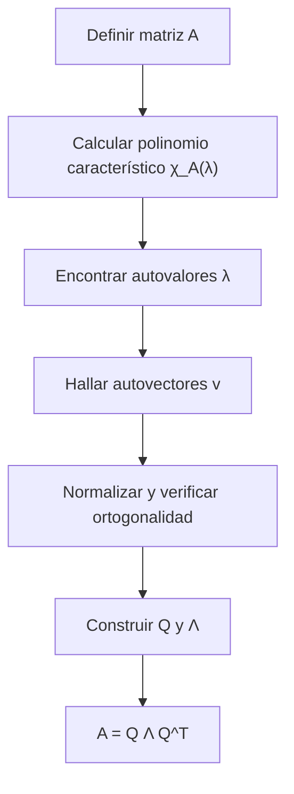

# Álgebra Lineal I - Transformaciones simétricas

## 7.5 Ejemplos.

---

### 1 Objetivos de aprendizaje

Al finalizar esta guía podrás:

- Resolver ejemplos de transformaciones simétricas.
- Calcular polinomios característicos, valores y vectores propios.
- Verificar la ortogonalidad de los autovectores.
- Aplicar el teorema espectral en ejemplos concretos.
- Usar Python para comprobar cálculos manuales.

### 2 Ejemplo 1: Matriz simétrica 2×2

$$ A = \begin{bmatrix} 2 & 1 \\\ 1 & 2 \end{bmatrix} $$

**Paso 1. Polinomio característico:**

$$ \chi_A(\lambda) = (2-\lambda)^2 - 1 = \lambda^2 - 4\lambda + 3. $$

**Paso 2. Autovalores:**

$$ \lambda_1 = 1, \quad \lambda_2 = 3. $$

**Paso 3. Autovectores:**

- Para $\lambda_1=1$: $v_1 = (1,-1).$
- Para $\lambda_2=3$: $v_2 = (1,1).$

**Paso 4. Normalización:**

$$ \hat v_1 = \tfrac{1}{\sqrt{2}}(1,-1), \quad \hat v_2 = \tfrac{1}{\sqrt{2}}(1,1). $$

**Conclusión:**

$$ A = Q \Lambda Q^T, \quad Q = \tfrac{1}{\sqrt{2}}\begin{bmatrix} 1 & 1 \\\ -1 & 1 \end{bmatrix}, \quad \Lambda = \begin{bmatrix} 1 & 0 \\\ 0 & 3 \end{bmatrix}. $$

### 3 Ejemplo 2: Matriz simétrica 3×3

$$ A = \begin{bmatrix} 4 & 2 & 0 \\\ 2 & 3 & 0 \\\ 0 & 0 & 1 \end{bmatrix} $$

**Paso 1. Polinomio característico:**

$$ \chi_A(\lambda) = (\lambda-1)(\lambda^2-7\lambda+10). $$

**Paso 2. Autovalores:**

$$ \lambda_1 = 1, \quad \lambda_2 = 2, \quad \lambda_3 = 5. $$

**Paso 3. Autovectores:**

- $\lambda_1=1$: $v_1 = (0,0,1).$
- $\lambda_2=2$: $v_2 = (-2,1,0).$
- $\lambda_3=5$: $v_3 = (1,2,0).$

**Ortonormalización:** se obtiene una base ortonormal $Q$.

**Conclusión:** Matriz diagonalizada ortogonalmente.

### 4 Ejemplo 3: Matriz de covarianza (aplicación)

Sea el conjunto de datos 2D:

$$ X = \{(2,0), (0,2), (3,1), (1,3)\}. $$

**Paso 1. Matriz de covarianza:**

$$ C = \frac{1}{n} X^T X = \begin{bmatrix} 3.5 & 2.5 \\ 2.5 & 3.5 \end{bmatrix}. $$

**Paso 2. Autovalores y autovectores:**

$$ \lambda_1 = 1, \; \lambda_2 = 6, \quad v_1=(1,-1), \; v_2=(1,1). $$

**Interpretación:** El vector propio asociado a $\lambda_2$ marca la dirección de mayor varianza (análisis de componentes principales, PCA).

### 5 Ejemplo 4: Contraste con matriz no simétrica

$$ A = \begin{bmatrix}0 & -1 \\\ 1 & 0\end{bmatrix} \quad (\text{rotación 90°}) $$

**Polinomio característico:**

$$ \chi_A(\lambda) = \lambda^2+1. $$

**Raíces:** $\pm i$, **no reales**.

**Conclusión:** La simetría es clave para garantizar valores propios reales.

### 6 Diagramas

**Flujo de resolución de ejemplos:**



### 7 Código en Python

```python
import numpy as np

# Ejemplo 1: Matriz simétrica 2x2
A = np.array([[2,1],[1,2]])
vals, vecs = np.linalg.eigh(A)
print("Autovalores:", vals)
print("Autovectores (columnas):\n", vecs)
```

```python
import sympy as sp

A = sp.Matrix([[4,2,0],[2,3,0],[0,0,1]])
λ = sp.symbols('λ')
print("Polinomio característico:", A.charpoly(λ).as_expr())
print("Autovalores:", A.eigenvals())
print("Autovectores:", A.eigenvects())
```

### 8 Ejercicios propuestos

1. Calcula la descomposición espectral de:

   $$ A = \begin{bmatrix} 1 & 2 \\\ 2 & 4 \end{bmatrix}. $$

2. Para $A = \begin{bmatrix} 3 & 1 & 0 \\\ 1 & 3 & 0 \\\ 0 & 0 & 2 \end{bmatrix}$:
   a) Encuentra sus autovalores y autovectores.
   b) Verifica que $A=Q\Lambda Q^T$.

3. Genera una matriz simétrica aleatoria 3×3 en Python y diagonalízala.

4. Interpreta geométricamente los vectores propios de la matriz de covarianza del Ejemplo 3.

5. Contrasta los autovalores de una matriz simétrica con los de una matriz de rotación.

### 9 Referencias recomendadas

- S. Axler, _Linear Algebra Done Right_, Springer.
- G. Strang, _Introduction to Linear Algebra_, MIT Press.
- D. C. Lay, _Álgebra Lineal y sus aplicaciones_, Pearson.
- H. Anton & C. Rorres, _Álgebra Lineal con aplicaciones_, Wiley.
- NumPy docs: [`numpy.linalg.eigh`](https://numpy.org/doc/stable/reference/generated/numpy.linalg.eigh.html).
- SymPy docs: `Matrix.charpoly`, `Matrix.eigenvals`, `Matrix.eigenvects`.

### 10 Checklist de autoevaluación

- Sé calcular polinomios característicos de matrices simétricas.
- Puedo obtener autovalores y autovectores manualmente.
- Verifico ortogonalidad de autovectores en ejemplos.
- Uso Python para confirmar mis resultados.
- Distingo el caso simétrico del no simétrico.
