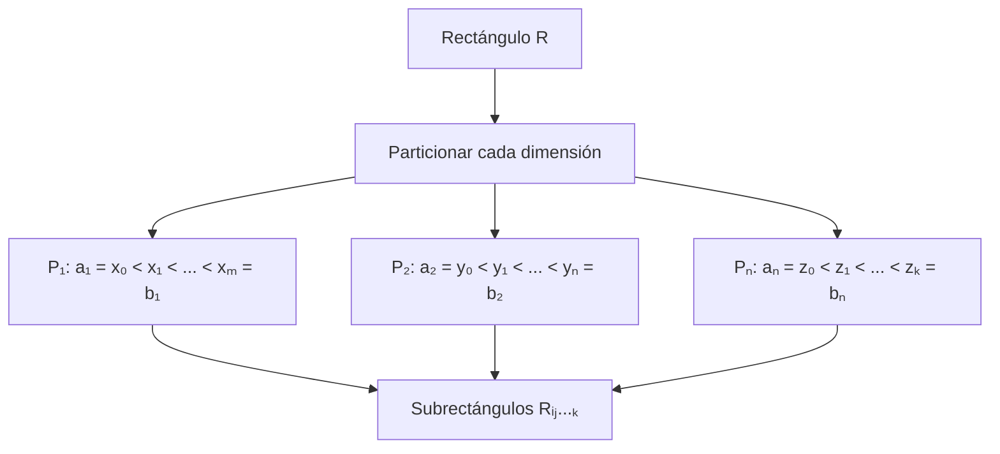

# Matemáticas para Ciencias Aplicadas III - Integral de Riemann

## 1.1 Integral sobre rectángulos. Propiedades de la integral.

---

### Introducción

La integral de Riemann sobre rectángulos es la extensión natural del concepto de integración en una variable a funciones de varias variables. Esta herramienta es fundamental en ciencias aplicadas para calcular volúmenes, masas, promedios y muchas otras cantidades.

### 1. Definición de Rectángulo en ℝⁿ

Un rectángulo en ℝⁿ es el producto cartesiano de n intervalos cerrados:

$$R = [a_1, b_1] \times [a_2, b_2] \times \cdots \times [a_n, b_n]$$

**Volumen del rectángulo:**
$$V(R) = (b_1 - a_1)(b_2 - a_2) \cdots (b_n - a_n)$$

### 2. Particiones de un Rectángulo

Una partición P de R se obtiene al dividir cada intervalo componente:

$$P = P_1 \times P_2 \times \cdots \times P_n$$
donde cada $P_i$ es una partición de $[a_i, b_i]$.



### 3. Sumas de Riemann

Para una función $f: R \subset \mathbb{R}^n \rightarrow \mathbb{R}$ acotada:

**Suma inferior:**
$$L(f, P) = \sum_{i=1}^{m} \sum_{j=1}^{n} m_{ij} \cdot V(R_{ij})$$
donde $m_{ij} = \inf\{f(x,y) : (x,y) \in R_{ij}\}$

**Suma superior:**
$$U(f, P) = \sum_{i=1}^{m} \sum_{j=1}^{n} M_{ij} \cdot V(R_{ij})$$
donde $M_{ij} = \sup\{f(x,y) : (x,y) \in R_{ij}\}$

### 4. Integral de Riemann sobre Rectángulos

Una función acotada $f: R \rightarrow \mathbb{R}$ es integrable Riemann si:

$$\sup_P L(f, P) = \inf_P U(f, P)$$

Este valor común se denota por:

$$\iint_R f(x,y)  dA \quad \text{o} \quad \int_R f$$

### 5. Propiedades Fundamentales de la Integral

#### 5.1 Linealidad

Si f y g son integrables sobre R y α, β ∈ ℝ, entonces:

$$\int_R (\alpha f + \beta g) = \alpha \int_R f + \beta \int_R g$$

#### 5.2 Monotonía

Si f(x) ≤ g(x) para todo x ∈ R, entonces:

$$\int_R f \leq \int_R g$$

#### 5.3 Aditividad respecto al dominio

Si R = R₁ ∪ R₂ y R₁ ∩ R₂ tiene medida cero, entonces:

$$\int_R f = \int_{R_1} f + \int_{R_2} f$$

#### 5.4 Desigualdad triangular

$$\left| \int_R f \right| \leq \int_R |f|$$

#### 5.5 Teorema del valor medio

Si f es continua en R, existe c ∈ R tal que:

$$\int_R f = f(c) \cdot V(R)$$

### 6. Teorema de Fubini

Si f es integrable sobre R = [a,b] × [c,d], entonces:

$$\iint_R f(x,y)  dA = \int_a^b \left( \int_c^d f(x,y)  dy \right) dx = \int_c^d \left( \int_a^b f(x,y)  dx \right) dy$$

### 7. Ejemplos Resueltos

#### Ejemplo 1: Integral sobre rectángulo simple

Calcular $\iint_R (x + y)  dA$ donde R = [0,1] × [0,2]

**Solución:**

$$\int_0^1 \int_0^2 (x + y)  dy  dx = \int_0^1 \left[ xy + \frac{y^2}{2} \right]_0^2 dx$$

$$= \int_0^1 (2x + 2)  dx = \left[ x^2 + 2x \right]_0^1 = 1 + 2 = 3$$

#### Ejemplo 2: Función escalonada

Sea f(x,y) = 2 si x + y ≤ 1, f(x,y) = 1 si x + y > 1, en R = [0,1] × [0,1]

**Solución:**
Dividimos R en dos regiones y aplicamos aditividad:

$$\iint_R f  dA = 2 \cdot \text{Área}(x+y \leq 1) + 1 \cdot \text{Área}(x+y > 1)$$

$$= 2 \cdot \frac{1}{2} + 1 \cdot \frac{1}{2} = 1 + 0.5 = 1.5$$

### 8. Implementación Computacional

```python
import numpy as np
from scipy.integrate import dblquad

# Ejemplo: integral de x*y sobre [0,1]x[0,2]
def integrando(y, x):
    return x * y

resultado, error = dblquad(integrando, 0, 1, 0, 2)
print(f"Resultado: {resultado}, Error estimado: {error}")

# Implementación manual de suma de Riemann
def suma_riemann_2d(f, a, b, c, d, n, m):
    """
    Calcula la suma de Riemann para f(x,y) sobre [a,b]x[c,d]
    """
    dx = (b - a)/n
    dy = (d - c)/m
    suma = 0

    for i in range(n):
        for j in range(m):
            x_i = a + (i + 0.5) * dx  # Punto medio
            y_j = c + (j + 0.5) * dy
            suma += f(x_i, y_j) * dx * dy

    return suma

# Ejemplo de uso
def f_ejemplo(x, y):
    return x + y

aproximacion = suma_riemann_2d(f_ejemplo, 0, 1, 0, 2, 1000, 1000)
print(f"Aproximación: {aproximacion}")
```

### 9. Ejercicios Propuestos

#### Ejercicio 1

Demuestre que si f(x,y) = 1 para todo (x,y) ∈ R, entonces:

$$\iint_R 1  dA = V(R)$$

#### Ejercicio 2

Calcule $\iint_R (x^2 + y^2)  dA$ donde R = [0,2] × [0,3]

#### Ejercicio 3

Demuestre la propiedad de monotonía de la integral.

#### Ejercicio 4

Sea f(x,y) = 3 si x ≤ y, f(x,y) = 1 si x > y, en R = [0,1] × [0,1].
Calcule $\iint_R f(x,y)  dA$

#### Ejercicio 5

Implemente en Python una función que calcule la suma superior e inferior de Riemann para una función dada.

#### Ejercicio 6

Determine si la siguiente función es integrable en [0,1] × [0,1]:

$$ f(x,y) = \begin{cases} 1 & \text{si } x,y \in \mathbb{Q} \\\ 0 & \text{en otro caso} \end{cases} $$

### 10. Diagrama Conceptual


### 11. Aplicaciones en Ciencias

La integral sobre rectángulos tiene aplicaciones en:
- **Física**: Cálculo de centros de masa, momentos de inercia
- **Probabilidades**: Distribuciones conjuntas de variables aleatorias
- **Ingeniería**: Cálculo de flujos a través de superficies
- **Economía**: Modelos de optimización con múltiples variables

### 12. Referencias y Bibliografía

1. **Apostol, T. M.** - "Calculus, Vol. 2" - Capítulo 11
2. **Marsden, J. E. & Tromba, A. J.** - "Vector Calculus" - Capítulo 5
3. **Spivak, M.** - "Calculus on Manifolds" - Capítulo 3
4. **Stewart, J.** - "Cálculo de varias variables" - Capítulo 15
