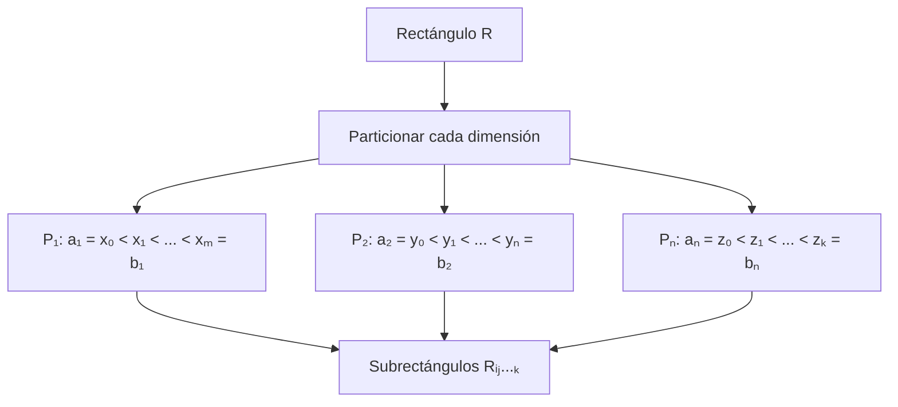
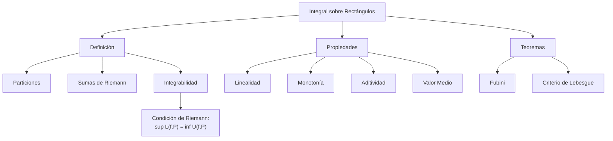

# Matemáticas para Ciencias Aplicadas III - Integral de Riemann

## 1.1 Integral sobre rectángulos. Propiedades de la integral.

---

### Introducción

La integral de Riemann sobre rectángulos es la extensión natural del concepto de integración en una variable a funciones de varias variables. Esta herramienta es fundamental en ciencias aplicadas para calcular volúmenes, masas, promedios y muchas otras cantidades.

### 1. Definición de Rectángulo en ℝⁿ

Un rectángulo en ℝⁿ es el producto cartesiano de $n$ intervalos cerrados:

$$R = [a_1, b_1] \times [a_2, b_2] \times \cdots \times [a_n, b_n]$$

**Volumen del rectángulo:**

$$V(R) = (b_1 - a_1)(b_2 - a_2) \cdots (b_n - a_n)$$

### 2. Particiones de un Rectángulo

Una partición $P$ de $R$ se obtiene al dividir cada intervalo componente:

$$P = P_1 \times P_2 \times \cdots \times P_n$$

donde cada $P_i$ es una partición de $[a_i, b_i].$ Los productos de un subintervalo de cada $P_i$ forman los **subrectángulos** de la partición. Una partición $P'$ es un **refinamiento** de $P$ si contiene todos sus puntos; al refinar, las sumas inferiores no disminuyen y las superiores no aumentan.



### 3. Sumas de Riemann

Para una función $f: R \subset \mathbb{R}^n \rightarrow \mathbb{R}$ acotada se definen las sumas siguientes. Las escribimos para $n = 2,$ con $R = [a, b] \times [c, d]$ dividido en $m \times k$ subrectángulos $R_{ij}:$

**Suma inferior:**

$$L(f, P) = \sum_{i=1}^{m} \sum_{j=1}^{k} m_{ij} \cdot V(R_{ij})$$

donde $m_{ij} = \inf\{f(x,y) : (x,y) \in R_{ij}\}.$

**Suma superior:**

$$U(f, P) = \sum_{i=1}^{m} \sum_{j=1}^{k} M_{ij} \cdot V(R_{ij})$$

donde $M_{ij} = \sup\{f(x,y) : (x,y) \in R_{ij}\}.$

**Suma de Riemann:** eligiendo un punto $c_{ij} \in R_{ij}$ en cada subrectángulo,

$$S(f, P) = \sum_{i,j} f(c_{ij}) \, V(R_{ij})$$

Siempre $L(f, P) \leq S(f, P) \leq U(f, P),$ y para dos particiones cualesquiera $L(f, P_1) \leq U(f, P_2).$

### 4. Integral de Riemann sobre Rectángulos

Una función acotada $f: R \rightarrow \mathbb{R}$ es integrable Riemann si:

$$\sup_P L(f, P) = \inf_P U(f, P)$$

Este valor común se denota por:

$$\iint_R f(x,y) \, dA \quad \text{o} \quad \int_R f$$

**Criterio de Riemann:** $f$ es integrable si y solo si para todo $\varepsilon > 0$ existe una partición $P$ con $U(f, P) - L(f, P) < \varepsilon.$

#### 4.1 ¿Qué funciones son integrables?

- Toda función **continua** en $R$ es integrable.
- Más en general, una función acotada es integrable si el conjunto de sus puntos de discontinuidad tiene **medida cero** (criterio de Lebesgue). Por ejemplo, una función continua salvo sobre un número finito de segmentos o curvas suaves es integrable.
- Un conjunto $Z \subset \mathbb{R}^n$ tiene medida cero si para todo $\varepsilon > 0$ se puede cubrir con una cantidad numerable de rectángulos cuyo volumen total es menor que $\varepsilon.$ Los puntos, los segmentos y las curvas suaves en $\mathbb{R}^2$ tienen medida cero.

### 5. Propiedades Fundamentales de la Integral

#### 5.1 Linealidad

Si $f$ y $g$ son integrables sobre $R$ y $\alpha, \beta \in \mathbb{R},$ entonces

$$\int_R (\alpha f + \beta g) = \alpha \int_R f + \beta \int_R g$$

#### 5.2 Monotonía

Si $f(x) \leq g(x)$ para todo $x \in R,$ entonces

$$\int_R f \leq \int_R g$$

#### 5.3 Aditividad respecto al dominio

Si $R = R_1 \cup R_2,$ con $R_1$ y $R_2$ rectángulos cuya intersección tiene medida cero (por ejemplo, comparten solo un lado), entonces

$$\int_R f = \int_{R_1} f + \int_{R_2} f$$

#### 5.4 Desigualdad triangular

$$\left| \int_R f \right| \leq \int_R |f|$$

Si $f$ es integrable, $|f|$ también lo es. En particular, si $|f| \leq M$ en $R,$ entonces $\left|\int_R f\right| \leq M \, V(R).$

#### 5.5 Teorema del valor medio

Si $f$ es continua en $R,$ existe $c \in R$ tal que

$$\int_R f = f(c) \cdot V(R)$$

El número $\frac{1}{V(R)}\int_R f$ es el **valor promedio** de $f$ en $R.$

### 6. Teorema de Fubini

Si $f$ es continua sobre $R = [a,b] \times [c,d],$ entonces

$$\iint_R f(x,y) \, dA = \int_a^b \left( \int_c^d f(x,y) \, dy \right) dx = \int_c^d \left( \int_a^b f(x,y) \, dx \right) dy$$

Basta con que $f$ sea integrable y que las integrales interiores existan. El tema 1.3 lo estudia con detalle.

### 7. Ejemplos Resueltos

#### Ejemplo 1: Integral sobre rectángulo simple

Calcular $\iint_R (x + y) \, dA$ donde $R = [0,1] \times [0,2].$

**Solución:**

$$\int_0^1 \int_0^2 (x + y) \, dy \, dx = \int_0^1 \left[ xy + \frac{y^2}{2} \right]_0^2 dx$$

$$= \int_0^1 (2x + 2) \, dx = \left[ x^2 + 2x \right]_0^1 = 1 + 2 = 3$$

#### Ejemplo 2: Función escalonada

Sea $f(x,y) = 2$ si $x + y \leq 1$ y $f(x,y) = 1$ si $x + y > 1,$ en $R = [0,1] \times [0,1].$

**Solución:**
$f$ es discontinua solo sobre el segmento $x + y = 1,$ que tiene medida cero, así que es integrable. Escribimos $f = 1 + \chi_T,$ donde $\chi_T$ vale $1$ en el triángulo $T = \{x + y \leq 1\}$ y $0$ fuera:

$$\iint_R f \, dA = 2 \cdot \text{Área}(x+y \leq 1) + 1 \cdot \text{Área}(x+y > 1)$$

$$= 2 \cdot \frac{1}{2} + 1 \cdot \frac{1}{2} = 1 + 0.5 = 1.5$$

### 8. Implementación Computacional

```python
import numpy as np
from scipy.integrate import dblquad

# Ejemplo: integral de x*y sobre [0,1]x[0,2]
def integrando(y, x):
    return x * y

resultado, error = dblquad(integrando, 0, 1, 0, 2)   # orden de argumentos: f(y, x)
print(f"Resultado: {resultado}, Error estimado: {error}")  # exacto: 1

# Implementación manual de suma de Riemann
def suma_riemann_2d(f, a, b, c, d, n, m):
    """
    Calcula la suma de Riemann para f(x,y) sobre [a,b]x[c,d]
    """
    dx = (b - a)/n
    dy = (d - c)/m
    suma = 0

    for i in range(n):
        for j in range(m):
            x_i = a + (i + 0.5) * dx  # Punto medio
            y_j = c + (j + 0.5) * dy
            suma += f(x_i, y_j) * dx * dy

    return suma

# Ejemplo de uso
def f_ejemplo(x, y):
    return x + y

aproximacion = suma_riemann_2d(f_ejemplo, 0, 1, 0, 2, 200, 200)
print(f"Aproximación: {aproximacion}")   # exacto: 3

# Sumas inferior y superior (ejercicio 5). Para f monótona en cada variable,
# el ínfimo y el supremo en cada subrectángulo se alcanzan en sus esquinas.
def sumas_inf_sup(f, a, b, c, d, n, m):
    x = np.linspace(a, b, n + 1)
    y = np.linspace(c, d, m + 1)
    X, Y = np.meshgrid(x, y, indexing="ij")
    F = f(X, Y)
    esquinas = np.stack([F[:-1, :-1], F[1:, :-1], F[:-1, 1:], F[1:, 1:]])
    area = (b - a) / n * (d - c) / m
    return esquinas.min(axis=0).sum() * area, esquinas.max(axis=0).sum() * area

for n in (10, 100):
    L, U = sumas_inf_sup(f_ejemplo, 0, 1, 0, 2, n, n)
    print(f"n = {n}: L = {L:.4f}, U = {U:.4f}, U - L = {U - L:.4f}")
```

Al refinar la partición, $U - L$ tiende a cero y ambas sumas se acercan a $3.$ En general el ínfimo y el supremo no tienen por qué estar en las esquinas; aquí funciona porque $x + y$ es creciente en ambas variables.

### 9. Ejercicios Propuestos

#### Ejercicio 1

Demuestre que si $f(x,y) = 1$ para todo $(x,y) \in R,$ entonces

$$\iint_R 1 \, dA = V(R)$$

#### Ejercicio 2

Calcule $\iint_R (x^2 + y^2) \, dA$ donde $R = [0,2] \times [0,3].$

#### Ejercicio 3

Demuestre la propiedad de monotonía de la integral.

#### Ejercicio 4

Sea $f(x,y) = 3$ si $x \leq y$ y $f(x,y) = 1$ si $x > y,$ en $R = [0,1] \times [0,1].$
Calcule $\iint_R f(x,y) \, dA.$

#### Ejercicio 5

Implemente en Python una función que calcule la suma superior e inferior de Riemann para una función dada.

#### Ejercicio 6

Determine si la siguiente función es integrable en [0,1] × [0,1]:

$$ f(x,y) = \begin{cases} 1 & \text{si } x,y \in \mathbb{Q} \\ 0 & \text{en otro caso} \end{cases} $$

#### Soluciones

1. Para cualquier partición, $m_{ij} = M_{ij} = 1,$ así que $L(f, P) = U(f, P) = \sum V(R_{ij}) = V(R).$
2. $\int_0^2 \int_0^3 (x^2 + y^2) \, dy \, dx = \int_0^2 (3x^2 + 9) \, dx = 8 + 18 = 26.$
3. Si $f \leq g,$ en cada subrectángulo $\inf f \leq \inf g,$ así que $L(f, P) \leq L(g, P) \leq \int_R g$ para toda $P.$ Tomando supremo sobre $P,$ $\int_R f \leq \int_R g.$
4. La región $x \leq y$ es un triángulo de área $\frac{1}{2}:$ $3 \cdot \frac{1}{2} + 1 \cdot \frac{1}{2} = 2.$
5. Ver la función `sumas_inf_sup` de la sección 8.
6. No es integrable. Todo subrectángulo contiene puntos con ambas coordenadas racionales y puntos con alguna irracional, así que $m_{ij} = 0$ y $M_{ij} = 1:$ $L(f, P) = 0$ y $U(f, P) = 1$ para toda partición. Su conjunto de discontinuidades es todo el cuadrado.

### 10. Diagrama Conceptual



### 11. Aplicaciones en Ciencias

La integral sobre rectángulos tiene aplicaciones en:
- **Física**: Cálculo de centros de masa, momentos de inercia
- **Probabilidades**: Distribuciones conjuntas de variables aleatorias
- **Ingeniería**: Cálculo de cargas distribuidas sobre placas y presiones sobre compuertas
- **Economía**: Modelos de optimización con múltiples variables

### 12. Referencias y Bibliografía

1. **Apostol, T. M.** - "Calculus, Vol. 2" - Capítulo 11
2. **Marsden, J. E. & Tromba, A. J.** - "Vector Calculus" - Capítulo 5
3. **Spivak, M.** - "Calculus on Manifolds" - Capítulo 3
4. **Stewart, J.** - "Cálculo de varias variables" - Capítulo 15
