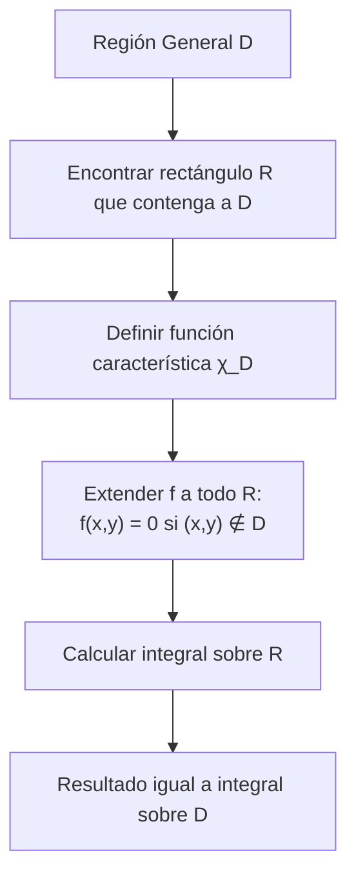
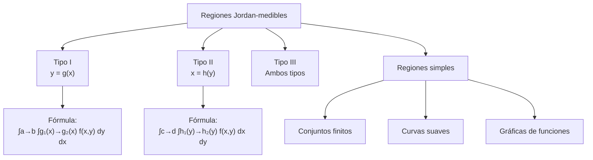

# Matemáticas para Ciencias Aplicadas III - Integral de Riemann

## 1.2 La integral sobre regiones más generales.

---

### Introducción

La extensión de la integral de Riemann a regiones más generales que rectángulos es fundamental para aplicaciones prácticas en física, ingeniería y otras ciencias. Esta guía cubre los conceptos, métodos y aplicaciones de la integración sobre regiones generales.

### 1. Definición de Regiones Jordan-medibles

Una región D ⊂ ℝ² es Jordan-medible si su frontera ∂D tiene medida cero.

**Caracterización:** D es Jordan-medible si y sólo si la función característica:

$$ χ_D(x) = \begin{cases} 1 & \text{si } x \in D \\ 0 & \text{si } x \notin D \end{cases} $$

es integrable sobre algún rectángulo R que contenga a D.

### 2. Integral sobre Regiones Generales

Si D es Jordan-medible y f es acotada, definimos:

$$\iint_D f(x,y)  dA = \iint_R f(x,y) \cdot χ_D(x,y)  dA$$

donde R es un rectángulo que contiene a D.



### 3. Tipos de Regiones

#### 3.1 Regiones de Tipo I

Regiones entre las gráficas de funciones de x:

$$D = \{(x,y) \mid a \leq x \leq b, g_1(x) \leq y \leq g_2(x)\}$$

**Fórmula de integración:**
$$\iint_D f(x,y)  dA = \int_a^b \left( \int_{g_1(x)}^{g_2(x)} f(x,y)  dy \right) dx$$

#### 3.2 Regiones de Tipo II

Regiones entre las gráficas de funciones de y:

$$D = \{(x,y) \mid c \leq y \leq d, h_1(y) \leq x \leq h_2(y)\}$$

**Fórmula de integración:**
$$\iint_D f(x,y)  dA = \int_c^d \left( \int_{h_1(y)}^{h_2(y)} f(x,y)  dx \right) dy$$

#### 3.3 Regiones de Tipo III

Regiones que son both Tipo I y Tipo II.

### 4. Cambio de Orden de Integración

Para regiones que son tanto de Tipo I como de Tipo II, podemos cambiar el orden de integración:

$$\int_a^b \int_{g_1(x)}^{g_2(x)} f(x,y)  dy  dx = \int_c^d \int_{h_1(y)}^{h_2(y)} f(x,y)  dx  dy$$

### 5. Propiedades de la Integral sobre Regiones Generales

Todas las propiedades de la integral sobre rectángulos se mantienen:

- Linealidad
- Monotonía
- Aditividad
- Desigualdad triangular
- Teorema del valor medio

### 6. Ejemplos Resueltos

#### Ejemplo 1: Región triangular

Calcular $\iint_D (x + y)  dA$ donde D es el triángulo con vértices (0,0), (1,0) y (0,1).

**Solución:**
La región puede describirse como:

$$D = \{(x,y) \mid 0 \leq x \leq 1, 0 \leq y \leq 1-x\}$$

$$\iint_D (x + y)  dA = \int_0^1 \int_0^{1-x} (x + y)  dy  dx$$
$$= \int_0^1 \left[ xy + \frac{y^2}{2} \right]_0^{1-x} dx$$
$$= \int_0^1 \left( x(1-x) + \frac{(1-x)^2}{2} \right) dx = \frac{1}{3}$$

#### Ejemplo 2: Cambio de orden de integración

Calcular $\int_0^1 \int_{x^2}^{\sqrt{x}} f(x,y)  dy  dx$ cambiando el orden de integración.

**Solución:**
La región es:

$$D = \{(x,y) \mid 0 \leq x \leq 1, x^2 \leq y \leq \sqrt{x}\}$$

Como región Tipo II:

$$D = \{(x,y) \mid 0 \leq y \leq 1, y^2 \leq x \leq \sqrt{y}\}$$

Por tanto:

$$\int_0^1 \int_{x^2}^{\sqrt{x}} f(x,y)  dy  dx = \int_0^1 \int_{y^2}^{\sqrt{y}} f(x,y)  dx  dy$$

### 7. Implementación Computacional

```python
import numpy as np
from scipy.integrate import dblquad

# Integral sobre región general (Tipo I)
def integral_tipo_I(f, a, b, g1, g2, puntos=1000):
    """
    Calcula ∫∫_D f(x,y) dA para región Tipo I
    D = {(x,y) | a ≤ x ≤ b, g1(x) ≤ y ≤ g2(x)}
    """
    def integrando_interno(x):
        # Para x fijo, integramos respecto a y
        return dblquad(lambda y: f(x,y), g1(x), g2(x))[0]

    # Integramos respecto a x
    x_valores = np.linspace(a, b, puntos)
    integral = np.trapz([integrando_interno(x) for x in x_valores], x_valores)
    return integral

# Ejemplo: ∫∫_D (x+y) dA donde D es el triángulo con vértices (0,0), (1,0), (0,1)
def f(x, y):
    return x + y

def g1(x):
    return 0  # Límite inferior en y

def g2(x):
    return 1 - x  # Límite superior en y

resultado = integral_tipo_I(f, 0, 1, g1, g2)
print(f"Resultado: {resultado}")

# Usando scipy
resultado_scipy, error = dblquad(lambda y, x: x + y, 0, 1, g1, g2)
print(f"Resultado con scipy: {resultado_scipy}")
```

### 8. Ejercicios Propuestos

#### Ejercicio 1

Calcular $\iint_D xy  dA$ donde D está acotada por y = x² e y = x.

#### Ejercicio 2

Calcular $\iint_D e^{x/y}  dA$ donde D está acotada por y² = x, x = 0, y = 1.

#### Ejercicio 3

Cambiar el orden de integración y calcular:

$$\int_0^1 \int_{y}^{1} e^{x^2}  dx  dy$$

#### Ejercicio 4

Calcular el área de la región limitada por las parábolas y = x² - 4x + 3 e y = -x² + 2x + 3.

#### Ejercicio 5

Implementar en Python una función para integrar sobre regiones Tipo II.

#### Ejercicio 6

Calcular $\iint_D \frac{y}{x^2 + y^2}  dA$ donde D es la región en el primer cuadrante entre los círculos x² + y² = 1 y x² + y² = 4.

### 9. Diagrama Conceptual: Clasificación de Regiones



### 10. Aplicaciones Prácticas

#### 10.1 Cálculo de áreas

El área de una región D está dada por:

$$A(D) = \iint_D 1  dA$$

#### 10.2 Centros de masa

Para una lámina con densidad ρ(x,y):

$$M = \iint_D ρ(x,y)  dA$$

$$\bar{x} = \frac{1}{M} \iint_D x ρ(x,y)  dA, \quad \bar{y} = \frac{1}{M} \iint_D y ρ(x,y)  dA$$

#### 10.3 Momentos de inercia

$$I_x = \iint_D y^2 ρ(x,y)  dA, \quad I_y = \iint_D x^2 ρ(x,y)  dA$$

### 11. Consejos para Resolución de Problemas

1. **Dibujar la región** de integración
2. **Determinar el tipo** de región (I, II, III)
3. **Establecer los límites** de integración correctamente
4. **Considerar cambiar el orden** de integración si simplifica el cálculo
5. **Verificar la respuesta** mediante diferentes métodos

### 12. Referencias y Bibliografía

1. **Apostol, T. M.** - "Calculus, Vol. 2" - Capítulo 12
2. **Marsden, J. E. & Tromba, A. J.** - "Vector Calculus" - Capítulo 5
3. **Stewart, J.** - "Cálculo de varias variables" - Capítulo 15
4. **Larson, R. & Edwards, B. H.** - "Cálculo" - Capítulo 14
